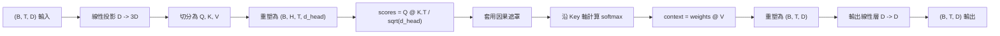
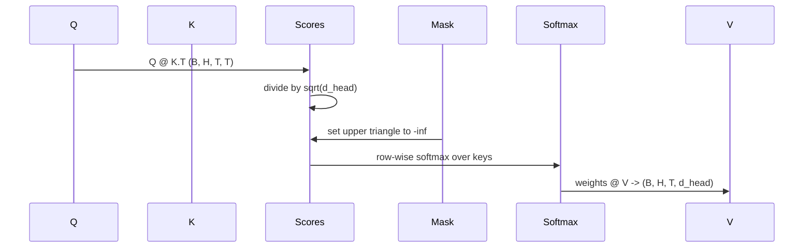

# 多頭自注意力機制（Multi-Head Self-Attention）

> 單次線性投影、三重獨立視圖、H 個平行注意力頭、單一因果遮罩。以真實 LLM 實際運作的方式，親手建構完整的注意力區塊。

**Type:** Build
**Languages:** Python
**Prerequisites:** Phase 04 lessons, Phase 07 transformer lessons, Lessons 30 through 32 of this phase
**Time:** ~90 minutes

## Learning Objectives｜學習目標
- 將批次 Query / Key / Value 投影實作為單一線性投影層，並將其平行切分為 H 個獨立的注意力頭。
- 實作縮放點積注意力（Scaled Dot-Product Attention），並正確處理正規化與資料型別（dtype）。
- 施加嚴格的因果遮罩（Causal Mask），從數學上徹底杜絕當前位置跨時序窺探未來 Token。
- 針對固定輸入檢視各注意力頭的權重，直觀推理各個注意力頭各自看什麼。
- 在極簡玩具任務上微型訓練注意力區塊，親眼觀察隨著注意力頭的分工特化，損失函數曲線是如何下降的。

```figure
cap-multihead-attention
```

## 架構認知

注意力機制（Attention）的核心使命，是允許序列中某個 Token 的向量表徵，能夠主動從同一序列中的其餘 Token 之中抽取並匯聚相關資訊。所謂「自注意力（Self-Attention）」，是指 Query（查詢）、Key（鍵）與 Value（值）三者皆自同一個輸入序列投影而來。所謂「多頭（Multi-Head）」，是指將投影後的維度空間拆分為 H 個彼此平行的子注意力運算，最後將各頭的上下文輸出拼接並進行二次投影融合。

有效率的實作方式是：建構單一線性層，將維度直接從 `D` 投影至 `3 * D`；隨後透過切片將輸出解耦為 Q、K、V 三重視圖；接著將其維度重新整形（Reshape）為 H 個大小皆為 `D // H` 的獨立頭部。矩陣乘法、Softmax 與加權求和全部以批次張量運算進行，使各個頭能在加速器上平行執行。

本課將親手打造該核心區塊。我們將同步引入因果遮罩（Causal Mask），使該程式碼能直接無縫作為 decoder-only 自回歸因果 LLM 的注意力核心層。下一課我們將把它堆疊為完整的 Transformer 區塊，並在後續課程中啟動全量訓練。

## 形狀合約

區塊輸入張量形狀為 `(B, T, D)`。輸出張量形狀同為 `(B, T, D)`。因果遮罩形狀為 `(T, T)`（或支援向其廣播的張量）。在注意力區塊內部，中間張量的形狀嚴格維護為 `(B, H, T, d_head)`，其中單頭維度 `d_head = D // H`。系統施加的硬性幾何約束為：`D % H == 0`。



這兩個線性投影層（QKV 合併投影層與輸出投影層）是整個注意力區塊中**僅有的可學習參數**。因果遮罩、Softmax、矩陣點積以及形狀變換（Reshape）皆為完全不消耗參數的純數學張量運算。

## QKV 投影合併與切分

樸素的初學者寫法通常是定義三個相互獨立的線性層，分別用於 Q、K 與 V。而高效能實作方式則是定義單一輸出為 `3 * D` 維度的線性層，隨後在記憶體中執行向量切片。這兩者在數學運算上是嚴格等價的，因為分別乘以三個 `(D, D)` 的權重矩陣，本質上完全等同於乘以一個將它們垂直堆疊拼接的 `(3D, D)` 大權重矩陣。

高效能版本在物理執行上顯著更快，因為硬體加速器只需啟動一次大矩陣乘法核心（Kernel Launch），而非三次細碎的小呼叫。此外，參數初始化也更為簡約優雅，因為這三個子矩陣存放在同一個參數張量中，能夠以一致的幾何尺度完成統一初始化。

## 多頭維度變換

在完成 QKV 切分後，Q、K、V 各自的張量形狀皆為 `(B, T, D)`。為了將其轉化為 H 個平行的獨立注意力空間，我們先將其 Reshape 為 `(B, T, H, d_head)`，隨後透過轉置（Transpose）調整為 `(B, H, T, d_head)`。此時，頭部維度 H 被提到了批次維度旁邊，使得 PyTorch 能夠將多頭自注意力直接視為跨越 `B * H` 個獨立實例的大規模並行批次運算。

單頭維度 d_head 保持在最後一個軸，使得在計算注意力打分時，矩陣乘法 `Q @ K.transpose(-2, -1)` 能直接在該維度上完成點積收縮。計算輸出的形狀為 `(B, H, T, T)` 的單頭注意力分數矩陣。

## 縮放因子除法

在送入 Softmax 之前，所有原始分數必須強制除以 `sqrt(d_head)`。若缺乏該縮放步驟，隨著單頭特徵維度 `d_head` 的擴大，點積數值的變異數將顯著膨脹，從而將 Softmax 函式推向極致飽和區——在該區域中，某個單一位置將霸佔接近 100% 的全部機率質量，而其餘位置的權重趨近於微小的零。在飽和區內，反向傳播計算出的梯度極其微弱，直接導致模型訓練停滯不前。除以 `sqrt(d_head)` 能確保注意力分數的變異數在不同頭部維度下維持恆定穩定。

## 因果遮罩實施

自回歸 Decoder-only 語言模型在預測下一個 Token 時，在物理上嚴格僅能依託於過去的歷史上下文。因果遮罩正是從數學層面強制落實這項約束。具體而言：在執行 Softmax 之前，注意力打分矩陣 `(T, T)` 對角線以上的所有未來位置條目，皆被強制替換為負無窮大。在 Softmax 計算後，這些位置所分配到的注意力權重精確歸零。



我們在物件初始化時將該遮罩註冊為 PyTorch Buffer，確保它自動跟隨模型移動到相同的運算裝置（GPU/CPU）上，且絕不參與反向傳播的梯度圖建構。該遮罩預先建構好模型所能承受的最大上下文長度；在前向傳播時，只需依據當前輸入長度動態切出左上角 `(T, T)` 區域即可。

## 輸出線性投影

在各頭計算出上下文向量 `(B, H, T, d_head)` 之後，我們先轉置回 `(B, T, H, d_head)`，將其平鋪 Reshape 為 `(B, T, D)`，最後施加一個形狀為 `(D, D)` 的線性輸出投影層。輸出投影層的存在至關重要：它允許模型在特徵層面上將各個獨立頭部提取到的異質資訊進行跨通道的深度融合。若缺乏該投影層，H 個頭部的特徵只能等到後續神經網路層才能勉強重組，人為限制了注意力區塊的表徵容量。

## 注意力權重審查機制

本課在 forward 方法中暴露了一個可選的 `return_weights=True` 參數。一旦開啟，區塊將在回傳輸出張量的同時，並列回傳形狀為 `(B, H, T, T)` 的各注意力頭的權重張量。底部演示程式在簡短輸入上印出某個頭部的權重熱圖，讓你能親眼看見三角形的因果遮罩結構以及各個位置的注意力聚焦分佈。

訓練後的模型中，不同注意力頭會學到不同模式：某些頭專注於緊鄰的前一個 Token；某些頭專門聚焦於序列開頭的 token；某些頭則將注意力近乎均勻地鋪滿整個過去上下文。這項審查鉤子是開展可解釋性（interpretability）研究的標準入口。

## 極簡訓練演示

`main.py` 底部的演示程式將該多頭注意力區塊與一個微型 LM Head 預測頭連接，在一個字串複製任務上展開端到端訓練。輸入張量的每一行皆為同一個隨機 ID 的連續複製序列；預測目標為該輸入向左平移一位後的結果，因此模型必須學會「下一個 Token 必定與前一個 Token 完全一致」的先驗規則。損失函數採用標準交叉熵（Cross-Entropy）。在配置 H=4、D=32、T=12 且詞表大小為 64 的情境下，損失值在 CPU 上僅需 3 個 Epoch 即可從初始隨機猜測的約 `log(64) ~ 4.16` 暴跌至 `1.0` 以下。

該演示的目的絕非為了訓練一個具備通用智慧的模型，而是為了從工程上確鑿驗證：梯度能夠順暢流經該注意力區塊的每一個運算節點，且各個頭部在具備明確客觀規律的問題上能夠真正學出專屬的特化特徵。

## 本課邊界

本課未包含前饋神經網路（FFN）區塊。真實 LLM 中的完整 Transformer 層是由自注意力區塊與一個兩層 MLP 前饋網路共同構成，且兩者各自被殘差連接（Residual Connection）與層正規化（LayerNorm）所包裹。這些結構將在下一課中全量組裝。

本課未實作旋轉位置編碼（RoPE）或 ALiBi。這兩者在計算流向中同樣介入於 QKV 投影步驟，但它們屬於獨立的教學單元。本課所打造的注意力區塊原生相容這兩者：只需在點積相乘之前對 Q 和 K 向量實施旋轉矩陣變換即可。

本課未實作推論階段的 KV Cache（鍵值快取）。在連續自回歸生成時對歷史 K 與 V 向量進行記憶體暫存，是讓推論延遲大幅降低的核心最佳化技術。它會改變 K 與 V 張量的形狀合約（但保持 Q 不變），該主題屬於推論加速專題。

## 程式碼導讀

`main.py` 定義了 `MultiHeadSelfAttention` 核心類別。該類別持有兩個線性投影層與一個註冊的遮罩 Buffer。前向傳播嚴格依照「投影、Reshape、打分、遮罩、Softmax、加權、拼接與輸出投影」的流向執行。底部的演示程式組裝了一個包含 token embedding、positional embedding、注意力區塊與 LM Head 的微型神經網路，在複製任務上訓練 3 個 Epoch，並印出損失函數衰減曲線與單頭注意力權重熱圖。`code/tests/test_attention.py` 單元測試嚴密鎖定了形狀合約、因果性、Softmax 歸一化性質、多頭切分等價性以及反向傳播梯度流。

運作演示程式。嘗試將 `n_heads` 從 4 增加至 8（保持 `d_model=32`，即 `d_head=4`），親眼觀察注意力權重熱圖所發生的微妙演變。
