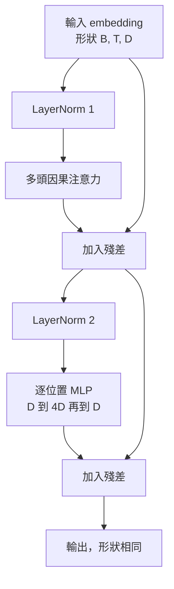
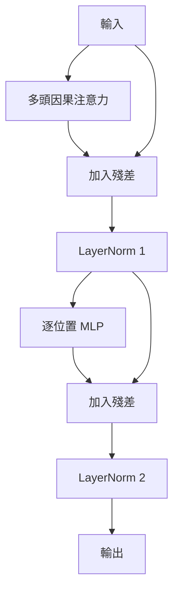

# 從零建構 Transformer 區塊（Transformer Block from Scratch）

> 單一區塊（Block）是每一款現代自回歸 Decoder 大語言模型的基本構成單元。層正規化（LayerNorm）、多頭自注意力、殘差連接、前饋網路 MLP、殘差連接。Pre-LN 變體能穩定訓練，甚至無需學習率預熱（Warmup）；而 Post-LN 變體則是 2017 年初代 Transformer 論文所採用的原始結構。本課將並列實作這兩種變體，深入對比並實證究竟是哪一種架構能夠在常規學習率下完好存活於 12 層的深度堆疊中。

**Type:** Build
**Languages:** Python
**Prerequisites:** Phase 19 lessons 30 to 33 (tokenizer, embeddings, attention math, batched data loader)
**Time:** ~90 minutes

## Learning Objectives｜學習目標

- 在 PyTorch 中使用四大核心積木搭建 Transformer 區塊：LayerNorm、多頭因果注意力、殘差連接、逐位置前饋網路（MLP）。
- 實作 Pre-LN 與 Post-LN 兩種不同的層正規化拓撲配置，並深刻理解為何 Pre-LN 能夠在無需預熱學習率的前提下穩定收斂。
- 在多頭自注意力內部實施因果遮罩，從數學上徹底杜絕 Token `i` 窺探任何未來的 Token `j > i`。
- 在 12 層深度堆疊神經網路中精確追蹤兩個變體各自的反向傳播梯度流，以實測數字代替主觀臆斷。
- 將本課打造的區塊作為可插拔單元，為下一節課組裝 1.24 億參數的完整 GPT 模型奠定基石。

## The Problem｜問題

一個現代 Transformer 大模型，本質上只不過是同一個基礎區塊的連續重複堆疊。如果在單一區塊的設計上出現了微小偏差，將其重複 12 次後，你所交付的模型要麼會在第一個 Epoch 內發散，要麼在後續整個訓練過程中需要學習率預熱技巧。初學者在盲目堆疊區塊時最容易遭遇的兩大經典致命陷阱：一個是注意力機制意外窺探了未來時序；另一個是將 LayerNorm 擺在了錯誤的拓撲位置上，導致其在深層網路中完全無法約束殘差訊號的劇烈震盪。

一旦看清了本質，修復邏輯是極其確定性的：單個區塊內部精確擁有兩條殘差 branch 與兩個正規化位置。正確選定這些位置，後續深層堆疊的工程就只剩下純粹的矩陣記帳了。

## The Concept｜核心概念

每一個純 Decoder 架構的 Transformer 區塊，皆是一個接收形狀為 `(batch, sequence, embedding)` 的張量並回傳完全相同形狀張量的數學函式。在區塊內部，由兩個子層共同承擔運算任務。



這就是著名的 **Pre-LN 變體**。LayerNorm 放置在殘差主幹旁路的 branch 內部、緊鄰具體子層運算之前。而外層的殘差直連通道則始終保持純淨無阻礙地向前傳遞未經正規化的原始訊號。

而 **Post-LN 變體** 則將 LayerNorm 挪動到了殘差相加操作之後。



兩者的張量輸入輸出形狀完全相同，但訓練行為並不相同。在 Post-LN 架構中，沿著殘差主幹向後流動的梯度，必須穿過 LayerNorm；當網路深度達到 12 層且學習率設為常規的 `3e-4` 時，該梯度衰減得很快，因此需要 Warmup 預熱排程；而 Pre-LN 的殘差主幹未受正規化干擾，梯度得以乾淨平滑地直接貫穿傳導至底層 embedding 層。這正是從 GPT-2 起採用 Pre-LN 的根本原因。

### 因果多頭注意力子層

注意力子層將輸入張量分別投影為 Query、Key、Value 三組特徵。維度自 `(B, T, D)` 變換為 `(B, H, T, D/H)`（其中 `H` 為頭部數量）。縮放點積注意力計算單頭注意力分數 `softmax(Q K^T / sqrt(d_k))`，將對角線上方的上三角區域強制替換為 負無窮大，透過 Softmax 將遮罩轉化為零權重，最後乘以 `V`。所有頭部的上下文輸出被重新拼接回 `(B, T, D)` 並施加最後一次線性投影。因果遮罩是確保模型維持自回歸特性的唯一物理屏障；忘記遮罩，模型就學會了作弊。

### 逐位置前饋神經網路

逐位置前饋網路對序列中的每一個 Token 獨立套用完全相同的兩層全連接神經網路。中間隱藏層維度擴展為 embedding 維度的 4 倍，活化函式採用平滑的 GELU，在第二層線性變換後緊跟 Dropout 正則化。在 MLP 內部，各個 Token 之間完全不發生任何跨時序通訊；所有的跨 Token 資訊交織與語義融合，皆已在前面的注意力層中全量完成。

### 殘差連接的雙重使命

殘差連接在數學上達成了兩大不可或缺的工程目標：第一，它讓深度方向上的梯度反向傳播變為純加法通道，使梯度範數在穿透 12 層後依然能保持穩定的數量級；第二，它允許每個區塊僅需對既有的語義表徵學習「加法更新（Additive Update）」，而無需承擔將整個表徵完全推倒重寫的沉重負擔。這兩大效應是 Transformer 區塊能隨深度擴展的原因。

```figure
cc-transformer-block
```

## Build It｜動手實作

`code/main.py` 實作了以下核心元件：

- `class LayerNorm`：具備可學習縮放因子（Scale）與偏移量（Shift），配置數值防禦常數 eps，在每個 Token 向量維度上獨立實施正規化。
- `class MultiHeadAttention`：配置 `num_heads`、單頭維度 `head_dim = d_model // num_heads`、QKV 合併投影、註冊因果遮罩 Buffer，以及注意力與殘差 Dropout。
- `class FeedForward`：包含兩層線性投影、GELU 活化函式與 Dropout。
- `class TransformerBlock`：具備 `pre_ln` 布林切換開關，允許在兩種架構變體之間隨意切換。
- 底部演示程式：在完全相同的隨機輸入下，分別組裝 6 層 Pre-LN 堆疊與 6 層 Post-LN 堆疊，印出：(a) 輸出張量形狀，(b) 單次反向傳播後在最底層輸入 embedding 矩陣處觀測到的真實梯度範數（Gradient Norm）。

執行測試：

```bash
python3 code/main.py
```

輸出結果：展示兩套堆疊的形狀驗收與梯度範數對比。在完全相同的初始學習率下，Pre-LN 堆疊在底層 embedding 處的梯度範數比 Post-LN 堆疊大出了一個數量級——這正是 Pre-LN 能夠在無預熱排程下依然穩定收斂的底層實證證據。

## 技術堆疊

- `torch` 負責張量運算、Autograd 自動微分與 `nn.Module` 物件封裝。
- 不引入任何高階 `transformers` 函式庫，不載入任何預訓練權重。整套區塊全部由最底層的數學原語從零建構。

## 工業級正式環境落地模式

三大實戰工程技巧，將教科書上的理論積木蛻變為可直接發布的正式環境元件：

**QKV 融合線性投影（Fused QKV projection）**：分別調用三個獨立線性層意味著發起三次底層 CUDA Kernel Launch 與三次小矩陣乘法。而定義一個輸出維度為 `3 * d_model` 的合併線性層，能將所有運算濃縮在單次 GPU 核心啟動中完成，隨後在記憶體中沿著最後一個維度進行張量切分。融合路徑在所有硬體加速晶片上皆顯著更快，與 GPT-2、LLaMA 及 Mistral 的參考實作完全一致。

**註冊因果遮罩 Buffer（Registered causal mask buffer）**：因果遮罩的形狀嚴格僅取決於預設的最大上下文長度。在建構時透過 `register_buffer` 一次性分配該張量，在每次前向傳播時透過切片截取當前視窗，徹底省去逐次重複動態分配記憶體的開銷。忽略該最佳化技巧會導致遮罩生成在超長上下文場景下成為吞噬記憶體配置器的效能熱點。

**嚴格兩處 Dropout，絕非三處（Dropout in two places, not three）**：Dropout 應當且僅應當放置在注意力 Softmax 之後（Attention Dropout）以及 MLP 的第二層線性變換之後（Residual Dropout）。若在殘差本身施加 Dropout，會破壞讓梯度在深層網路中傳遞的加法恆等映射。某些早期實作曾犯下這個錯誤，導致訓練容易變得脆弱。

## Use It｜實際應用

- 本課所打造的 Transformer 區塊，無需進行任何修改，即可直接作為隨插即用單元插入第三十五課的 GPT 全模型組裝中。
- Pre-LN 變體是當代每一款主流開放權重大型語言模型所採用的標準配置。而 Post-LN 變體則是 2017 年初代 Transformer 論文的原始產物。同時掌握這兩者，已完全足以讓你看懂工業界所有主流的 Decoder 解碼器架構。
- 將 GELU 替換為 SiLU，即得到了 LLaMA 家族的前饋網路；將 LayerNorm 替換為手寫的 RMSNorm，即得到了 LLaMA 家族的正規化層。骨架完全相通。

## Exercises｜練習

1. 為區塊中的所有線性層加入 `bias=False` 旗標。現代開源大模型已普遍在線性層中全面移除 Bias 偏置項。精確計算在一個 12 層、隱藏維度為 768 的標準模型中，移除偏置項能為你淨省下多少可學習參數？
2. 將 `nn.LayerNorm` 替換為手寫的 RMSNorm，驗證替換後整個區塊的輸出張量形狀不變。
3. 為注意力區塊追加一個可選旗標，支援將第一個注意力頭的注意力權重以 `(B, T, T)` 張量形式導出。將對角線上方的上三角區域繪製出來，確認在 Softmax 之後其數值精確為零。
4. 建構一個單元健全性檢查：構造一個形狀為 `(2, 16, 384)` 且 `H=6` 的測試張量，同時送入 Pre-LN 與 Post-LN 兩套堆疊。在權重初始化完全一致且關閉 Dropout 的前提下，斷言兩者的前向傳播輸出存在實質數學差異（例如驗證 `not torch.allclose` 為真）。

## Key Terms｜關鍵術語

| 術語 | 常見說法 | 實際意義 |
|------|-----------------|------------------------|
| Pre-LN | 「前置正規化」 | LayerNorm 位於殘差 branch 內、每個子層之前；殘差路徑傳遞未正規化的訊號。 |
| Post-LN | 「後置正規化」 | LayerNorm 位於殘差相加之後；這是 2017 年論文採用的架構，也需要預熱。 |
| Causal mask | 「三角遮罩」 | 將注意力 logits 的上三角設為負無窮，使 Token i 無法讀取 j > i 的 Token。 |
| Fused QKV | 「合併投影」 | 以一個寬度為 3D 的線性層取代三個寬度為 D 的線性層；只需一次 kernel 和一次矩陣乘法。 |
| Residual stream | 「跳躍連接」 | 未正規化的張量，由上至下流經每個區塊；每個區塊都會在其上加上更新量。 |
## Further Reading｜延伸閱讀

- 第 7 階段第 02 課（從零建構自注意力機制）：深入鑽研支撐該區塊底層的自注意力數學原理。
- 第 7 階段第 05 課（完整 Transformer 架構）：回顧相同骨架在傳統 Encoder-Decoder 架構下的對偶實作。
- 第 10 階段第 04 課（預訓練 Mini GPT）：親手體驗該區塊無縫接入真實預訓練工程的完整訓練流程。
- 第 19 階段第 35 課（本專案軌道）：將 12 個此類積木區塊縱向堆疊，完整拼裝出參數量達 1.24 億的標準 GPT 模型。
