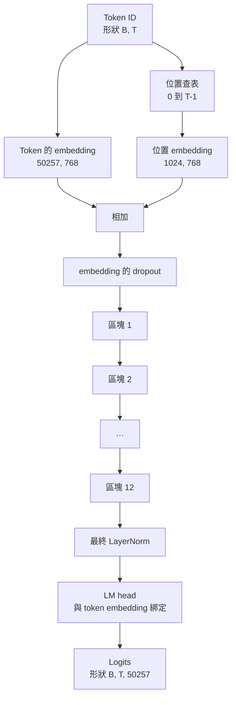
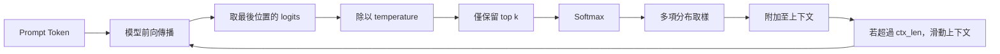

# GPT 全模型組裝（GPT Model Assembly）

> 12 個 Transformer 區塊縱向堆疊、一個 token embedding 矩陣、一個可學習位置 embedding 矩陣、一個全局最終 LayerNorm，以及一個綁定權重的語言模型預測頭（LM Head）。這就是總參數量達 1.24 億的標準 GPT-2 模型的完整實體。本課將把上述所有模組組裝為一個流暢運作的模型類別、盤點參數量以確認參數量符合 124M 參考規格，並使用多項分布取樣（Multinomial Sampling）、溫度係數（Temperature）與 Top-k 截斷來生成文字。

**Type:** Build
**Languages:** Python
**Prerequisites:** Phase 19 lessons 30 to 34
**Time:** ~90 minutes

## Learning Objectives｜學習目標

- 將第三十四課打造的 Transformer 區塊完整組裝為全功能的 GPT 模型：token embedding、位置 embedding、N 個區塊堆疊、最終 LayerNorm 以及語言模型頭。
- 嚴格復現官方經典的 1.24 億參數量標準配置：詞表容量 50257、上下文長度 1024、隱藏層維度 768、12 個注意力頭、12 層堆疊。
- 將語言模型預測頭與輸入 token embedding 矩陣進行權重綁定（Weight Tying），並清晰解釋為何該技巧在當前規模下能直接淨省約 3800 萬個重複參數。
- 實作自回歸文字生成引擎：支援自 Prompt 出發、整合多項分布取樣、溫度平滑縮放與 Top-k 截斷，並透過滑動視窗保證長度不突破上下文上限。
- 對標 124M 標準目標，客觀度量模型的獨特參數量與前向傳播運算開銷。

## The Problem｜問題

單一 Transformer 區塊本身無法獨立承擔任務。你必須將輸入的 Token ID 轉化為稠密向量、疊加精確的時間空間位置資訊、將訊號穿透多層深層堆疊傳播，並最終重新投影回覆蓋全詞表的 Logits。上述四個環節只要遺漏了任何一步，模型要麼在前向傳播時當場崩潰、要麼位置資訊出現漂移，要麼根本無法張口吐字。

模型的幾何參數形狀同樣具備極其嚴肅的數學依據。官方參考級的 GPT-2 Small 模型在精確採用上述配置時，參數量嚴格等於 1.24 億。這些數字絕非憑空捏造的玄學：詞表 50257 乘以 embedding 維度 768 是 token embedding 矩陣；位置長度 1024 乘以 768 是位置 embedding 矩陣；12 個區塊、每個區塊約 700 萬參數，累計貢獻約 8400 萬參數；最後的 LM 預測頭透過權重綁定直接複用 token embedding。將上述各部分精確相加，不多不少正好收斂至 1.24 億。如果你組裝出來的模型參數量與官方基準對不上，這表示底層某處可能有連線錯誤。

## The Concept｜核心概念



Token ID 映射為 Token 語義向量；位置索引映射為位置幾何向量。兩者相加後注入多層 Transformer 堆疊。在堆疊的出口處，全局最終 LayerNorm 是在所有現代變體中皆被頑強保留的唯一模組外元件。而 LM 預測頭則直接複用最前端的 token embedding 矩陣，這就是所謂的權重綁定（Weight Tying）。

### 權重綁定機制

token embedding 矩陣的形狀為 `(vocab, d_model)`。而語言模型預測頭則需要將特徵從 `d_model` 重新投影回 `vocab`。兩者的維度恰好互為轉置矩陣。權重綁定意味著：在底層物理記憶體中，兩者本質上是同一個參數張量的二次重複引用。在詞表為 50257、維度為 768 的配置下，該矩陣包含高達 3800 萬個參數。若不綁定，你必須在記憶體中支付兩次開銷；而一旦開啟綁定，你僅需支付一次儲存成本，且由於輸入端與輸出端共享梯度回傳，也能得到稍微更乾淨的梯度訊號。

### 可學習位置 embedding，而非正弦編碼

經典 GPT-2 採用可學習位置 embedding。位置查表是一個形狀為 `(1024, 768)` 的獨立參數張量。模型在每次前向計算時，動態查取位置 0 到 T-1 的對應向量，並直接與 Token 向量相加。這是業界最簡潔明瞭的位置編碼方案（RoPE、ALiBi、T5 相對偏置等則是其他選擇），亦是 124M 官方標竿所採用的原始架構。

### 自回歸生成：溫度、Top-k 與多項分布取樣

生成流程遵循嚴格的自回歸循環。在每一步推論中，模型針對序列的所有位置輸出覆蓋全詞表的 Logits 分數。我們嚴格僅截取**最後一個位置**的 Logits；將其除以溫度係數（Temperature）；可選地將 Top-k 之外的所有低分位置強制遮罩為負無窮大；透過 Softmax 歸一化為機率分佈；最後從該分佈中進行多項分布取樣，抽取出下一個預測 Token。



三個旋鈕調節三種截然不同的生成體感：溫度趨近於 0 會使分佈極度尖銳，直接退化為確定性的貪婪搜尋（Greedy）；溫度設為 1 則完美保留模型的原生機率分佈；Top-k 設為 1 等同於貪婪搜尋；Top-k 設為 40 則會過濾長尾候選項。在下一課的預訓練中，我們將直接依託該生成函式作為定性評估模型進步的關鍵視窗。

```figure
cc-gpt-assembly
```

## Build It｜動手實作

`code/main.py` 實作了以下核心架構：

- `class GPTConfig` 配置資料類別，內建標準的 124M 預設參數：`vocab_size=50257`、`context_length=1024`、`d_model=768`、`num_heads=12`、`num_layers=12`、`mlp_expansion=4`、`dropout=0.1`、`use_bias=True`、`weight_tying=True`。
- `class GPTModel` 主類別：包含 token embedding、位置 embedding、embedding Dropout、12 個 `TransformerBlock` 區塊堆疊、最終 LayerNorm，以及在開啟旗標時自動與 token embedding 綁定同一個儲存底層的 `lm_head`。
- `count_parameters` 輔助計算函式：能準確識別記憶體中的共享指標，確保權重綁定在參數量統計時不會被錯誤重複計算。
- `generate` 自回歸文字生成函式：整合溫度縮放、Top-k 截斷、多項分布取樣，以及防範溢出最大長度的滑動視窗機制。
- 底部演示程式：實例化模型、印出參數量並與官方 124M 基準並列展示、從固定 Prompt 出發生成一段短文本以驗收端到端管線。

執行測試：

```bash
python3 code/main.py
```

輸出結果：展示與官方 124M 嚴密對齊的參數量審計結果、從隨機 Prompt 生成的 Token ID，並確鑿證實 LM Head 與 token embedding 在底層確實共享同一片物理儲存記憶體。

為了確保本機演示能秒級跑完，腳本同時運作了一個超微型的微縮配置（`d_model=64`、`num_layers=2`）進行端到端文字吐字；而標準的 124M 配置則完整建構並執行參數量核對與單次前向驗收。

## 技術堆疊

- `torch` 負責張量運算、自動微分與神經網路模組封裝。
- `code/main.py` 在本機完全重現了第三十四課所打造的標準 Transformer 區塊結構。

## 工業級正式環境落地模式

三大實戰工程考量，決定了一個大模型架構究竟是玩具程式碼還是工業級產品：

**殘差投影層的小尺度縮放初始化（Initialize residual projections small）**：注意力的輸出投影層與 MLP 的第二層線性投影，皆直接匯入殘差相加節點。若將它們與其他常規線性層採用相同的標準差進行初始化，殘差主幹的訊號強度會隨著網路深度加深而增長，直接導致頂層的最終 LayerNorm 進入高熱區間。工業標準解法是：將這兩處特殊投影層的初始化標準差強制乘以 `1 / sqrt(2 * num_layers)`；如此一來，殘差流在穿透 12 層後依然能穩定保持在極其理性的動態範圍內。

**快取位置索引張量，杜絕逐次重複分配（Cache position id tensor）**：在每次前向傳播中反覆調用 `torch.arange(T)` 會引發高頻的短生命週期記憶體分配。在 `__init__` 中為最大上下文長度一次性預分配好該張量，在每次調用時直接切片截取前 T 個元素，徹底消解記憶體配置器的效能熱點。

**在參數指標維度進行實質綁定，絕非淺層拷貝（Tie weights at parameter level）**：執行 `lm_head.weight = token_embedding.weight` 能讓 LM Head 與 token embedding 共用同一個底層張量；而數值拷貝則無法做到。最佳化器必須更新同一個參數實體，Autograd 計算圖中也必須匯聚於同一個節點。若僅僅進行拷貝，LM Head 很快便會在訓練中與輸入 embedding 背道而馳，權重綁定所帶來的所有工程優勢將蕩然無存。

## Use It｜實際應用

- 本課定義的 GPTModel 類別，其架構形狀與下一課預訓練迴圈所驅動的目標模型完全一致。
- 將可學習位置 embedding 替換為旋轉位置編碼（RoPE），無需更動任何區塊或頭部邏輯，即可直接躍遷至當代主流的 LLaMA 家族。
- 將 GELU 替換為 SiLU、將 LayerNorm 替換為 RMSNorm，即可補齊 LLaMA 家族的其餘所有現代改進。
- 本課實作的 generate 自回歸生成函式適用於任意輸出 Logits 的解碼模型。在第三十七課載入預訓練 GPT-2 權重後，你可以直接複用本課的生成迴圈來生成文字。

## Exercises｜練習

1. 手動解除 LM Head 與 token embedding 矩陣的權重綁定，重新計算全模型獨立參數量。驗證兩者的參數差值等於 50257 乘以 768 = 3800 萬。
2. 將可學習位置 embedding 替換為在建構時一次性計算好的固定正弦查表。確認模型前向傳播依然完全正常，且全模型參數量精準下降了 786,432 個參數。
3. 為 generate 函式擴充 `greedy=True` 旗標：直接跳過隨機抽樣，固定選取最大機率（Argmax）對應的 Token。驗證在多次重複運作中輸出的 Token 序列具備 100% 的確定性。
4. 引入 `repetition_penalty` 重複懲罰係數：在執行 Softmax 之前，將 Prompt 與歷史生成文字中已出現過的所有 Token 對應的 Logits 強制除以該懲罰係數。在固定 Prompt 上進行實測，展示大於 1 的係數會減少輸出中的重複次數。
5. 在 `top_k` 之外追加 `top_p`（核取樣，Nucleus Sampling）機制：編寫兩行核心邏輯，確保被保留的候選 Token 集合其累計機率質量恰好突破設定的 `top_p` 閾值。

## Key Terms｜關鍵術語

| 術語 | 常見說法 | 實際意義 |
|------|-----------------|------------------------|
| Weight tying | 「綁定 embedding」 | LM head 和 token embedding 共用同一個參數張量；可省下 vocab × d_model 個參數，並符合 GPT-2 參考架構。 |
| Position embedding | 「可學習的位置」 | 形狀為（context length, d_model）的獨立表格，會加到 Token 向量上，並透過端到端訓練學得。 |
| Sliding window context | 「上下文上限」 | 當 prompt 加上生成的 Token 超過上下文長度時，捨棄最舊的 Token，讓有效視窗符合長度限制。 |
| Top-k sampling | 「K 值截斷」 | 保留數值最高的 K 個 logits，將其餘值遮罩為負無窮，再對剩下的值執行 softmax。 |
| Temperature | 「取樣溫度」 | 在 softmax 前將 logits 除以 T；T 小於 1 會使分布更尖銳，T 等於 1 保持原始分布，T 大於 1 則使分布更平坦。 |
## Further Reading｜延伸閱讀

- 第 19 階段第 34 課：深入了解被本模型反覆堆疊的標準 Transformer 區塊底層細節。
- 第 19 階段第 36 課：打造完整的預訓練迴圈，使用交叉熵損失函數全面驅動該模型訓練。
- 第 19 階段第 37 課：將 OpenAI 官方發布的 GPT-2 原始預訓練權重精確灌入該完全同構的架構中。
- 第 7 階段第 07 課（GPT 因果語言建模）：系統複習 next-token prediction 的深層數學原理。
- 第 10 階段第 04 課（預訓練 Mini GPT）：回顧在相同架構上開展微型預訓練的早期實驗方法。
