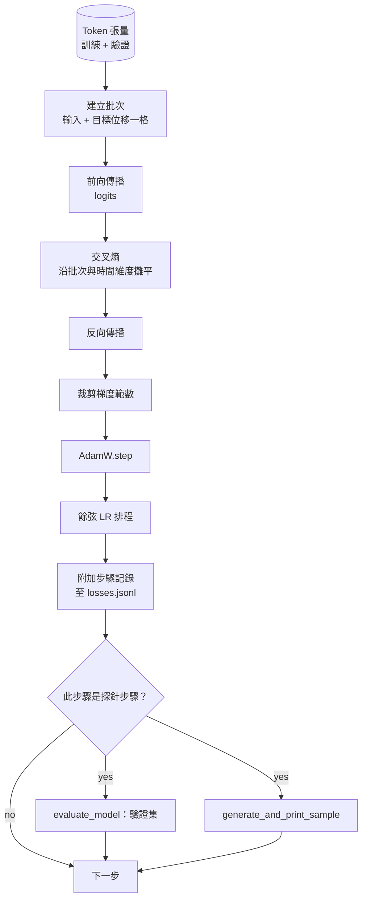

# 訓練迴圈與模型評估（Training Loop and Evaluation）

> 一個缺乏客觀度量的訓練迴圈，本質上只是一段充滿謊言的空轉程式碼。本課將親手打造驅動 GPT 模型訓練的完整工業級控制迴圈：針對權重矩陣與偏置項實施嚴格解耦的 AdamW 權重衰減（Weight Decay Split）、線性預熱搭配餘弦退火的學習率排程、批次損失計算函式 `calc_loss_batch`、在保留驗證集上的客觀評估傳遞 `evaluate_model`、每隔 K 步觸發一次的文字生成定性探針 `generate_and_print_sample`，以及可隨時供後續繪圖審計的 JSONL 訓練記錄。這套骨架將直接適用於你未來所建構的任何自回歸 Decoder 大語言模型。

**Type:** Build
**Languages:** Python
**Prerequisites:** Phase 19 lessons 30 to 35
**Time:** ~90 minutes

## Learning Objectives｜學習目標

- 建構標準預訓練迴圈：嚴格落實 next-token prediction 的錯位平移對齊，並計算展平後的交叉熵損失函數。
- 配置 AdamW 最佳化器：對二維權重張量施加權重衰減，對 LayerNorm 縮放因子與偏置項張量嚴格排除衰減。
- 實作結合線性預熱（Warmup）與餘弦退火（Cosine Decay）的動態學習率排程，並精確追蹤學習率隨時序的演變。
- 透過 `evaluate_model` 在獨立保留的驗證集上實施評估，確保不同實驗運作之間的驗證損失具備可比性。
- 每隔 K 步調用 `generate_and_print_sample` 生成定性抽樣文字，搶在損失函數曲線之前提早捕捉模型發散崩潰。
- 將逐步的訓練記錄持久化至 JSONL 檔案中，使其隨時可被重新載入、繪圖審查，並作為標準工程資產隨模型交付。

## The Problem｜問題

一個僅僅懂得在終端機印出單步 Loss 的粗糙訓練腳本，必然會在三個方向上徹底失控。第一，它無法告訴你損失值的下降究竟是否出於正確的原因（模型可能只是嚴重過擬合了訓練集，而完全沒有學到任何泛化規律）；第二，它無法即時預警數值發散的開端（損失值可能只尖峰後恢復，也可能尖峰後崩潰）；第三，它無法讓你直觀看見模型究竟學到了什麼語言能力（Loss 只是一個抽象的純量，而一段生成的自然語言段落才能體現真實能力）。若訓練迴圈缺乏多維度的即時度量，這三類隱患將被完全掩蓋。

本課的訓練迴圈從三個維度進行全方位立體度量：每一步記錄當前訓練批次的損失值；每隔 K 步在獨立保留的驗證集批次上記錄評估損失值；每隔 K 步從固定 Prompt 出發生成一段延續文字。訓練軌跡即時以 JSONL 形式落盤，使這份產物成為訓練迴圈的佐證。

## The Concept｜核心概念



整個架構中最容易被忽視的兩大精妙之處，是損失函數的時序對齊以及 AdamW 的權重衰減分組。

### 損失函數時序對齊

大模型在序列中的每一個位置皆在預測緊隨其後的下一個 Token。如果輸入批次的 Token 序列為 `[t0, t1, t2, t3]`，那麼目標批次的序列必須嚴格為 `[t1, t2, t3, t4]`。交叉熵損失在展平為 `(batch * seq, vocab)` 的預測矩陣與展平為 `(batch * seq,)` 的標籤向量之間進行計算。一旦忘記這一位的錯位平移，你將會把模型訓練成「預測當前自己」的自戀網路——其損失值能迅速暴跌至接近零，但模型實質上根本沒有學到任何預測未來的有用能力。

### AdamW 權重衰減分組

權重衰減（Weight Decay）適用於權重張量，不應施加於正規化縮放值或偏置項上。若對 LayerNorm 的 Scale 參數施加權重衰減，會逐漸將縮放係數拖向零，直接破壞層正規化的數值穩定性；而對偏置項施加衰減，雖然在數學上無害，但純屬浪費運算資源。工業標準分組準則為：凡是二維矩陣形態的張量（全連接層權重、embedding 查表矩陣）皆納入衰減分組；凡是形似純量、縮放因子或偏置項的一維向量，一律排除在衰減之外。

### 預熱加餘弦退火排程

線性預熱在最初的數百步內將學習率從 0 平滑攀升至目標峰值，給予最佳化器（Optimizer）內部的一階動量與二階變異數足夠的時間累積與初始化；隨後的餘弦退火在剩餘步數中將學習率平滑壓回至接近 0，使模型在最終階段能以極其微小的步長對權重進行 fine-tuning。這套組合拳是當代主流開放權重大型語言模型最普遍採用的排程標準，因為它能消除訓練最初 1000 步與最後 1000 步中的大部分容易出問題的時段。

### 獨立保留驗證集評估

`evaluate_model` 每次自驗證集中抽取固定數量的批次，累計交叉熵損失，除以總批次數，回傳平均評估損失。全程關閉自動微分梯度計算，關閉 Dropout。在相同的隨機種子與相同的切片劃分下，該數值在不同執行間可重現。將保留驗證集的 Loss 與當前訓練批次的 Loss 並列呈報，是即時揪出模型是否發生過擬合（Overfitting）的標準防線。

### 定性取樣探針作為早期預警

一個訓練 Loss 下降得十分漂亮、但生成出來的文字全體退化為同一個單詞無休止循環的模型，顯然在內部發生了崩潰。一個 Loss 曲線看似走平、但生成的取樣文字卻從最初的亂碼逐漸收斂為清晰有意義詞彙的模型，顯然正在健康地吸收知識。定性探針的直觀反饋速度遠遠快於盲看抽象的數值曲線，且能精準捕捉標量指標所遺漏的嚴重語義退化。

```figure
cap-training-loop
```

## Build It｜動手實作

`code/main.py` 實作了以下核心模組：

- `make_batches(token_ids, batch_size, context_length)`：將長條 Token 張量精準切分為錯位平移一格的輸入與目標張量對。
- `calc_loss_batch(model, inputs, targets)`：執行前向傳播、展平矩陣形狀，並回傳交叉熵純量損失。
- `evaluate_model(model, val_loader, max_batches)`：在關閉梯度圖的前提下迭代固定批次的驗證集，回傳平均損失值。
- `generate_and_print_sample(model, prompt, max_new_tokens)`：調用第三十五課的生成函式，在固定 Prompt 上生成文字並在終端機印出展示。
- `build_param_groups(model, weight_decay)`：將全模型參數精確拆分為「施加衰減組」與「不施加衰減組」的 AdamW 專屬列表。
- `cosine_with_warmup(step, warmup_steps, total_steps, max_lr, min_lr)`：數學計算給定 Step 處對應的即時學習率數值。
- `train(...)`：核心訓練調度迴圈，即時將軌跡寫入 `outputs/losses.jsonl`，並每隔 `eval_every` 步印出評估損失與定性生成取樣。
- 底部演示程式：在合成資料上微型訓練一個小型模型若干步驟，產出 JSONL 記錄，並在探測步驟即時印出驗證 Loss 與文字生成效果。在 CPU 上運作完畢僅需不足一分鐘。

執行測試：

```bash
python3 code/main.py
```

輸出結果：展示單步訓練 Loss、每逢探針節點的驗證 Loss、即時文字生成效果，並最終產出可用 `json.loads` 逐行解析的 `outputs/losses.jsonl` 標準記錄檔。

## 技術堆疊

- `torch` 負責自動微分 Autograd、AdamW 最佳化器與神經網路模組封裝。
- `main.py` 在本機內部自包含重現了第三十五課所打造的 `GPTModel` 架構。

## 工業級正式環境落地模式

三種模式，能讓你放心讓這套教科書式訓練迴圈通宵執行：

**梯度範數裁剪是不可妥協的底線（Gradient norm clipping is non-negotiable）**：偶爾遇到的異常劣質資料、學習率突變或數值邊界情況，極易引發瞬間的局部梯度爆炸，直接將數個小時的心血徹底洗白摧毀。在 `backward` 反向傳播之後、在 `step` 更新參數之前，強制調用 `torch.nn.utils.clip_grad_norm_(params, max_norm=1.0)` 將梯度向量的範數壓制在安全範圍內。1.0 是大多數設定下都適用的預設值。

**基於 JSONL 的可接續訓練記錄，絕非脆弱的 Pickle 檔案（Resumable JSONL logging）**：每一步以 `{"step": int, "train_loss": float, "lr": float}` 的標準 JSON 物件寫入一行 JSONL。這種設計具備極致的工程健壯性：任何意外當機皆能留下可讀的產物、可以用簡單的腳本隨時繪圖，且只需讀取最後一行即可取得準確的接續訓練步驟。Pickle 序列化會綁定產生檔案時的模組配置，因此在重構時很脆弱。

**驗證批次自固定切片預先產生（Eval batches drawn from a fixed slice）**：驗證集的 Token 切片在腳本啟動時一次性預先切分鎖定，絕不在運作中途動態隨機抽取。不同實驗運作之間的對比有效性，完全建立在驗證測試樣本二進位級別一致性的基礎之上；否則，對比兩次實驗的驗證 Loss，在很大程度上只不過是在測量資料隨機洗牌帶來的雜訊波動而已。

## Use It｜實際應用

- 本課所打造的訓練迴圈，是未來在海量真實文字語料上訓練完整 124M 模型的標準骨架。只需將合成資料替換為基於真實檔案的 `datasets` 風格資料載入器，整套迴圈程式碼無需任何修改即可全速運作。
- 產出的 JSONL 記錄是將一場長期訓練轉化為嚴謹工程資產的核心證據。下一節課我們將使用它直接對比「剛訓練完成的 model checkpoint」與「預訓練 model checkpoint」的收斂表現差異。
- 定性生成抽樣探針是任何單一標量指標皆無法替代的全能安全網。

## Exercises｜練習

1. 為 `weight_decay_groups()` 編寫單元測試：嚴格斷言所有 LayerNorm 的縮放尺度與偏置項皆被正確劃分進「無衰減組」，而所有的線性權重與 embedding 表矩陣皆被正確劃分進「有衰減組」。
2. 將合成隨機 Token 替換為從真實文字檔案中讀取的原始字串，使演示程式在具備實際語義的語料上展開訓練。驗證定性探針生成的取樣文字中，是否開始自發湧現出語料庫中存在的字元模式。
3. 為餘弦退火排程引入 `min_lr` 兜底底線（設定為 `max_lr` 的 10%），繪製學習率衰減曲線並觀察其平滑收尾特徵。
4. 在常規 JSONL 記錄之外，每隔 `eval_every` 步自動將全模型權重與最佳化器狀態打包保存為 model checkpoint 檔案。擴充 `resume_from` 啟動參數，驗證中斷後能夠無損重新加載狀態並接續訓練。
5. 在記錄損失的同時，記錄並計算每一步的每秒 Token 吞吐量（Tokens per second），確認其在長期訓練中始終維持在穩定的效能範圍內。

## Key Terms｜關鍵術語

| 術語 | 常見說法 | 實際意義 |
|------|-----------------|------------------------|
| Loss alignment | 「位移一格」 | 輸入位置 0..T-1 的 Token 對應目標位置 1..T；交叉熵在攤平後的形狀上計算。 |
| Decay split | 「分成兩組」 | AdamW 對矩陣形狀的張量套用權重衰減，對縮放值或偏置張量則不套用。 |
| Warmup | 「緩慢起步」 | 在固定步數內，將學習率從零逐步提高到目標值，讓最佳化器狀態有時間累積。 |
| Eval batches | 「保留評估批次」 | 在程式啟動時從驗證 Token 張量切出固定範圍，並在每次探測時使用相同批次。 |
| Qualitative probe | 「輸出樣本」 | 每隔 K 步以固定 prompt 生成一小段文字並印出，藉此捕捉單靠損失值看不出的失效模式。 |
## Further Reading｜延伸閱讀

- 第 19 階段第 35 課：深入回顧被本訓練迴圈所全速驅動的標準 GPT 全模型架構。
- 第 19 階段第 37 課：將 OpenAI 官方預訓練權重載入至該模型中，對比開箱即用的推論效果。
- 第 10 階段第 04 課（預訓練 Mini GPT）：親手體驗在真實自然語言語料上調用該流程進行訓練的實踐手冊。
- 第 10 階段第 10 課（模型評估）：探索除交叉熵損失之外，更為廣闊前沿的大模型能力基準評估體系。
