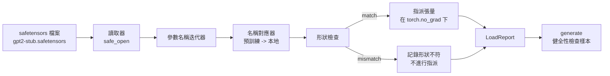

# 載入預訓練模型權重（Loading Pretrained Weights）

> 從零預訓練一個 1.24 億參數的大模型是一項重大的算力預算決策；而直接載入一個公開發布的 model checkpoint 則是日常工程中很平常的事。本課將把 safetensors 格式的預訓練 GPT-2 風格權重，精確載入進第三十五課完全同構的模型架構中，逐行梳理參數命名映射規則，並透過單次生成檢驗來確鑿證明權重載入成功。無網路依賴、無黑盒第三方載入器，也不依賴不透明的載入器。

**Type:** Build
**Languages:** Python
**Prerequisites:** Phase 19 lessons 30 to 36
**Time:** ~90 minutes

## Learning Objectives｜學習目標

- 使用 `safetensors` Python 函式庫解析 safetensors 權重檔案，檢查張量名稱清單與具體幾何維度。
- 將公開預訓練檔案中的每個參數名稱，精確映射至第三十五課 GPT 模型的對應內部參數上。
- 妥善處理解決兩大命名慣例差異：官方 GPT-2 權重的 `wte/wpe/h.N.attn.c_attn/c_proj` 與 `mlp.c_fc/c_proj`，對標本軌道本地命名的 `tok_embed/pos_embed/blocks.N.attn.qkv/out_proj` 與 `mlp.fc1/fc2`。
- 在執行任何權重指派賦值之前，主動偵測並堅決拒絕張量形狀不符（Shape Mismatch）的非法賦值，拋出精確報錯。
- 使用載入後的權重生成一段簡短的接續文本，確認輸出的 Token 來自載入後的分布，而非隨機初始化的分布。

## The Problem｜問題

公開發布的模型權重從來不會主動迎合你自定義的程式碼架構。它們嚴格攜帶著原始官方實作所規定的參數名稱。預訓練檔案中儲存的是形狀為 `(2304, 768)` 的 `transformer.h.0.attn.c_attn.weight`；而你的模型內部期望的卻是 `blocks.0.attn.qkv.weight`（形狀同為 `(2304, 768)`，這是同一個矩陣在不同記憶體排布下的變體），或者你的模型調用了 `nn.Linear`，而後者在記憶體中期望以轉置矩陣的形式儲存權重。同一個物理參數往往會以三種微妙不同的身分（名稱、形狀維度、位元組記憶體排列）同時出現，權重載入器必須將這三者完美調和抹平。

一個盲目拷貝的粗糙載入器會把正確的張量誤塞進錯誤的位置，最終讓模型吐出一堆胡言亂語的亂碼。而一個在形狀不符時直接靜默略過且完全不留記錄的載入器，則會讓你痛苦猜測究竟是哪一個核心層未能成功入庫。本課所建構的載入器具備嚴密的顯式可審計性：每一次賦值皆有詳細記錄、每一次形狀皆經過硬性檢驗，並透過一個標準的 `LoadReport` 集中呈現命中數、缺失數與形狀衝突清單。

## The Concept｜核心概念



名稱映射器本質上是一個字串至字串的映射函式。形狀檢查是一道嚴格的 if 條件。張量指派在 `torch.no_grad()` 上下文中完成，確保 Autograd 不會對載入過程記錄多餘的計算圖。最後出具的載入報告完整記錄每個參數的最終去向。

### 官方 GPT-2 參數命名約定

公開發布的官方 GPT-2 權重檔案採用以下命名體系：

| 官方預訓練名稱 | 形狀維度 | 實體架構語義 |
|---|---|---|
| `wte.weight` | (50257, 768) | token embedding 查表矩陣 |
| `wpe.weight` | (1024, 768) | 位置 embedding 查表矩陣 |
| `h.N.ln_1.weight` | (768,) | 第 N 個區塊的 LayerNorm 1 縮放因子 |
| `h.N.ln_1.bias` | (768,) | 第 N 個區塊的 LayerNorm 1 偏置項 |
| `h.N.attn.c_attn.weight` | (768, 2304) | QKV 融合線性投影權重 |
| `h.N.attn.c_attn.bias` | (2304,) | QKV 融合線性投影偏置項 |
| `h.N.attn.c_proj.weight` | (768, 768) | 注意力輸出投影權重 |
| `h.N.attn.c_proj.bias` | (768,) | 注意力輸出投影偏置項 |
| `h.N.ln_2.weight` | (768,) | 第 N 個區塊的 LayerNorm 2 縮放因子 |
| `h.N.ln_2.bias` | (768,) | 第 N 個區塊的 LayerNorm 2 偏置項 |
| `h.N.mlp.c_fc.weight` | (768, 3072) | MLP 第一層升維線性權重 |
| `h.N.mlp.c_fc.bias` | (3072,) | MLP 第一層偏置項 |
| `h.N.mlp.c_proj.weight` | (3072, 768) | MLP 第二層降維線性權重 |
| `h.N.mlp.c_proj.bias` | (768,) | MLP 第二層偏置項 |
| `ln_f.weight` | (768,) | 全局最終 LayerNorm 縮放因子 |
| `ln_f.bias` | (768,) | 全局最終 LayerNorm 偏置項 |

兩處必須提前預判的工程意外：第一，官方權重中 `c_attn`、`c_proj`、`c_fc` 等線性層是以 Conv1D 格式儲存的，相較於 PyTorch `nn.Linear.weight` 所期望的維度順序，其矩陣呈現轉置狀態。載入器必須在指派賦值時主動執行 .t() 轉置；第二，官方檔案中根本不存在 LM Head 的獨立權重——因為模型在架構上天然依託與 `wte` 的權重綁定，因此一旦 `wte` 成功載入，LM Head 僅需透過指標別名共享即可。

### 本地模型參數命名約定

本軌道中所建構的本地模型採用自解釋的清晰語義命名：

| 本地內部名稱 | 實體架構語義 |
|---|---|
| `tok_embed.weight` | token embedding 查表矩陣 |
| `pos_embed.weight` | 位置 embedding 查表矩陣 |
| `blocks.N.ln1.scale` | 第 N 個區塊的 LayerNorm 1 縮放因子 |
| `blocks.N.ln1.shift` | 第 N 個區塊的 LayerNorm 1 偏置項 |
| `blocks.N.attn.qkv.weight` | QKV 融合線性投影權重 |
| `blocks.N.attn.qkv.bias` | QKV 融合線性投影偏置項 |
| `blocks.N.attn.out_proj.weight` | 注意力輸出投影權重 |
| `blocks.N.attn.out_proj.bias` | 注意力輸出投影偏置項 |
| `blocks.N.ln2.scale` | 第 N 個區塊的 LayerNorm 2 縮放因子 |
| `blocks.N.ln2.shift` | 第 N 個區塊的 LayerNorm 2 偏置項 |
| `blocks.N.mlp.fc1.weight` | MLP 第一層升維線性權重 |
| `blocks.N.mlp.fc1.bias` | MLP 第一層偏置項 |
| `blocks.N.mlp.fc2.weight` | MLP 第二層降維線性權重 |
| `blocks.N.mlp.fc2.bias` | MLP 第二層偏置項 |
| `final_ln.scale` | 全局最終 LayerNorm 縮放因子 |
| `final_ln.shift` | 全局最終 LayerNorm 偏置項 |

這兩套命名體系之間的映射關係是嚴格固定的。本課將其封裝為一個字典物件，供載入器依序遍歷驅動。

### 測試夾具樁檔案

真實的完整 GPT-2 權重檔案高達 0.5 GB。底部演示程式不要求聯網下載龐大檔案；而是在首次運作時於本機動態生成一個微型的 safetensors 測試夾具——它嚴格遵循官方 GPT-2 的命名規範與形狀比例，但將模型維度縮小為 12 個區塊、d_model=192。該測試夾具具備真實檔案的一切結構特徵，足以完整覆蓋並測試載入器中的每一條程式碼 branch。將該夾具替換為真實的 0.5 GB 官方檔案，本載入器無需更動任何一行程式碼即可直接完美運作。

```figure
cc-weight-remap
```

## Build It｜動手實作

`code/main.py` 實作了以下核心功能：

- 內建第三十五課 `GPTModel` 的微型複本，確保本課具備完全的自包含性。
- `make_pretrained_to_local(num_layers)` 函式：動態展開各層區塊的專屬命名映射關係。
- `load_safetensors(model, path)` 核心載入器：遍歷檔案中的張量名稱、執行映射轉換、校驗形狀維度、對 Conv1D 風格權重實施轉置，並在 `torch.no_grad()` 模式下完成安全指派。回傳 `LoadReport`。
- `make_stub_safetensors(path, cfg)` 函式：動態合成一份具備官方標準命名的微型 safetensors 測試檔案。
- 底部演示程式：在首次運作時生成 `outputs/gpt2-stub.safetensors`；初始化一個全新模型並記錄其在隨機權重下的生成文本；載入測試夾具權重；記錄載入後的生成文本；並列印出兩者；並確鑿斷言兩次生成的輸出截然不同（證明權重載入實質性改變了模型的行為）。

執行測試：

```bash
python3 code/main.py
```

輸出結果：展示夾具檔案路徑、逐項載入明細記錄、`LoadReport` 匯總報告、載入前的生成文字、載入後的生成文字，以及針對一條特意注入測試夾具中的畸形張量所展示的形狀不符攔截告警（證明異常處理路徑正常運作）。

## 技術堆疊

- `safetensors` 用於讀取磁碟上的權重檔案並提供高效的串流 Reader。
- `torch` 負責承載目標模型並執行底層張量轉置與記憶體覆蓋。
- 零依賴 `transformers`，零依賴 `huggingface_hub`，零網路外部呼叫。

## 工業級正式環境落地模式

三大實戰工程準則，能讓你的權重載入器在面對各類第三方未知檔案時依然穩如泰山：

**在執行任何實質指派賦值前，永遠先行全量驗證檔案**：打開 safetensors 檔案，遍歷掃描內部所有張量的名稱、資料型別與形狀維度，在記憶體中完整跑通一次映射與形狀校驗流程；只有當確認所有關鍵張量皆 100% 匹配無誤後，才正式啟動物理權重寫入。載入了一半便尷尬崩潰的模型是正式環境中最危險的隱性定時炸彈。

**為每一筆賦值記錄來源名稱與目標名稱**：當模型在載入後輸出胡言亂語時，詳細的映射記錄能立即告訴你究竟是哪一個張量被放錯了位置；若缺乏這些記錄，排查這類問題將退化為痛苦的人肉二進位 Hexdump。本課實作的 `LoadReport` 類別即時追蹤記錄 `loaded`（成功載入）、`missing`（目標缺失）、`unexpected`（檔案多餘）以及 `shape_mismatch`（形狀衝突）四大陣列，並在最後印出清晰的摘要報告。

**LM Head 必須是指標別名，絕不能額外深拷貝**：在載入 `tok_embed` 之後，執行 `model.lm_head.weight = model.tok_embed.weight` 是典型模式。若將 embedding 矩陣的值深拷貝一份賦予給一個獨立的 `lm_head.weight` 參數，不僅會徹底破壞權重綁定的訓練合約，且會讓你的模型參數量在記憶體中憑空暴增一倍。

## Use It｜實際應用

- 該載入器適用於任何遵循官方命名規範的標準 safetensors 權重檔案。對於真實的官方 GPT-2 檔案（Small / Medium / Large / XL），無需更動任何載入程式碼，模型配置必須與 checkpoint 相符（包括層數、隱藏維度與注意力頭數）。
- 相同的架構模式可直接外推至 LLaMA、Mistral 或 Qwen 等主流開源模型：只需更新名稱映射字典，而底層的形狀校驗與載入報告邏輯完全同構。
- 載入後的健全性文本生成（Sanity Generation）是一道極其靈敏的即時門禁：若載入後的生成樣本與隨機初始化時看起來毫無二致，這意味著名稱映射肯定出現了嚴重偏差，導致所有權重皆被靜默漏掉。

## Exercises｜練習

1. 為載入器擴充 `dtype` 參數：支援在賦值過程中將張量動態轉換為目標精度（`bfloat16`、`float16`、`float32`）。驗證一個原本為 `float32` 的模型在降維轉換為 `bfloat16` 後依然能正常前向推論生成。
2. 加入 `expected_layers` 參數：當傳入的檔案中包含的 `h.N` 索引最大值與當前模型的 `num_layers` 不一致時，堅決拒絕載入並拋出明確異常。
3. 將該載入器與第三十五課的文本生成函式進行串聯：印出兩組並列對比樣本——一組來自隨機初始化狀態，另一組來自載入權重後的真實推論。
4. 打造權重匯出（Export）功能：將當前模型的記憶體權重反向格式化為官方預訓練命名規範，並導出為一個全新的 safetensors 檔案。將該檔案重新餵回載入器，驗證其報告中的形狀不符次數為零。
5. 擴充 `NAME_MAP` 以適配 LLaMA 家族的命名慣例（無偏置項、RMSNorm、融合 QKV 排布），並在一個自動生成的 LLaMA 測試夾具上重新運作該載入器。

## Key Terms｜關鍵術語

| 術語 | 常見說法 | 實際意義 |
|------|-----------------|------------------------|
| Name map | 「鍵值重新對應」 | 將預訓練張量名稱對應至本地參數名稱的函式；通常是依層索引展開的字典。 |
| Shape mismatch | 「形狀不符」 | 預訓練張量存在於對應名稱下，但維度與本地參數不符；載入器會拒絕指派並記錄這組名稱。 |
| Transpose-on-load | 「Conv1D 配置」 | 發布的 GPT-2 權重中，注意力與 MLP 投影矩陣的方向和 nn.Linear 預期相反；載入時會轉置。 |
| Weight tying alias | 「共用 LM head」 | 設定 model.lm_head.weight = model.tok_embed.weight，讓 head 和 embedding 共用儲存空間；因此檔案中沒有獨立的 head 權重。 |
| Load report | 「涵蓋範圍摘要」 | 追蹤 loaded、missing、unexpected 和 shape_mismatch 清單的小型資料類別；輸出摘要可用來判斷載入是否成功。 |
## Further Reading｜延伸閱讀

- 第 19 階段第 35 課：深入回顧接收該權重注入的標準 GPT 模型幾何架構。
- 第 19 階段第 36 課：回顧產出形狀相同的 model checkpoint 的標準訓練迴圈。
- 第 10 階段第 11 課（模型量化）：當顯示記憶體極度吃緊時，如何對載入後的模型權重實施量化壓縮。
- 第 10 階段第 13 課（建構完整 LLM 管線）：全景俯瞰大模型在權重載入、推論服務與線上維運的完整生命週期。
