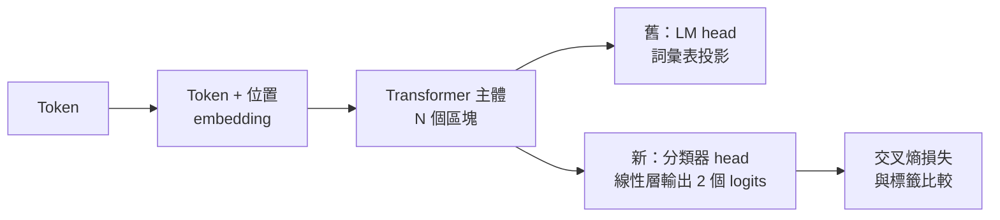
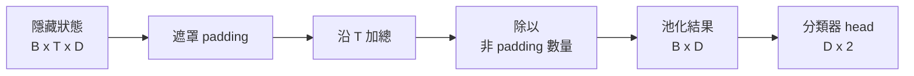
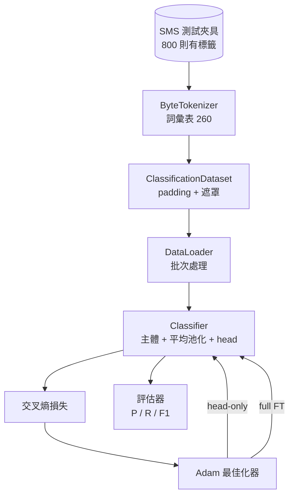

# 專案實戰第 38 課：透過替換預測頭實施分類器 fine-tuning（Capstone Lesson 38: Classifier fine-tuning by Head Swap）

> 這是 Track B 軌道的第一個專案實戰。一個預訓練語言模型是由多層自注意力區塊堆疊、最後以一個 Token 預測頭作為收尾的網路架構。當你的業務目標是辨識垃圾郵件（Spam vs Ham）時，原本的 LM 預測頭顯然用錯了地方，但主幹神經網路所學到的特徵表徵絕大部分依然高度有效。本課將親手把原本的語言預測頭拆除、在池化後的特徵表徵上方直接焊上一個二分類線性投影層，並以兩種完全不同的策略訓練分類器：**僅訓練分類頭（凍結主幹）**與**全量參數 fine-tuning（Full fine-tuning）**。客觀評估依據獨立保留測試集上的精確率（Precision）、召回率（Recall）與 F1 分數。你將深刻領會每一種策略所換取的收益與所背負的代價。

**Type:** Build
**Languages:** Python (torch, numpy)
**Prerequisites:** Phase 19 lessons 30-37 (NLP LLM track: tokenizer, embedding table, attention block, transformer body, pre-training loop, checkpointing, generation, perplexity)
**Time:** ~90 minutes

## Learning Objectives｜學習目標

- 在完全無需重新初始化模型主幹權重的前提下，將語言模型頭替換為下游分類預測頭。
- 實作兩大訓練範式：凍結主幹（僅訓練分類頭）與全量 fine-tuning，兩者共享同一套訓練迴圈。
- 建構感知 Token 特徵的資料管線：支援自動填充 Padding、遮罩計算，以及注意力輸出的特徵池化。
- 直接從模型輸出的原始 Logits 中精確計算精確率、召回率、F1 分數以及混淆矩陣（Confusion Matrix）。
- 在參數量大小、訓練物理耗時與可提升空間之間建立嚴密的工程權衡思維。

## The Problem｜問題

假設你剛剛在通用文字語料庫上預訓練了一個小型 Transformer 模型。該模型的輸出頭負責將最後一層隱藏狀態投影至一個容量為 1000 個 token 的詞彙表中。現在，你手頭上拿到了 800 則標註為垃圾簡訊（Spam）或正常簡訊（Ham）的簡訊，目標是建構一個二分類器。你有三種工程選擇：

最愚蠢的選擇是：拋棄預訓練模型，僅用這 800 條樣本從零隨機初始化並訓練一個全新的分類神經網路。預訓練模型的主幹權重內部早已沉澱了極其寶貴的語言結構知識：單詞身分、位置與簡單的共現關係。粗暴扔掉它，等於親手將先前投入的所有算力預算付之一炬。

兩條正確的工程路徑是：**凍結主幹並僅替換分類頭**，以及**解凍主幹並實施全量參數 fine-tuning**。僅訓練頭部（Head-Only）速度極快、記憶體開銷幾乎為零，且在樣本極少時極少發生過擬合；全量 fine-tuning（Full FT）速度相對較慢、在小樣本上可能過度擬合；當下游領域與預訓練語料差異較大時，準確率可再提高。

本課將並列實作這兩種策略，讓你在完全相同的測試夾具上親眼見證兩者的實測對比。

## The Concept｜核心概念



整個模型可以抽象為函式 `f_theta(tokens) -> hidden_states`。預測頭則是函式 `g_phi(hidden) -> logits`。替換預測頭（Head Swap）的本質就是：保留昂貴的參數集合 `theta`，僅僅將 `g_phi` 替換為全新的二分類線性層。模型主幹集中了絕大多數參數與算力成本，而分類頭僅僅是一個微不足道的單層矩陣。

系統中存在兩組可訓練參數：

- `theta`（模型主幹）：每個注意力區塊包含數萬個權重。
- `phi`（分類預測頭）：僅包含 `hidden_dim * num_classes` 個權重以及偏置項。

在**僅訓練頭部（Head-Only）**模式下，你僅針對 `phi` 計算反向傳播梯度，而對 `theta` 嚴格將梯度置零。PyTorch 允許你透過對主幹參數批次設定 `requires_grad=False` 極速達成此目的。此時最佳化器只會處理分類頭的參數，主幹權重被完美絕對凍結。

而在**全量 fine-tuning（Full Fine-Tuning）**模式下，你允許反向傳播梯度貫穿流經整套神經網路堆疊。主幹權重會隨之進行 fine-tuning，以全力適應下游分類目標。然而在極小資料集上該模式背負著「災難性遺忘（Catastrophic Forgetting）」的風險：主幹中原本習得的通用先驗語言特徵，極易被小樣本的雜訊嚴重沖刷洗白。

## 特徵池化機制的抉擇

語言模型在每一步皆輸出一個向量；但分類器需要的是代表**整個句子序列的單一總體向量**。業界存在三種主流選型：

- **平均池化（Mean pool）**：對整個序列維度上的所有隱藏狀態計算算術平均值，並透過 Attention Mask 強制忽略 Padding 填充項。
- **CLS 專屬標籤池化（CLS pool）**：在文字開頭插入一個特殊 token，並嚴格僅提取該位置的最終輸出。這正是經典 BERT 所採用的標準姿勢。
- **最後 Token 池化（Last-token pool）**：直接取序列中最後一個非 Padding 的有效 Token 輸出向量。這是 GPT 家族解碼器分類時的標準做法。

本課全面採用**帶有注意力遮罩權重的平均池化（Mean Pooling with Attention Mask）**。它在數學上最為簡潔優雅、在不同長度的序列上皆能提供高度平穩的訊號，且完全無需在預訓練階段刻意引入額外的 CLS 特殊 Token。



## 資料集設計

`code/main.py` 以確定性的方式在記憶體中動態合成 800 條短訊樣本，正負樣本嚴格維持 50/50 均衡（400 條 Spam 垃圾簡訊，400 條 Ham 正常簡訊）。生成器鎖定固定隨機種子，挑選語意模板並動態填入槽位詞彙，產出長度在 5 至 25 個 Token 之間的合成短訊內容。真實正式環境資料庫通常包含雜訊，而本測試夾具的核心使命在於 100% 的極致可重現性。

資料集嚴格按照 80/20 進行分層劃分（Stratified Split）：640 條訓練集，160 條測試集。測試集嚴格繼承了 50/50 的正負平衡。在一個平衡且完全獨立保留的測試集上度量，才能確保精確率與召回率反映出最真實的客觀水準。

## 度量指標體系

二分類評估將「類別 1（Spam）」標定為正例。核心統計值：

- `TP`（真陽性）：模型預測為 Spam，且實際確實為 Spam。
- `FP`（偽陽性）：模型預測為 Spam，但實際其實為正常 Ham（誤傷）。
- `FN`（偽陰性）：模型預測為 Ham，但實際其實為惡意 Spam（漏網）。
- `TN`（真陰性）：模型預測為 Ham，且實際確實為正常 Ham。

三大核心頭條指標：

- `precision = TP / (TP + FP)`：在所有被模型標記為垃圾簡訊的樣本中，究竟有多大比例是真正抓對的？（衡量防誤傷能力）。
- `recall = TP / (TP + FN)`：在資料集中所有真實存在的垃圾簡訊中，模型成功揪出了多大比例？（衡量防漏報能力）。
- `F1 = 2 * P * R / (P + R)`：精確率與召回率的調和平均數。

混淆矩陣（Confusion Matrix）以 2x2 網格形式印出這四個原始整數。演示程式在兩種訓練模式結束時皆會向終端機完整輸出該矩陣。

```figure
cap-classifier-head-swap
```

## 系統架構



本課主幹模型刻意採用極致微縮的架構：詞表容量 260、隱藏維度 64、4 個注意力頭、2 個區塊堆疊、最大上下文長度 32。該微縮尺度使得兩種訓練模式皆能在 CPU 上於 90 秒內極速跑至完全收斂。本課程式碼完全自包含：透過內建的 `pretrain_quick` 輔助函式，先在文字語料上快速進行 5 個 Epoch 的自回歸語言模型訓練，為模型主幹賦予非隨機的實質特徵底座。

## 實作內容

所有實作收斂於單一的 `main.py` 與單元測試模組 `code/tests/test_main.py`：

1. `ByteTokenizer`：將原始位元組映射為整數 ID，預留專屬的 Pad ID。
2. `Block`：具備多頭注意力與前饋神經網路的 Pre-LN Transformer 區塊。
3. `LMBody`：包含 token embedding 與 positional embedding，堆疊多個 Block，輸出最後一層隱藏狀態。
4. `MeanPool`：沿著序列維度實施帶有注意力遮罩加權的平均池化。
5. `Classifier`：將主幹、池化層與二分類線性預測頭完整組裝。同一個主幹實例在兩種訓練模式下被重複複用。
6. `freeze_body` 與 `unfreeze_body`：動態開關主幹參數的 `requires_grad` 梯度開關。
7. `train_classifier`：共享的統一訓練迴圈。接收目標模型與針對可訓練參數配置好的最佳化器實例。
8. `evaluate`：在獨立測試集上運作並回傳標準的 `Metrics(precision, recall, f1, confusion)` 資料物件。
9. `run_demo`：快速預訓練主幹，隨後執行僅訓練頭部並評估，接著執行全量 fine-tuning 並評估，並列印出兩份報告，以 0 碼退出。

## 為何這場對比至關重要

僅訓練頭部（Head-Only）模式通常收斂極快，且較能平順地欠擬合。在當前這 800 條樣本的小資料集上，經過 20 個 Epoch 的頭部 fine-tuning 後，你通常能觀察到精確率達到約 0.9、召回率達到約 0.85 的優異成績。而全量 fine-tuning（Full FT）耗費的運算時間約為前者的 3 倍，且受隨機種子波動的影響，整體表現通常僅差幾個百分點。

本課的目的絕非強行欽定某一個策略為永久贏家。它傳授的是閱讀客觀指標與精算工程成本的底層洞察力：在 800 條極小資料集與微型模型上，僅訓練分類頭是較合適的選擇；而在 8 萬條資料與大型模型上，全量 fine-tuning 開始有優勢。而你在本課中所帶走的，是一套統一的程式碼抽象——同一個 `train_classifier` 函式處理兩者，只需透過單次調用即可無縫切換。

## 進階延伸挑戰

- 實作第三種折衷模式：**僅解凍最後一個 Transformer 區塊（Partial Fine-Tuning）**。其成本低於全量 fine-tuning，但學到的內容比僅訓練分類頭更多。
- 引入學習率排程器（Scheduler）：在分類頭上施加較大的學習率與餘弦退火，在模型主幹上施加極其微小且平穩的學習率，這是正式環境常見的 fine-tuning 設定。
- 將平均池化替換為可學習的注意力池化（Attention Pool）：引入一個可學習的單一 Query 向量對整個序列進行注意力檢索。在長文本序列分類任務上，該方案通常優於樸素的平均池化。

本實作提供了所有必要的擴充錨點。單元測試鎖定了底層合約。量化指標的極限，由你親手推高。
