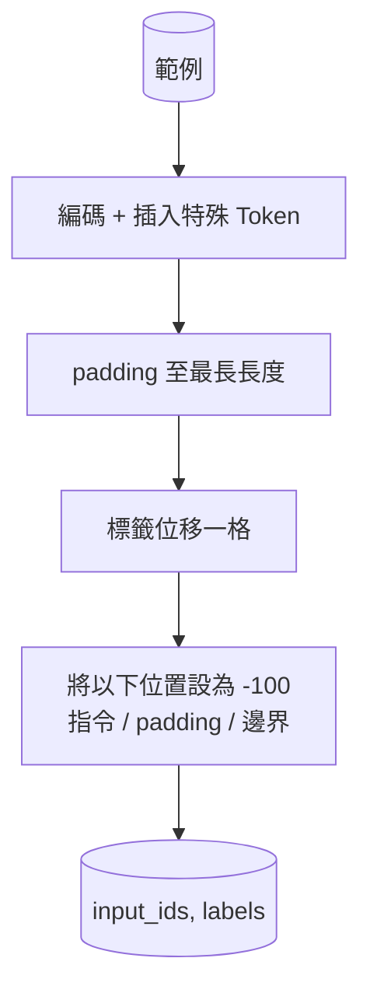

# 專案實戰第 39 課：透過監督式 fine-tuning 實施指令 fine-tuning（Capstone Lesson 39: Instruction Tuning by Supervised Fine-Tuning）

> 預訓練底座模型擁有強大的文字接續能力，但對「遵循人類指令」一無所知。監督式 fine-tuning（SFT）是用於修正該缺陷的最精簡實用技術：向模型餵入「指令—回答」配對樣本，並訓練神經網路預測回答部分的 Token。關鍵在於：**損失函數必須且僅能計算回答部分，而嚴格對指令部分實施梯度遮罩**。本課將親手實作 Alpaca 風格的 SFT 訓練迴圈，編寫自定義的 Collate 批次組裝函式，使用 `ignore_index=-100` 精確遮罩指令 Token，在包含 200 組指令—回答配對的語料上訓練，並在獨立保留測試集上使用精確匹配率（Exact-Match）進行驗收。

**Type:** Build
**Languages:** Python (torch, numpy)
**Prerequisites:** Phase 19 lessons 30-37 (NLP LLM track: tokenizer, embedding table, attention block, transformer body, pre-training loop, checkpointing, generation, perplexity)
**Time:** ~90 minutes

## Learning Objectives｜學習目標

- 將「指令—回答」配對資料格式化為帶有明確特殊邊界標籤的單一自回歸序列。
- 建構專屬的 Collate 批次組裝函式，精確遮罩指令 Token，使交叉熵損失僅作用於回答 Token。
- 在 SFT 目標下執行 fine-tuning，訓練微型 Transformer 主幹，觀察評估指標的變化。
- 實作嚴格遵循「回答起始邊界（Response-Start Boundary）」的貪婪搜尋與溫度取樣生成演算法。
- 在獨立保留測試集上，對模型生成的回答精確計算 Exact-Match（精確匹配率）指標。

## The Problem｜問題

一個純粹基於「預測下一個 Token」訓練出來的底座模型，在認知上根本不知道什麼叫做「指令（Instruction）」。若你向它輸入 `"What is the capital of France?"`，它很可能會繼續拋出下一個疑問句，或者胡亂捏造一段無關的散文。模型雖然掌握了語言語法，但完全缺乏遵循對話格式的「合約精神」。

SFT 的底層合約是一份結構化的字串模板。每一個訓練樣本皆被格式化為包含三大連續區間的單一序列：

```text
<INST> What is the capital of France? <RESP> The capital of France is Paris.
```

邊界標記是預先在詞表中註冊好的特殊 Token。模型在訓練過程中逐漸學會：位於 `<RESP>` 之後的內容才是它必須輸出的答案，且只有這部分回答會被外界打分。底座模型的自回歸目標並未改變，改變的是它所見到的語料全部被規範化為這種形態。

但這裡存在一個致命的工程陷阱：如果你將整條序列直接扔進樸素的交叉熵損失函數中，你實質上是在訓練模型去預測指令內部的詞彙！然而在真實線上運作時，指令是由使用者直接傳入的已知條件。你絕對不希望浪費寶貴的參數容量去學習預測人類輸入。唯一的正確解法是：**損失遮罩（Loss Masking）**。

## The Concept｜核心概念


`ignore_index` 是 PyTorch `torch.nn.functional.cross_entropy` 的一項關鍵特性。在計算損失時，目標標籤張量中凡是數值等於 `ignore_index` 的位置，其產生的損失與反向傳播梯度精確為零。PyTorch 的業界通用慣例是將其設為 `-100`。Collate 批次組裝函式為每個樣本打造兩個核心張量：`input_ids`（傳入模型的完整輸入序列）與 `labels`（`input_ids` 的副本，並將指令位置覆寫為 `-100`）。

在前向傳播時，模型能完整看見整條序列；自注意力機制可以毫無阻礙地回顧指令內容。但損失函數與梯度更新嚴格僅計算回答部分。這正是教科書級的標準狀態：**以指令為條件，以預測回答為目標**。

## 資料集設計

`main.py` 以確定性方式合成 200 組「指令—回答」配對，全面覆蓋六大核心任務類型：

- 事實型單輪問答（例如：某國的首都在哪裡）
- 基礎算術運算
- 實體清單提取
- 單句摘要提煉
- 基礎程式碼編寫（print、sort 等）
- 概念名詞定義

每個任務皆具備結構化的指令模板與確定性的標準答案。在教學實作中刻意維持格式簡潔。雖然真實世界中的 SFT 資料集需要模糊指標，但本測試夾具的核心使命在於 100% 確定性地驗證訓練合約的正確性。

資料集嚴格按照 160 條訓練集與 40 條測試集進行切分。測試集完整覆蓋了所有六大任務類型，使我們能夠在測試報告中逐一按分類呈報精確匹配率。

## Tokenization 與動態填充

本課採用位元組級 tokenizer，並預留三個專屬特殊 Token：

- `INST_ID = 256`：標記指令區間的開始。
- `RESP_ID = 257`：標記指令與回答的實體交界線。
- `PAD_ID = 258`：用於對齊變長批次的填充標籤。

標準序列形態為：`[INST] inst_bytes [RESP] resp_bytes [PAD]*`。Collate 函式的具體組裝流程如下：

1. 對每個樣本分別執行 tokenization。
2. 將當前 Batch 內的所有樣本，統一動態 Padding 填充至該 Batch 中最長樣本的物理長度。
3. 建構因果標籤張量：`labels` 為 `input_ids` 向左平移一位的副本，並施加遮罩：
   - 將對應指令文字的所有位置強制覆寫為 `-100`。
   - 將對應 Padding 填充的所有位置強制覆寫為 `-100`。
   - 將 `RESP_ID` 邊界標籤本身的位置同樣強制覆寫為 -100（因為你不需要訓練模型去預測這個固定的邊界符號，它只需預測符號後面的內容）。



平移操作是經典的自回歸訓練技巧：`input_ids` 的位置 `i` 用於預測位置 `i+1`，因此 `labels[i] = input_ids[i+1]`。遮罩在平移後施加，以對準正確的位置。

## 訓練迴圈


訓練迴圈遵循標準的 PyTorch SFT 範式。使用 Adam 最佳化器，學習率設定在 3e-4 至 1e-3 之間，在此測試夾具上訓練 10 至 20 個 epoch。模型主幹足夠輕巧（隱藏維度 96、2 個區塊、最大長度 64），在 CPU 上僅需 2 分鐘即可達到收斂。

每隔 5 個 Epoch，迴圈在獨立保留測試集上執行微型評估，並即時印出 Exact-Match 精確匹配率。親眼看著該指標從 Epoch 1 時的 0.0 逐步攀升至 Epoch 15 時的約 0.85，正是本專案實戰最激動人心的時刻：你親眼見證了模型在同一時間既學會了對話格式合約，又精準記住了各類任務的事實知識。

## 自回歸推論生成

在評估推論時，大模型接收指令前綴：`[INST] inst_bytes [RESP]`，隨後自回歸逐字生成 Token，直到滿足以下任一終止條件：

- 生成的序列長度達到設定的 `max_len` 上限；
- 模型產生啟發式停止條件：連續兩個句尾符號（`.`、`!`、`?`）。

本課實作了貪婪解碼（Greedy）與可選的溫度取樣器。在計算 Exact-Match 時強制使用貪婪搜尋，確保評估指標具備 100% 的確定性與客觀性。第四十一課將深入探討帶取樣的高階評估體系。

## 精確匹配率評估

Exact-Match（EM）是文字生成領域中最為嚴苛的死板硬指標。系統將模型生成的預測回答字串進行標準化清理（全量轉小寫、去除首尾空白、合併連續空格），並與經過完全相同清理的標準答案字串進行嚴格字元級比對。單樣本得分非 0 即 1。全局指標即為所有測試樣本的算術平均值。

工業級 SFT 管線通常會將 Exact-Match 與 Token 級 F1（第四十一課）以及 LLM 裁判相互結合。但 Exact-Match 依然是無可替代的第一基石：當它報告 0.7 時，這意味著 70% 的測試題目被模型一字不差地精準答對。

```figure
cc-sft-loss-mask
```

## 實作內容

所有實作收斂於單一的 `main.py` 與附帶測試模組：

1. `InstructionTokenizer`：支援保留特殊標籤的位元組級編碼器。支援編碼純指令前綴或完整的「指令—回答」配對。
2. `make_dataset`：鎖定隨機種子，在六大任務維度上合成 200 組指令—回答配對。
3. `SFTDataset`：封裝底層資料，為每個樣本提供準備好遮罩的 `(input_ids, labels)`。
4. `sft_collate`：動態批次 Padding 填充，建構 Batch 張量，並精確將 `-100` 寫入指令與 Padding 位置。
5. `TinyGPT`：微型 Transformer 主幹，包含 Token embedding、位置 embedding 與權重可綁定或不綁定的 LM Head。
6. `train_sft`：標準 SFT 訓練迴圈，具備逐 Epoch 的評估鉤子。
7. `generate`：自指令前綴出發的因果自回歸解碼器，支援貪婪與取樣模式，內建終止條件。
8. `exact_match`：字串標準化比對函式，回傳 `[0, 1]` 浮點數。
9. `run_demo`：合成資料、訓練 20 個 Epoch、執行評估、印出按分類細分的得分報告，以 0 碼退出。

## 為何遮罩生死攸關

若缺乏 `-100` 損失遮罩，交叉熵損失會將指令 Token 視為學習目標。模型將被迫耗費巨大的參數量去學習「如何複誦人類的提問」。這直接引發兩大致命後果：第一，寶貴的模型容量被無端浪費在重構人類早已提供的已知輸入上；第二，在大多數對話樣本中，指令 Token 數多於回答 Token 數；若不施加遮罩，指令部分的損失會使模型在「回答部分」上的有效學習率低於預期。**遮罩絕非無足輕重的微小修飾，它就是 SFT 的靈魂本身**。

## 進階延伸挑戰

- 引入學習率預熱與餘弦退火排程器。在 fine-tuning 階段，模型對學習率波動的敏感度遠遠高於預訓練階段。
- 實作 Token 級別的損失記錄，繪製訓練過程中的損失曲線。你將觀察到：在最初的幾個 Epoch 中，損失下降主要由模板標籤（`<RESP>`、常見開頭詞）所主導；而在後續階段，模型才真正開始消化實質答案中的關鍵 Token。
- 將評估體系擴充至 BLEU-1 或 chrF。當模型輸出了一句意思完全正確但換了同義詞的表達時，Exact-Match 會嚴厲判定為 0 分，而模糊指標能給出更公允的畫像。
- 引入支援多輪對話的 Chat 模板，在包含追問互動的複雜測試夾具上重新訓練並驗收。

本實作交付了標準的格式合約、損失遮罩與訓練控制迴圈。將一個底座模型徹底蛻變為聽話的指令遵循者，其核心本質全在於這一個精妙的 Collate 函式之中。
