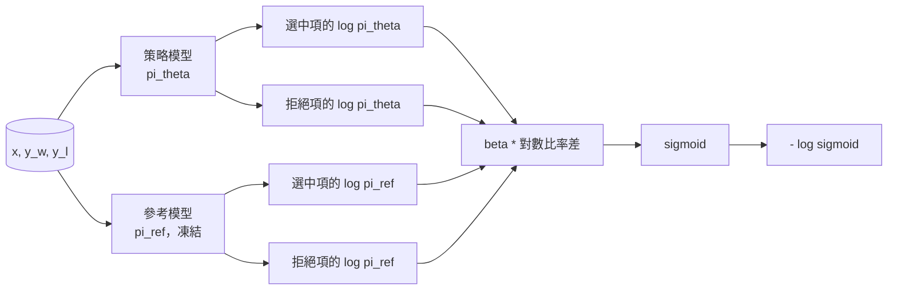
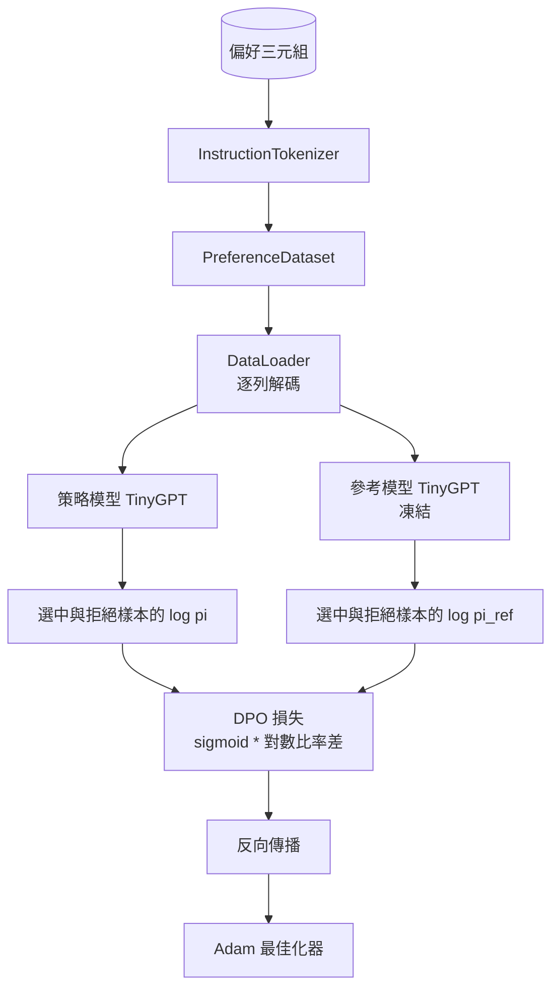

# 專案實戰第 40 課：從零打造直接偏好最佳化（Capstone Lesson 40: Direct Preference Optimization from Scratch）

> 獎勵模型（Reward Model）與 PPO 演算法構成了傳統 RLHF 的經典技術堆疊。而直接偏好最佳化（DPO）則以極具數學美感的方式，將該重型堆疊直接坍縮為單一的有監督損失函數，驅動策略模型直接在人類成對偏好資料上完成擬合。本課將從獎勵差異恆等式出發親自推導 DPO 損失公式、組裝一個凍結的參考模型（Reference Model）與一個可訓練的策略模型（Policy Model）、計算逐 token 對數機率，並在包含選中（Chosen）與拒絕（Rejected）樣本的偏好測試集上微型訓練 Transformer。單元測試鎖定了損失公式的數學嚴密性與梯度符號方向，確保你的實作與原始論文完全一致。

**Type:** Build
**Languages:** Python (torch, numpy)
**Prerequisites:** Phase 19 lessons 30-37 (NLP LLM track: tokenizer, embedding table, attention block, transformer body, pre-training loop, checkpointing, generation, perplexity)
**Time:** ~90 minutes

## Learning Objectives｜學習目標

- 推導 DPO 損失函數：將其理解為作用於縮放對數比率差值（Scaled Log-Ratio Difference）上的 Sigmoid 函式，並深刻理解其與隱式獎勵（Implicit Reward）的內在聯繫。
- 建構「參考模型 + 策略模型」雙模架構：參考模型保持絕對凍結，策略模型承擔動態參數更新。
- 在兩個模型下精準計算序列級別的對數機率（Log-Probabilities），並嚴格遮罩 prompt 區間。
- 在 `(prompt, chosen, rejected)` 三元組偏好資料上訓練策略模型，親眼見證 Chosen 的對數機率相對於 Rejected 出現顯著攀升。
- 透過單元測試嚴密驗證損失數學計算、反向傳播梯度方向符號，以及參考模型的絕對不變性。

## The Problem｜問題

假設你手中已經擁有了一個 SFT 模型。它固然能夠聽懂並遵循指令，但輸出品質卻良莠不齊：有些回答精煉準確，有些回答卻囉嗦冗長甚至夾雜細微的事實錯誤。同時，你收集到了一個微型的人類成對偏好資料集：針對同一個 Prompt 提問，人類標註員明確挑選出了一個優質回答（Chosen）並標記了另一個劣質回答（Rejected）。

傳統 RLHF 的標準解法是一個極其繁瑣的兩階段管線：首先在成對偏好資料上訓練一個獨立的標量獎勵模型（Reward Model）；隨後使用強化學習 PPO 演算法，以獎勵模型為標靶對策略模型進行策略梯度最佳化。該路徑雖然可行但極度昂貴且脆弱：在 PPO 訓練期間記憶體中必須同時常駐兩個模型、必須引入嚴苛的 KL 散度懲罰以防策略模型偏離 baseline 過遠，且獎勵模型脆弱時會出現「獎勵作弊（Reward Hacking）」。

DPO 徹底顛覆了這一範式。它將上述兩階段合二為一，用單一的有監督損失函數全面取代了 PPO。獎勵模型在物理上根本不再顯式存在！策略模型直接在成對偏好資料集上接受監督式梯度更新，且底層隱式具備朝向 SFT 參考模型的嚴格 KL 約束。在 Bradley-Terry 偏好假設下，DPO 與 PPO 擁有完全相同的理論最優解，但所需程式碼少得多。

## The Concept｜核心概念

推導從經典的 Bradley-Terry 偏好模型出發。給定一個 prompt `x` 以及兩個候選回答 `y_w`（勝出者 Chosen）與 `y_l`（落敗者 Rejected），人類偏好 `y_w` 的機率滿足：

```text
P(y_w > y_l | x) = sigmoid( r(x, y_w) - r(x, y_l) )
```

其中 `r` 為某個潛在的真實獎勵函數。傳統 RLHF 首先擬合 `r`，隨後尋求最優策略 `pi` 以最大化 `r` 並抑制 KL 散度：

```text
max_pi   E_{x, y~pi} [ r(x, y) ] - beta * KL(pi || pi_ref)
```

DPO 的開創性洞察在於：在上述最佳化目標下，最優策略 `pi*` 存在以 `r` 表達的閉式解析解（Closed Form）：

```text
pi*(y | x) = (1/Z(x)) * pi_ref(y | x) * exp( r(x, y) / beta )
```

將該等式對 `r` 進行代數重排求解：

```text
r(x, y) = beta * ( log pi*(y | x) - log pi_ref(y | x) ) + beta * log Z(x)
```

注意：`log Z(x)` 同時適用於 `y_w` 與 `y_l`，因為它取決於 `x` 而非 `y`，所以在計算偏好差異時會抵消：

```text
r(x, y_w) - r(x, y_l) = beta * ( log pi_theta(y_w|x) - log pi_ref(y_w|x)
                                - log pi_theta(y_l|x) + log pi_ref(y_l|x) )
```

將該差值直接代入 Bradley-Terry Sigmoid 公式中，並在所有偏好對上取 negative log-likelihood，即得到了舉世聞名的 DPO 損失函數：

```text
L_DPO(theta) = - E_{(x, y_w, y_l)} [
  log sigmoid( beta * ( log pi_theta(y_w|x) - log pi_ref(y_w|x)
                       - log pi_theta(y_l|x) + log pi_ref(y_l|x) ) )
]
```

這就是全部的損失！每個樣本的損失僅僅是一個基於四個對數機率數值計算出的單純標量。沒有獨立的獎勵模型，沒有複雜的 PPO Actor-Critic 網路，損失中亦無需顯式計算 KL 散度項——因為 KL 約束早已在解析推導中被完美融合進了公式內部。



## 梯度的方向符號驗證

在啟動任何真實訓練前，先進行一道極其關鍵的數學理性檢查。我們計算損失相對於 `log pi_theta(y_w | x)` 的偏導數：

```text
d L_DPO / d log pi_theta(y_w | x) = - beta * (1 - sigmoid(z))
```

其中 `z` 為 Sigmoid 的輸入。對所有 `z`，此梯度皆為負數，這表示：**調高策略模型對 Chosen 優質回答的生成對數機率，將會降低全局損失值**。相對地，損失相對於 `log pi_theta(y_l | x)` 的梯度為正：提高 Rejected 劣質回答的對數機率會增加損失。訓練會提高 Chosen 的機率、降低 Rejected 的機率；參考模型（Reference）保持凍結，不會更新。

## 資料夾具設計

本課內建了 12 組精心設計的偏好三元組 `(prompt, chosen, rejected)`。Chosen 回答精煉準確；Rejected 回答則冗長囉嗦、文不對題或夾帶事實錯誤。這些樣本橫跨第三十九課的經典任務族（首都、算術、清單提取），使一個原本具備 SFT 基礎的微型模型能夠在乾淨的起點上無縫啟動對齊。

本測試夾具刻意保持微縮規模。在正式環境生產中，DPO 通常在數萬對偏好樣本上訓練；而在本課中，核心目標是讓損失數學計算與控制迴圈在微型資料上極速端到端跑通，並可觀察到 Chosen 與 Rejected 之間的對數機率差距擴大。

## 參考模型的不變性約束

DPO 的工程實作必須以極其嚴苛的態度守護參考模型（Reference Model）。參考模型是 SFT 模型的完美靜態快照。必須百分之百保證以下三項不變性性質：

- 參考模型的所有參數**絕對不允許接收任何反向傳播梯度**。
- 參考模型在各個 Epoch 之間計算出的對數機率**絕對不允許發生任何漂移變動**。
- 策略模型在初始化時**必須嚴格拷貝自參考模型的完全相同權重**（理論上最優參數 `theta` 是在參考模型基礎上學出的增量漂移；以參考模型為起點是最具嚴密定義的初始狀態）。

系統在程式碼層面透過以下三道鎖落實上述約束：

- 在調用參考模型進行前向傳播時，強制套上 `torch.no_grad()` 上下文。
- 對參考模型的所有參數，無一例外顯式設定 `requires_grad=False`。
- 在參考模型實例化完畢後，透過 `policy.load_state_dict(reference.state_dict())` 完成策略模型的精確深拷貝初始化。

```figure
cap-dpo-preference
```

## 系統架構



底層模型採用與第三十九課完全同構的 TinyGPT（純 Decoder 架構、因果自回歸、位元組級 tokenizer）。參考模型與策略模型共享完全相同的網路骨架；在訓練推進過程中，策略模型的權重逐漸遠離參考模型，而參考模型自身則如磐石般紋絲不動。

## 實作內容

所有實作收斂於單一的 `main.py` 與對應的測試套件：

1. `InstructionTokenizer`：帶有 `INST` 與 `RESP` 特殊標籤的位元組 tokenizer，架構與第三十九課完全一致。
2. `TinyGPT`：純解碼器 Transformer 模型，程式碼自包含。
3. `make_preferences`：回傳 12 組標準的 `(prompt, chosen, rejected)` 三元組偏好資料。
4. `sequence_log_prob` 核心函式：傳入模型、Prompt 前綴與回答文本，精確計算並回傳回答部分各 token 的 next-token 對數機率總和（嚴格排除 Prompt 區間的任何干擾）。
5. `dpo_loss` 核心損失函式：接收四個對數機率與超參數 `beta`，回傳單樣本的損失張量以及用於記錄的隱式獎勵增量數值。
6. `train_dpo`：標準訓練迴圈，在每個步驟中計算策略與參考模型在勝出者與落敗者上的四組對數機率，施加 DPO 損失，驅動 Adam 最佳化器更新。
7. `evaluate_margins` 評估函式：在任意給定時間點，計算並呈報策略模型在 Chosen 與 Rejected 之間的平均對數機率邊際差值（Margin）。
8. `run_demo`：快速預熱預訓練底座模型、克隆為策略與參考模型、執行 30 步 DPO 訓練、印出逐步損失值與邊際擴大趨勢，以 0 碼退出。

## 為何 DPO 具備強大威力

在 Bradley-Terry 偏好模型假設成立的前提下，DPO 與經典 RLHF 在獎勵的參數化上有所差異，但兩者等價。其底層所對應的隱式獎勵為 `r(x, y) = beta * (log pi(y|x) - log pi_ref(y|x))`。該獎勵可由偏好識別，最多只差一個 `x` 的函式，而此差異會在差值中抵消。閉式解直接消除了對顯式獎勵模型的依賴。而 KL 散度約束則在結構層面得到了自適應的天然保護：一旦策略模型 `pi` 偏離參考模型 `pi_ref` 過遠，對數比率差值將急劇擴大，使得 Sigmoid 函式迅速滑入飽和平坦區，因此當策略模型偏離過遠時，梯度會受到抑制，減緩策略模型進一步偏離。**參考模型就是你的終極安全防護網**。

## 進階延伸挑戰

- 為對數機率總和引入長度正規化（Length Normalization）：將總 Log-prob 除以回答文本的長度。長度偏見（Length Bias）是經典 DPO 的一項已知失效模式，模型往往會投機取巧地偏愛極端簡短的回答，僅僅因為短文本在絕對數值上的累計負對數機率天然較小。
- 實作 IPO（Identity Preference Optimization）損失變體：將原本的 Sigmoid + Log 結構替換為 `(z - 1)^2` 的均方誤差形式。對比兩者在測試夾具上的收斂速度。
- 引入標籤平滑（Label Smoothing）參數：在硬性的勝負標籤與均勻的 0.5 之間實施平滑插值。
- 將參考模型替換為一個參數規模更小、推論成本更低的輕量級模型（展現模型知識蒸餾 Distillation 的變體風味）。

本實作交付了標準的損失公式、嚴格的參考不變性保護，以及完整的對齊訓練迴圈。數學推導是靈魂，可運作的程式碼是真理。
