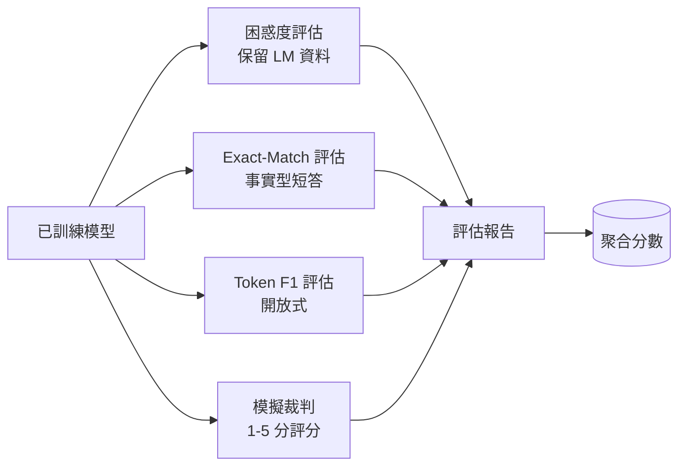
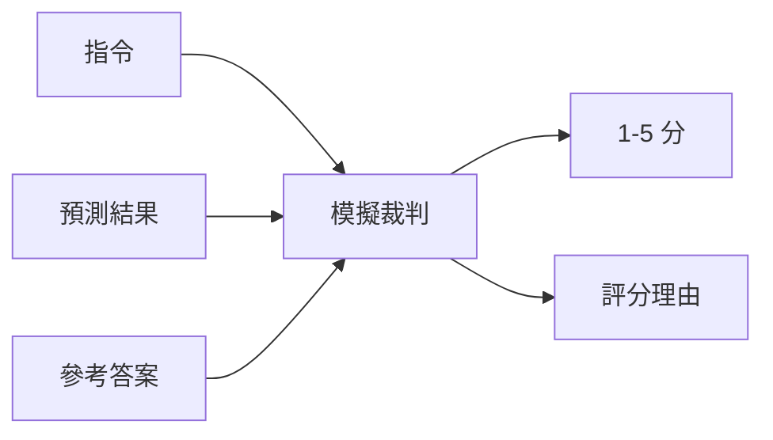
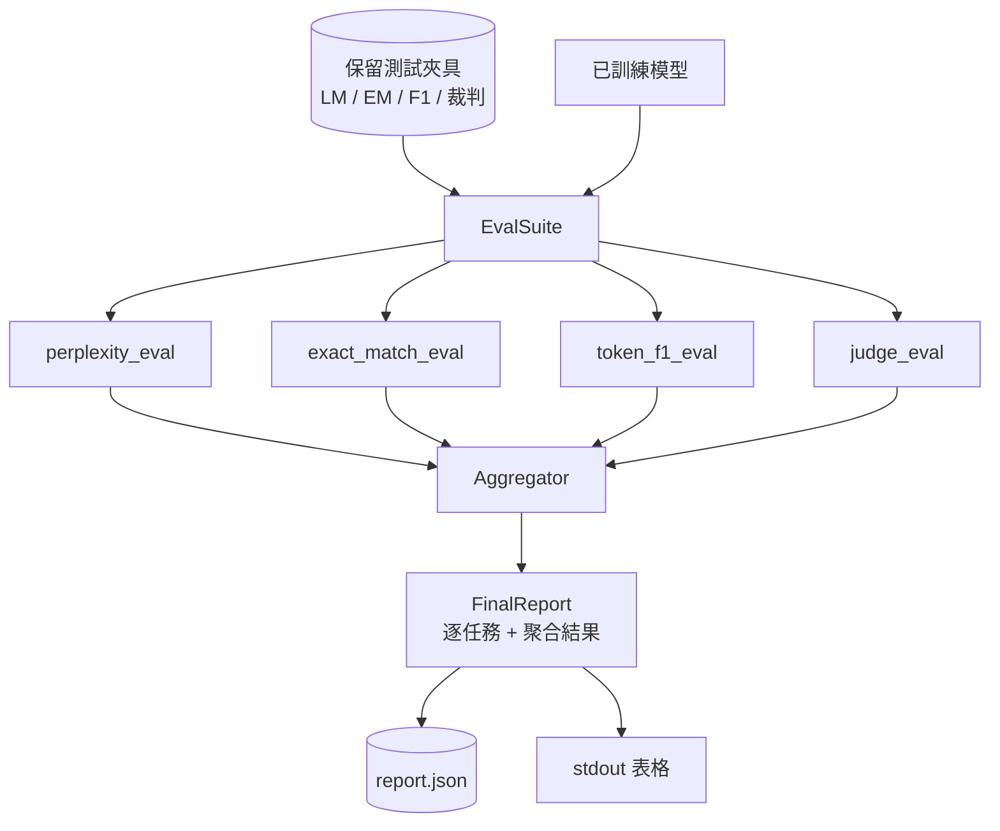

# 專案實戰第 41 課：全維度綜合評估管線（Capstone Lesson 41: Full Evaluation Pipeline）

> 模型的訓練進展可以藉由損失函數曲線進行即時監控；而模型的真實能力評估，則必須仰賴架構師親手精心設計。本課將親手打造一套統一的評估管線（Eval Pipeline）：接收任意已訓練語言模型，並對其執行四項不同類型的評估，將測試結論動態聚合為包含逐任務細項的綜合報告，並內建一套本機離線運作的 Mock「LLM 裁判（LLM-as-a-Judge）」，確保全套評估無需聯網即可自閉環運作。這四大維度涵蓋了任何準備交付的模型所需的核心面向：語言建模能力（困惑度 Perplexity）、短文本事實精確度（Exact-Match）、開放式語意相似度（Token F1），以及定性綜合評分（LLM-as-a-Judge）。

**Type:** Build
**Languages:** Python (torch, numpy)
**Prerequisites:** Phase 19 lessons 30-37 (NLP LLM track: tokenizer, embedding table, attention block, transformer body, pre-training loop, checkpointing, generation, perplexity)
**Time:** ~90 minutes

## Learning Objectives｜學習目標

- 在微型 Transformer 模型上，嚴密扣除 Padding 填充 Token，精確計算獨立保留語料上的困惑度（Perplexity）。
- 針對短文本事實型 prompt，執行標準的 Exact-Match（精確匹配率）評估。
- 在預測文本與標準答案之間，透過正規化清洗精準計算 Token 級別的 F1 分數。
- 建構本地離線 Mock LLM 裁判，依據結構化規則為模型回答出具 1 至 5 分的客觀評分與仲裁依據。
- 將四大評估維度加權聚合為單一的總合報告，並輸出逐題細分清單。

## The Problem｜問題

任何單一維度的度量指標，皆永遠無法完整描摹一個大語言模型的真實畫像。困惑度（Perplexity）固然能揭示模型在底層文字機率分佈上的擬合程度，但它完全無法告訴你該模型是否具備回答人類問題的實用能力；Exact-Match（精確匹配）能精準度量模型是否一字不差地吐出了黃金標準答案，但它會對完全正確的同義詞改寫施加殘酷的零分懲罰；Token F1 寬容包容了同義句改寫，但若回應表面詞彙重疊度高、核心內容卻有誤，也可能遭到誤導；LLM 裁判能捕捉定性面向，但呼叫大模型 API 既昂貴且充滿隨機波動。

真正成熟的工業級評估管線，必須同時兼具這四大維度。每個評估維度皆精確覆蓋其餘三者所遺漏的盲區；每個維度皆在專門為該指標量身訂製的獨立保留資料集上執行。最終產出的綜合報告將各任務的細項指標與加權總分並列呈現，讓技術審查人員能一眼看穿該模型在各項工程指標之間究竟做出了何種權衡妥協。

本課將在單一檔案內，端到端完整建構這套工業級評估管線。

## The Concept｜核心概念



每一個具體的評估模組本質上皆是一個符合 `(model, dataset) -> EvalResult` 簽名的函式。回傳的結果物件攜帶具體的量化數值、逐題詳細診斷記錄，以及在全局聚合中所使用的指標名稱。管線透過一份設定進行編排調度，宣告執行哪些具體評估以及如何分配權重權衡。

## 困惑度的嚴密計算

困惑度的數學定義為：`exp(mean negative log-likelihood per token)`。在具體工程實作中存在兩大經典陷阱：

- 分母中的 Token 計數必須嚴格基於**真實有效的 Token 物理位置**，而絕對不能直接粗暴除以 batch * sequence。Padding 填充 Token 必須在分母中被嚴格排除，否則算出的困惑度會虛假偏低，嚴重美化模型表現。
- 自回歸模型會預測 next token，因此位於位置 `i` 處的 Logits 預測的是位置 `i+1` 處的標籤。在此處發生的任何差一錯誤（Off-by-one）皆是極其不易察覺的：訓練損失可能看似正常下降，但算出的困惑度指標卻徹底失去了物理意義。

本課評估模組在每個批次中分別累加所有非 Padding 位置的 `-log p(token)` 總和以及真實有效 Token 總數，最後在全域進行單次除法並取指數。這種做法在數值計算上遠比在批次維度簡單平均每個 Batch 的困惑度更為嚴密安全（後者會嚴重低估短文本的權重），完全符合經典教科書定義。

## 帶有正規化清洗的精確匹配

評測工具在進行字串比對之前，首先對模型預測文字與標準參考答案實施雙向正規化清洗：

- 全量轉換為小寫字元。
- 剝離首尾的所有空白字元。
- 將連續的多個空格合併為單一空格。
- 若兩者僅差在句尾標點符號，自動忽略末尾標點（`.`、`!`、`?`）。

經過正規化清洗後的 Exact-Match 才能在真實工程中具備實用意義。模型回答 `"Paris"` 是對的；回答 `"Paris."` 同樣是對的；回答 `"  paris  "` 亦是對的。但在正規化之後，指標依然嚴厲要求兩者的核心字串必須維持字元級別的一致。

## 正確的 Token 級 F1 計算

Token F1 是基於詞袋（Bag-of-tokens）計算出的精確率與召回率的調和平均數。具體計算步驟：

1. 對預測文字與標準答案實施正規化清洗（採用與 Exact-Match 完全相同的規則）。
2. 使用空白字元將句子拆分為離散的 Token 詞彙清單。
3. 計算兩者在多重集合（Multiset）意義下的交集元素個數。
4. Precision = `intersection_count / len(pred_tokens)`；Recall = `intersection_count / len(ref_tokens)`；F1 為兩者的調和平均。

若預測文字與標準答案皆為空，F1 定義為 1（平凡匹配）；若僅有一方為空，F1 定義為 0。此模式與 SQuAD 評估參考實作相符，能夠在面對同義句改寫時提供高度平穩客觀的連續評分。

## 本地離線 Mock LLM 裁判

在真實生產中，裁判角色通常交由雲端前沿旗艦大模型擔任。但在本課中，評估流程必須具備離線自閉環運作的能力。我們打造了一個確定性的本地 Mock 裁判函式：接收使用者的提問指令、模型的預測回答與標準答案，回傳 `{1, 2, 3, 4, 5}` 的離散整數評分以及一句具體的仲裁理由。其內部評分規則完全確定：

- 5 分：當清洗後的預測文字與標準答案完全一致。
- 4 分：當預測文字與標準答案之間的 Token F1 分數至少 0.8。
- 3 分：當 Token F1 分數落在 `[0.5, 0.8)` 區間。
- 2 分：當 Token F1 分數落在 `[0.2, 0.5)` 區間。
- 1 分：其餘所有情形。

雖然它只是一個確定性模擬器，但它暴露了與真實大模型裁判完全同一的呼叫介面。在未來正式環境中，只需更換該函式內部的實作，整條評估管線無需更動任何一行程式碼。



## 加權聚合評分機制

總合得分是經過正規化處理後的各項評估分數的加權平均數。每個評估模組首先將自身的指標數值正規化為 `[0, 1]` 區間內的浮點數：

- 困惑度：透過 `1 / (1 + log(perplexity))` 進行非線性映射。困惑度為 1 映射至滿分 1，困惑度為無窮大映射至 0。
- 精確匹配率（EM）：本身已天然落在 `[0, 1]` 區間。
- Token F1：本身已天然落在 `[0, 1]` 區間。
- LLM 裁判：將 1 至 5 分的得分除以 5 進行歸一化。

權重比例可完全自由配置。系統預設的經典權重組合為：困惑度佔 0.2、精確匹配佔 0.3、Token F1 佔 0.3、LLM 裁判佔 0.2。權重的分配屬於產品決策層面；本課為其提供了開箱即用的調節旋鈕。

```figure
cg-eval-quadrant
```

## 系統架構



`EvalSuite` 是一個輕量級的流程編排器。每個獨立評估模組皆為獨立函式，接收 `(model, tokenizer, dataset, config)` 並回傳 `EvalResult`。`Aggregator` 負責匯總所有結果並編譯出最終的綜合審查報告。演示程式在終端機印出漂亮的排版表格，並同步落盤一份 JSON 副本，供下游 CI 門禁系統自動化解析。

## 實作內容

所有實作收斂於單一的 `main.py` 與附帶單元測試模組：

1. `TinyGPT`：與第三十八至四十課完全一致的純解碼器模型架構，程式碼自包含。
2. `InstructionTokenizer`：支援 INST / RESP / PAD 特殊標籤的位元組 tokenizer。
3. 四大測試夾具：語言模型語料庫、EM 測試集、F1 測試集以及裁判測試集。每個集合包含 20 道確定性題目。
4. `perplexity_eval`：回傳包含困惑度數值與單 Token 損失直方圖的 `EvalResult`。
5. `exact_match_eval`：回傳平均 EM 分數與逐題詳細診斷記錄。
6. `token_f1_eval`：回傳平均 Token F1 分數與逐題詳細診斷記錄。
7. `mock_judge` 與 `judge_eval`：出具逐題得分與評判理由，呈報全集平均得分。
8. `Aggregator.normalise`：針對各維度指標的專屬正規化映射規則。
9. `Aggregator.aggregate`：加權求和邏輯與最終報告組裝器。
10. `run_demo`：快速微型訓練一個模型、執行四大評估、在終端機輸出排版表格並寫出 JSON 檔案，以 0 碼退出。

## 報告的閱讀層級

輸出的評估報告具備清晰的三層結構：最頂層是綜合加權總分（Aggregate Score）；中層是四大核心評估維度的各自量化指標；最底層則是面向深度排障的逐題詳細記錄。日常 CI 管線通常只需監控頂層加權得分；而當工程師追查某次變更引發的局部退化時，底層的逐題記錄能精確告訴你究竟是哪幾道提問被模型答錯。

JSON 格式的報告採用穩定不變的 Key 定義，方便監控儀表板繪製跨版本的歷史走勢曲線；而終端機印出的排版表格，則是供工程師在訓練結束時第一時間肉眼快速掃描的直觀視窗。

## 進階延伸挑戰

- 引入校準度評估（Calibration Eval）：模型輸出的 Softmax 機率信心是否與其實際正確率相吻合？將預測結果按信心分桶，呈報每個區間的經驗準確率。
- 引入強健性評估（Robustness Eval）：為測試題目注入人為擾動（拼寫筆誤、同義改寫、干擾性無關修飾），度量指標在面對擾動時的回撤幅度。
- 將 Mock 裁判替換為真實的雲端旗艦模型 API 呼叫。函式呼叫介面完全保持不變。
- 實作按任務動態權重學習：不再使用寫死的靜態權重，而是依據目標偏好排序動態擬合最優權重係數。

本實作交付了完整的四大評估模組、聚合器與最終報告生成體系。工業級大型評估管線只不過是在此基礎上擴展了更多業務維度；其底層設計模式始終如一：一個評估對應一個函式、一個聚合器統一記帳、一份結構化報告公證驗收。
