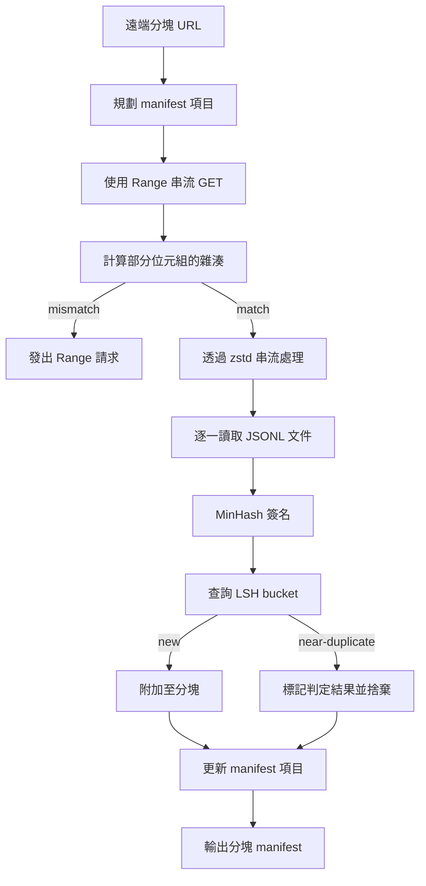

# 海量語料下載器（Large Corpus Downloader）

> 訓練一個語言模型的浩瀚工程，早在模型進行第一次前向傳播之前就已經悄然拉開序幕。整個語料庫必須安全落盤於磁碟上、實施即時解壓縮、剔除近似重複文本，並提供精確的分塊定址能力；且在網路於 4% 處突然中斷之前，斷點續傳的容災機制就必須已經全量就緒。本課將親手打造一個串流下載器：下載壓縮分塊、使用 Zstandard 實施邊下載邊解壓、透過 MinHash 與局部敏感雜湊（LSH）對近似重複文件進行特徵指紋提取與去重，並最終產出一份值得後續所有訓練管線信賴的分塊清單（Shard Manifest）。

**Type:** Build
**Languages:** Python
**Prerequisites:** Phase 19 lessons 30-37
**Time:** ~90 minutes

## Learning Objectives｜學習目標

- 使用 `urllib` 串流下載遠端分塊，並透過 `zstandard` 實施即時解壓縮，絕不在記憶體中快取整份龐大檔案。
- 透過向伺服器發起使用已驗證位元組偏移量的 HTTP `Range` 請求，續傳部分下載內容。
- 為每篇文件建構 MinHash 特徵簽名，並使用 LSH 進行分桶，使高度相似的近似重複文件發生碰撞。
- 產出標準的分塊清單（Manifest），嚴格記錄內容雜湊、位元組大小、文件總數以及去重裁決結果。

## The Problem｜問題

當你第一次嘗試在一個高達 200 GB 的龐大語料庫上啟動下載時，網路往往會在進度達到 41% 時意外中斷，腳本伴隨著 `urllib` 異常直接崩潰退出。第二次重跑時，它又在 78% 處斷線。到了 99% 時，你可能已經把下載迴圈推倒重寫了三次。在大型語料工程的第一分鐘，你就必須從架構上嚴密設計的兩大防線是：**部分下載的可靠斷點續傳**與**近似重複文件的高效過濾**。這兩項難題都有廣為人知的解法，卻常被略過，因為管線通常從一行 `requests.get` 呼叫開始，之後才逐漸增加複雜功能。

斷點續傳本質上是一個嚴謹的 HTTP 協定問題。伺服器端必須支援 `Range` 標頭；用戶端必須依據磁碟上的持久化檢查點嚴格記錄已驗證的位元組偏移量；且該已驗證偏移量必須在行程意外崩潰後依然完好存活。如果記錄的偏移量與磁碟檔案只差 1 個位元組，續傳時寫入的資料就會錯亂，檔案也會因此損壞，直到後續 tokenization 階段才會發現。

去重本質上是一個簽名問題。傳統的精確雜湊完全無法識別「近似重複（Near-Duplicates）」：同一篇維基百科文章被追加了不同的版權頁腳、同一份原始碼檔案被換上了不同的開源許可證頭、同一個部落格貼文的每個超連結後方被動態拼上了不同的追蹤參數。MinHash 搭配 LSH 能以次線性成本捕捉這些近似重複。其成本是為每篇文件計算一次簽名，並為每個簽名查詢一個 bucket。

## The Concept｜核心概念



### 基於 `urllib` 的串流處理

Python 標準庫中的 `urllib.request.urlopen` 回傳一個類檔案物件（File-like Object）。將其包裹進 `zstandard.ZstdDecompressor().stream_reader` 之中，位元組資料流便能直接從網路流經解壓縮器，再進入文件迭代器中，而**絕不在記憶體中保留壓縮前或解壓縮後的整份巨型檔案實體**。在整個運作過程中，記憶體中僅需常駐當前行的文字緩衝區、當前文件的 MinHash 簽名以及 LSH 索引字典。

### 基於 HTTP `Range` 的安全續傳

下載器為每個分塊持久化兩個實體檔案：分塊本體檔案以及一個 `.partial.json` 檢查點檔案。檢查點嚴格記錄：`verified_bytes`（已驗證位元組數）、`expected_size`（預期總大小）、`sha256_prefix`（針對前 `verified_bytes` 個位元組計算出的前綴 SHA256 雜湊）以及原始來源 URL。當下載器重新啟動時，它首先讀取檢查點，重新掃描磁碟上的既有位元組，重新計算 `sha256_prefix`，**唯有在重新計算的雜湊與檢查點 100% 吻合時，才允許發起 Range 續傳**。若雜湊不符，該殘破檔案直接被整份丟棄，下載自第 0 位元組重新發起。靜默損壞不可能發生，因為已驗證的位元組會經過檢查，而非直接假設正確。

### MinHash 與 LSH 局部敏感雜湊

MinHash 能在固定維度的記憶體空間中，估計兩個集合的 Jaccard 相似度。對於一篇文字文件而言，該集合即為其文字中的 Shingles（重疊的 n-grams）。文件簽名是由 `k` 個獨立雜湊函式計算出的最小值組成的向量。若兩篇文件的真實 Jaccard 相似度為 `s`，則它們在簽名中任意一個分量上發生數值相等的機率恰好等於 `s`。

LSH 隨後將這 `k` 個分量劃分為 `b` 個頻帶（Bands），每個頻帶包含 `r` 行，滿足 `k = b * r`。兩篇文件在至少一個頻帶中發生完全碰撞的機率為 `1 - (1 - s^r)^b`，這會在特定相似度閾值周圍形成極其陡峭的 S 型階躍曲線，其門檻由所調整的 `s` 和 `(b, r)` 決定。在語料庫文字去重中，典型語料去重常用的閾值為 `s = 0.8`，在 LSH 學術文獻中對應的經典超參數為 `k = 128`、`b = 32`、`r = 4`。

### 分塊清單作為合約邊界

下載器唯一對外交付的持久化合約產物就是清單（Manifest）。清單以分塊為單位，嚴格記錄其來源 URL、解壓後的真實位元組大小、文件總數、去重後的唯一文件數，以及該分塊最終檔案的完整 SHA256 雜湊。下游的 tokenization 管線在讀取資料時，嚴格依據該清單進行掃描，而絕對禁止直接遍歷目錄檔案。若某個分塊缺失或其 SHA256 與清單不符，清單機制會強制下游拒絕啟動。清單是將「檔案隨便下完了」與「資料已完整下載且具備密碼學可驗證性」清晰劃分開來的決定性邊界。

```figure
cap-corpus-downloader
```

## Build It｜動手實作

`code/main.py` 實作了以下核心模組：

- `ShardPlanner`：讀取分塊 URL 清單，生成初步規劃好的清單條目。
- `StreamingDownloader`：打開支援可選 `Range` 標頭的 `urllib` 網路串流，寫入臨時檔案，在接收每個資料區塊時即時更新 `.partial.json` 檢查點，並在續傳時精確校驗 SHA256 前綴雜湊。
- `ZstdDocIterator`：使用 `zstandard.ZstdDecompressor` 包裹類檔案串流，按行即時產出單篇 JSONL 文件。
- `MinHasher`：使用一組固定種子的獨立雜湊函式族，為輸入字串生成 `k` 維的簽名向量。
- `LSHIndex`：按頻帶對簽名進行分桶，即時回報碰撞事件。
- `Dedup`：結合雜湊器與 LSH 索引，為每篇文件打上 `keep`（保留）或 `near_duplicate`（近似重複）的裁決標籤，並記錄其發生碰撞的目標分塊 ID。
- `ManifestWriter`：匯總各分塊的統計資料，輸出最終的 `manifest.json`。

檔案底部的演示程式在本地磁碟上動態生成一個微型合成語料庫、使用 `zstandard` 進行壓縮、透過 `file://` 本地 URL 協議模擬網路下載、實施 MinHash 去重，並最終印出產出的完整清單。

執行測試：

```bash
python3 code/main.py
```

腳本以結束碼 0 安全退出，並在終端機輸出清晰的清單摘要。

## 工業級正式環境落地模式

四大實戰架構模式，能將本課的微型引擎無縫擴展至支撐真實數百 GB 的工業語料庫：

**寫入磁碟前必須先行落盤檢查點（Checkpoint before write）**：在將下載的位元組實際追加寫入分塊檔案之前，必須先對 `.partial.json` 執行 `fsync` 強制刷盤。否則，若在兩者之間發生突然斷電，磁碟狀態將發生致命倒置：分塊檔案中已經寫入了新資料，但檢查點卻依然停留在舊狀態；下次重啟續傳時，下載器會誤以為磁碟上的已驗證位元組少於實際檔案大小，重複寫入重疊的資料碎片，直接導致整個檔案二進位損壞。檢查點先行，隨後寫入資料。這與資料庫中的預寫式記錄（Write-Ahead Log，WAL）遵循完全同一的嚴謹工程紀律。

**分區分片式 LSH 索引（Sharded LSH index）**：當語料庫擴大至 200 GB 規模時，單一全局 LSH 索引將無法全部常駐於伺服器記憶體中。標準解法是依據第一個頻帶（Band）的雜湊值對 LSH 索引進行分區分片，將各分區持久化存放在磁碟上，每次計算出新簽名時僅載入並查詢其所落入的那個特定分區。代價是每篇文件額外增加一次磁碟讀取；收益是 LSH 索引徹底告別了實體記憶體天花板的限制。

**墓碑標記，絕非直接物理刪除（Tombstone, not delete）**：被判定為近似重複的文件，在清單中記錄為 `near_duplicate`，並附上發生碰撞的文件之 shard ID。直接刪除會失去重複文件與保留文件之間的連結；墓碑標記則保留稽核軌跡，並讓下游流程日後可調整閾值。

**清單本身必須具備 SHA256 內容雜湊**：清單文件自身在落盤時，必須被計算出全局的內容雜湊值。下游的所有訓練階段在信任清單中的任何條目之前，必須首先校驗清單本身的內容雜湊。缺乏該機制的清單本身就是一個脆弱的攻擊面：任何擁有磁碟寫入權限的外部程式篡改了單一檔案，即可悄無聲息地毒化整條訓練管線。

## Use It｜實際應用

正式環境實務模式：

- **CI/CD 自動化與容器重啟韌性**：雲端 CI 執行環境具備天然的臨時性（Ephemeral）。下載器必須具備將每次運作視為全新磁碟環境的心智模型，能從快取或遠端來源接續下載。`--cache-dir` 應當作為一等公民參數支援。
- **去重永遠發生在 tokenization 之前**：tokenization 是一項運算極其昂貴的高負載操作。在完全重複的文件上呼叫兩次 tokenizer，意味著為完全相同的損失函數收斂曲線支付兩倍的算力帳單。去重是 tokenization 的上游防線，絕不能放在下游。
- **清單作為 Git 合併門禁**：訓練作業會從固定 Git commit 讀取清單的 sha256。每一次訓練資料集的升級迭代，在程式碼儲存庫中表現為一次標準的 Git commit。程式碼與資料之間的連結由 Git 記錄，而非靠口耳相傳。

## Ship It｜交付成果

在真實商業專案中，交付的 `outputs/skill-corpus-downloader.md` 將詳細規範：哪些 URL 為下載器輸送資料、檢查點目錄的物理儲存結構、去重所採用的精確 Shingle 寬度與 `(k, b, r)` 參數三元組，以及清單檔案在版本控制系統中的儲存路徑。本課直接交付了該核心引擎的完整原始碼。

## Exercises｜練習

1. 為下載器追加 `--shingle-width` 命令列參數，客觀測量當寬度分別設為 3、5、9 時，去重裁決結果發生的具體變化。為預設選型寫出一份架構論證。
2. 透過動態嗅探前幾個二進位魔術字元（Magic Bytes），為下載器擴充對 gzip 格式的原生支援，使呼叫方無需在外部手動指定壓縮編解碼器類型。
3. 實作 `--resume-only` 嚴格續傳模式：若在本地未找到對應的檢查點檔案，下載器堅決拒絕發起全新下載並拋出異常。該模式在 CI 環境中極其有用，能有效防止某個故障任務意外重新下載 200 GB 的海量資料。
4. 將 LSH 索引的底層儲存遷移至 Python 的 shelve 模組或 SQLite 本機資料庫檔案中，客觀測量其與純記憶體實作相比的吞吐量。
5. 在下載器啟動時加入針對 `manifest.lock` 的強驗證邏輯：若磁碟上既有的清單雜湊與鎖定檔案中聲明的雜湊不一致，下載器強制 Fail-closed 終止運作。

## Key Terms｜關鍵術語

| 術語 | 常見說法 | 實際意義 |
|------|-----------------|------------------------|
| Shard | 「一個檔案」 | 語料庫中具備獨立 sha256 的自足切片，也是續傳與去重的單位。 |
| MinHash signature | 「指紋」 | 集合的 `k` 分量摘要；每個分量都是對集合套用一個獨立雜湊函式後所得的最小值。 |
| LSH band | 「bucket」 | 由 `r` 個簽名分量組成，做為碰撞偵測的單一 bucket key。 |
| Verified bytes | 「續傳偏移量」 | 磁碟上的位元組，其 sha256 前綴符合檢查點記錄；這是唯一安全的續傳偏移量。 |
| Manifest | 「索引」 | 下載器產出的唯一持久記錄，包含內容雜湊。 |
## Further Reading｜延伸閱讀

- [RFC 7233](https://datatracker.ietf.org/doc/html/rfc7233) — HTTP Range 範圍請求官方標準，亦是續傳協定的底層規範。
- [Zstandard format specification](https://datatracker.ietf.org/doc/html/rfc8478) — 讓高效串流解壓縮成為可能的資料幀格式技術規格。
- [MinHash](https://en.wikipedia.org/wiki/MinHash) — 本課所採用的集合特徵簽名數學理論基礎。
- [Locality-sensitive hashing](https://en.wikipedia.org/wiki/Locality-sensitive_hashing) — 支撐快速去重碰撞的頻帶分組數學架構。
- 第 19 階段第 43 課：深入學習接收該下載器輸出的 HDF5 二進位 tokenization 語料庫封裝技術。
- 第 19 階段第 44 課：學習在該語料庫上驅動模型訓練的餘弦退火學習率排程架構。
- 第 19 階段第 45 課：學習結合自動混合精度（AMP）與梯度裁剪的高效能訓練控制迴圈。
