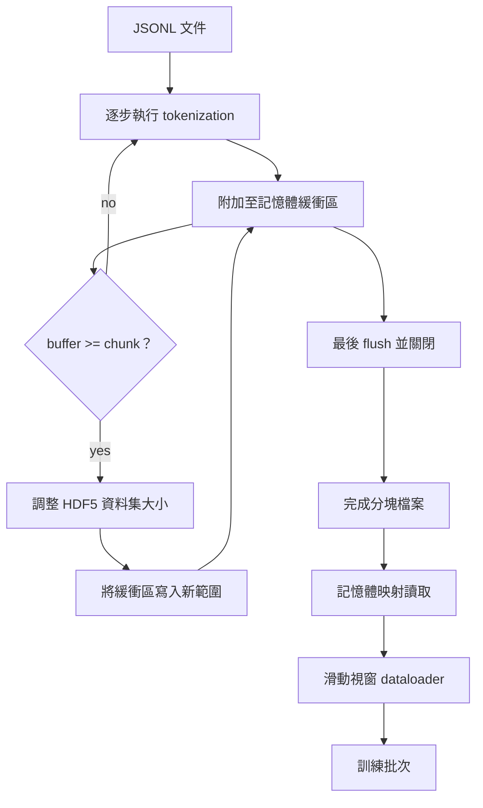

# HDF5 二進位 tokenized 語料庫

> 下載完成的海量語料，必須以訓練器能夠在網卡／磁碟線速下順暢串流讀取的格式進行物理儲存。磁碟上的原始 JSONL 文字檔案根本無法承受 16 個 DataLoader worker；而具備動態可擴展、分塊整數儲存特性的 HDF5 格式則能輕鬆勝任。本課將親手打造：將文字串流經 tokenization 後寫入可擴展 HDF5 資料集、跨多個實體檔案的分片並行寫入、訓練執行時期的記憶體映射（Memory-Mapped）極速讀取，以及產出固定長度序列與精確填充的滑動視窗 DataLoader。

**Type:** Build
**Languages:** Python
**Prerequisites:** Phase 19 lessons 30-37
**Time:** ~90 minutes

## Learning Objectives｜學習目標

- 將海量文字串流寫入具備確定性分塊機制的 HDF5 可擴展整數資料集。
- 實施跨多個 HDF5 檔案的分片寫入，將單點故障隔離在分塊內部並最大化並行度。
- 透過 HDF5 依託作業系統 Page Cache 的分塊排布機制讀取 Token，確保 DataLoader 僅在組裝 Batch 的瞬間才向記憶體緩衝區複製資料。
- 實作滑動視窗 DataLoader，依據明確的打包封裝規則向模型源源不斷輸出固定長度的訓練序列。

## The Problem｜問題

一個現代語言模型訓練作業，在數十個背景 Worker 的驅動下，往往需要以每秒數十萬個樣本的驚人頻寬吞吐 Token。儲存在磁碟上的 JSONL 文字檔案在遭遇第一次冷快取分頁缺失（Page Fault）時就會當場崩潰：JSON 解析器極其緩慢、文件邊界無法被二進位隨機定址，且若想跳轉讀取「第 4,217,884 個樣本」，系統不得不從檔案第 0 行開始全量掃描。即便是在壓縮率上表現優異的 Parquet 格式此處同樣難以勝任，因為訓練器不需要複雜的列式資料庫特徵，它所渴望的本質上是一整條支援 O(1) 常數級隨機存取的扁平 Token 串流。

HDF5 完美契合了該極端負載需求：它提供具備分塊（Chunked）、動態擴展（Resizable）的純整數資料集，其在磁碟上的物理佈局對作業系統的 Page Cache 極度友好。當訓練器請求 `tokens[3,200,000 : 3,200,8192]` 的切片時，HDF5 直接將請求的資料選取區域（hyperslab）從 Page Cache 中複製進新分配的 NumPy 陣列中。每個 Worker 僅需維持一個開啟的檔案句柄以及一個分塊大小的 Page Cache 記憶體開銷，相較於解碼文字 JSONL 的沉重負擔，該代價微乎其微。

整個建構過程中最考驗工程功力的是寫入端的嚴謹紀律。可動態擴展的資料集極易被錯誤濫用：若每處理一篇文件就執行一次資料集擴容寫入，HDF5 檔案將產生嚴重的碎片化直至無法讀取；若將所有文件全部在記憶體中快取並在最後一次擴容寫入，一旦行程意外崩潰將丟失整批資料。唯一正確的工程準則是：**先緩衝再擴容（Buffer-then-extend）**，將緩衝區大小精確設定為 HDF5 的分塊大小（Chunk Size），並採用跨檔案分片寫入，確保任何單點崩潰最多只會損失單一分片。

## The Concept｜核心概念



### 正確實作可動態擴展的 HDF5

底層 Token 資料集在建立時顯式宣告 `maxshape=(None,)` 並指定固定的 `chunks=(chunk_size,)`。寫入流程首先將 Token 累積暫存於長度為 `chunk_size` 的記憶體 NumPy 陣列緩衝區中。當緩衝區填滿時，資料集物理擴容精確的 `chunk_size` 大小，並將緩衝區資料一次性寫入新開闢的地址空間中。在處理至分片末尾時，殘餘的未滿緩衝區被寫入最後一塊局部區域中。除了最後一次寫入外，所有的寫入操作皆在二進位層面維持嚴格的連續性與 Chunk 分塊對齊；而讀取端則依據儲存在 HDF5 檔案屬性中的真實 `token_count` 數值精確截斷尾部。

### 分片式並行寫入

單一龐大的 HDF5 檔案是系統的單點故障隱患。本管線採用分散式分片並行寫入：來自第 19 階段第 42 課的每一個輸入分塊，各自對應產出一個獨立的 HDF5 輸出分片。一個全局的 `shards.json` 索引檔案以分片為單位，嚴格記錄其檔案路徑、有效 Token 總數、文件總數以及針對該分片全量 Token 計算出的 SHA256 雜湊值。訓練器在啟動時讀取 `shards.json` 以計算全局樣本偏移量並嚴格校驗語料完整性。

### 基於記憶體映射的高效讀取

在模型訓練執行時期，每個 Worker 以 `swmr=True`（單寫多讀）模式打開其分配到的 HDF5 分片，發起 `tokens[start:stop]` 的切片請求。HDF5 的 Chunk 排布使得一旦某個分塊被命中，後續的讀取由作業系統 Page Cache 支援。Worker 永遠不需要在記憶體中全量載入整個檔案：切片資料被快速拷貝至 DataLoader 的批次緩衝區中，隨後 DataLoader 在組裝 Batch 時將其拷貝至釘選記憶體（Pinned Memory）訓練張量中。在訓練熱點路徑上，跨越 Chunk 分塊邊界時僅需發起一次系統呼叫；其餘時間全是在記憶體中進行極速讀取。

### 滑動視窗 DataLoader

DataLoader 是整套體系中唯一知曉訓練序列長度（Context Window）的元件。它在全局 Token 串流中隨機選取一個起始索引，連續讀取 `window_size + 1` 個 Token，並回傳 `(input, target) = (tokens[:-1], tokens[1:])`。該讀取不受單篇文件的實體邊界限制：視窗可能跨越兩篇文件，中間會有明確的 `boundary_token_id`，讓模型學會使用分隔符。這是標準的資料打包規則；初學者也常忘記這項規則，結果語料中 8% 是訓練邊界 Token，92% 是自然文字。

```figure
cc-hdf5-corpus
```

## Build It｜動手實作

`code/main.py` 實作了以下核心模組：

- `Tokenizer`：位元組級確定性 tokenizer，足以應付本課示範。介面為 `encode(text) -> list[int]` 與 `vocab_size`。
- `HDF5ShardWriter`：建立可擴展整數資料集、在記憶體中以 Chunk 大小為單位快取 Token、按固定步長實施擴容與寫入，並在關閉時將真實 `token_count` 與 `sha256` 寫入 HDF5 屬性中。
- `ShardedTokenizationPipeline`：遍歷輸入文件、分發路由至對應寫入器，並輸出最終的 `shards.json` 索引清單。
- `MmapTokenStore`：以記憶體映射模式打開多個分片檔案、計算全局定址偏移量，並暴露統一的 `get_slice(start, stop)` 切片讀取介面。
- `SlidingWindowDataloader`：自全局資料串流中抽取隨機視窗，產出 `(input_ids, target_ids)` NumPy 陣列批次。

底部的演示程式在本地記憶體中建構一個微型語料庫、對其執行 tokenization 並切分為兩個獨立的 HDF5 分片、透過記憶體映射重新打開它們、驅動 DataLoader 連續產出 10 個訓練批次，並印出批次形狀與資料校驗和。

執行測試：

```bash
python3 code/main.py
```

腳本以結束碼 0 退出，並輸出各批次的校驗和明細。

## 工業級正式環境落地模式

有四種模式可將本課擴展至真實訓練作業。

**Chunk 大小必須與典型讀取視窗成整數倍對齊**：訓練器每次抽樣精確讀取 `window_size + 1` 個 Token。將 HDF5 的 Chunk 大小設定為 `window_size` 的整數倍，能保證每次讀取在作業系統 Page Cache 邊界上完美對齊。若 Chunk 大小與視窗長度不匹配，每次抽樣皆會被迫跨越兩個實體分塊，導致磁碟 I/O 吞吐直接折半暴跌。

**將真實 Token 總數存放在檔案屬性中，而非依賴資料集長度**：由於 Chunk 大小通常無法被文件邊界整除，資料集的最後一個實體分塊往往存在未填滿的空白尾巴。必須將真實的 `token_count` 作為 HDF5 Attribute 存放在資料集屬性中，讀取端在掃描時嚴格截斷於該數值。否則，DataLoader 會讀入尾部大量全為 0 的 Padding 填充，直接將模型訓練成只會預測 0 的殘疾網路。

**分片 SHA256 支援分散式並行校驗**：每個 HDF5 分片皆在內部屬性中記錄自身 Token 位元組的獨立 SHA256 雜湊。訓練器可在正式啟動訓練前並行校驗所有分片的雜湊完整性。一旦發現某個檔案損壞，立即快速失敗，而絕不會拖到訓練了 16 個小時後的第 3 個 Epoch 才尷尬崩潰。

**讀寫兩端嚴格啟用 `swmr=True`，且寫入端顯式宣告 `libver="latest"`**：單寫多讀（SWMR）模式要求寫入端必須以 `libver="latest"` 打開檔案、預先建立好所有資料集結構，隨後顯式設定 `file.swmr_mode = True`。在此之後，寫入端在每次執行 `resize` 擴容後必須主動調用 `dataset.flush()`，如此一來以 `swmr=True` 打開的讀取端 Worker 才能即時看見一致的資料更新。忽略 `libver="latest"` 或在結構變更後才啟用 SWMR，是引發「檔案被死鎖（File is locked）」異常的常見原因。

## Use It｜實際應用

正式環境實務模式：

- **一個來源分塊對應一個 HDF5 檔案**：第 42 課的下載器針對每個 URL 產出一個文字分塊；本課的 tokenization 管線針對每個文字分塊產出一個 HDF5 檔案。這套 1:1 的嚴密映射讓續傳與部分故障復原都很簡單。
- **文件邊界隔離標籤**：邊界 Token 是 tokenizer 詞表的一部分，亦是 DataLoader 唯一被允許主動注入的特殊標記。若希望模型忽略文件交界，訓練損失函數會主動遮罩該標籤；否則模型將自然學會將其作為文件終止符號使用。
- **`shards.json` 作為唯一事實標準**：在語料庫中追加新分塊意味著生成新的 HDF5、計算其雜湊值，並向 shards.json 追加一行記錄。訓練器在啟動時僅讀取該索引檔案一次，而絕不浪費時間去遍歷浩瀚的磁碟目錄。

## Ship It｜交付成果

在真實商業專案中，交付的 `outputs/skill-hdf5-tokenized-corpus.md` 將詳細記錄：對接該管線的 tokenizer 版本、與訓練視窗完美對齊的 Chunk 大小規格、`shards.json` 在版本控制中的錨定位置，以及多個 DataLoader worker 如何在檔案層級實施分片負載均衡。本課直接交付了該高效能儲存引擎的完整原始碼。

## Exercises｜練習

1. 為 HDF5 寫入器新增 `--compression gzip` 旗標，測量演示語料庫上的吞吐成本，並為選定的預設值辯護。
2. 為滑動視窗 DataLoader 引入確定性隨機種子，嚴格斷言使用相同種子運作的兩次獨立任務所產出的 Batch 張量完全二進位一致。
3. 實作 `--validate` 快速驗證模式：循序讀取每個分片，在記憶體中重新計算所有 Token 的 SHA256 雜湊，並與 `shards.json` 中的記錄進行比對。CI 管線在啟動預訓練前必須強制跑通該檢查。
4. 針對「Chunk 大小等於視窗長度」、「Chunk 大小為視窗長度一半」以及「Chunk 大小為視窗長度兩倍」三種情境展開極限壓測。出具詳細的 Page Cache 命中率分析報告。
5. 追加 `--max-document-tokens` 參數：在寫入階段直接對超長文件實施物理截斷。深度辯論：將該決策放在「寫入時提前截斷」與「讀取時動態截斷」相比，各自的工程權衡何在？

## Key Terms｜關鍵術語

| 術語 | 常見說法 | 實際意義 |
|------|-----------------|------------------------|
| Resizable dataset | 「僅供附加」 | 設定 `maxshape=(None,)` 的 HDF5 資料集，可透過 resize 以 chunk 大小為步幅擴充。 |
| Chunked layout | 「HDF5 的儲存方式」 | 固定大小的磁碟頁面，可由核心記憶體映射，讓 dataloader 連續讀取。 |
| `swmr` mode | 「讀取時寫入」 | Single-Writer-Multiple-Reader 模式，讓 dataloader worker 安全共用檔案。 |
| Shard index | 「shards.json」 | 包含所有 Token 分片偏移量與內容雜湊的持久索引。 |
| Sliding window | 「訓練樣本」 | 從全域 Token 串流擷取固定長度切片，並由訓練器搭配位移一格的目標。 |
## Further Reading｜延伸閱讀

- [HDF5 chunking documentation](https://support.hdfgroup.org/documentation/hdf5/latest/hdf5_chunking.html) — 本課所採用的 HDF5 動態分塊資料集物理儲存規格。
- [h5py user guide](https://docs.h5py.org/en/stable/) — HDF5 的 Python 繫結。
- [NumPy memory mapping](https://numpy.org/doc/stable/reference/generated/numpy.memmap.html) — HDF5 透過 h5py 暴露的讀取端記憶體映射基礎功能。
- 第 19 階段第 42 課：深入了解為本課提供原始輸入語料的海量下載器架構。
- 第 19 階段第 44 課：學習直接消費該 DataLoader 輸出串流的餘弦退火學習率排程架構。
- 第 19 階段第 45 課：學習包裹單步訓練、結合混合精度 AMP 的極限吞吐控制迴圈。
