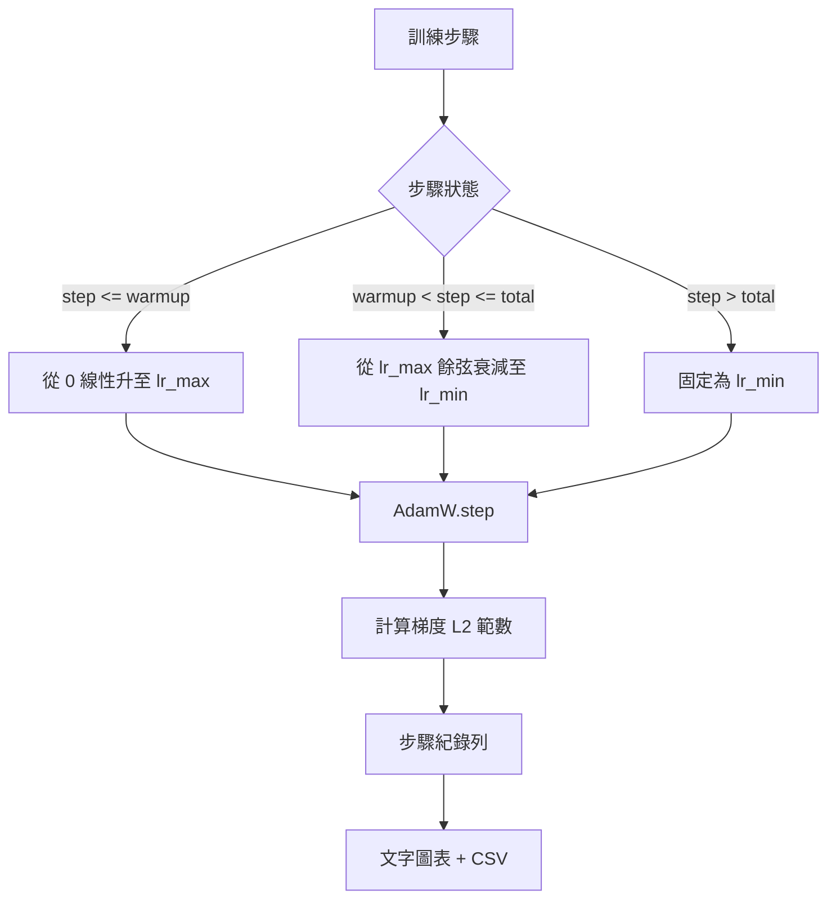

# 帶線性預熱的餘弦學習率排程（Cosine LR with Linear Warmup）

> 學習率排程（LR Schedule）是整個模型訓練中重要性僅次於損失函數的核心架構決策。帶有線性預熱（Linear Warmup）的餘弦退火（Cosine Decay）搭配 AdamW 最佳化器，是現代語言模型訓練的標準預設——它允許模型在最脆弱的初始 1000 步更新中以極小步長平穩探索，隨後平滑攀升至設定峰值，並在後續階段優雅退火衰減回接近零。本課將親手實作該排程器、繪製隨訓練步數變化的學習率曲線、將梯度範數與學習率並列記錄，並以數學斷言證明排程精確恪守預熱、峰值與退火的三大物理邊界。

**Type:** Build
**Languages:** Python
**Prerequisites:** Phase 19 lessons 30-37
**Time:** ~90 minutes

## Learning Objectives｜學習目標

- 實作無縫對接 AdamW 最佳化器的「線性預熱 + 餘弦退火」動態學習率排程演算法。
- 在任意訓練步數精確計算當前學習率，避免不同執行間的浮點漂移。
- 將梯度 L2 範數與即時學習率並列審計記錄，使模型訓練的生理健康狀態全局透明可見。
- 將學習率排程即時渲染為終端機可直觀肉眼掃描的 ASCII 文字圖表，並同步匯出為標準 CSV 資料記錄。

## The Problem｜問題

在模型預訓練的最初 1000 步更新中，神經網路處於最為劇烈、最脆弱的混沌期。模型權重依然高度依託隨機初始化分佈；最佳化器的二階矩移動估計尚未穩定；計算出的參數梯度範數異常龐大且充滿劇烈雜訊。若這些更新期間的學習率已達峰值，模型可能會發散，或陷入無法脫離的損失高原。針對該缺陷的兩大經典工程防線是：第 19 階段第 45 課將深入講解的「梯度裁剪（Gradient Clipping）」，以及本課所專注的「自零緩慢爬升的學習率排程器」。

帶有預熱的餘弦排程由三個連續的數學區間構成：自第 0 步至第 `warmup_steps` 步，學習率自 0 線性平滑放大至設定的峰值 `lr_max`；自第 `warmup_steps` 步至第 `total_steps` 步，學習率嚴格遵循餘弦曲線的上半區間，自 `lr_max` 平滑退火衰減至設定的最低下限 `lr_min`；在超過 `total_steps` 之後，學習率被永久固定在 `lr_min`，確保即便外部調度器因配置失誤而意外多跑了步數，系統亦不會在未察覺的情況下離開排程。

建構該排程器最容易踩坑的細節在於：差一錯誤（Off-by-one）極易在邊界處悄然潛伏。這類邊界錯誤往往會在模型連續訓練了 6 個小時、即將開始過擬合的關鍵分水嶺節點上突然爆發為高出或低出 1% 的異常數值，若缺乏在邊界處的窮盡式單元測試，此類缺陷幾乎完全隱形。

## The Concept｜核心概念



### 線性預熱公式

針對滿足 `step` 落在 `[0, warmup_steps]` 且 `warmup_steps > 0` 的初始階段，學習率精確定義為：`lr_max * step / warmup_steps`。當設定 `warmup_steps = 0` 的退化極限情況時，系統將其視為「關閉預熱」：排程在第 0 步直接自 `lr_max` 啟動並立即無縫進入餘弦退火區間。某些自動化測試套件會刻意傳入 `warmup_steps = 0` 以檢驗排程器是否依然能穩定輸出合法曲線。

### 餘弦退火公式

針對滿足 `step` 落在 `(warmup_steps, total_steps]` 的退火階段，學習率計算公式為：`lr_min + 0.5 * (lr_max - lr_min) * (1 + cos(pi * progress))`，其中進度比例定義為 `progress = (step - warmup_steps) / max(1, total_steps - warmup_steps)`。在 `step = warmup_steps` 時，`cos(0) = 1`，因此學習率為 `lr_max`，與預熱終點完全一致；在 `step = total_steps` 時，`cos(pi) = -1`，因此學習率為 `lr_min`，與衰減終點完全一致。

在兩個端點保持連續並非偶然。這正是排程器要實作為以 `step` 為自變數的單一函式，而不是拼接三個不同函式的原因。拼接式排程在第一次變更 lr_max 時會失去一個邊界。

### 步數超額後的保底鎖定

針對 `step > total_steps` 的超額階段，學習率固定在 `lr_min`。合約明確規定：排程器不會報錯或外推，而是維持在下限，讓訓練器記錄警告。若要延長訓練，應修改設定檔中的 `total_steps`，而不是訓練迴圈。

### 梯度範數與學習率的並行審計

學習率排程與梯度範數（Gradient Norm）各反映一部分訓練狀況。訓練迴圈每一步都會記錄兩者：訓練發散時，梯度範數會早於損失出現尖峰；設定得當的預熱會讓梯度範數隨學習率線性上升；峰值過於激進時，預熱後的梯度範數仍會維持在高檔。磁碟上的資料列格式固定為：`step, lr, grad_l2_norm, loss`。CSV 是唯一持久保存的紀錄。

```figure
cap-cosine-warmup
```

## Build It｜動手實作

`code/main.py` 實作了以下核心模組：

- `CosineWithWarmup`：無狀態排程函式 `lr(step) -> float`，完整封裝上述數學幾何計算。
- `TrainState`：將模型、`AdamW` 最佳化器以及學習率排程整合進單一的訓練步進物件中。
- `TrainState.step`：執行單次前向傳播、單次反向傳播、即時計算並記錄梯度 L2 範數，並將算出的即時 `lr(step)` 注入最佳化器。
- `plot_schedule_ascii`：將學習率隨時間的變化軌跡以乾淨的 ASCII 文字圖表直觀呈現。
- `write_schedule_csv`：逐步匯出包含步數與對應學習率數值的標準 CSV 檔案。

檔案底部的演示程式建構了一個微型的 `nn.Linear` 線性模型，在固定輸入批次上連續執行 20 步訓練，在終端機逐步印出即時學習率、梯度範數與損失值，並在結尾輸出 ASCII 字元圖表進行視覺化健全性檢查。

執行測試：

```bash
python3 code/main.py
```

腳本以結束碼 0 安全退出，輸出逐步訓練記錄以及排程曲線圖。

## 工業級正式環境落地模式

四大實戰工程範式，確保學習率排程器符合高標準正式環境交付規範：

**排程參數必須收斂於配置檔案，絕不能硬編碼於程式碼中**：訓練器嚴格自 Git 版本控制下的 YAML 或 JSON 配置中讀取 `warmup_steps`、`total_steps`、`lr_max` 與 `lr_min`。排程可重現是因為配置檔案具備內容尋址；排程可審計是因為所有參數變更皆作為標準的 Git PR Diff 記錄在案。

**單調遞增的全局步數計數器，且與 Epoch 徹底解耦**：某些初學者架構容易在資料集分片或 DataLoader 重啟時，將 Step 與 Epoch 的概念混淆。排程器在讀取步數時，嚴格依託於 model checkpoint 中的 `global_step`，而非本地的局部計數器。一次中斷續訓的作業能從正確的排程位置接續，因為全局步數是持久保存的計數軸。

**訓練作業目錄中的排程圖**：每次訓練作業都會將 `outputs/lr_schedule.png`（或本課實作的 ASCII 字元圖）寫入該作業的目錄。審查人員只需快速瀏覽目錄，就能在不重新執行任何程式碼的情況下檢查排程是否合理。這能在 PR 階段抓出排程配置錯誤。

**記錄 Schema 必須嚴格鎖定**：`step, lr, grad_l2_norm, loss` 必須嚴格依照該順序排列。下游的資料分析 notebook 或可觀測性儀表板深度依賴該 Schema；若在未升級版本號的前提下隨意重命名欄位，將會直接破壞團隊內部所有的儀表板。

## Use It｜實際應用

正式環境實務模式：

- **調整超參數時，優先搜尋峰值 `lr_max`**：`lr_max` 是對收斂性最敏感的旋鈕。建議先在微型模型上小規模掃描；最優 `lr_max` 隨模型大小僅略微變化，因此小模型上的掃描結果可作為強先驗。
- **預熱步數應當設定為總步數的百分比，而非絕對數值**：一場 2 億步的超長訓練若設定 2000 步預熱，模型幾乎在第一瞬間就衝上了峰值；而一場 2 萬步的訓練作業若同樣設定 2000 步，則意味著前 10% 的時間全在緩慢爬坡。將預熱定義為總步數的固定比例（業界常規：1% 至 3%），能保證排程自動隨訓練週期自適應縮放。
- **保底下限 `lr_min` 刻意設定為非零**：將下限設定為峰值 `lr_max` 的 10% 能確保最佳化器在漫長的長尾退火階段依然具備微弱的持續學習能力。若排程設定為 `lr_min = 0`，往往只會產出一張看似完美落地的圖表，但模型在後期實質上早已徹底停止了有效訓練。

## Ship It｜交付成果

在真實工程專案中，交付的 `outputs/skill-cosine-warmup.md` 將詳細記錄：哪一份設定檔宣告了排程參數、訓練器的全域計數器自何處讀取，以及具體的 `lr_max` 掃描實驗報告。本課直接交付了該核心演算法的完整原始碼。

## Exercises｜練習

1. 為排程器擴充「平方根倒數（Inverse-Square-Root）」衰減變體，在一場 200 步的微型訓練實驗中對比兩者。實測究竟哪一條曲線能引導模型達成更低的最終損失？
2. 追加 `--restart` 參數，在 `total_steps / 2` 處注入第二次線性預熱。深入辯論：在你的微型實驗上，熱重啟（Warm Restarts）究竟是提升了收斂質量，還是破壞了穩定性？
3. 編寫單元測試驗證排程的嚴格連續性：證明在 `[0, total_steps]` 區間內的任意連續步數上，數值差絕對值 `|lr(step+1) - lr(step)|` 嚴格受限於 `lr_max / warmup_steps`。
4. 將該無狀態排程函式包裝接入 PyTorch 官方的 `torch.optim.lr_scheduler.LambdaLR` 中，驗證其能與 PyTorch 框架程式碼無縫整合。這個 LambdaLR 包裝器會改變什麼？
5. 追加 `--plot-png` 參數，調用 `matplotlib` 將排程繪製為高清 PNG 圖片。深入分析：在 CI 自動化管線中，本課手寫的 ASCII 文字圖與外部 PNG 圖片相比，各自的優缺點何在？

## Key Terms｜關鍵術語

| 術語 | 常見說法 | 實際意義 |
|------|-----------------|------------------------|
| Warmup | 「緩慢起步」 | 在前 `warmup_steps` 次更新內，將學習率從零線性提高到 `lr_max`。 |
| Cosine decay | 「平滑下降」 | 在剩餘步數內，從 `lr_max` 到 `lr_min` 的餘弦曲線上半部。 |
| Floor | 「訓練後的下限」 | 超過 `total_steps` 後，排程固定維持的 `lr_min` 值。 |
| Gradient norm | 「梯度的 L2 範數」 | 串接所有梯度向量後計算的歐幾里得範數，每一步都會記錄。 |
| Global step | 「排程軸」 | 在重新啟動後仍持續遞增，並用來驅動排程的步數計數器。 |
## Further Reading｜延伸閱讀

- [Loshchilov and Hutter, SGDR: Stochastic Gradient Descent with Warm Restarts (arXiv 1608.03983)](https://arxiv.org/abs/1608.03983) — 餘弦退火排程奠基性學術論文。
- [Loshchilov and Hutter, Decoupled Weight Decay Regularization (arXiv 1711.05101)](https://arxiv.org/abs/1711.05101) — AdamW 權重衰減解耦原創論文。
- [PyTorch torch.optim.lr_scheduler](https://docs.pytorch.org/docs/stable/optim.html#how-to-adjust-learning-rate) — PyTorch 官方動態學習率調整技術文件。
- 第 19 階段第 42 課：回顧為該排程消費語料提供輸入的海量下載器。
- 第 19 階段第 43 課：回顧與該排程共同協同進化的 HDF5 高效能 DataLoader。
- 第 19 階段第 45 課：深入學習下一層的梯度裁剪與自動混合精度（AMP）技術。
