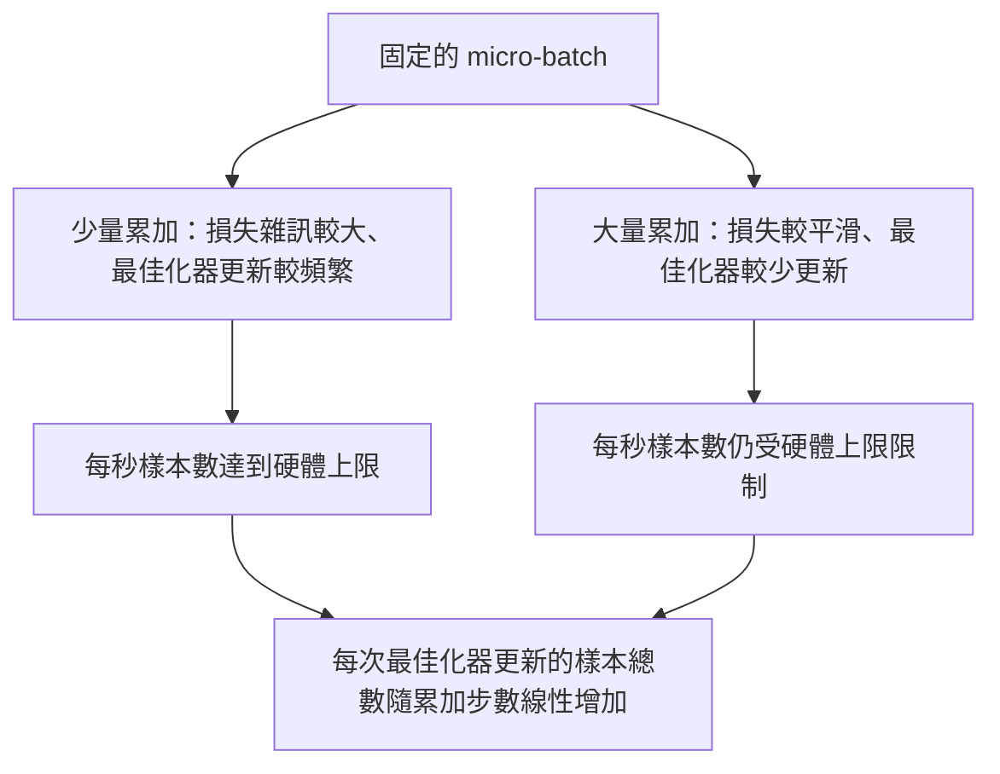

# 梯度累積（Gradient Accumulation）

> 藉助微批次（Micro-Batch）的逐步推進，在顯示記憶體預算無法直接承受的極限大批次下完成模型訓練。精準縮放單步損失、暫扣最佳化器更新，讓反向傳播的梯度在參數緩衝區中平穩堆疊。

**Type:** Build
**Languages:** Python
**Prerequisites:** Phase 19 lessons 42 to 45
**Time:** ~90 minutes

## Learning Objectives｜學習目標

- 推導有效批次大小（Effective Batch）的核心恆等式：`effective_batch = micro_batch * accum_steps`。
- 實作單個微批次的損失縮放（Loss Scaling），確保累加後的梯度與單次全量大批次反向傳播的數學結果精確一致。
- 在前向累積期間跳過最佳化器的跨節點通訊同步，嚴格落實「僅在最後一步同步（Sync-on-last-step）」策略。
- 繪製並解讀吞吐量隨有效批次擴展的效能曲線，理解其邊際收益遞減規律。

## The Problem｜問題

你想以 512 的有效批次進行訓練，因為在該尺度下損失函數曲線更為平滑，且最佳化器的每一步更新具備更具統計意義的方向穩定性。然而，你桌上的硬體加速晶片（GPU）在載入 32 個樣本後顯示記憶體就會當場 OOM 溢出。將批次直接翻倍是不可能的物理現實；將模型參數規模直接折半同樣不可接受。深度學習界自 2017 年以來最廣泛採用的工程技巧，就是連續發起 16 次獨立的反向傳播，讓計算出的參數梯度直接在底層參數的梯度緩衝區中進行加法累積，直到累積次數抵達目標預算後，才正式觸發一次最佳化器更新。

然而這裡存在致命的數值陷阱：累加後的損失值不再等同於大批次的原始損失數值。將 16 個小微批次的交叉熵損失直接簡單相加，其數值是單個大批次真實損失的 16 倍之巨！若未對單步損失進行對等除法縮放，梯度的空間方向雖然正確，但其幅值模長卻被整整放大了 16 倍，直接導致最佳化器的步長更新被病態放大 16 倍，瞬間引發數值爆炸。修復只需一個簡單的除法，但它也是最容易被工程師遺忘的致命死穴。

## The Concept｜核心概念


核心合約極為精簡：

- 每個微批次的損失在調用 `backward()` 之前，必須強制除以 `accum_steps`。PyTorch 預設會將反向傳播產生的梯度直接在 `param.grad` 中進行加法累積；除法操作能將累積後的全局總梯度精確還原至正確的平均尺度。
- 最佳化器的 step 更新在每個有效批次中**僅被允許觸發一次**，嚴格在最後一個微批次的反向傳播結束後執行。在累積中途擅自觸發更新，會導致後續微批次在已經被篡改的錯誤權重上計算梯度。
- 最佳化器的內部狀態（動量緩衝區、Adam 的一階與二階矩）嚴格按照「有效步進」推進，絕不能在每個微批次中頻繁前進。否則指數移動平均值（EMA）將以錯誤的時間頻率更新，提前燒毀學習率排程。
- 在單一裝置上這僅僅是純粹的記憶體記帳；而在多節點分散式叢集（DDP）中，該機制會將非最終的微批次全量包裹在 `no_sync` 上下文中，徹底跳過跨網路的梯度 All-Reduce 通訊；僅在最後一個微批次中單次完成跨節點聚合，將昂貴的網路傳輸開銷自 N 次暴跌為僅需 1 次。

### 數學等價性的程式碼證明

```python
loss = criterion(model(x_full), y_full)
loss.backward()
opt.step()
```

在數學意義上完全等價於：

```python
for x, y in chunks(x_full, y_full, n):
    scaled = criterion(model(x), y) / n
    scaled.backward()
opt.step()
```

（兩者僅存在微小的浮點數加總順序誤差）。在迴圈結束時，參數中沉澱的累加梯度張量，與單次全量批次反向傳播產出的結果完全一致。本課程式碼在 `equivalence_check` 中實施嚴格斷言，要求兩者的最大絕對誤差（max_abs_diff）必須嚴格低於 1e-4。

### 算力與時間成本的流向

每一個微批次皆必須承擔一次前向傳播與一次反向傳播。梯度累積是用「時間換空間」的典型妥協。在固定微批次顯示記憶體上限的前提下，隨著有效批次的持續擴展，吞吐量變化如下，詳見 `outputs/accum-curve.json`：



天下沒有免費的午餐。將 `accum_steps` 翻倍，單次最佳化器更新所需的時間也會翻倍。真正改變的是梯度估計的變異數：在相同的時間預算下，最佳化器更新步數會減少，但每一步會以更多樣本計算平均梯度。學術界通常將大批次與小批次視為不同的最佳化問題；而本課聚焦於機制本身，而非統計性質。

```figure
cc-grad-accumulation
```

## Build It｜動手實作

`code/main.py` 交付以下三大核心步驟：

### 第一步：數學等價性嚴密校驗

`equivalence_check()` 在相同隨機種子下實例化兩個完全相同的神經網路複本。第一個複本在單次前向傳播中吃下 16 個樣本的完整批次；第二個複本被切分為 4 個微批次（每批 4 個樣本），損失除以 4 後依序累加。函式精確比對最佳化器更新前的梯度張量以及更新後的模型權重。硬性斷言要求 `max_abs_diff < 1e-4`。

### 第二步：僅在最後一步同步模式

`train_one_optimizer_step` 遍歷微批次。除最後一個微批次外，其餘所有微批次皆進入 `no_sync_context(model)`。在單行程環境下該上下文為空操作；在 DDP 分散式叢集中它正是跳過跨卡通訊的核心接縫。`sync_counter` 計數器嚴密審計脫離 no_sync 作用域的次數；對於 N 個微批次，每個有效步進的同步次數必須嚴格等於 1，而非 N。

### 第三步：吞吐量效能曲線掃描

`sweep_effective_batches` 在固定微批次的前提下，遍歷多組不同的累加步數配置。針對每組設定精確記錄：

- `samples_per_sec`：總樣本處理數除以端到端物理耗時（每秒樣本吞吐）。
- `median_step_ms`：單個有效步進的耗時中位數（p50）。
- `sync_calls`：實際觸發的分散式集合通訊次數。
- `avg_loss`：掃描週期內各有效步進的平均損失。

輸出結果自動落盤至 `outputs/accum-curve.json`，方便在資料科學 notebook中進行二次繪圖分析。

執行測試：

```bash
python3 code/main.py
```

腳本首先印出等價性校驗的誤差數值，隨後輸出效能掃描表格，並標註產出的 JSON 檔案路徑，以結束碼 0 安全退出。

## Use It｜實際應用

在正式環境大規模預訓練中，梯度累積通常隱藏在單一的全局排程參數身後。PyTorch 的標準工程公式為：`accumulation_steps = effective_batch // (micro_batch * world_size)`。本課不允許使用的框架也會包裝同一個迴圈，但步驟相同：縮放損失、在非最後一個微批次略過同步、累積梯度，並只更新一次。

三大工業級實戰準則：

- 微批次大小的選定準則為：**最大化填滿單卡顯示記憶體物理極限**。任何更小的數值皆是在白白浪費 GPU 算力核心的並行度；任何更大的數值則會引發 OOM 崩潰。
- 有效批次的大小取決於學習率排程。超大有效批次需要匹配線性縮放的更高學習率以及更充分的預熱；這正是自 2017 年以來被反覆證實的「線性縮放定律（Linear Scaling Rule）」。
- 累加步數是溝通上述兩者的唯一彈性橋樑，亦是你在執行時期無需重寫 DataLoader 即可隨意調整的唯一旋鈕。

## Ship It｜交付成果

交付的 `outputs/skill-gradient-accumulation.md` 完整規範了該配方：將損失嚴格除以 `accum_steps`、在前續微步跳過跨節點通訊同步、在有效批次邊界單次觸發最佳化器更新，並將吞吐量對比曲線導出為 JSON 檔案，使算力與時間的權衡邊界全局透明。

## Exercises｜練習

1. 以 `--num-steps 100` 重新執行效能掃描，繪製每秒樣本吞吐隨有效批次擴展的變化曲線。指出該曲線在哪一個批次規模開始趨於平緩。
2. 故意編寫一個錯誤的未縮放變體（完全不對損失除以 N），在第 1 步更新後比對其與標準參考模型之間的權重參數誤差，直觀感受梯度模長被放大的破壞力。
3. 將 SGD 替換為 AdamW 最佳化器，嚴格驗證最佳化器內部維護的一階動量與二階變異數，確實嚴格依照「有效步進」前進，而絕對沒有在微批次中被錯誤遞增。
4. 引入真實的 `DistributedDataParallel` 封裝，並將 `no_sync_context` 精確路由至 DDP 官方原生方法。驗證跨卡通訊次數 sync_calls 是否精準減少了 N-1 次。
5. 修改等價性校驗邏輯，對比兩種不同的微批次切分方案（例如 2 by 8 與 4 by 4），分析並解釋浮點數求和順序變化所需放寬的微小容差邊界。

## Key Terms｜關鍵術語

| 術語 | 常見說法 | 實際意義 |
|------|-----------------|------------------------|
| Micro batch | 「前向傳遞的批次」 | 可在單次前向傳遞中放入裝置記憶體的資料切片。 |
| Accum steps | 「每步反向傳播次數」 | 在執行一次最佳化器更新前，累加的反向傳播次數。 |
| Effective batch | 「批次」 | micro-batch 大小 × 累加步數 × 資料平行 world size。 |
| Loss scaling | 「除以 N」 | 每個 micro-batch 除以 N，使累加後的梯度符合完整批次的尺度。 |
| Sync on last | 「略過其他步驟」 | 只在累加視窗中最後一次反向傳播時執行梯度 collective。 |
## Further Reading｜延伸閱讀

- PyTorch 官方技術文件之 `DistributedDataParallel.no_sync` 專題：深入掌握「僅在最後一步同步」的工業級底層通訊最佳化細節。
- Goyal et al., 2017（超大批次訓練線性縮放定律）：探討為何現代大模型普遍追求大有效批次的經典奠基論文。
- PyTorch 官方 Issue 追蹤：關於梯度累積與自動混合精度（AMP）在梯度還原時相互交互的邊界陷阱。
- 第 19 階段第 42 至 45 課：全面回顧本課所預設依託的模型架構、DataLoader、最佳化器與訓練器的基礎架構。
- 第 19 階段第 47 課：深入學習 model checkpoint 儲存與續訓，確保長時間的梯度累積作業能撐過執行時間上限。
