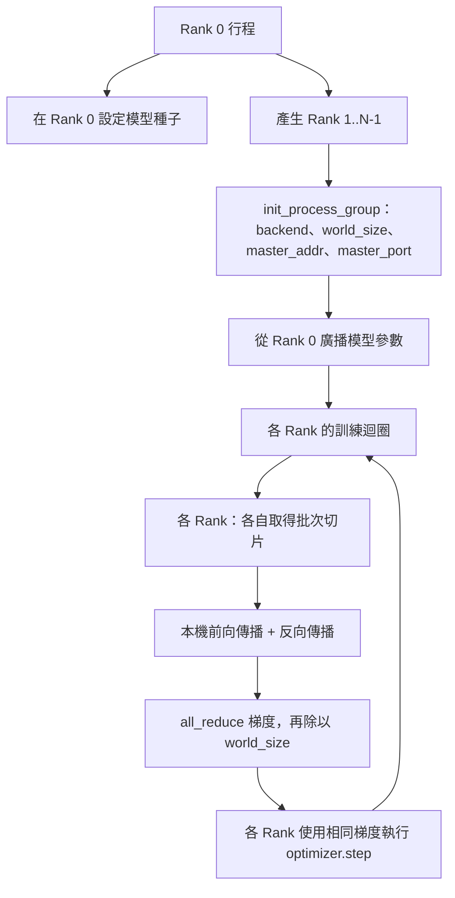
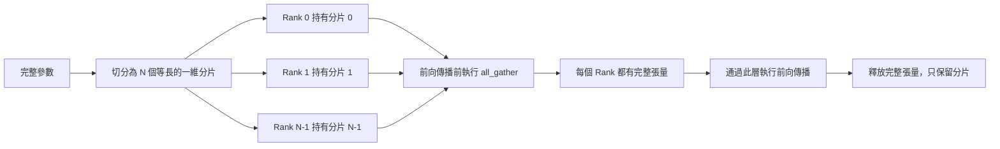

# 從零打造分散式資料平行與 FSDP（Distributed Data Parallel and FSDP from Scratch）

> 多節點多行程（Multi-Rank）分散式訓練的本質，完全收斂於兩大集合通訊原語（Collectives）與一條核心鐵律：在啟動時廣播全模型參數、在反向傳播後對梯度求全局平均，且永遠絕不允許不同節點對當前所處的訓練步數產生分歧。

**Type:** Build
**Languages:** Python
**Prerequisites:** Phase 19 lessons 42 to 45
**Time:** ~90 minutes

## Learning Objectives｜學習目標

- 使用 `gloo` 通訊後端，在完全無專屬硬體加速器的普通 CPU 上，成功拉起跨 N 個 Rank 的分散式行程組（Process Group）。
- 實作極簡的 DDP（分散式資料平行）封裝器：在建構時廣播模型參數，並在反向傳播後對梯度實施 All-Reduce 全局歸約。
- 在數學上證明：跨 Rank 的梯度 All-Reduce 求和平均，與在拼接後的完整輸入上由單一行程計算出的梯度數值相符。
- 親手勾勒 FSDP（完全分片資料平行）的參數分片核心骨架：每個 Rank 僅持有參數切片，在前向傳播時動態 Gather 收集完整張量，並在運算完畢後立即釋放記憶體。

## The Problem｜問題

模型能夠塞入單張硬體加速卡中；但資料集卻龐大無比。算力與時間預算要求你在每秒物理時鐘內見識到 N 倍的訓練樣本。解決該問題的第一核心槓桿是**資料平行（Data Parallel，DDP）**：每個 Rank 節點在批次資料的不同切片上運行完全相同的模型複本，隨後在最佳化器更新參數之前對梯度求平均。第二核心槓桿是 **FSDP（Fully Sharded Data Parallel）**：當模型規模龐大到連單張顯卡都無法容納時，每個 Rank 僅持有模型參數的 1/N 切片，並在前向傳播逐層推進的過程中，依託網路通訊按需動態重構完整層參數。

分散式訓練中最痛苦的死穴在於複雜的內部記帳。若不同節點間的模型權重發生了哪怕微小漂移，整場訓練將在無聲無息中徹底腐化；若你在跨節點聚合時只對梯度求了平均而忘記對損失求平均，監控看板上的數值將徹底失真；若底層集合通訊後端在網路拓撲握手上無法達成一致，整個叢集將陷入無止境的永久掛起（Hang）。唯一徹底擺脫恐懼的工程解法，就是親手實作底層集合通訊原語，永遠不再對無法自證清白的黑盒封裝抱有僥倖心理。

本課全面運作在普通 CPU 環境下，完全不依賴任何專屬 CUDA 硬體。PyTorch 官方二進位庫預先整合了 `gloo` 後端，原生支援 `torch.multiprocessing` 行程並行；完全相同的程式碼結構只需在多 GPU 節點上將後端切換為 `nccl`，即可零摩擦無縫轉移至真實正式環境。

## The Concept｜核心概念



### 兩大決定性的核心集合通訊原語

| 集合通訊原語 | 物理行為定義 | 典型觸發場景 |
|---|---|---|
| `broadcast`（廣播） | 將單一 Rank 上的張量精確複製分發至所有其餘 Rank | 參數初始化、排程器狀態對齊、任何一對多的強制同步 |
| `all_reduce`（全域歸約） | 跨所有 Rank 對張量求和（或均值、最大值），所有 Rank 皆獲得最終聚合結果 | 反向傳播結束後的全局梯度求平均 |
| `all_gather`（全域收集） | 每個 Rank 各自貢獻一個局部分塊張量，所有 Rank 皆獲得拼接後的完整全量張量 | Logits 收集、FSDP 參數動態解分片（Unshard） |

DDP 的本質合約就是：**建構時 `broadcast` 參數，反向傳播後 `all_reduce` 梯度**。而 FSDP 則在此基礎上，在每一層前向傳播啟動前動態追加了一次 `all_gather`。

### 梯度平均與單行程計算的數學等價性

在 N 個 Rank 節點上平行訓練大小為 B 的小批次，在數學上必須產出與單個行程在 N*B 的大批次上訓練相同的梯度。其奧祕在於：將各 Rank 計算出的局部梯度求和並除以 N，在線性代數上精確等於在全量輸入上調用均值歸約（Mean Reduction）交叉熵損失函數所產出的理論梯度。本課程式碼嚴密斷言：手動 All-Reduce 的梯度與單行程參考 baseline 梯度的最大絕對誤差嚴格低於 `max-abs-diff < 1e-3`（實測差異通常約為 1e-8）。

### FSDP 參數分片架構速寫



顯示記憶體增益在數學上是絕對精確的：每個 Rank 常駐持有的模型參數顯示記憶體開銷直接暴跌為 1/N。其代價是每次前向傳播都必須支付一次 all_gather 通訊開銷。在工業級 FSDP 實作中，系統會精巧地將當前層的通訊與上一層的實體計算在時間軸上進行重疊管線化，使物理耗時遠低於純理論預測。本課對每個參數進行往返驗證，並斷言重建張量與原始張量逐位元相同。

### CPU 與 gloo 通訊後端

雖然 CUDA 與 NCCL 是正式環境的標配，但相同的 API 在 CPU 上完全對等存在。gloo 是專門針對 CPU 設計的分散式集合通訊函式庫。在 GPU 上，`gloo` 的速度比 `nccl` 慢好幾個數量級，但兩者對外暴露的 API 抽象完全相同。本課使用 `backend="gloo"` 初始化行程組，並透過 `torch.multiprocessing` 派生子行程，而非 `torchrun`；其在底層呼叫的皆是標準的 `torch.distributed` 原語。在多卡 GPU 節點上，只需改用 `backend="nccl"`、裝置張量，並以 `torchrun` 啟動即可。

```figure
cg-allreduce-ring
```

## Build It｜動手實作

`code/main.py` 交付以下核心架構步驟：

### 第一步：拉起分散式行程組

```python
os.environ["MASTER_ADDR"] = "127.0.0.1"
os.environ["MASTER_PORT"] = str(port)
dist.init_process_group(backend="gloo", rank=rank, world_size=world_size)
```

`MASTER_ADDR` 與 `MASTER_PORT` 是多節點握手的約會點（Rendezvous）：所有 Rank 節點皆連線至相同主機的相同連接埠。本課透過「隨機綁定後立即關閉」的巧妙技巧動態選取閒置連接埠，降低多任務共用同一台實體伺服器時的連接埠碰撞風險。

### 第二步：建構時強制廣播參數

`MinimalDDP.__init__` 遍歷模型的所有參數與 Buffer，強制調用 `dist.broadcast(tensor, src=0)`。Rank 0 上的權重數值成為全局權威黃金 baseline。缺乏該步驟，每個 Rank 會在自身獨立的隨機種子下各自初始化，導致所有節點自第 0 步開始便各自走向分道揚鑣的毀滅深淵。

### 第三步：反向傳播後實施梯度 All-Reduce

```python
def all_reduce_grads_(module, world_size):
    for p in module.parameters():
        if p.grad is None:
            p.grad = torch.zeros_like(p.data)
        dist.all_reduce(p.grad.data, op=dist.ReduceOp.SUM)
        p.grad.data.div_(world_size)
```

每個 Rank 在本地反向傳播結束後，皆精確獲得了全局求平均後的完全同一份梯度張量。此時在各 Rank 上獨立觸發的最佳化器更新，是在完全相同的梯度輸入下推動的，這正是所有節點在漫長的訓練過程中權重參數始終保持完美同步的根本物理保證。

### 第四步：單行程等價性嚴密證明

`manual_all_reduce_matches_single_process` 在 Rank 0 上建構完全相同的單行程參考模型，將其計算出的梯度與經過手動 All-Reduce 聚合後的梯度進行比對。實測最大絕對誤差穩定收斂於 1e-8 數量級。

### 第五步：FSDP 參數分片與重構往返

`fsdp_round_trip_sketch` 將每個參數張量展平為一維向量、對齊填充至 `world_size` 的整數倍、切分為局部切片、調用 all_gather 重構全量張量，並剝離填充項。每個 Rank 重構出的張量與原始張量 100% 精確吻合。這就是 FSDP 的動態解分片步驟；而其逆向操作（前向計算後重新分片）只是從 all_gather 得到的張量切出一個切片。

執行測試：

```bash
python3 code/main.py
```

預設在 CPU 上派生 2 個並行行程，透過 `gloo` 完成握手與全套集合通訊，並以結束碼 0 安全退出。輸出結果自動落盤至 `outputs/ddp-demo.json`，完整記錄各 Rank 的參數總和、All-Reduce 後的梯度範數、FSDP 雙向重構驗證，以及分散式梯度與單行程基準線的誤差矩陣。

## Use It｜實際應用

工業級生產訓練框架在底層調用的皆是完全相同的集合通訊原語。PyTorch 官方的 `DistributedDataParallel` 在此基礎上追加了三項工程最佳化：在反向傳播中途透過 Hook 提前重疊觸發 All-Reduce（梯度計算與通訊並行重疊）、分桶聚合（Bucket All-Reduce，將多個細碎小張量打包為大資料塊一次性通訊以提高頻寬利用率），以及第四十六課所使用的 `no_sync` 上下文。

PyTorch 官方的 FSDP 則追加了：將多個參數展平為連續大緩衝區的 FlatParameter 機制、下一層參數解分片與當前層計算的重疊預取，以及可選的 CPU Offload 顯示記憶體卸載機制。

但底層骨架永遠不變：**啟動時廣播、計算後歸約、顯示記憶體不足時分片**。

## Ship It｜交付成果

交付的 `outputs/skill-distributed-fsdp-ddp.md` 完整規範了該配方：使用 `gloo`（CPU）或 `nccl`（GPU）初始化行程組、使用在建構時廣播並在反向傳播後歸約的 DDP 外殼包裹模型，並在超大模型場景下適配 FSDP 的 all_gather 分片重構模式。

## Exercises｜練習

1. 以 `--world-size 4` 參數啟動 4 個行程，驗證在訓練全流程中所有 Rank 之間的參數離散誤差始終嚴格小於 1e-3。
2. 將手動的求和再除法替換為 PyTorch 原生支援的 `dist.all_reduce(op=dist.ReduceOp.AVG)` 算子，對比兩者在底層通訊耗時上的具體差異。
3. 為 DDP 封裝器追加反向傳播 Post-Backward Hook：在特定層計算出梯度的瞬間立即向網路非同步發射該層的 All-Reduce，使通訊與後續層的反向傳播在時間線上重疊；客觀測量其帶來的物理耗時縮短。
4. 完整實作 FSDP 的重新分片（Re-shard）步驟：在前向傳播計算結束的瞬間，立即將龐大的全量張量自顯示記憶體中銷毀，僅重新持有本地的微小切片。客觀度量單節點顯示記憶體佔用的驟降幅度。
5. 在配備多卡 CUDA 的實體伺服器上將後端切換為 `nccl`。對比並記錄哪些環境變數發生了改變、哪些核心邏輯保持原封不動。

## Key Terms｜關鍵術語

| 術語 | 常見說法 | 實際意義 |
|------|-----------------|------------------------|
| Backend | 「gloo 或 nccl」 | 實作 collective ops 的函式庫；gloo 用於 CPU，nccl 用於 GPU。 |
| World size | 「Rank 總數」 | 群組中的行程數；collective ops 以該群組為運作單位。 |
| Rank | 「Worker ID」 | 群組內行程的識別碼，從 0 開始編號。 |
| All-reduce | 「加總梯度」 | 跨所有 Rank 加總張量，最後每個 Rank 都會取得相同結果。 |
| Unshard | 「收集參數」 | 透過 all_gather 將各 Rank 的切片重建為完整張量。 |
## Further Reading｜延伸閱讀

- PyTorch 官方技術文件之 `torch.distributed` 專題：深入掌握本課所依託的各類底層集合通訊原語規格。
- `gloo` 開源通訊函式庫集合通訊清單：其 API 抽象與 NVIDIA GPU 專屬的 `nccl` 完全對稱映射。
- 第 19 階段第 46 課：回顧利用 `no_sync` 將 DDP 集合通訊開銷進行極限壓縮的梯度累積技術。
- 第 19 階段第 47 課：回顧能夠原生相容 DDP 與 FSDP 多節點拓撲的分散式 model checkpoint 儲存架構。
- PyTorch FSDP 官方技術手冊：深入了解工業級完全分片資料平行的底層記憶體管理與通訊管線實作。
