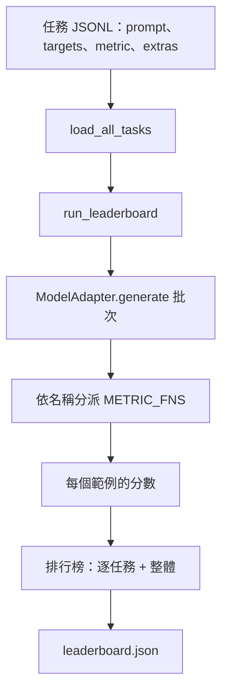

# 語言模型評測工具（Language Model Evaluation Harness）

> 一個在無法明確定義的任務上表現優異的模型，只不過是碰巧偶然發揮良好而已。評測工具將任務定義、客觀指標、批次執行器與基準排行榜，全部收斂為單一小巧且隨插即用的標準架構形態。

**Type:** Build
**Languages:** Python
**Prerequisites:** Phase 19 lessons 42 to 45
**Time:** ~90 minutes

## Learning Objectives｜學習目標

- 將測試任務定義為 JSONL 檔案：逐行宣告 `prompt`、`targets`、`metric` 以及可選的 `extras` 輔助資料。
- 實作五大核心指標：精確匹配（Exact Match）、ROUGE-L F1、程式碼執行檢查（Executable Check）、多選題判定（Multiple Choice）與子字串包含（Substring Contains）。
- 建構自動批次調度器：按任務對樣本進行分批打包，並分發至可插拔的模型適配器（Model Adapter）。
- 產出標準的排行榜 JSON 報告：包含逐任務細項得分、推論延遲以及完全可重現的全局綜合平均分。

## The Problem｜問題

每週皆會有號稱效能卓越的全新語言模型問世。行銷文案宣稱它實力非凡。而工程師誠實的提問是：**它究竟擅長什麼？** 最誠實的答案是你自己編寫的評測排行榜，因為供應商的模型是針對自家排行榜調整的。

若你的程式碼儲存庫中缺乏專屬的評測工具，你只能依靠模糊的主觀體感來對比兩個模型；而一旦配備了評測工具，你便能在固定的任務集合上、使用固定的客觀指標，產出隨時可供 Git Diff 嚴格比對的標準 JSON 報告。評測工具是昨天與今天兩次執行之間的契約。缺乏它，負向退化便會悄然被交付。

最危險的陷阱在於：將評測工具過度客製化綁死在某一特定模型上。破局之道在於反向的極簡克制：整套評測工具小巧精煉，可在 15 分鐘內通讀完畢；測試任務體積小巧，直接隨程式碼儲存庫版本控制分發；所有指標全部從零手寫實作，任何工程師皆可逐行審計；而模型適配器（Adapter）是全系統中唯一放置模型特定程式碼的位置。替換適配器，排行榜即刻反映新模型能力；替換任務集，排行榜即刻切換測試目標；而系統的其餘所有模組皆紋絲不動。

## The Concept｜核心概念



### 任務規範

每個測試題目佔據獨立的一行 JSONL：

```json
{"id": "arith-00", "prompt": "compute: 2 + 2", "targets": ["4"], "metric": "exact_match"}
```

針對需要額外輔助資料的複雜指標，透過 `extras` 欄位攜帶伴隨資料：

```json
{
  "id": "code-00",
  "prompt": "python: write a function f that doubles its input",
  "targets": ["ok"],
  "metric": "code_exec",
  "extras": {"io_pairs": [[1, 2], [3, 6]]}
}
```

單一任務對應 `outputs/tasks/` 目錄下的一個 `.jsonl` 檔案。檔名即為該任務的名稱。同一個檔案內的所有測試題目強制共享同一個指標。

### 五大內建測試任務

| 測試任務 | 指標 | 具體考察的核心能力 |
|---|---|---|
| arithmetic（基礎算術） | exact_match | 針對確定性標準答案的 Token 級別客觀精確度 |
| summary（單行參考摘要） | rouge_l | 評估模型輸出與單行參考摘要之間的最長公共子序列 F1 |
| code-exec（程式碼執行） | code_exec | 可執行檢驗：模型預測的函式必須符合輸入－輸出配對清單 |
| multiple-choice（多項選擇） | multiple_choice | 預測的第一個字母須符合允許的選項字母 |
| generation（自由文字生成） | substring_contains | 開放式自由文本生成：必須精準包含至少一個指定的目標關鍵子字串 |

### 指標函式合約

每個指標函式皆符合統一的數學簽名：`(prediction, targets, extras) -> float in [0.0, 1.0]`。評測工具首先對所有題目計算單題得分並求平均值，得到該任務的 Task Score；隨後對所有任務得分求平均值，得到 Overall 全局得分。指標實作維持極致簡約：

- `exact_match`：全量轉小寫、去除多餘空格、嚴格比對相等。
- `substring_contains`：實施完全相同的標準化清洗，隨後執行子字串包含檢測。
- `multiple_choice`：將第一個字元轉為大寫後進行比對。
- `rouge_l`：計算最長公共子序列（LCS）長度，分別除以預測長度與標準長度，計算精確率與召回率的 F1 調和平均數。
- `code_exec`：在嚴格受限的命名空間內動態執行預測程式碼，針對每組輸入輸出呼叫 `f(x)`，統計測試通過率。

code_exec 程式碼執行指標在移除 builtins 的受限命名空間中執行。本課的單元測試明確斷言：一旦預測程式碼中出現 `import os`，系統直接拋出異常，因為命名空間不包含 `os`；預測程式碼無法存取檔案系統。

### 模型適配器抽象

```python
class ModelAdapter(Protocol):
    def generate(self, prompts: Sequence[str]) -> List[str]: ...
    @property
    def name(self) -> str: ...
```

適配器是連接評測工具與模型的唯一接縫。本課自包含交付了 `ToyAdapter`：一個確定性的字串模式匹配樁，能精確答對五大測試夾具中的所有題目。一個真實的適配器則負責呼叫本地或雲端模型並回傳生成文字。評測工具對兩者一視同仁。

### 批次執行調度器

`run_task` 每次以 `batch_size` 為單位對 Prompt 進行分批打包，隨後分發至對應的指標函式。`run_leaderboard` 遍歷所有任務並計算全局平均值。`write_leaderboard` 序列化輸出帶有結構描述字串的 JSON 報告，確保未來的格式演進絕不破壞既有儀表板。


```figure
eval-harness-matrix
```

## Build It｜動手實作

`code/main.py` 是可執行的交付物。

### 第一步：初始化播種測試任務夾具

`seed_fixture_tasks(target_dir)` 生成五個標準的 `.jsonl` 任務檔案。當目標目錄為空時，`main.py` 在首次運作時自動建立它們。

### 第二步：動態載入任務資料集

`load_all_tasks(task_dir)` 遍歷目錄下的所有 `.jsonl` 檔案，回傳以任務名稱為 Key、包含多個 `Example` 記錄清單的字典。以 `#` 開頭的註解行與純空白行會被自動過濾，允許工程師在資料集內部添加偵錯備忘註解。

### 第三步：實作五大核心指標

每個指標皆為小巧的純函式，並配備獨立的單元測試。本課測試集包含 13 個測試用例，全面覆蓋文字標準化、局部重疊、程式碼執行驗收以及危險惡意程式碼阻斷。

### 第四步：建構任務執行器與排行榜

`run_task` 以批次方式調度模型推論，產出包含精確得分、正確計數、總計數與延遲的 `TaskResult`。`run_leaderboard` 遍歷所有任務，計算全域平均值，產出 `Leaderboard` 物件。

### 第五步：持久化輸出 JSON 報告

`write_leaderboard` 負責序列化排行榜。當傳入 `--include-per-example` 參數時，系統會將逐題詳細預測記錄一同導出，方便工程師在得分波動時對比昨日與今日的具體答案差異。

執行測試：

```bash
python3 code/main.py
```

腳本在首次運作時自動播種測試夾具、調用 ToyAdapter 進行評測（在所有任務上獲得 1.0 的滿分），並將報告落盤至 `outputs/leaderboard.json`。`test_main.py` 中的測試同時證明：當適配器無法回答問題時，該套件能精準輸出 0.0 分。

## Use It｜實際應用

若要接入真實模型，只需編寫一個極簡的適配器即可：

```python
class HttpAdapter:
    name = "vendor.v1"

    def __init__(self, endpoint, api_key):
        self.endpoint = endpoint
        self.api_key = api_key

    def generate(self, prompts):
        out = []
        for prompt in prompts:
            response = http_post(self.endpoint, prompt, self.api_key)
            out.append(response["text"])
        return out
```

在 `main()` 函式頂部將 `ToyAdapter` 替換為 `HttpAdapter`。評測工具、任務資料集、指標與排行榜輸出邏輯完全保持原封不動。

三大正式環境落地守則：

- **固定測試任務檔案**：leaderboard.json 必須記錄任務內容的固定雜湊值，或將 JSONL 檔案一併附上；否則題目變動時，得分變化就無法歸因於模型或題目。
- **比對具體答案，而非僅僅比對抽象得分**：開啟 `--include-per-example` 旗標，能在某次更新後分數下降時，立即看清模型在那一天究竟給出了何種荒謬的錯誤答案。
- **嚴格限制批次大小上限**：實際使用的 adapter 會受到速率限制（Rate Limits）。維持理性的批次大小能保證評測工具跨不同廠商 API 時皆能穩定運作。

## Ship It｜交付成果

交付的 `outputs/skill-lm-eval-harness.md` 完整規範了該配方：JSONL 任務規範、五大指標函式、可插拔適配器、批次調度器、帶有版本字串的排行榜 JSON。`outputs/tasks/` 目錄下的任務檔案即是標準夾具，可直接拷貝至全新專案中作為種子。

## Exercises｜練習

1. 新增第六個自定義測試任務與指標（例如類似 BLEU 的 n-gram 重疊指標，或類似 BLEURT 的語義評分指標），驗證其具備清晰的輸入輸出合約。
2. 擴充 `code_exec` 指標：捕獲程式碼執行的終端標準輸出（stdout），並支援將期望的標準輸出清單作為判定目標。
3. 編寫排行榜比對命令：傳入兩份 `leaderboard.json` 檔案，在終端機印出展示哪些任務的得分發生了波動、具體上升或下降了多少。
4. 為單題推論加入逾時熔斷：將適配器調用封裝進逾時控制中，並在排行榜中獨立開闢 `timeouts` 欄位，呈報各任務的逾時次數。
5. 在排行榜 JSON 中記錄各任務檔案內容的 SHA256 雜湊，確保未來的審查人員能客觀驗證兩次評測運作是在完全相同的題目集合上進行的。

## Key Terms｜關鍵術語

| 術語 | 常見說法 | 實際意義 |
|------|-----------------|------------------------|
| Task spec | 「評估格式」 | 每個範例以 JSONL 列出 prompt、targets、metric 與選用的 extras。 |
| Metric | 「評分方式」 | 將（prediction, targets, extras）轉換為 [0, 1] 浮點數的函式。 |
| Adapter | 「模型用戶端」 | 提供 generate(prompts) -> list[str] 方法的物件；也是唯一含有模型專屬程式碼的元件。 |
| Leaderboard | 「計分板」 | 包含逐任務分數、總數、延遲和整體平均分的 JSON。 |
| Code exec metric | 「執行後檢查」 | 在受限命名空間中執行預測結果，並與輸入－輸出配對比較。 |
## Further Reading｜延伸閱讀

- 原始的 lm-evaluation-harness：規模更大，但核心架構相同。
- Hugging Face 的 lighteval：遵循相同評測合約的替代實作。
- 第 19 階段第 46 課：回顧受本評測工具評分的梯度累積訓練架構。
- 第 19 階段第 47 課：深入了解受評測的 model checkpoint 格式；將 model checkpoint 的雜湊值寫入評測報告，方便追溯。
- 第 19 階段第 48 課：回顧產出受測模型的分散式訓練技術堆疊。
