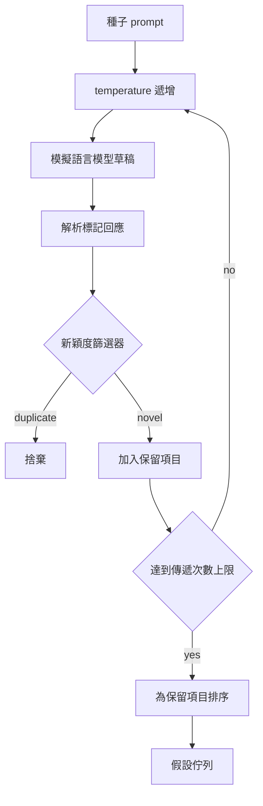

# 科研假設生成器（Hypothesis Generator）

> 一個反覆提出雷同問題的科研 Agent，只不過是在毫無意義地浪費 token。真正的工程巧思在於強制每一次起草皆能落在全新的地方。

**Type:** Build
**Languages:** Python
**Prerequisites:** Phase 19 Track A lessons 20-29
**Time:** ~90 minutes

## Learning Objectives｜學習目標
- 驅動取樣器自種子 Prompt 出發，將生成文字解析為強型別的假設記錄（Hypothesis Records）。
- 在每次取樣傳遞中動態爬升取樣溫度（Temperature Ramping），引導後續起草逐漸遠離前序草稿的思維定勢。
- 使用輕量級 embedding 模型與餘弦距離閾值，過濾詞彙特徵相近的近似重複假設。
- 實作綜合創新度（Novelty）、具體性（Specificity）與可測性（Testability）的加權評分函式，對候選假設進行動態優先級排序。
- 全流程維持嚴格確定性，確保相同的種子輸入永遠穩定產出完全相同的假設佇列。

## 為何先生成後過濾

如果一個規劃器每次僅向模型索取單一假設，這在教學玩具範例中或許足夠，但在真實自主科研控制迴圈中則是完全錯誤的架構形狀。科研迴圈需要的是一個**具備深度的排隊佇列**——如此一來，當第一條假設在實驗中證偽失敗時，執行器無需再次發起昂貴的模型全流程取樣，即可直接取出下一條就緒的備選假設。

兩項核心技術思想協同建構了該佇列：第一項是**動態溫度爬升（Temperature Ramping）**：每經過一輪取樣，系統自動將取樣溫度拉高一檔，強制激勵後續草稿向更廣闊的未知語義空間發散探索；第二項是**創新度過濾（Novelty Filtering）**：在每次草稿產出後，生成器即時計算該文本與所有既有倖存假設之間的向量距離，堅決丟棄任何落在已知語義聚集叢集內部的同質化候選。

本課提供了一個確定性的 Mock 語言模型樁，針對固定 Prompt 回傳結構化的腳本 Token 序列。該模擬樁完全足以貫穿全鏈路驗證：種子 Prompt 輸入、溫度爬升排程、候選標籤解析、創新度過濾篩選，以及最終的排序佇列輸出。

## 假設資料結構的標準規格

```text
Hypothesis
  id             : int           (monotonic within a run)
  text           : str           (the claim)
  variables      : list[str]     (what changes between conditions)
  metric         : str           (what the runner will measure)
  baseline_ref   : str | None    (which paper or run the comparison cites)
  draft_pass     : int           (which sampler pass produced this)
  temperature    : float         (the sampler setting at draft time)
  novelty_score  : float         (distance from prior survivors, 0..1)
  rank_score     : float         (weighted sum used for ordering)
```

`variables`（條件間會改變的項目）與 `metric`（觀測指標）不是自由文字。解析器會從標記回應中擷取這兩個欄位。第五十二課的實驗執行器在組裝實驗設定時，會直接讀取這些欄位。

`baseline_ref` 是可選但強烈推薦的參考基準。第五十三課的評估器需要基準線作為比較對象。若假設中遺漏了該參考項，評估器將自動回退至同指標上的上一輪歷史運作結果。

```figure
cg-novelty-ramp
```

## 系統架構



控制迴圈結構清晰明瞭。最關鍵的是每個節點皆具備不可逾越的剛性契約。

## 動態溫度爬升機制

起始溫度為 `t_min`，終止溫度為 `t_max`，單步爬升步長為 `(t_max - t_min) / (n_passes - 1)`。每一次傳遞皆以當前溫度呼叫取樣器，依據 `GeneratorConfig.schedule()` 產出 `n_passes` 個均勻間隔的取樣點。Mock 模型透過在以 `(prompt, temp_bucket)` 為 Key 的預設響應表中切換，完美模擬溫度調控行為。溫度桶為開區間，微小的溫度跨度即可觸發不同的回應模板。在正式環境中，取樣器會改用真實模型，並傳入 `temperature=t`。

預設排程設定為 6 輪傳遞，溫度自 `0.2` 平滑爬升至 `1.2`。6 輪已完全足以填滿候選佇列，且絕不浪費算力去生成那些注定會被創新度過濾器無情抹除的垃圾樣本。低於 `0.2` 時，模型只會復讀原始種子的陳詞濫調；高於 `1.2` 時，回應可能偏離主題並無法通過解析器。

## 創新度向量過濾器

每當一份新草稿被成功解析後，生成器立即對其文字進行 embedding，並計算其與所有既有倖存假設的餘弦距離。embedding 演算法採用輕量級的雜湊詞袋（Hashed Bag of Words）並歸一化為單位向量。兩個單位向量之間的餘弦距離定義為 `1 - dot(a, b)`。只有當新草稿與所有既有假設的最小距離嚴格大於 `novelty_threshold` 閾值時，方可獲准晉升為倖存者。預設閾值設定為 `0.25`。

基於雜湊的特徵 embedding 簡潔純粹：具備 100% 的確定性、零外部第三方依賴，且足以抓出明顯案例（例如兩份草稿的大部分名詞相同）。在工業級正式環境中，隨時可將其無縫替換為現代小型語句向量模型，外部介面完全相容。

## 綜合優先級評分

```text
rank_score = w_novelty * novelty_score
           + w_specificity * specificity_score
           + w_testability * testability_score
```

評分由三大子維度加權求和而成：`novelty_score` 是與既有假設的最小特徵距離；`specificity_score` 是假設中所包含的具體實驗變數數量除以目標變數數；`testability_score` 是一項關鍵指標——若同時定義了指標與參考基準線則記 1.0 分，若僅定義了指標則記 0.5 分，若皆缺失則記 0 分。

預設加權比例為 `0.4`、`0.3` 與 `0.3`。權重完全在配置類別中宣告，下游專案可在不更動底層程式碼的前提下自由調整策略偏好。

## 模擬語言模型樁

```python
class MockLLM:
    def sample(self, prompt: str, temperature: float, seed: int) -> str:
        ...
```

在給定 `(prompt, temperature, seed)` 三元組的前提下，取樣器具備嚴格的確定性。Mock 內部維護一張以 `(prompt_signature, temperature_bucket)` 為 Key 的預設響應表。若查表缺失，取樣器回傳一個會故意觸發解析失敗的兜底字串，單元測試集嚴密覆蓋了這條異常路徑。

隨機種子被混合進響應標籤中，確保同一個 `(prompt, temperature)` 在不同種子下能產出不同草稿。在單元測試中我們強制鎖定隨機種子以確保 100% 可重現性；在正式環境中，種子可來自系統時鐘或計數器。

## 標準輸出佇列

最終產出一個按 `rank_score` 降序排列的強型別 `Hypothesis` 記錄清單。第五十二課的實驗執行器自佇列頭部彈出（Pop）優先級最高的第一條假設執行實驗；第五十三課的評估器在實驗結束後出具最終裁判。若結果表明該假設被證偽，執行器隨即直接彈出下一條候選假設接續推進。

佇列長度是有限的。一旦佇列耗盡，編排器可以選擇擴充原始種子 Prompt 的範疇重新觸發生成，或者終止任務並呈報算力預算耗盡。

## 程式碼導讀

`code/main.py` 定義了 `Hypothesis` 資料類別、`MockLLM` 模擬語言模型、`HypothesisGenerator` 核心生成器以及確定性演示程式。生成器暴露單一的 `run(seed_prompt)` 入口並回傳排序佇列；傳遞輪次由 `GeneratorConfig.n_passes` 讀取。特徵 embedding 採用純原生雜湊詞袋，創新度過濾與綜合評分皆封裝為小巧的純函式，完全不依賴 `numpy` 等第三方重型數學庫，具備極致的跨平台可攜性。

`code/tests/test_generator.py` 完整覆蓋了線性正確路徑、重複假設攔截過濾、解析器異常容錯、溫度爬升邊界驗證以及最終優先級排序的嚴密斷言。

## 在科研閉環中的架構定位

第五十課負責產出假設施工作業佇列；第五十一課提取佇列頭部並觸發學術文獻檢索，自已知人類知識庫中驗證或駁斥該假設；第五十二課提取同一個假設頭部並調度算力執行真實物理實驗；第五十三課綜合文獻與實驗結果，出具最終裁判。這四節課無縫咬合為一個完全無人值守的自主科研控制迴圈；同時在每一個邊界節點上，皆允許人類科學家隨時介入審查與轉向。
