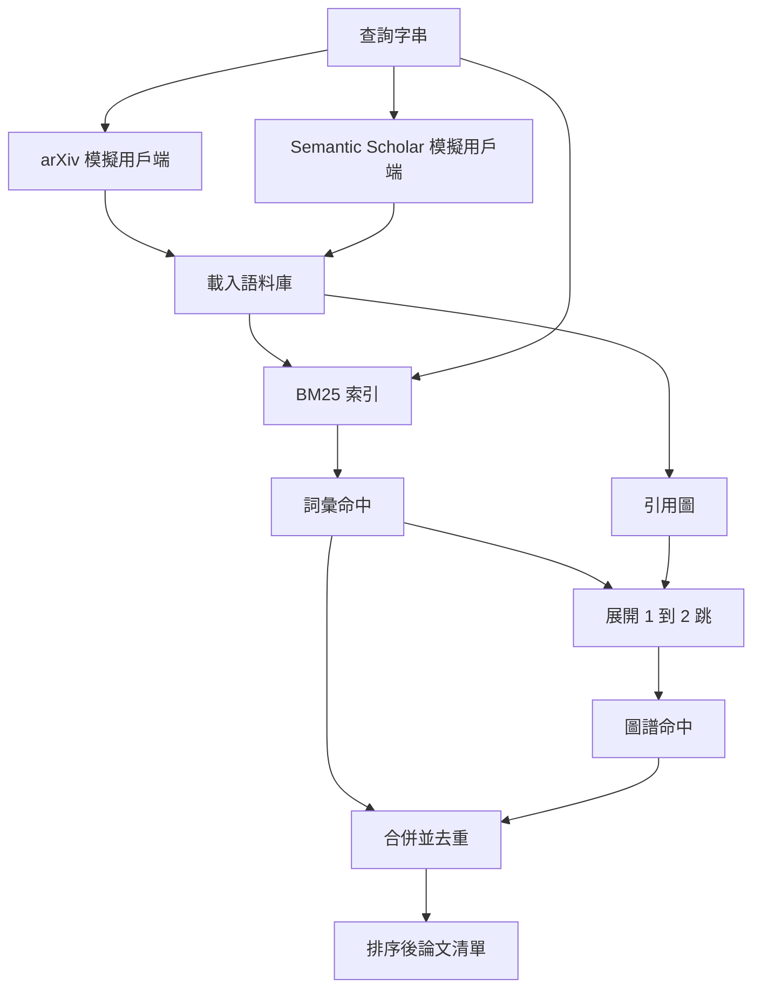

# 學術文獻檢索（Literature Retrieval）

> 提出一個科研假設是廉價的；而搞清楚是否早就有人證明過該結論，才是最昂貴的環節。在實驗執行器啟動算力沙盒之前，優先打造解答該問題的文獻檢索層。

**Type:** Build
**Languages:** Python
**Prerequisites:** Phase 19 Track A lessons 20-29
**Time:** ~90 minutes

## Learning Objectives｜學習目標
- 抽象建模精簡的論文記錄結構，涵蓋後續科研控制迴圈所需的全部核心欄位。
- 僅依託 Python 標準庫資料結構，親手實作完整的 BM25 論文摘要倒排索引。
- 沿著引用關係拓撲圖展開雙向游走遍歷，挖掘詞彙檢索所遺漏的深層關聯論文。
- 基於穩定的論文 ID，對詞彙檢索與圖譜檢索兩路召回結果實施精確去重與融合。
- 將兩套模擬的外部文獻 API 封裝在統一用戶端身後，確保在未來接入真實線上端點時上層調用完全無感。

## 為何需要兩路檢索

單純在論文摘要上執行關鍵字檢索，只能召回那些在詞彙表面上與查詢提問高度重疊的論文。這能覆蓋大多數常規情境，但必然會遺漏兩大關鍵死角：第一類是**開創性奠基論文採用了完全不同的專業詞彙**（例如提問「稀疏注意力（Sparse Attention）」，卻漏掉標題為「Transformer 路由中的區塊選擇（Block Selection in Transformer Routing）」的論文）；第二類是**關鍵論文是針對某個已知經典錨點的後續突破**——在此情境下，先定位該經典論文錨點隨後沿著引用圖向前遍歷追溯，遠比在大海撈針的摘要庫中盲目暴力匹配高效得多。

本課親手實作這兩路檢索：基於摘要的 BM25 檢索負責捕捉字面語義命中；引用圖譜拓撲遍歷則以初始種子為起點，向前與向後展開 1 至 2 跳（Hops）的關聯擴展。兩路候選集基於論文 ID 去重合併，並依照多維度綜合得分進行加權重排序。

## 論文資料結構的標準規格

```text
Paper
  id          : str           (stable identifier, "p001" for the mock corpus)
  title       : str
  abstract    : str
  year        : int
  authors     : list[str]
  references  : list[str]     (paper ids this paper cites)
  citations   : list[str]     (paper ids that cite this paper)
  source      : str           (which mock api supplied it, "arxiv" or "s2")
```

references（本文引用的前人文獻）與 citations（引用本文的後續文獻）共同構成了有向引用圖譜。兩套模擬 API 回傳的欄位存在交集但並不完全相同，語料庫載入器以 `id` 為鍵對它們實施屬性聯集融合。

```figure
cg-citation-hops
```

## 系統架構



檢索用戶端統籌兩路檢索與最終合併。呼叫端傳入自然語言查詢字串，用戶端回傳排序後的論文清單，每個條目皆附帶清晰的細分得分欄位（`bm25_score`、`graph_distance`、`recency_score`、`final_score`），完整解釋排序背後的客觀依據。

## 從零實作 Okapi BM25

實作採用經典的 Okapi BM25 演算法，預設超參數設定為 `k1=1.5`、`b=0.75`。底層索引僅依託兩個原生字典：`term -> doc_frequency`（文件頻率）與 `term -> list of (doc_id, term_count)`（倒排列表）。文件長度為摘要切分出的 Token 總數；平均文件長度在索引建置時一次性算好。查詢打分是針對查詢中所有詞項求和 `idf * tf_norm`，其中 `tf_norm` 為經過文件長度正規化的標準詞頻。

tokenizer 首先執行 `lower`，隨後在非字母數字字元處切分。本課未引入詞幹提取（Stemming）。在生產系統中可隨時替換為小型 Stemmer 模組，對外介面完全相容。

```text
idf(t)      = log((N - df + 0.5) / (df + 0.5) + 1.0)
tf_norm(t)  = (f * (k1 + 1)) / (f + k1 * (1 - b + b * dl / avgdl))
score(d, q) = sum over t in q of idf(t) * tf_norm(t)
```

## 引用圖譜拓撲遍歷

圖譜會從語料庫建構一次。前向邊自論文指向其引用的參考文獻（References）；後向邊自論文指向引用了它的衍生文獻（Citations）。遍歷演算法以 BM25 檢索排名前列的文獻作為種子節點，發起廣度優先搜尋（BFS），最大跳數嚴格限制為 2 跳。

2 跳是一項深思熟慮的上限設定：1 跳過於淺薄，往往只能抓到直系祖先或後代；3 跳則會在高度連通的學術網路中使結果集急遽膨脹，並往往偏離原始查詢主題。本課將跳數上限暴露為可配置參數，供下游迴圈靈活調節。

## 去重與加權重排

兩路檢索會產出大量重疊的候選集合。合併邏輯以論文 ID 作為唯一鍵值。針對每篇論文，最終得分為各子項的加權融合：

```text
final_score = w_bm25 * bm25_score_norm
            + w_graph * graph_score
            + w_recency * recency_score
```

`bm25_score_norm` 是原始 BM25 分數除以候選集中最高 BM25 得分（歸一化至 0 到 1 區間）；`graph_score` 針對文字直接命中記 1.0 分，1 跳鄰居記 `0.6` 分，2 跳鄰居記 `0.3` 分，其餘記 0 分；`recency_score` 是自語料庫最早發布年份至最新年份的線性歸一化分數。

預設加權權重為 `0.5`、`0.3` 與 `0.2`。這些權重屬於配置項：在成熟陳舊的研究主題中可調低時效性權重，而在日新月異的爆發領域則可大幅拉高時效性權重。

## 模擬論文語料庫

測試語料由 `build_corpus()` 在記憶體中動態生成，包含 100 篇生成的論文。每篇論文皆具備精心撰寫的標題與摘要，橫跨五大經典研究領域：稀疏注意力（Attention Sparsity）、檢索增強生成（RAG）、低秩適配（LoRA）、資料集蒸餾（Dataset Distillation）與評估執行環境（Evaluation Harnesses）。文獻引用關係被嚴密編織，使各主題形成連通子圖，並有少數跨主題邊。

兩套模擬 API 用戶端（`ArxivMockClient` 與 `SemanticScholarMockClient`）讀取完全相同的語料庫，但暴露各自不同的欄位視圖。arXiv 僅提供標題、摘要、年份與作者；Semantic Scholar 額外提供引用文獻清單與被引清單。檢索用戶端自動以 ID 實施融合；不同用戶端欄位不一致的處理方式留待後續課程說明。

## 下游模組讀取規格

第五十二課的實驗執行器將讀取 `paper.id`、`paper.title` 以及摘要的前三句話，作為實驗的背景資訊。第五十三課的評估器則讀取 `paper.year` 與 `paper.references`，將實驗結果與特定的歷史基準文獻進行精確歸因比對。

檢索用戶端回傳一個結構化的 `RetrievalResult` 物件，同時封裝排序後的論文清單與本次查詢的關鍵指標：命中數、平均分、最高分以及端到端物理耗時。執行器會即時記錄這些指標，供可觀測性看板繪製長期檢索品質走勢圖。

## 程式碼導讀

`code/main.py` 定義了 `Paper`、`ArxivMockClient`、`SemanticScholarMockClient`、`BM25Index`、`CitationGraph`、`RetrievalClient` 以及確定性演示程式。模擬用戶端與語料庫全量收斂在單一檔案內，保持極致的自包含性。BM25 實作僅有 60 行，圖譜遍歷僅需一個清晰的方法。

`code/tests/test_retrieval.py` 完整覆蓋了純文字路徑、圖譜拓撲路徑、結果合併、去重邏輯以及空查詢防禦的單元測試。

## 在科研閉環中的架構定位

第五十課產出假設佇列；第五十一課執行文獻檢索，檢視該假設是否已有定論；若尚無定論，第五十二課立即接手並執行實驗；第五十三課綜合文獻檢索結論與實驗觀測指標，出具最終裁判。文獻檢索是四個階段中算力開銷最低的環節，因此在編排器中永遠被置於最前端優先觸發。
