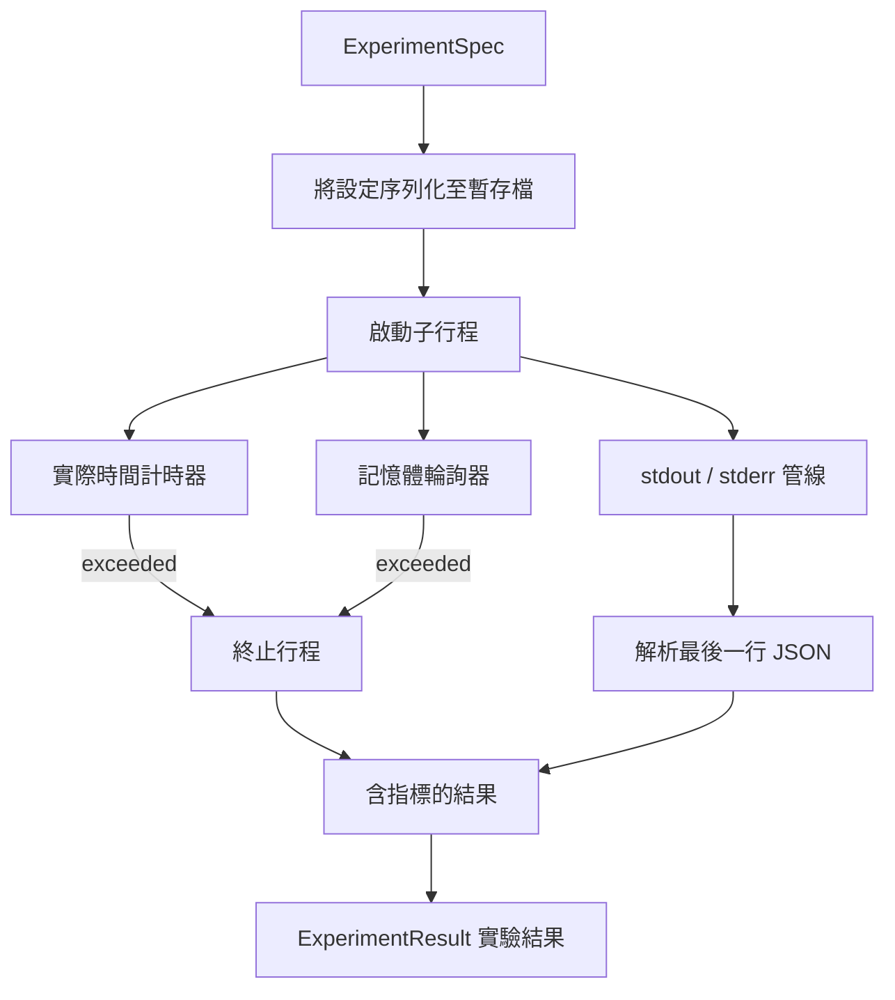

# 實驗執行器（Experiment Runner）

> 科研控制迴圈的客觀真實性，完全取決於其測量手段的誠實度。本課將親手打造實驗執行器：接收規格說明書、在沙盒化的子行程中執行程式碼，並產出一份值得評估器深度信賴的結構化 JSON 指標資料塊。

**Type:** Build
**Languages:** Python
**Prerequisites:** Phase 19 Track A lessons 20-29
**Time:** ~90 minutes

## Learning Objectives｜學習目標
- 將實驗編碼為強型別規格說明書（ExperimentSpec），使執行器能將其序列化並派生子行程。
- 啟動子行程並施加硬性實際時間逾時（Wall-clock Timeout）與軟性記憶體上限（Soft Memory Cap），將兩者暴露為明確的終止條件。
- 完整擷取標準輸出（stdout）、標準錯誤（stderr）與結構化指標資料塊，沉澱進單一的結果物件中。
- 建置消融實驗表（Ablation Table）：在固定基礎規格上，一次僅對單一配置旋鈕發起參數掃描。
- 鎖定隨機種子以確保實驗結果具備確定性，使評估器在多次重複運作中看見完全相同的數值。

## 為何採用子行程

自主科研迴圈在本質上運作的是未經充分審查的不可信程式碼。假設由取樣器產生，實驗腳本亦源自同一路徑；將兩者直接置於主行程內部執行，等同於引狼入室，任何未捕獲的底層崩潰都會直接拖垮整個頂層編排器。子行程是程式語言自帶的最簡純粹隔離：完全獨立的作業系統行程、相互隔離的記憶體位址空間，以及父行程端可靠的訊號控制機制。

本課所實作的執行器並未追求作業系統核心級別的極限沙盒（無 cgroup、無 seccomp 系統呼叫過濾、無 namespace 重新映射）。但它具備剛性的實際時間逾時、定時輪詢記憶體膨脹的監控執行緒，以及在觸發任意紅線時強制殺死子行程的處置邏輯。這正是所有更為複雜的重型沙盒所依託的最小執行環境合約。本課刻意將合約維持在一次閱讀就能看完的篇幅。

## 實驗規格的標準結構

```text
ExperimentSpec
  spec_id        : str            (stable id, "exp_001")
  hypothesis_id  : int            (link back to the queue from lesson 50)
  script_path    : str            (path to the python script to run)
  config         : dict           (passed to the script as one json arg)
  seed           : int            (deterministic seed for the experiment)
  wall_timeout_s : float          (hard timeout, killed on exceed)
  memory_cap_mb  : int            (soft cap, polled; killed on exceed)
  metric_keys    : list[str]      (which fields the evaluator will read)
```

實驗腳本存放在磁碟上；執行器將配置參數寫入臨時檔案供腳本讀取。腳本在執行完畢時，預期會在 stdout 終端機標準輸出上印出單行 JSON，其包含的 Key 必須涵蓋 `metric_keys` 所宣告的所有必要指標。標準輸出上的其餘雜項文字會被完整捕獲，但會被指標解析器安全忽略。

```figure
cg-runner-limits
```

## 系統架構



執行器是一個包含單一主方法的乾淨類別。記憶體輪詢器是一個輕量級背景執行緒，按固定間隔喚醒，讀取 proc 檔案系統中相當於 `psutil` 的子行程資料，在不支援該特性的平台上則優雅降級為空操作。

## 軟性記憶體上限的考量

硬性記憶體限制依賴 POSIX 特有的 `resource.setrlimit`，無法跨平台通用。本課採用具備高移植性的工程方案：在背景輪詢子行程的實體常駐記憶體（RSS），一旦偵測到數值超越上限，主動發起 Kill 終止。該限制之所以被稱為「軟性」，是因為輪詢存在非零的時間間隔；在兩次輪詢之間，行程可能瞬間激增並隨即回落。執行器在結果中忠實記錄所觀測到的最大峰值 RSS，供評估器判斷當前實驗距離記憶體紅線究竟有多近。

在缺乏行程記憶體檢查支援的作業系統上，輪詢器記錄一次警告後自動停用。但實際時間逾時控制在任何環境下皆始終剛性生效。單元測試全面覆蓋了這兩條執行路徑。

## 標準輸出與錯誤流擷取

執行器在子行程結束時，一次性排空並讀取兩條管線資料。Stdout 被逐行掃描；最後一行能夠被成功解析為 JSON 且完整包含所有 `metric_keys` 的文字，被正式認定為最終指標資料塊。在此之前的其餘 JSON 輸出被保留在 `intermediate_metrics` 中，評估器可據此繪製訓練過程中的學習曲線。

Stderr 報錯文字被原汁原味地完整記錄至結果物件中。執行器絕不在子行程回傳非零退出碼時向外拋出未捕獲異常；而是將其客觀記錄在結果中。任何非零退出碼一律被打上 `"crash"`（崩潰）標籤（即便腳本在中途曾勉強印出過部分指標），確保評估器預設將任何不完整的執行視為徹底失敗。

## 消融實驗表生成

```python
def ablate(base: ExperimentSpec, knob: str, values: list[Any]) -> list[ExperimentSpec]:
    ...
```

傳入基礎實驗規格與目標旋鈕名稱，該輔助函式針對每個候選值回傳一個繼承基礎設定且精準覆蓋 `config[knob]` 的獨立規格物件。每個派生規格皆擁有依指定格式衍生的 `spec_id`（如 `f"{base.spec_id}_{knob}_{value}"`）。執行器內建 `AblationRunner`，依序執行所有規格，並回傳以旋鈕數值為 Key 的 `AblationTable`。

為何堅持一次只調節一個旋鈕？全因子（Full Factorial）網格爆炸會引發計算維度的幾何級數激增，並產出評估器無法解讀的結果。一次只動一個變數，才能產出可供評估器繪圖的乾淨座標軸。本課僅以重複的單旋鈕消融支援多旋鈕掃描，並由呼叫端負責組合。

## 確定性保證

每一個實驗規格皆嚴格攜帶隨機種子。執行器透過配置字典將該種子透傳給子行程腳本（`config["__seed"] = spec.seed`）。在 `code/experiments/` 中提供的模擬實驗腳本恪守該種子，在不同運作中能保證產出相同的指標數值。第五十三課的評估器高度依賴該確定性；若缺乏確定性，「實驗指標退化」很可能只是由不同的隨機初始化雜訊引發的假象。

## 模擬實驗腳本

本課內建了一個標準的模擬實驗腳本：`code/experiments/sparsity_experiment.py`。這是一個真實的可執行 Python 腳本：讀取配置檔案路徑、基於 numpy 隨機數模擬一次微型訓練過程，並在退出時印出一行標準的 JSON 指標。腳本支援接收 `sleep_s` 參數用於觸發超時測試，接收 `allocate_mb` 參數，用於測試記憶體限制的輪詢與終止路徑。

該模擬腳本並未進行真實的神經網路運算。它是一個數值計算模擬器，模擬了訓練迴圈的形態：損失函數下降曲線、最終困惑度指標、物理時鐘耗時。本課的核心在於掌握執行器本身的工程架構，而非被龐大的具體模型分散精力。真正的實驗程式會匯入模型。

## 最終實驗結果結構

```text
ExperimentResult
  spec_id              : str
  hypothesis_id        : int
  exit_code            : int
  terminal             : "ok" | "timeout" | "oom" | "crash"
  wall_time_s          : float
  peak_rss_mb          : float | None
  metrics              : dict
  intermediate_metrics : list[dict]
  stdout_tail          : str
  stderr_tail          : str
```

評估器在審查結果時，優先讀取 `metrics` 與 `terminal`。若 terminal 不是 `"ok"`，該次實驗即視為失敗；只有狀態為 "ok" 時，指標資料才會送入後續的統計顯著性檢定。

## 程式碼導讀

`code/main.py` 定義了 `ExperimentSpec`、`ExperimentResult`、`ExperimentRunner`、`AblationRunner` 以及確定性演示程式。子行程管理收斂於單一主類別。記憶體輪詢器是一個精巧的背景執行緒。消融輔助方法是一個純函式。

`code/experiments/sparsity_experiment.py` 是測試專用的模擬實驗腳本。它自命令列參數讀取配置路徑，並在結束時印出單行 JSON。

`code/tests/test_runner.py` 完整覆蓋了正常成功路徑、逾時強殺路徑、崩潰攔截路徑、消融實驗矩陣執行，以及兩次運作之間的嚴密確定性驗證。

## 在科研閉環中的架構定位

第五十課提出科研假設；第五十一課過濾掉文獻中早已解決的冗餘想法；第五十二課為倖存的假設執行實驗並收集資料；第五十三課讀取實驗結果，執行統計顯著性檢定，並寫下裁決，讓編排器將其與假設 ID 關聯儲存。
