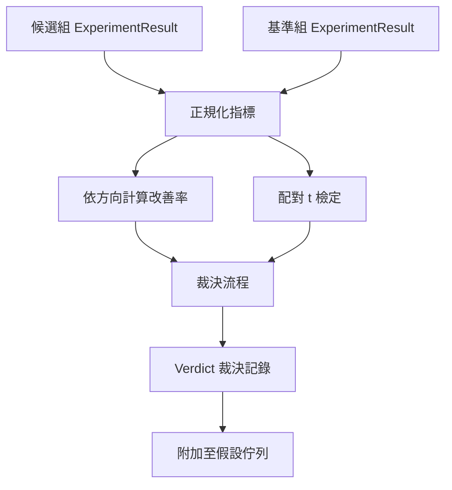

# 實驗結果評估器（Result Evaluator）

> 執行器產出數字；評估器負責判斷這些數字代表改善、退化，還是雜訊。建構一條將指標轉為一句結論的判定流程。

**Type:** Build
**Languages:** Python
**Prerequisites:** Phase 19 Track A lessons 20-29
**Time:** ~90 minutes

## Learning Objectives｜學習目標
- 結合指標改善方向感知（Direction-Aware）與硬性改善閾值，客觀對比候選實驗組與基準線組。
- 在跨隨機種子的成對指標資料上，從零手寫實作配對 t 檢定（Paired t-test），並精確計算雙尾 p 值（p-value）。
- 對對數尺度（Log-scaled）的非線性指標進行規範化平滑，使下游綜合報告能將其與線性指標融合評定。
- 為每個假設出具結構化的裁決結論（Verdict），供頂層編排器精準掛載回第五十課的假設佇列中。
- 保持所有評估步驟為純函式，確保相同的輸入資料永遠 100% 產出完全相同的裁決結果。

## 為何採用配對檢定

執行器單次運作吐出的一個孤立數字，根本無法證明技術改進是否真實存在。在完全相同的模型配置下，僅僅換一個隨機種子，測出的困惑度就會發生上下起伏。指標數值的變動很可能純粹由隨機雜訊引發。科學客觀的對照必須採用**配對實驗（Paired Experiment）**：在完全相同的資料上、使用完全相同的一組隨機種子，分別在候選組（Candidate）與基準組（Baseline）各跑一次。每個種子貢獻一個差值。這些差值的平均數就是效果（effect）；這些差值的標準誤則是雜訊底線。

本課從零實作該統計檢定，零依賴 `scipy.stats`。核心數學邏輯小巧精煉，可在單屏內一覽無餘：

```text
diffs    = [a_i - b_i for i in seeds]
mean     = sum(diffs) / n
variance = sum((d - mean) ** 2 for d in diffs) / (n - 1)
t_stat   = mean / sqrt(variance / n)
df       = n - 1
p_value  = two_sided_p(t_stat, df)
```

雙尾 p 值的計算依託正則化不完全貝塔函式（Regularised Incomplete Beta Function）。本課手寫了一套基於 Lentz 連分數（Lentz Continued Fraction）的極簡演算法，整套統計模組僅需 60 行標準庫程式碼。

## 具備方向感知的改善率計算

不同指標的「進步」在數值方向上截然不同。某些指標數值越大越好（如準確率 Accuracy、每秒吞吐量 Throughput）；而另一些指標數值越小越好（如損失函數 Loss、困惑度 Perplexity、物理耗時 Wall-time）。評估器為每個指標顯式綁定 `direction` 方向屬性：

```text
if direction == "higher_is_better":
    improvement = (candidate - baseline) / abs(baseline)
elif direction == "lower_is_better":
    improvement = (baseline - candidate) / abs(baseline)
```

改善率是一個帶有正負符號的相對比例。對於「數值越小越好」的指標，若候選組數值下降，算出的改善率為正；反之若數值上升，改善率為負。裁決路徑同時審查其符號與絕對幅度。

系統配置了硬性的實質改善閾值（`improvement_threshold=0.02`，即 2% 的改善幅度）。若相對變動幅度低於該閾值，無論 p 值在統計上多麼顯著，判定結果皆為「雜訊（Noise）」；迴圈不關注使用者無法測量的變化。

```figure
cg-paired-verdict
```

## 系統架構



評估器執行三項彼此獨立的計算，並在裁決路徑中合併結果。每一項計算皆為無共享狀態的純函式。

## 對數正規化

困惑度（Perplexity）相對於損失函數是呈指數級關係的。在 Loss 上微小的 0.1 點下降，在困惑度上會放大為劇烈的數值驟跌。直接比對兩組實驗的困惑度固然可行，但若要在單一綜合報告中將其與線性指標進行公平權衡，就必須進行對數標準化。

對於宣告了 `scale` 欄位為 `"log"` 的指標，評估器在計算改善率之前，強制取其自然對數（ln），隨後在對數空間中套用 2% 的改善閾值。例如，困惑度從 32 降至 28 時，其對數差值為 `log(28) - log(32) = -0.133`；以基準對數值計算的改善率約為 3.9%，高於 2% 閾值。

```text
if scale == "log":
    a = log(candidate)
    b = log(baseline)
else:
    a = candidate
    b = baseline
```

宣告為 `scale="linear"`（預設值）的指標直接跳過該轉換。同一套程式碼優雅相容兩種尺度。

## 按種子配對的嚴密校驗

第五十二課的執行器每次運作產出一份指標記錄。為了實施配對檢定，評估器需要候選組與基準組在各個隨機種子下對應的完整結果列表。編排器在多組相同種子下分別執行兩套配置，並向評估器傳入兩份 `ExperimentResult` 列表。

評估器依據種子 ID（存放在 `result.metrics["seed"]` 中）將兩組記錄逐一配對。若兩份列表的種子集合無法嚴格一對一雙向匹配，評估器直接拋出 `PairingError` 異常，要求編排器重新補齊缺失的實驗。

## 標準裁決物件的結構

```text
Verdict
  hypothesis_id          : int
  metric                 : str
  direction              : "higher_is_better" | "lower_is_better"
  scale                  : "linear" | "log"
  candidate_mean         : float
  baseline_mean          : float
  improvement            : float       (signed, fraction; see direction rules)
  p_value                : float | None  (None if n < 2)
  significance_threshold : float
  improvement_threshold  : float
  verdict                : "improved" | "regressed" | "noise" | "failed"
  rationale              : str
```

裁決判定路徑遵循清晰嚴密的決策表：

```text
1. If any candidate result has terminal != "ok": verdict = "failed"
2. else if |improvement| < improvement_threshold:  verdict = "noise"
3. else if p_value is None or p_value > significance: verdict = "noise"
4. else if improvement > 0:                          verdict = "improved"
5. else:                                             verdict = "regressed"
```

rationale 是一句客觀清晰的人類可讀判詞，編排器可直接將其記錄在假設歷史中。

## 程式碼導讀

`code/main.py` 定義了 `MetricSpec`、`Verdict`、`Evaluator`、t 統計量與不完全貝塔函式計算輔助類別，以及確定性演示程式。t 檢定完全由 Python 原生標準庫數學函式實作；numpy 僅用於讀取指標列表並快速計算均值與變異數。

`code/tests/test_evaluator.py` 完整覆蓋了確認改善路徑、效能退化路徑、幅度微小判定為雜訊路徑、樣本數不足判定為雜訊路徑、子行程異常終止（Failed）路徑、對數尺度平滑計算、對標已知統計學黃金參考數值的 t 檢定精度校驗，以及種子不匹配異常攔截測試。

## 在科研閉環中的架構定位

第五十課產出假設佇列；第五十一課過濾既有文獻；第五十二課在多個種子下分別執行候選組與基準組實驗；第五十三課接管實驗資料並出具最終裁決。編排器將這四課串接起來：

```text
for hypothesis in queue:
    literature = retrieval.search(hypothesis.text)
    if literature_settles(hypothesis, literature):
        attach(hypothesis, verdict="settled")
        continue
    candidates = runner.run_all(specs_for(hypothesis))
    baselines  = runner.run_all(baseline_specs_for(hypothesis))
    metric_spec = MetricSpec("perplexity", direction=LOWER, scale=LOG)
    verdict = evaluator.evaluate(hypothesis.id, metric_spec, candidates, baselines)
    attach(hypothesis, verdict)
```

本課不包含該編排器；四課只透過各自定義的資料類別就能組合，不需要額外的黏合程式碼。
