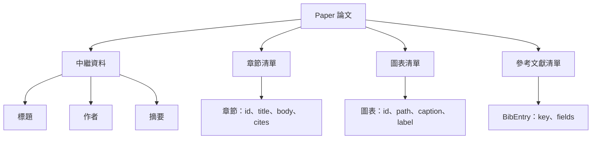
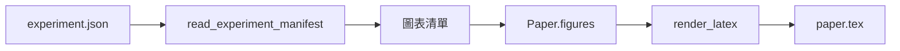
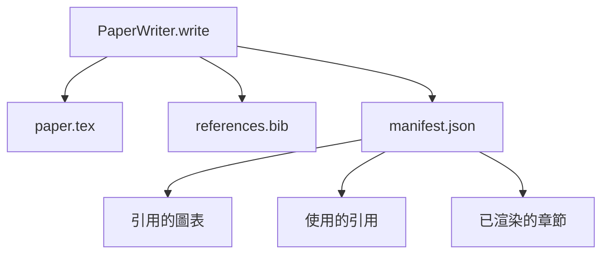

# 論文撰寫器（Paper Writer）

> 一份 LaTeX 骨架（Skeleton）本質上是科研人員與排版引擎之間簽署的剛性契約。若合約被破壞，文件將無法編譯，且編譯報錯異常刺耳。永遠堅持先建構骨架，隨後再向其中填充正文。

**Type:** Build
**Languages:** Python
**Prerequisites:** Phase 19 lessons 50-53
**Time:** ~90 minutes

## Learning Objectives｜學習目標

- 將學術論文視為具備明確章節拓撲圖的結構化產物，而非隨意揮灑的散漫非結構化文字。
- 在編寫任何具體正文段落之前，優先生成宣告好摘要、章節插槽、圖表位置與文獻引用鍵的 LaTeX 骨架。
- 透過確定性的插槽機制，將實驗產出的視覺資產（圖表路徑與圖說 Caption）自動注入骨架中。
- 封裝模擬的正文產生器：依據結構化大綱自動填充各章節段落，使整個管線在無模型介入時依然具備完整的單元可測性。
- 統一導出單一 `paper.tex` 原始碼、`references.bib` 參考文獻庫，以及一份完整記錄所有被引用圖表與文獻條目的 manifest 交付清單。

```figure
ch-paper-skeleton
```

## 為何先建構骨架

直接以自由文字草稿起步的論文寫作，會累積結構性技術債務。引言（Introduction）中往往會悄悄膨脹出原本應當屬於相關工作（Related Work）的冗餘段落；某張圖表在尚未被定義聲明前就被正文提前引用；參考文獻庫中為同一篇論文建立了三個不同的引用 Key。等到作者驚覺混亂時，修復與重寫的代價高於最初的寫作成本。

骨架優先的理念徹底顛覆了這種混亂。整個文件結構會預先以資料形式宣告。章節是具備明確名稱與順序的插槽（Slots）；圖表是具備唯一 ID 與圖說的視覺插槽；參考文獻 Key 在頂部統一宣告並嚴密綁定其所指向的條目。正文段落只不過是依序被灌裝進這些既定插槽中的內容。在正文動筆之前，執行環境程式便能在資料層面進行全自動靜態校驗：每張圖表是否有對應插槽？每個引用項目是否有對應的文獻條目？每個章節是否皆合法出現在目錄中？

這正是前面各章節貫穿始終的同一工程紀律：在計畫、工具呼叫與全鏈路追蹤中，**結構就是契約**。

## 論文資料結構的標準規格



每個欄位皆為純粹的 Python 原生資料。渲染器是一個從 `Paper` 物件單向映射至 LaTeX 字串的純函式。在渲染正式觸發前，執行環境能對論文進行深度的自我反省與審計：清點章節數量、排查丟失的圖表實體檔案、嚴格校驗每個 `\cite{key}` 是否皆能在 `BibEntry` 中找到對應。

## 渲染合約的剛性保證

LaTeX 渲染器嚴密保證三大核心性質：第一，骨架中的每一個圖表插槽，皆會輸出一個標準的 `\begin{figure}` 區塊，並帶有形如 `fig:<id>` 的穩定 Label 標籤；第二，每個章節皆會輸出一個標準的 `\section{}`，並帶有形如 `sec:<id>` 的穩定 Label，讓交叉引用正常運作；第三，參考文獻輸出一個 `\bibliography` 區塊，其對應的 `references.bib` 精確包含論文中宣告的所有文獻條目，不多一條，亦不少一條。

違反上述任意一條性質，在系統中皆會觸發致命的渲染異常（Render Error），而非軟弱的警告。骨架就是不可動搖的法規；一個靜默丟棄圖表的渲染器是嚴重的合約違規。

## 來自實驗資產的圖表注入

本軌道前面的章節在執行實驗時產出了標準的 JSON 清單。每個清單皆攜帶了一組實驗資產記錄，包含磁碟實體路徑與簡要圖說。論文撰寫器讀取該實驗清單，自動將其轉譯為標準的 `Figure` 物件。



注入過程具備絕對的確定性。圖表 ID 由實驗名稱與單調遞增計數器自動合成；圖說直接提取自實驗清單；檔案路徑自動轉換為相對於論文輸出目錄的相對路徑，確保即便實驗資產存放在磁碟其他位置，編譯 LaTeX 時依然能精確定位並載入圖片。

## 模擬正文產生器

本課在實作中完全不呼叫外部模型。`MockProseGenerator` 讀取結構化大綱，以完全確定性的方式輸出正文。大綱為每個章節提供簡短的概要提示。產生器自動將該提示展開為包含章節標題的兩段標準段落。每當大綱中宣告了圖表或文獻引用時，生成的正文會提及對應的圖表標籤與引用 Key。

這已完全足以完整測試論文撰寫器的全部邊界行為。在真實工程中，只需將該產生器替換為真實的模型 API 呼叫；而外層的執行環境架構無需進行任何重構。這正是將正文產生器抽象為可調用介面的巨大工程價值：單元測試中使用確定性樁，正式環境中使用模型，整條管線完全保持同一。

## 標準輸出交付清單

論文撰寫器在輸出目錄中自動落盤三個標準檔案：



這份 manifest 是供下游評估器或批判迴圈（Critic Loop）直接讀取的結構化資料。下游模組不必解析 LaTeX 語法，直接讀取 JSON 清單即可。下一課的批判迴圈以該清單為輸入，產生回饋清單。這就是 manifest 屬於核心合約的一部分、而 LaTeX 不屬於其中的原因。

## 四大嚴格驗證閘門

在正式向磁碟寫入任何檔案之前，撰寫器強制執行四大驗證閘門：

1. 論文內部的所有圖表 ID 必須全局唯一，絕無重複。
2. 每個章節宣告的 `cites` 引用清單中的所有 Key，必須已在論文的參考文獻庫中被正式宣告。
3. 論文摘要（Abstract）不得為空。
4. 論文標題（Title）不得為空。

任意一項閘門未通過，立即拋出附帶精確失敗原因的 `PaperValidationError` 異常。系統堅決實施原子化防禦：**要麼三個檔案全量正確寫出，要麼一個檔案都不寫**，絕不允許殘留半成品的殘缺目錄。

## 程式碼導讀

`code/main.py` 定義了 `Paper`、`Section`、`Figure`、`BibEntry`、`PaperValidationError`、`MockProseGenerator`、`PaperWriter` 以及核心渲染函式 `render_latex`。`write` 方法接收輸出目錄，負責產出 `paper.tex`、`references.bib` 與 `manifest.json`。`read_experiment_manifest` 輔助函式負責將實驗清單批次轉譯為 `Figure` 物件。

`code/tests/test_paper_writer.py` 完整覆蓋了：無章節極簡骨架渲染、包含兩章節兩圖表的完整渲染、引用文獻缺失閘門攔截、重複圖表 ID 閘門攔截、清單結構驗收，以及 LaTeX 字串合約驗證（確保每個章節皆正確對應 `\section{}`，每張圖表皆正確對應 `\begin{figure}`）。

## 工程深化

在真實工業級落地中，有兩項進階能力極具擴充價值。第一，**多格式交叉渲染（Multi-format render）**：相同的 `Paper` 物件既可編譯為標準學術 LaTeX，又能編譯為用於部落格宣傳的 Markdown，或編譯為用於即時預覽的 HTML 格式；此時渲染器成為作用於 `Paper` 的策略。第二，**文獻中繼資料自動擴充**：傳入一個簡短的引用 Key，撰寫器自動從本機 DOI 快取庫取得標準 BibTeX 條目。這兩項擴充皆能完美疊加於當前骨架之上，而無需動搖底層核心合約。

骨架先行是核心押注。章節、圖表與文獻作為純資料宣告，正文被精確灌裝入插槽，清單與 LaTeX 並列交付。其餘的所有自動化優雅升級，皆能在這座堅固的地基上自如生長。
