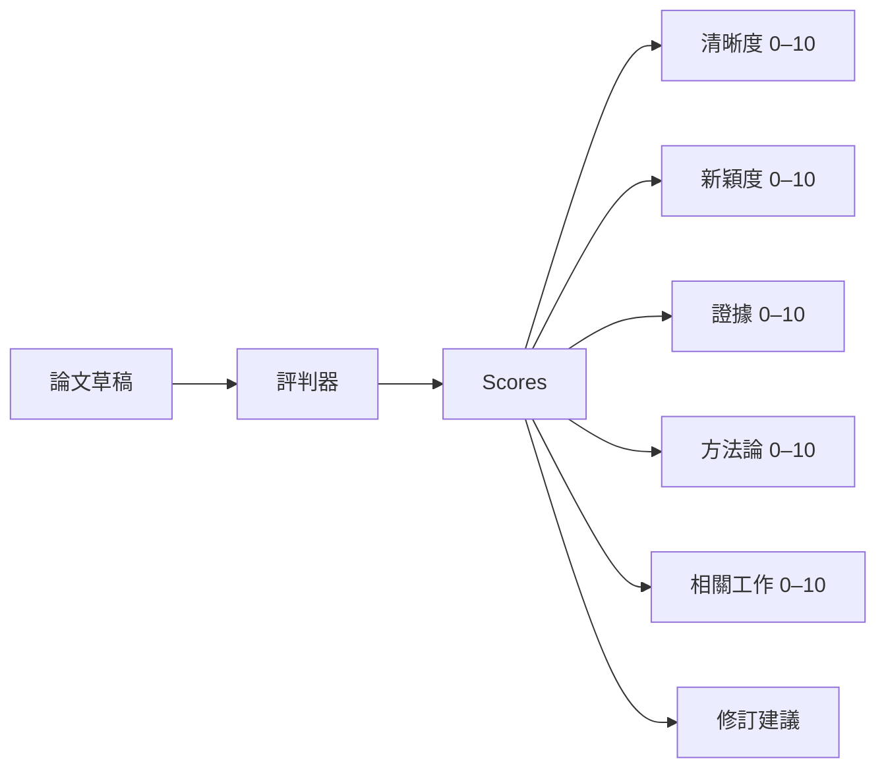
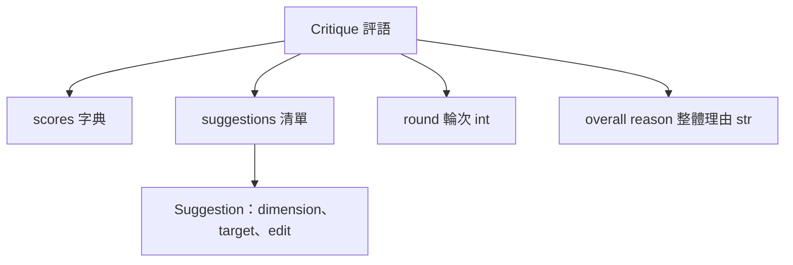
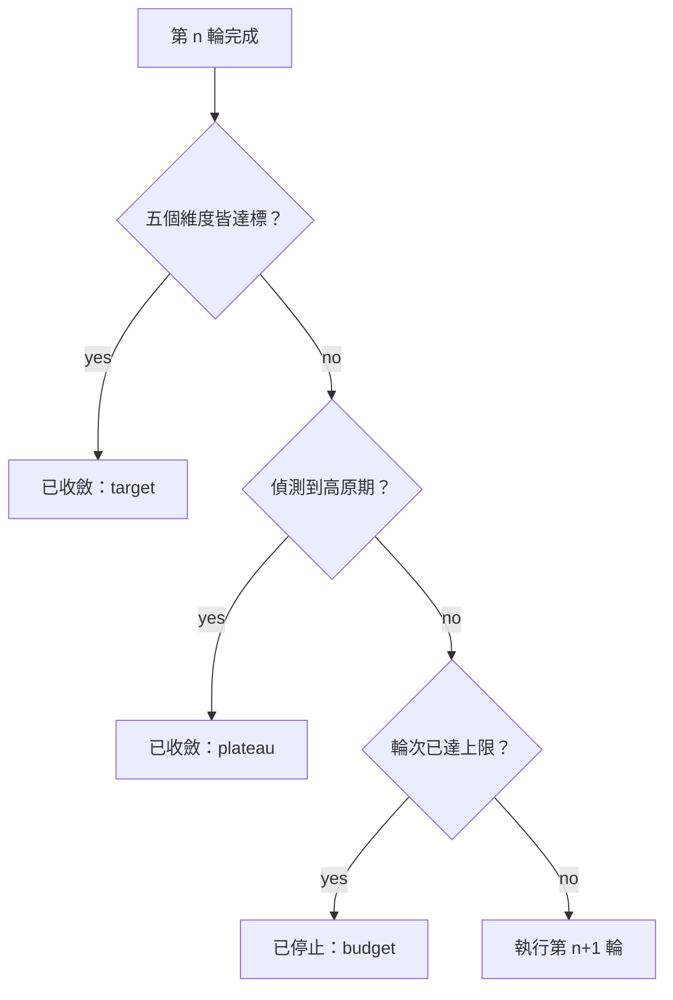
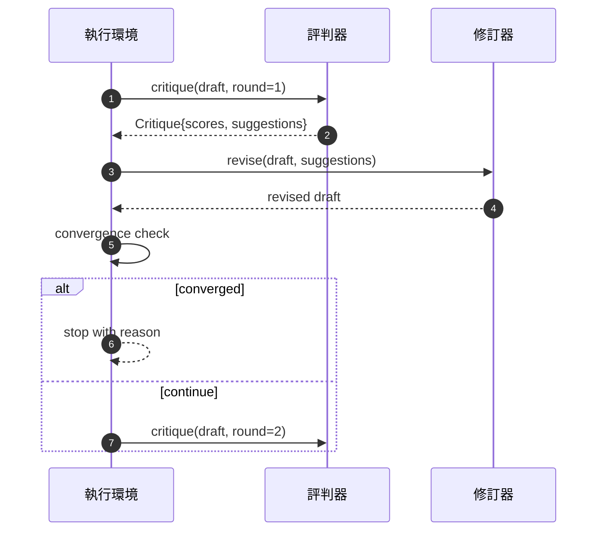

# 批判迴圈（Critic Loop）

> 第一輪就回覆「看起來不錯」的評判器有缺陷；永遠回覆「仍需修改」的評判器也有缺陷。真正值得關注的是能收斂的評判器，而收斂需要經過工程設計。

**Type:** Build
**Languages:** Python
**Prerequisites:** Phase 19 lessons 50-53
**Time:** ~90 minutes

## Learning Objectives｜學習目標

- 在五個固定維度上為論文草稿進行客觀打分：表達清晰度（Clarity）、學術創新度（Novelty）、實證論據（Evidence）、研究方法論（Methodology）、相關文獻工作（Related-work）。
- 將每一輪評審產出的修改批判，封裝為結構化的修訂 Diff，而非散漫無約束的自由重寫。
- 透過跨輪次比對得分走勢偵測收斂狀態：在遇到得分平台期（Plateau）、達成目標（Target Met）或迭代預算耗盡（Budget Exhausted）時終止。
- 施加最大迭代輪數硬性邊界，防止不具備收斂特性的死循環評判器無限空轉。
- 逐輪發布結構化追蹤 Trace，供監控儀表板或後續排程階段即時渲染評分攀升軌跡。

```figure
ch-critic-converge
```

## 為何採用五個固定維度

一個非結構化的散漫評判器只會吐出一大段自然語言建議段落。在下一輪修改時，重寫模組只能將該段落當作模糊的背景上下文。重寫後的草稿究竟是否真正解決了評審提出的尖銳批評？這是根本無法被客觀驗證的，因為批判本身從一開始就缺乏剛性結構。

五大固定維度賦予了執行環境一份明確的評分契約：



評分不是單一標量，而是一個五維特徵向量。執行環境在各輪迭代中嚴密監控每個維度的數值動態。如果一次修改雖然提升了清晰度、卻導致實證論據得分暴跌，系統將精準識別出論據維度發生了退化，收斂性檢查機制也會發現這項退化。純文字模型批判器絕無可能提供這種剛性保證。

## 批判物件的標準規格



每一條修訂建議（Suggestion）皆精確攜帶其旨在改善的特定維度、目標章節，以及修訂者能夠依循落地的具體 `edit` 編輯指令。修訂器（Reviser）同樣是一個標準可調用物件。本課交付了一個確定性修訂器，將 edit 指令解讀為針對該章節的追加寫入操作；而在正式環境中，大模型修訂器則將完全相同的欄位解讀為局部重寫 Prompt。底層軟體合約完全同一。

## 嚴格有序的收斂終止規則

批判迴圈在觸發以下三大條件中的任意一條時自動終止：



**達成目標（Target）** 是最為嚴苛的卓越條件：全部五個維度（清晰度、創新度、論據、方法論、相關工作）的得分必須**全體達到 `>= target_score`**（預設為 `8.0`），迴圈才獲准以成功狀態退出。即便平均分極高，只要有任何一個弱項維度拖後腿，系統皆堅決不予放行！**高原停滯（Plateau）** 比較當前輪次的平均分與上一輪的平均分；若改善幅度連續兩輪皆低於 `plateau_epsilon`（預設為 `0.1`），迴圈以 `plateau` 終止。**預算熔斷（Budget）** 則是最大輪數的硬性上限（預設為 `5` 輪），超額直接以 `budget` 終止。

優先級順序至關重要：**Target 勝過 Plateau 勝過 Budget**。若第 3 輪在剛好觸發高原判定的同時全部維度皆突破了目標分數，最終裁決為 `target`，而非 `plateau`。

## 為何高原檢測必須跨越兩輪

單一輪次的分數停滯極可能只是純粹的隨機雜訊。即便是在確定性打分機制下，具體得分依然微妙依賴於先套用了哪條建議、後套用了哪條建議。要求**連續兩輪**皆出現微弱停滯，才能有效過濾掉瞬態擾動。一旦執行環境報告 Plateau，這意味著草稿確實已停止改善。

## 教學專用確定性評判器

本課在實作中不呼叫外部模型。內建的評判器是一個基於三大客觀訊號進行打分的確定性純函式：章節平均正文字元長度（對應表達清晰度）、圖表數量與文獻引用數量（對應實證論據），以及論文中繼資料中的 `originality_tag` 標籤（對應學術創新度）。修訂器清楚知道如何針對性地推高各項得分：

```text
clarity      grows when the average section body length increases
novelty      grows when originality_tag is set to "high"
evidence     grows when a section's figure_refs is non-empty
methodology  grows when a section titled "Method" exists with body
related-work grows when a section titled "Related Work" exists with body
```

修訂器將每條建議解析為精準的段落追加。在第一輪修改後，執行環境能觀測到分數上升。單元測試集正是依託該性質，嚴密斷言控制迴圈確實能有效縮減質量差距。

## 完整迴圈的時序合約



執行環境主掌輪次計數器、全鏈路 Trace 與收斂條件仲裁。評判器專責給出評分向量與修改建議。修訂器專責生成文字 Diff。三大元件職責分明，任何一方皆絕對嚴禁越權修改其餘元件的內部狀態。

## 全鏈路追蹤輸出

每一輪迭代皆會向外發布標準的 Trace 事件：記錄當前輪次、五維得分向量、建議數量以及收斂判定結論。完整的 Trace 鏈路隨最終修改後的草稿一同回傳。下游儀表板能據此繪製逐輪分數圖表；下一課的迭代排程器則讀取該 Trace，智能決策當前研究 branch 是否具備繼續深挖的價值。

## 防範劣質評判器的安全預算

一個只會產出無效平庸建議、無法引導得分上漲的劣質評判器，極易將系統直接鎖死在最大輪數天花板上。全鏈路 Trace 讓這一事故原形畢露：連續 5 輪、得分走勢水平走平、終止原因標註為 `budget`。工程師能一眼看出這是評判器本身的邏輯缺陷，而非論文草稿質量問題。相較於只交付最終草稿的黑盒做法，「Trace 優先」的架構設計能讓系統隱患無所遁形。

## 程式碼導讀

`code/main.py` 定義了 `Critique`、`Suggestion`、`Critic` 協定、`Reviser` 協定、`CriticLoop` 主迴圈，以及一個產出配對評判器與修訂器的工廠函式 `make_deterministic_critic_pair`。內建了極簡的 `Paper` 資料模型，確保本課自成一體。

`code/tests/test_critic_loop.py` 完整覆蓋了：首輪後得分單調遞增驗證、針對修改後草稿的目標達成收斂測試、連續兩輪平緩後的高原停滯終止測試、無效建議下的預算耗盡熔斷測試、修訂器建議套用正確性，以及 Trace 資料結構規範度校驗。

## 工程深化

在真實工業級落地中，有兩項進階能力極具擴充價值。第一，**維度動態加權（Dimension Weights）**：投稿學術研討會的論文通常對創新度賦予極高權重，而嚴肅期刊則更看重方法論的嚴密性；收斂判定可自然擴充為加權向量運算。第二，**雙評判器對抗仲裁（Paired Critics）**：一個評判器專責挑刺打分，第二個評判器在修訂器介入前對建議實施可行性二審仲裁。這兩項擴充皆能完美疊加於當前 `Critique` 資料結構之上。

核心押注全在於**結構化的評分向量**。一旦批判被賦予了剛性結構，後續無論是收斂規則、視覺化儀表板還是多評判器仲裁，皆能水到渠成地直接插拔集成。
