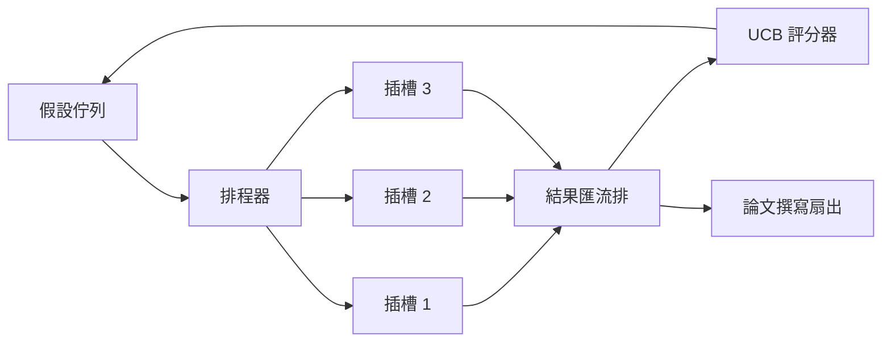
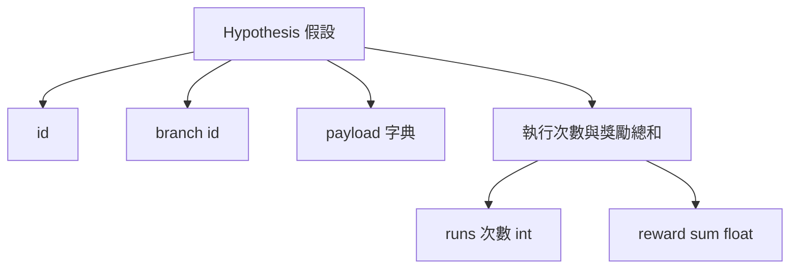
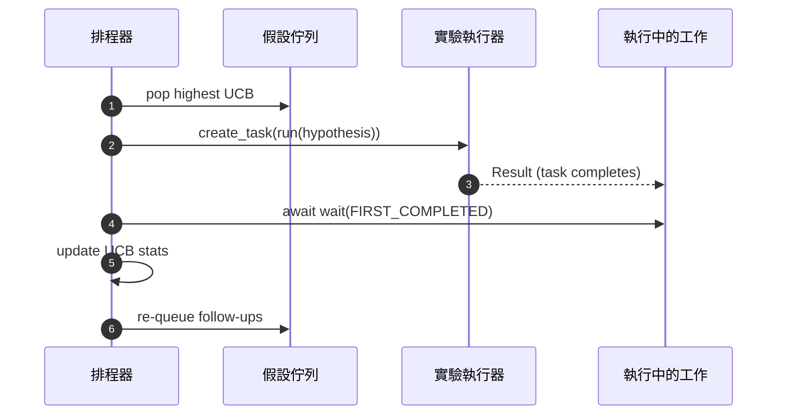

# 迭代排程器（Iteration Scheduler）

> 一個缺乏智慧排程器的科研控制迴圈，只不過是一張陷入妄想的線性死板任務清單。排程器是整個迴圈**決定何時該果斷放棄某一探索 branch**的中樞神經——而這項決策，正是科研博弈的勝負關鍵所在。

**Type:** Build
**Languages:** Python
**Prerequisites:** Phase 19 lessons 50-53
**Time:** ~90 minutes

## Learning Objectives｜學習目標

- 將科研工作流抽象建模為：假設佇列源源不斷輸送給平行的實驗插槽（Slots），實驗結果再扇入（Fan-in）匯聚。
- 基於 Python asyncio 同時並行驅動多個實驗，盡可能讓可用插槽保持忙碌。
- 使用信賴上界（upper confidence bound，UCB）演算法為每個假設研究 branch 動態打分，使排程器能在堅持探索未知 branch 的同時，果斷剪枝剪除低回報的死胡同。
- 將完成的成果扇出（Fan-out）：一方面觸發論文撰寫階段，另一方面派生後續子假設重新注入佇列。
- 逐輪發布結構化追蹤 Trace，呈現各 branch 的即時 UCB 得分、插槽佔用率以及剪枝決策歷程。

```figure
ch-ucb-scheduler
```

## 為何需要排程器，而非工作清單

一張死板的平面工作清單只能嚴格按照任務送出的先後順序依序執行。當各項任務完全正交獨立時，這種模式尚可應付。但真實的科學研究絕非相互獨立：第三個實驗產出的意外重大發現，會瞬間顛覆第四與第五個實驗的原有優先級。一個能夠即時吸收實驗結果反饋並動態重排佇列的智慧排程器，能讓每單位算力完成更多有用工作。

整個架構最精妙的設計在於評分決策規則。純貪婪（Greedy）排程器永遠只會盯著當前暫時領先的第一名死磕，徹底喪失了探索未知新路徑的能力；純隨機均勻排程器則永遠無法發揮已知優勢。而 **UCB（Upper Confidence Bound）演算法** 則是兼顧兩者的終極中庸之道：既能全力壓榨當前表現最佳的優勢 branch（Exploitation），又能為嘗試次數較少的 branch 保留探索容量（Exploration）。

## 系統宏觀架構



佇列維護所有待探索假設。每當有實驗插槽空出，排程器便從佇列中取出 UCB 得分最高的假設。每個插槽以非同步協程執行實驗。實驗完成後會將結果送至結果匯流排。匯流排更新該研究 branch 的 UCB 統計資料；當 branch 的平均回報超過閾值時，系統會觸發論文撰寫階段。

## 假設資料結構的標準規格



`branch`（研究 branch ID）是維護 UCB 統計資料的核心索引鍵。多條微觀假設可以歸屬於同一個宏觀 branch（branch 代表宏觀科研方向；假設則是該方向下的一次具體實驗）。`runs` 記錄該 branch 已完成的實驗次數，`reward_sum` 記錄累計獎勵。UCB 演算法同時讀取這兩個數值進行運算。

## UCB 動態打分公式

本課採用經典的 UCB1 數學公式：

```text
ucb(branch) = mean_reward(branch) + c * sqrt( ln(total_runs) / runs(branch) )
```

其中 `total_runs` 代表全系統跨所有 branch 累計完成的實驗總次數；`c` 是平衡探索與利用的權重係數，本課預設設定為 `sqrt(2)`。一個嘗試次數為 0 的全新 branch，其公式計算結果為 `+inf` 正無窮大，這在數學上百分之百保證了**所有從未被嘗試過的新 branch 必定被無條件優先排程執行**！一個平均回報極高的明星 branch 將持續保持高分，直到其他 branch 逐漸追趕上來；而一個嘗試了多次卻始終產出平平的劣質 branch，其得分會被那些嘗試次數較少的新替代品迅速超越覆蓋。

剪枝閘門（Pruning Gate）與選擇器彼此獨立解耦。當某個 branch 在經歷了至少 `prune_after_runs` 次實驗（預設 `3` 次）之後，其平均回報依然低於硬性安全底線（預設 `0.2`）時，剪枝機制會將該 branch 從未來的排程清單中徹底剔除，防止佇列無限膨脹。

## 基於 asyncio 的高併發插槽

排程器透過 `asyncio.create_task` 平行驅動多個實驗。每個任務都會執行一個回傳 `Result` 的 `async def` 實驗執行器。主控制迴圈透過 `asyncio.wait(..., return_when=asyncio.FIRST_COMPLETED)` 監聽在途任務集合，每當有任意一個任務率先完工，立即喚醒並更新 UCB 統計資料。



本課配置 3 個並行插槽。主迴圈不會被單一實驗阻塞。每當有插槽空閒，排程器立即填充新任務，直到佇列完全排空且所有在途任務全部執行完畢。

## 成果扇出：論文撰寫觸發機制

當某個研究 branch 的平均回報超過 `paper_threshold`（預設 `0.7`），且該 branch 此前尚未產生論文時，排程器會將 `paper.trigger` 事件加入輸出清單。下游的第五十四課論文撰寫器會接手此事件。本課會將觸發事件存成清單，供單元測試檢查。

## 成果扇出：後續子假設自主派生

當高回報結果出現時，排程器會呼叫使用者提供的 `expander`，在同一個研究 branch 下產生後續假設。擴展函式會將 `Result` 轉換為 `list[Hypothesis]`。本課的確定性擴展器會為任何 reward 超過論文門檻的結果產生兩個後續假設。

## 雙重安全預算約束

兩項硬性預算邊界，防止排程器陷入無休止的失控空轉：

```text
max_experiments    : total count of experiments run across all branches
max_seconds        : wall-clock cap (asyncio time)
```

一旦任意一項指標抵達紅線，排程器立即停止調度任何新任務，優雅等待所有在途任務安全執行完畢，隨後回傳最終的 Trace 追蹤報告，並在其中明確標註具體的 `stop_reason` 終止原因。

## 全鏈路追蹤與最終報告

每一次排程決策（任務挑選、分發調度、結果回收、死胡同剪枝、論文觸發扇出）皆會向外發布標準的 Trace 事件。最終產出的綜合報告匯總了各 branch 的詳細統計、總運作次數、端到端物理時鐘耗時，以及論文撰寫觸發事件清單。下一課的端到端整合示範會用該報告驅動論文撰寫器。

## 程式碼導讀

`code/main.py` 定義了 `Hypothesis`、`Result`、`BranchStats`、`IterationScheduler`，以及一個產出回報可預測之非同步實驗執行器的工廠函式 `make_deterministic_runner`。執行器內部設定了固定的微小休眠延遲 `delay_ms`（預設 `5ms`），使高併發插槽調度行為清晰可觀測。

`code/tests/test_scheduler.py` 完整覆蓋了：UCB 優先調度未嘗試 branch、平行插槽滿載佔用率、突破閾值時的論文自動觸發、低收益 branch 的自動剪枝、高收益成果派生後續子假設，以及兩項預算熔斷機制（實驗次數與物理時鐘逾時）。

## 工程深化

在真實工業級落地中，有三項進階能力極具擴充價值。第一，**跨工作階段的 UCB 狀態持久化（Persistent UCB Stats）**：當前的統計資料常駐於記憶體中；正式環境排程器會將其寫入檢查點，使系統在重啟後依然能保留已消耗的探索預算經驗。第二，**多目標 Pareto 決策（Multi-objective Scoring）**：實驗結果不再回傳單一標量回報，而是回傳多維特徵向量，UCB 相應升級為 Pareto 前沿挑選器。第三，**上下文 Bandit 演算法（Contextual Bandits）**：挑選器會根據假設特徵（長度、複雜度）進行條件化，使相似假設能共享探索資訊。

排程器讓科研探索不再只是一張死板工作清單。一旦 UCB 演算法就緒且多個插槽以非同步方式平行運作，其餘工程最佳化皆能在此基礎上展開。
