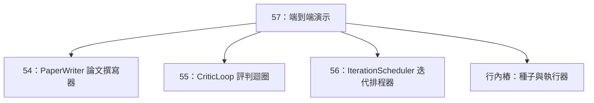
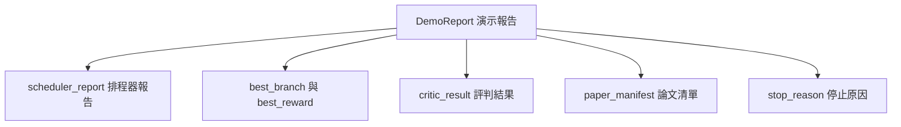

# 端到端科研閉環實戰演示（End-to-End Research Demo）

> 實戰演示（Demo）是先前撰寫的每一份契約在物理世界上交會碰撞的終極考場。只要其中任一處契約出現漏洞，演示程式就能發現問題。

**Type:** Build
**Languages:** Python
**Prerequisites:** Phase 19 lessons 50-53
**Time:** ~90 minutes

## Learning Objectives｜學習目標

- 端到端完整打通自動化科研控制迴圈：假設種子、實驗執行器、迭代排程器、批判迴圈、論文撰寫器。
- 透過純 Python import 機制（而非框架）將 Track D 前四課的核心原語組合。
- 驅動全套迴圈自我終止退出，並產出一份整合了各個階段輸出資產的統一演示報告。
- 維持全流程的絕對確定性，使單元測試集能夠對最終交付物的結構實施嚴密斷言。
- 在任何單一階段合約遭破壞時暴露清晰明確的錯誤模式，防止後續階段在已被污染的錯誤輸入下盲目運作。

```figure
ch-research-pipeline
```

## 系統的終極組合圖景


系統包含五大核心階段：初始種子提供 3 條基礎假設；排程器調用 3 個平行插槽在這些假設上並行推動 6 次實驗執行；結果匯流排回報一至多個論文撰寫觸發事件；最佳結果挑選器挑選出單一最佳結果；批判迴圈依據該成果對草稿展開多輪自我修訂；論文撰寫器最終導出全套 LaTeX 原始碼、BibTeX 文獻庫以及交付清單。

## 為何引用，而不複製

前面每一節課皆交付了包含公開資料類別與核心函式的 `main.py`。本演示透過動態調整 `sys.path` 包含各課的父目錄，以標準 Python import 方式直接載入它們。這不是任何花哨的框架封裝；這正是前述章節的單元測試早已常態化運作的原生引用模式。



行內樁（Inline Stub）在此處優雅替代了第五十課至第五十三課的複雜運算：它包含一個微型的假設種子生成器與一個同步的回報評分函式。使用者只需修改兩行 import 語句，即可隨時將該行內樁替換為前述章節打造的真實原語。

## 確定性的剛性保證

本演示的設計具有確定性：實驗執行器使用固定種子的 numpy 隨機數；批判迴圈的修訂器依固定順序遍歷五個維度；論文撰寫器的正文產生器使用第五十四課的 mock 版本；排程器的 UCB 挑選器在同分時依迭代順序打破平手，而不採用隨機選擇。

使用相同 seed 時，演示會產生相同報告。單元測試透過連續運作兩次端到端流程並比對 manifest，檢查此性質。

## 演示報告的標準規格



報告中的每一個欄位皆原汁原味地繼承自上游各個階段的原生輸出。本演示絕不對上游資料實施任何失真的扭曲變換；它的唯一職責就是**作為膠水進行無損組合**。這正是本演示作為頂層整合測試的最高價值所在。

## 異常失敗處理機制

每一個階段要麼全量成功，要麼拋出帶有強型別的精確異常：

```text
Scheduler ........ returns SchedulerReport with stop_reason
                   in {queue_empty, max_experiments, deadline}
Best-result pick . raises NoTriggerError if no paper trigger fired
Critic loop ...... returns LoopResult with status converged or stopped
Paper writer ..... raises PaperValidationError on contract break
```

任意一個階段的故障皆會透過強型別異常即刻短路終止整個演示。單元測試集嚴密釘死了這一契約：`test_no_triggers_raises_typed_error` 與 `test_best_picker_raises_when_no_triggers` 嚴格斷言當沒有任何研究 branch 發出觸發事件時，挑選器會主動拋出 `NoTriggerError` / `BestResultError`，且後續的論文撰寫器絕對不會被錯誤喚醒。

## 最佳成果挑選器

排程器為各個 branch 發送論文觸發事件。挑選器在所有被觸發的 branch 中，精選出平均回報最高的 branch。若出現相同最高分，依照 branch ID 的字母順序打破平局，確保極致的確定性。挑選器是一個小巧的純函式；測試用例在固定的排程報告上記錄了其確定性行為。

## 串聯批判迴圈

第五十五課的批判迴圈運作於 `MiniPaper` 資料結構之上。演示程式根據被選中的 branch 建立 `MiniPaper`：將 branch ID 填入摘要、播種引言與結果兩個初始章節，並根據 branch 的平均回報設定 `originality_tag`（若 `>= 0.8` 設為 high，若 `>= 0.6` 設為 medium，其餘設為 low）。

修訂器隨後驅動草稿進行多輪自我修訂直至收斂。收斂產物直接注入論文撰寫器。

## 串聯論文撰寫器

第五十四課的論文撰寫器運作於包含圖表與參考文獻的完整 `Paper` 結構之上。演示程式透過 `mini_to_full_paper` 函式將收斂後的 `MiniPaper` 進行無失真升級：為選中的研究 branch 掛載一張實體圖表，並將批判器所建議引用的所有文獻 Key 提取聯集、合成為一個微型的 BibTeX 條目庫。演示程式所引用的每一個文獻鍵皆在文獻列表中被正式宣告，因此驗證可通過。

## 程式碼導讀

`code/main.py` 定義了 `BestResultError`、`NoTriggerError`、`DemoReport`、`pick_best_branch`、`build_mini_paper`、`mini_to_full_paper` 以及核心驅動函式 `run_demo`。頂部的 import 邏輯動態修正 `sys.path`，自各課引進 `PaperWriter`、`CriticLoop` 與 `IterationScheduler`。

`code/tests/test_e2e.py` 完整覆蓋了：演示端到端運作並輸出全欄位填充的報告、兩次運作之間的嚴密確定性、無 branch 達標時拋出 NoTriggerError、撰寫合約破壞時拋出 PaperValidationError、論文清單正確包含獲勝 branch 的圖表，以及排程終止原因符合預期。

## 工程深化

在端到端綠燈通過後，有三項進階能力值得加入。第一，**持久化狀態**：將各階段結果寫入 JSON 儲存空間，讓系統重啟後不用重跑成本低的階段。第二，**儀表板**：將排程器與批判迴圈的 Trace 事件呈現在同一條時間軸上。第三，**真實模型呼叫**：將模擬正文產生器與確定性批判器替換為由模型驅動的版本，接線方式不必改變。

本演示的使命在於證明：**組合就是架構**。五節課程、四行 import、一份統一報告。下一次當你需要為科研迴圈追加一個全新階段時，整個串聯架構僅僅需要擴展一行程式碼而已。
