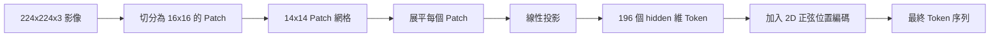

# 視覺編碼器影像切塊（Vision Encoder Patches）

> 視覺模型要讀取像素，需要一個處理像素的 tokenizer。patch embedding 就是這個 tokenizer。將整張影像切割為正方形網格、展平每個方塊、透過單層線性投影進行維度變換，隨後疊加 2D 空間位置訊號，讓 Transformer 清楚知曉每個方塊原本坐落於原始影像的何處。

**Type:** Build
**Languages:** Python
**Prerequisites:** Phase 19 lessons 30-37 (Track B foundations)
**Time:** ~90 minutes

## Learning Objectives｜學習目標

- 將連續像素影像 Token 化為固定長度的 patch embedding 向量序列。
- 實作基於 `Conv2d` 的高效 Patch 投影層，並在數學上證明其與「Unfold 展開後接全連接層」完全等價。
- 建構確定性的 2D 正弦 position embedding（Sinusoidal Position Embedding），使 Token 順序能精準編碼空間幾何座標。
- 在合成測試夾具上嚴密校驗 Patch 總數、embedding 張量形狀，以及 `Conv2d` 與 Unfold 的數值一致性。

## The Problem｜問題

Transformer 神經網路本質上消費的是由一維向量組成的序列。而一幅真實影像是三通道（RGB）的二維網格。若將每個像素都視為一個 Token，序列長度便會急遽增加：一張 224x224 RGB 影像有 150,528 個 Token；一個 12 層 Transformer 根本無法承受如此巨大的注意力二次方運算開銷。反之，若將整張影像拉平成一個巨大的扁平向量，空間局部性（Spatial Locality）便會流失，而注意力層無法恢復。視覺前端的核心使命，就是將龐大的像素網格高度壓縮為數百個 Token，每個 Token 精煉概括一個正方形局部區域。

patch embedding 透過單次線性投影優雅解決了該難題。將一張 224x224 的影像切割為 16x16 的方塊，產出一個 14x14 的網格，共計 196 個 Patch。每個 Patch 的原始像素被展平為 `(3, 16, 16) = 768` 維的向量，隨後透過一個線性層將其投影至模型的隱藏維度。Transformer 最終看見的是 196 個維度為 `hidden`（常規為 768）的 Token，外加一個可學習的 CLS Token。這是一段後續神經網路完全能夠從容消化的標準序列。

## The Concept｜核心概念



### 為何採用 Patch，而非單像素

自注意力機制的運算複雜度隨序列長度呈二次方增長。一個包含 196 個 Token 的序列，每層每頭僅需計算 `196 * 196 = 38,416` 次注意力分數；而 150,528 個 Token 的序列則需要計算高達 `150,528 * 150,528 = 22.6 billion` 次注意力分數！Patch 化帶來了驚人的 59 萬倍注意力算力縮減，且單個 16x16 區域已包含足夠的局部特徵以支撐高階視覺任務。其代價是犧牲了單個 Patch 內部的細粒度空間細節，這正是為何在需要精細定位的下游多模態架構中，往往會額外追加一條高解析度輔助 branch 的原因。

### 為何單層線性投影已完全足夠

每個 Patch 被視為一個獨立的高維向量。該投影負責學習一組基底：邊緣偵測器、色彩濾鏡、基礎紋理。單一線性層規模小巧（在 ViT-Base 規模下僅佔 `768 * 768 = 589,824` 個參數）且訓練速度快。雖然學術界存在更深層的卷積前置幹道（即混合型 Hybrid ViT），但扁平的單層線性投影始終是標準做法，當代絕大多數開源權重視覺編碼器皆採用此一極簡架構。

### 基於 `Conv2d` 的工程提速技巧

定義一個 `Conv2d(in_channels=3, out_channels=hidden, kernel_size=patch_size, stride=patch_size)` 的二維卷積層，且不填補；其數值輸出與「先 Unfold 展開再接全連接線性層」完全等價。因為卷積核在影像上滑動並與局部 Patch 像素進行點積，本質上就是在執行特徵投影。使用卷積算子是正式環境程式碼庫的普遍標準做法，因為它在 GPU 上的執行效率更高，且少了一次昂貴的張量重塑操作。

### 2D 正弦 position embedding

自投影層輸出的 Token 序列自身完全缺乏空間幾何概念。2D 正弦 position embedding 為每個 Token 提供固定的數學訊號，精確編碼其在網格中的 `(row, col)` 座標。embedding 維度的前一半使用不同頻率的 sin/cos 編碼行座標；後一半編碼列座標。該編碼完全是確定性的，允許你不重新訓練即可調整解析度，並能平滑插值到預訓練時從未見過的全新網格尺度上。

| 核心元件 | 張量形狀規格 | 實體參數量開銷 |
|---|---|---|
| Patch 投影層（`Conv2d`） | `(hidden, 3, patch, patch)` | `3 * P * P * hidden + hidden` |
| position embedding（固定正弦） | `(num_patches, hidden)` | 0（純數學計算，無可學習參數） |
| CLS token（可學習） | `(1, hidden)` | `hidden` |

在輸入解析度為 224、切塊大小為 16 的 ViT-Base/16 配置下：投影層佔 590,592 個參數，CLS Token 佔 768 個參數，正弦位置編碼佔 0 個參數。下一課（第五十九課）將在該視覺前端上方堆疊 12 層完整的 Transformer 區塊。

### 數學等價性作為健全性檢查

切塊步驟具備兩種完全不同的程式碼寫法：`Conv2d` 卷積投影，以及手動 Unfold 展開後接 Linear 全連接層。在權重一致的前提下，兩者必須產出等價的張量。本課的單元測試斷言了該等價性。若兩者輸出不一致，表示 Unfold 的數學運算有誤，後續 encoder 也就建立在錯誤的基礎上。

```figure
ch-patch-tokenizer
```

## Build It｜動手實作

`code/main.py` 實作了以下核心模組：

- `PatchEmbed`：`nn.Module`，封裝 `Conv2d` 算子的 Patch 投影模組。
- `sinusoidal_2d(grid_h, grid_w, dim)`：無狀態純函式，負責生成 2D 空間正弦位置查表矩陣。
- `VisionFrontEnd`：將 patch embedding、頭部拼裝 CLS Token 以及疊加 2D 位置編碼整合為統一的前向傳播通道。
- `synthesize_image(seed)` 輔助函式：基於 `numpy.random` 動態合成確定性的 224x224x3 測試影像。
- 底部演示程式：驅動測試影像穿透視覺前端，印出輸出張量形狀、CLS Token 範數以及position embedding 的一整列。

執行測試：

```bash
python3 code/main.py
```

輸出結果：驗證 224x224 的測試影像被 Token 化為形狀為 `(1, 197, 768)` 的張量序列。第 0 個 Token 為 CLS；隨後的 196 個為 Patch Token。position embedding 在同一行內部的範數高度均勻，這正是 2D 正弦編碼的標誌性幾何特徵。

## Use It｜實際應用

完全相同的 Patch 視覺前端廣泛存在於當代每一款頂級視覺語言模型中：CLIP ViT-L/14、SigLIP、DINOv2、Qwen-VL 家族以及 InternVL 體系，無一例外皆以「`Conv2d` Patch 投影 + 空間位置訊號」作為神經網路的起點。不同架構流派之間的微小差異全在於下游層面（CLS 池化 vs 無 CLS 池化、引入暫存器 Register Tokens、切塊大小選用 14 還是 16、透過插值支援動態解析度等）。本課所打造的前端，是所有上述前沿模型共同依託的物理基石。

## 單元測試

`code/test_main.py` 覆蓋了以下核心測試項：

- Patch 數量嚴格吻合 `(image_size / patch_size) ** 2` 的幾何公式。
- 輸出張量形狀精確符合 `(batch, num_patches + 1, hidden)`。
- `Conv2d` 投影與手動 Unfold 展開加 Linear 層在數值上完全等價。
- 2D 正弦位置查表在多次重複調用中維持 100% 的確定性。
- CLS Token 沿著批次維度 B 正確廣播，且各批次樣本之間絕無資料交叉洩漏。

執行單元測試：

```bash
python3 -m unittest code/test_main.py
```

## Exercises｜練習

1. 將固定正弦位置編碼替換為可學習的 `nn.Parameter` 矩陣，在極小合成分類任務上對比兩者在第 1 個 Epoch 內的 loss。可學習位置在固定解析度下略佔優勢；而變更訓練後解析度時，正弦位置編碼較有優勢。
2. 將 `Conv2d` 替換為顯式的 `nn.Unfold` 搭配 `nn.Linear`，在浮點容差範圍內斷言兩者的數值完全一致。同一套數學，兩種工程表達。
3. 為模組擴充非正方形 Patch 的支援能力（例如針對寬幅長條影像採用 32x16 的長方形切塊），驗證 2D 位置查表能否處理非正方形網格。
4. 在批次大小為 1、8、64 的情境下對 Patch 投影步驟進行效能 Profiling 分析。一般而言，Patch 投影極少成為系統瓶頸；後續的注意力層佔據了絕大多數的運算開銷。
5. 將該視覺前端作為完全凍結的特徵提取器，在包含 4 類幾何圖形（圓形、正方形、三角形、星形）的合成資料集上訓練下游分類頭。檢查 CLS Token 的輸出表徵是否能線性區分這些類別。

## Key Terms｜關鍵術語

| 術語 | 核心定義 |
|---|---|
| Patch（切塊） | 影像上的一個正方形局部子區域，經典尺寸為 14x14 或 16x16 |
| patch embedding | 將單個展平的像素方塊線性投影至模型隱藏維度的向量化過程 |
| Sequence length（序列長度） | 影像經 Token 化後產出的 Token 總數，通常包含額外追加的 CLS Token |
| Sinusoidal position（正弦位置） | 基於固定 sin/cos 數學函式編碼 2D 網格空間座標的無參數訊號 |
| CLS token | 加在序列最前端、用作池化頭的可學習向量 |

## Further Reading｜延伸閱讀

- An Image is Worth 16x16 Words（ViT, 2021）：將影像視為單詞序列、開創 Patch 視覺範式的奠基論文。
- Attention Is All You Need（2017）：原始正弦位置編碼公式出處，本課將其擴展至 2D 空間。
- DINOv2 學術論文：深入探討暫存器 Token（Register Tokens）的進階設計，可作為延伸練習 6 嘗試實作。
