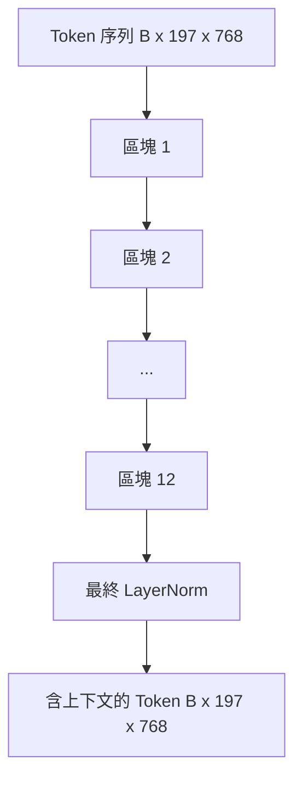
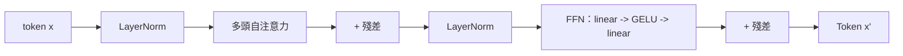

# Vision Transformer 編碼器（Vision Transformer Encoder）

> 單純的 Patch 切塊本身並無「視覺能力」。由 12 層 Pre-LN Transformer 區塊與 12 個注意力頭組成的深層網路，將孤立的 Patch 序列昇華為包含豐富全局上下文的表徵序列，並透過 CLS Token 在頂層隱藏狀態中完成整張影像的語意池化。本課是當代每一款現代視覺語言大模型（VLM）的核心動力室。

**Type:** Build
**Languages:** Python
**Prerequisites:** Phase 19 lessons 30-37 (Track B foundations)
**Time:** ~90 minutes

## Learning Objectives｜學習目標

- 實作整合多頭自注意力與前饋神經網路子層的 Pre-LN Transformer 區塊。
- 堆疊 12 個區塊與 12 個注意力頭，組裝標準的 ViT-Base 視覺編碼器。
- 將第五十八課打造的 Patch 視覺前端無縫接入編碼器，並成功執行前向傳播。
- 驗證 CLS Token 能夠在深層堆疊中自各個 Patch 充分匯聚全域語意資訊。

## The Problem｜問題

patch embedding 模組僅僅產出一段由 197 個 Token 組成的序列，每個 Token 只是一個代表局部像素特徵的高維向量，彼此之間完全處於相互孤立的無知狀態。一張貓咪的影像需要讓每個 Patch 清楚知曉：哪些區域是鬍鬚、哪些區域是背景、哪些區域是眼睛。Transformer 正是透過逐層自注意力計算，在各個 Patch 之間建立全域語意關聯的核心引擎。缺乏它，Patch 視覺前端只不過是一個稍顯巧妙的像素 tokenizer，完全不具備任何視覺理解能力。

業界的黃金標準架構極其收斂：12 層深度、12 個注意力頭、採用 Pre-LayerNorm 拓撲、GELU 活化函式，以及 4 倍擴展維度的前饋網路（FFN）。這套標準配方是 CLIP ViT-L、SigLIP、DINOv2、Qwen-VL 家族、InternVL 以及 2025 至 2026 年幾乎所有開源權重視覺編碼器的脊樑骨。閱讀上述論文時，可先假設採用此標準區塊形態，除非作者明確說明其他設計。

## The Concept｜核心概念





### Pre-LN vs Post-LN 拓撲

初代 Transformer 論文將 LayerNorm 放置在殘差相加之後（Post-LN）。而當代視覺語言模型皆採用 Pre-LN（在每個子層運算之前先執行 LayerNorm），因為它具備天然的訓練穩定性，甚至無需小心翼翼的學習率預熱技巧。兩者在程式碼上僅差一行順序，但在 12 層以上的深層網路中，反向傳播的梯度流動表現卻是天壤之別。

### 多頭自注意力機制

每個注意力頭將 Token 向量獨立投影為自身的 `(query, key, value)` 三元組，單頭維度為 `head_dim = hidden / num_heads`。在隱藏維度 `hidden = 768`、頭數 `heads = 12` 的標準配置下，單頭維度 `dim = 64`。12 個頭部並行執行自注意力計算，隨後將各頭輸出重新拼接回 768 維並透過輸出投影層融合。多頭的核心價值在於：一個頭可以專注於「盯住貓咪的眼睛」，另一個頭可以專注於「捕捉背景色彩漸變」，彼此並行運作且互不干擾。

### 為何前饋網路採用 4 倍維度擴展

前饋神經網路（FFN）採用 `hidden -> 4 * hidden -> hidden` 的經典沙漏膨脹結構，中間夾著平滑的 GELU 活化函式。4 倍係數是經驗法則，自 2017 年以來一直適用於語言與視覺 transformer：較小（2 倍）會欠擬合；較大（8 倍）在固定資料預算下會過擬合。MLP 儲存了模型大部分學得的事實，而中間層較大的維度提供了存放這些事實的空間。

| 核心元件 | ViT-Base 規模下的實體參數量 |
|---|---|
| 單區塊 QKV 合併投影層 | `3 * 768 * 768 = 1.77M` |
| 單區塊輸出線性投影層 | `768 * 768 = 590K` |
| 單區塊 FFN 前饋網路（4 倍擴展） | `2 * 768 * 4 * 768 = 4.72M` |
| 單區塊 LayerNorm 正規化層 | `4 * 768 = 3K` |
| **單區塊累計參數** | **約 7.1M** |
| 12 層區塊堆疊 | 約 85M |
| 加上 Patch 視覺前端 | **全模型總計約 86M** |

ViT-Base 是一個參數量為 8600 萬的視覺編碼器。以 2026 年的工業標準來看它十分精巧小巧（SigLIP-So400M 達到 4 億參數，Qwen-VL 的 ViT 達到 6.75 億參數），但其底層架構除寬度與深度外與本課完全同構。

### 是否需要因果遮罩？

答案是堅決不需要。Vision Transformer 是純編碼器（Encoder-only）架構且具備完全的雙向性（Bidirectional）：Token `i` 可以毫無保留地同時關注任意 Token `j`。無遮罩。第六十一課在文字解碼器端進行交叉注意力時才會引入因果遮罩，但在純視覺編碼器內部，注意力矩陣完全是全連通的。

### CLS Token 究竟學到了什麼

CLS Token 起初是一個可學習參數，自身完全不包含任何局部的像素資訊；但在穿透 12 層注意力堆疊的過程中，它透過注意力權重持續從所有 196 個 Patch 中主動抽取並吸收資訊。抵達頂層時，CLS 向量已蛻變為整張影像的全局語義摘要；下游各個輸出頭會將這個單一向量投影為類別 logits、對比式 embedding，或文字解碼器使用的交叉注意力鍵。

```figure
ch-cls-funnel
```

## Build It｜動手實作

`code/main.py` 實作了以下核心模組：

- `MultiHeadSelfAttention`：包含 `qkv` 合併投影與輸出投影、縮放點積注意力運算以及嚴格的張量維度斷言。
- `FeedForward`：包含 4 倍膨脹維度與 GELU 活化函式的高效能前饋神經網路。
- `Block`：整合多頭注意力、FFN 以及兩條殘差連接的 Pre-LN 核心區塊。
- `ViT`：堆疊 12 個標準 Block 區塊並以全局最終 LayerNorm 收尾的純視覺 Transformer 主幹。
- `VisionEncoder`：將第五十八課的 `VisionFrontEnd` 與 `ViT` 主幹無縫焊接，對外暴露 `forward()` 方法，同時回傳包含上下文的序列張量與池化後的 CLS 全局向量。
- 底部演示程式：驅動一張合成的 $224 \times 224$ 測試影像穿透整個編碼器，在終端機印出輸入形狀、輸出形狀、參數量盤點，以及每隔一層列印一次的 CLS 向量範數。

執行測試：

```bash
python3 code/main.py
```

輸出結果：驗證輸入影像被編碼為形狀為 `(1, 197, 768)` 的高階語義張量。CLS 向量的 L2 範數隨著各層組合而上升，並在最終 LayerNorm 處穩定下來。全模型參數量精確報告為約 86M。

## Use It｜實際應用

本課所定義的視覺編碼器，除寬度與深度外，正是 2025 至 2026 年每一款開源 VLM 大模型內部所運作的完全同構模組。各家頂尖模型之間的微小演化體現在：

- **寬度與深度的擴展**：ViT-Large 為 `hidden=1024, depth=24, heads=16`；SigLIP So400M 為 `hidden=1152, depth=27, heads=16`。底層 Block 完全一致。
- **池化頭部的選型**：CLS 池化（本課標配）vs 平均池化（SigLIP）vs 注意力池化（後續高階 VLM）。
- **位置編碼的演化**：固定正弦（第五十八課）vs 可學習 1D 查表 vs ALiBi vs 2D RoPE。區塊內部的注意力矩陣運算完全不受影響。
- **暫存器 Token（Register Tokens）**：DINOv2 在 CLS 後方額外拼入 4 個可學習 Token。在程式碼中僅僅是一行拼接。

這套區塊堆疊是堅固的物理基石。後續課程（第六十至六十三課）將全部建立在此基礎之上。

## 單元測試

`code/test_main.py` 覆蓋了以下核心測試項：

- 單個 Block 區塊完美維持輸入輸出維度不變，且對批次大小具備嚴格不變性。
- 注意力打分矩陣沿著 Key 軸的權重求和精確等於 1.0（Softmax 數值正確性驗證）。
- 殘差通道正確連通（即便輸入全 0 張量，CLS Token 仍會產生非零輸出）。
- 堆疊 4 層的前向傳播前向運算能穩定產出正確形狀。
- 反向傳播梯度能夠自頂部的 CLS 輸出端順暢傳導至底層最前端的 Patch 卷積投影層。

執行單元測試：

```bash
python3 -m unittest code/test_main.py
```

## Exercises｜練習

1. 引入暫存器 Token（Register Tokens，在 CLS 後方額外追加 4 個可學習向量）並重新運作。透過度量最後一層 Softmax 分佈的資訊熵，客觀對比引入暫存器前後注意力熱圖的平滑度變化。
2. 將 Pre-LN 替換為 Post-LN，在合成形狀分類任務上訓練 1 個 Epoch。直觀觀察兩者在完全不使用學習率預熱（Warm-up）時的收斂穩定性差異。
3. 為注意力模組擴充可選的 `attn_mask` 參數以支援因果下三角遮罩，使該完全相同的 Block 能夠直接作為自回歸文字解碼器區塊進行複用；遮罩形狀為 `(seq, seq)`，且為下三角矩陣。
4. 使用 `torch.profiler` 對批次大小為 1、8、64 的前向傳播進行硬體效能剖析。比較 MLP 層與注意力層的 wall time；預期 MLP 層耗時較長。
5. 將某個特定注意力頭的 QKV 投影層替換為低秩適配 LoRA 模組，凍結其餘所有參數，嚴格驗證反向傳播梯度只精準流向你所期望更新的 LoRA 矩陣。

## Key Terms｜關鍵術語

| 術語 | 核心定義 |
|---|---|
| Pre-LN | 在每個子層（自注意力或前饋網路）運算之前施加 LayerNorm，而非在相加之後 |
| Self-attention（自注意力） | 序列中的每一個 Token 主動向同一序列中的其餘所有 Token 計算權重並匯聚資訊 |
| Multi-head（多頭） | 將隱藏維度空間拆分為 `H` 個彼此平行的獨立頭部，分別捕捉異質特徵 |
| FFN expansion（前饋網路膨脹） | 前饋神經網路先將隱藏維度放大至 `4 * hidden`、隨後再收縮回原維度的沙漏結構 |
| CLS pooling（CLS 池化） | 直接提取序列最前端特殊 CLS Token 的最終隱藏狀態作為整張影像的全局語義摘要 |

## Further Reading｜延伸閱讀

- An Image is Worth 16x16 Words（ViT, 2021）：Vision Transformer 經典架構規格與超參數配置出處。
- DINOv2（2023）：深入學習暫存器 Token（Register Tokens）以及自監督預訓練損失函數。
- SigLIP（2023）：深入了解平均池化變體以及將在第六十二課中使用的 Sigmoid 對比損失函數。
