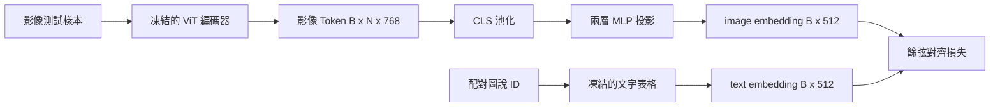

# 跨模態對齊投影層（Projection Layer for Modality Alignment）

> 視覺編碼器產出的是影像 Token。文字解碼器消費的是文字 Token。這兩者在底層生活在完全不同的高維幾何空間中。一個小巧的兩層 MLP 投影層將影像特徵映射至 text embedding space，並透過與配對圖說之間的餘弦對齊損失（Cosine Alignment Loss），使兩個空間趨於一致。這個投影層是視覺語言模型（VLM）中最小的元件，也是對遷移最重要的元件。

**Type:** Build
**Languages:** Python
**Prerequisites:** Phase 19 lessons 30-37 (Track B foundations)
**Time:** ~90 minutes

## Learning Objectives｜學習目標

- 建構將影像特徵精準映射至 text embedding space 的兩層 MLP 投影神經網路。
- 建構確定性的模擬 text embedding 查表矩陣（零外部預訓練 tokenizer 依賴、零真實語料依賴）。
- 在投影後的影像 Token 與配對圖說 text embedding 之間，精確計算餘弦對齊損失。
- 在同時絕對凍結視覺編碼器與 text embedding 矩陣的前提下，單獨對投影層實施端到端訓練。

## The Problem｜問題

你擁有一個視覺編碼器（第五十八至五十九課），它產出的影像 Token 維度為 `vision_hidden = 768`。同時，你希望在頂部掛載一個文字解碼器，其期望接收的 text embedding 維度為 `text_hidden = 512`（在不同大模型中該數值各異）。文字解碼器預期接收符合其維度要求的 Token。然而影像 Token 根本不是文字：它們生活在視覺編碼器純視覺預訓練所學出的特徵基底中，與文字解碼器的 word embedding 毫無內在幾何關聯。

兩層 MLP 投影層（線性層、GELU 活化、線性層）完美搭建了溝通兩者的跨模態橋樑。它的參數量極其小巧（約 `768 * 1024 + 1024 * 512 = 1.3M` 個參數），在單張 GPU 上僅需數分鐘即可完成訓練，且它是在跨模態對齊階段**唯一需要被更新的可學習元件**。視覺編碼器保持絕對凍結；text embedding 矩陣保持絕對凍結；只有中間的投影橋樑在接受反向傳播更新。這是 LLaVA 於 2023 年採用的配方，BLIP-2 將其重新詮釋為 Q-Former；此後每一款 open-weight VLM 都以某種形式採用這套做法。

## The Concept｜核心概念



### 投影前特徵池化

視覺編碼器輸出 197 個局部 Token。而文字端在句子層級僅擁有單一的圖說語義向量。為了實施對齊，每個樣本在影像端必須先提煉出單一的全局向量。CLS 池化是最簡潔的選擇：直接提取編碼器的第 0 個 Token 進行後續投影。對全部 197 個 token 取平均的平均池化（Mean Pooling）是另一種選擇（SigLIP 採用此方案）。兩者皆能將 197 個向量平滑匯聚為單一向量。

### 為何堅持兩層，而非單層線性

單一線性層在幾何上只能實施空間的旋轉與縮放，一旦兩個模組的幾何流形存在非線性的曲率錯配，單層線性變換將無能為力。在兩個線性層之間插入平滑的 GELU 活化函式，為投影層賦予了一次非線性彎曲的自由度，這在實證上已完全足以將 CLIP 風格的特徵流形對齊至語言模型的 embedding space。更深層的投影架構（如 LLaVA-NeXT 採用的 GLU 門控機制、Qwen-VL 採用的多層交叉注意力堆疊）皆屬於此基礎上的延伸；兩層 MLP 始終是公認的基準模型，BLIP-2 的 Q-Former 最終輸出端同樣採用了該標準形態。

| 投影層結構 | 形狀維度 | 實體參數量 |
|---|---|---|
| fc1 第一層線性 | `(vision_hidden, projection_hidden)` | `768 * 1024 + 1024` |
| 活化層 | GELU | 0 |
| fc2 第二層線性 | `(projection_hidden, text_hidden)` | `1024 * 512 + 512` |

在 `768 -> 1024 -> 512` 的維度下，全模組約有 1.3M 個參數。

### 餘弦對齊損失函數（Cosine alignment loss）

「對齊（Align）」絕對不意味著強行要求 `image_emb == text_emb`。對齊意味著：在共同的語義高維空間中，`image_emb` 的向量指向必須與 `text_emb` 的向量指向維持嚴格相同的幾何角度。餘弦損失精確定義為 `1 - cos_sim(image, text)`，數值範圍落在 0（完美方向一致）至 2（方向完全反向）之間。訓練的目標是在每對圖文樣本上將該值壓向 0。第六十二課將把該目標推廣為包含負樣本對比的 Batch 維度對比損失（InfoNCE），要求影像與自身圖說的距離比影像與 Batch 內其餘圖說的距離小；而本課聚焦於成對單樣本形態，使收斂動態直觀透明。

### 凍結編碼器是最大巧思

視覺編碼器擁有高達 8600 萬個參數；text embedding 矩陣同樣佔據數百萬參數。在微型教學語料上同時訓練它們無異於緣木求魚。將兩者全部施加絕對凍結，意味著整個系統中唯一發生參數位移的只有投影層這微小的 130 萬個權重，在數十組合成圖文對上僅需數百步迭代，便足以讓損失下降。這正是所有基於適配器（Adapter-based）的 VLM 能夠高效落地的底層秘密：**重型元件穩如磐石，輕量橋樑全速適配**。

```figure
ch-projection-bridge
```

## Build It｜動手實作

`code/main.py` 實作了以下核心模組：

- `MLPProjector(in_dim, hidden_dim, out_dim)`：包含兩層線性投影與中間 GELU 活化的投影神經網路。
- `MockTextEmbedding(vocab_size, dim)`：鎖定隨機種子、具備確定性初始化的凍結 text embedding 查表矩陣。
- `make_pair(seed, vocab_size)`：動態合成一對配對的（影像, 圖說）樣本。圖說為簡短的 Token ID 序列，其整體向量透過對 word embedding 進行平均池化生成。
- `cosine_alignment_loss(image_emb, text_emb)`：計算成對的 `1 - cos_sim` 核心對齊目標。
- 核心訓練迴圈：在 32 組合成圖文對上循環訓練 200 步，在視覺編碼器與文字查表完全凍結的狀態下，每隔 25 步即時印出損失數值。

執行測試：

```bash
python3 code/main.py
```

輸出結果：訓練損失在 200 步內從約 1.07 降至約 0.80，顯示僅靠投影層便能將影像 Token 拉向 text embedding space。腳本在最後印出各圖文對的最終餘弦相似度數值。

## Use It｜實際應用

完全相同的架構模式在當代每一款主流開源視覺語言模型中皆反覆湧現：

- **LLaVA 1.5**：採用兩層 GELU MLP 投影層，將 CLIP-ViT-L 的隱藏維度映射至 LLaMA embedding 維度。在第一階段中視覺編碼器與 LLM 全面凍結，僅單獨訓練該投影層；隨後在第二階段才解凍 LLM。
- **BLIP-2**：Q-Former 以 32 個學習到的 Query token 對影像 Token 執行交叉注意力，再將結果投影至 LLM embedding 維度。Q-Former 終點處的投影頭正是本課 MLP 的同構物。
- **MiniGPT-4**：單層線性投影，直接將 BLIP-2 Q-Former 的輸出對齊至 Vicuna 的 embedding 空間。
- **Qwen-VL**：雖然採用了多層交叉注意力適配器，但其終端最後一步依然是一個將特徵對齊至語言模型維度的投影層。

外層形狀或有變化，但內部核心職責永遠一致：**池化影像 Token、投影至文字維度，再單獨訓練**。

## 單元測試

`code/test_main.py` 覆蓋了以下核心測試項：

- 投影層輸出張量形狀精確吻合配置的 `out_dim` 維度。
- 被凍結的 text embedding 查表矩陣中，`requires_grad` 為 True 的參數量精確為零。
- 餘弦對齊損失在兩個完全同向的向量上精確等於 0，在反向向量上精確等於 2。
- 反向傳播單次更新後，梯度能夠流經投影層。
- 訓練迴圈在第 0 步與第 200 步之間降低損失。

執行單元測試：

```bash
python3 -m unittest code/test_main.py
```

## Exercises｜練習

1. 將 CLS 池化替換為對 196 個 Patch Token 的全域平均池化（Mean Pooling），對比兩者在 200 步後的最終收斂損失。平均池化通常在合成資料上收斂更快；而 CLS 池化在自然影像分佈上具備更高的樣本利用效率。
2. 為餘弦損失引入可學習的純量溫度係數（`cos / tau`），觀察當 `tau` 過小（引發劇烈梯度雜訊）或過大（導致損失曲線在極高位置水平停滯）時的系統表現。
3. 將兩層 MLP 退化替換為單層線性投影，精確量化兩者在最終對齊損失上的差距。非線性在自然影像特徵上較為重要，在合成特徵上則較不重要。
4. 為投影層權重加入小幅 L2 懲罰項，深入分析其與尺度不變的餘弦損失之間的交互影響（餘弦損失天生對向量模長不敏感，因此 L2 懲罰主要負責收縮未使用的方向）。
5. 將訓練完成後的投影層權重存檔至磁碟，隨後重新載入；推論時不執行視覺編碼器的反向傳遞，以驗證部署時只需要投影層。

## Key Terms｜關鍵術語

| 術語 | 核心定義 |
|---|---|
| Modality alignment（模態對齊） | 在統一共享的高維幾何空間中，使 image embedding 與 text embedding 具備可比性與關聯性 |
| Projection head（投影頭） | 負責將特徵從一個幾何空間單向映射至另一個空間的小型神經網路模組，通常為兩層 MLP |
| Cosine similarity（餘弦相似度） | 兩個向量的點積除以各自 L2 範數的乘積，度量兩者的空間夾角餘弦值 |
| Frozen encoder（凍結編碼器） | 整個模型的所有參數被顯式標記為 `requires_grad=False`，反向傳播時不累積梯度 |
| Mock corpus（模擬語料） | 用於訓練的合成配對，不需要下載資料集 |

## Further Reading｜延伸閱讀

- LLaVA 學術論文：深入學習「先單獨訓練投影層對齊、後解凍大語言模型進行 fine-tuning」的兩階段經典訓練方法論。
- BLIP-2 學術論文：探索 Q-Former 作為高階可學習投影適配器的架構原理。
- Qwen-VL 技術白皮書：研究如何將交叉注意力適配器作為更深層的非線性投影架構。
