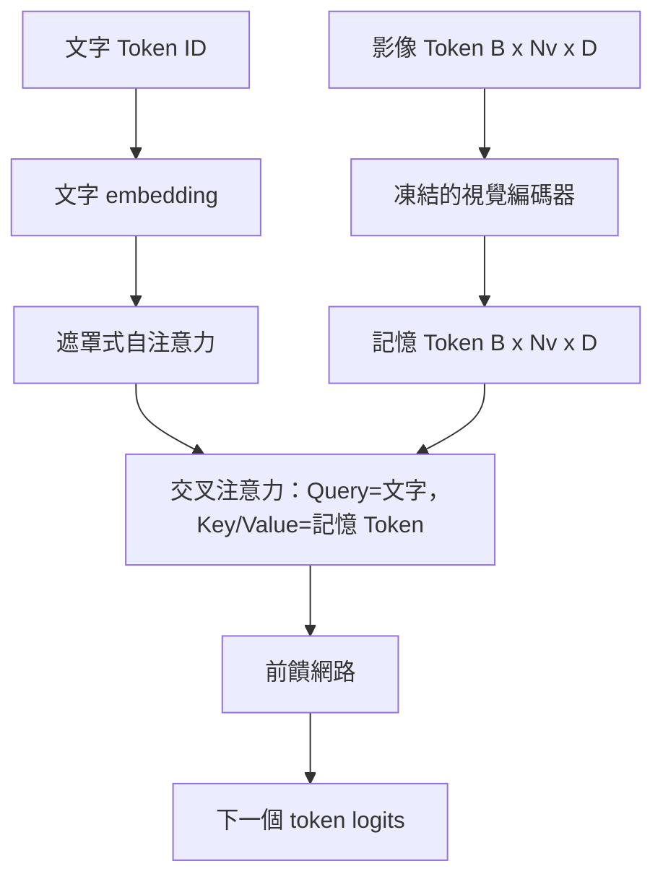
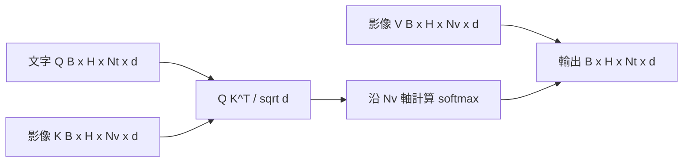

# 交叉注意力跨模態融合（Cross-Attention Fusion）

> 投影層只能將單一影像向量對齊至單一圖說向量。而一個真實的視覺語言解碼器，必須讓每一個文字 Token 能夠自由關注到每一個影像 Patch，使模型能夠將文字中的具體詞彙精確錨定在影像的局部區域中。交叉注意力（Cross-Attention）正是達成該空間語意錨定的核心機制：文字作為 Query（查詢），視覺特徵作為 Key 與 Value（鍵與值）。本課將親手實作交叉注意力區塊、因果文字自注意力機制，以及確保兩者幾何合法的專屬遮罩體系。

**Type:** Build
**Languages:** Python
**Prerequisites:** Phase 19 lessons 30-37 (Track B foundations)
**Time:** ~90 minutes

## Learning Objectives｜學習目標

- 實作多頭交叉注意力機制：Query 串流嚴格來自文字，Key/Value 串流嚴格來自視覺特徵。
- 組裝標準解碼器區塊：因果自注意力 + 交叉注意力 + 前饋神經網路（FFN）。
- 嚴密維護遮罩形狀：自注意力施加因果下三角遮罩，交叉注意力嚴格無遮罩。
- 成功執行批次前向傳播：文字 Token 批次與固定的影像 Token 記憶池完美融合。

## The Problem｜問題

將影像 Token 與文字 Token 直接暴力拼接成單一長序列，是跨模態融合的一種工程選擇（即早期融合 Early Fusion，Chameleon 與 Emu3 採用此路徑）。而交叉注意力則是另一種更為優雅的選擇（即晚期融合 Late Fusion，DeepMind Flamingo 開創此流派，並被後續所有 Flamingo 風格的解碼器廣泛繼承）。在晚期融合架構中，文字解碼器在主幹上專注於純文字 Token 的自回歸運算，並在每一個神經網路區塊中，透過交叉注意力機制主動向旁路的影像串流伸出觸角。

晚期融合具備兩項優點：第一，文字解碼的主幹串流始終保持純淨，模型能保留純文字能力；第二，影像特徵在輸入時僅需前向計算一次，隨後在整個自回歸解碼週期中被重複使用，因此即使生成長篇大論的詳細圖說，推論算力開銷依然低廉。其代價僅僅是在每個區塊中額外增加一個注意力子層。

## The Concept｜核心概念





### 遮罩形狀的剛性區隔

解碼器區塊內部的兩種注意力機制，在數學上需要完全不同的遮罩形狀：

| 注意力類型 | Query 序列長度 | Key 序列長度 | 遮罩規則 | 為何如此設計 |
|---|---|---|---|---|
| 自注意力（Self-Attention） | `Nt`（文字） | `Nt`（文字） | 因果遮罩：下三角矩陣 `(Nt, Nt)` | 自回歸生成時，當前文字 Token 絕對不能跨時序偷看未來的詞彙 |
| 交叉注意力（Cross-Attention） | `Nt`（文字） | `Nv`（視覺） | **完全無遮罩** | 整張影像在文字生成前已經完整可見，每個文字位置皆可自由觀看全圖 |

本課實作了專屬的形狀校驗函式，確保任何混淆遮罩的低級失誤會立即以顯式的 `ValueError` 拋出，而絕不會轉化為難以排查的靜默損壞損失曲線。

### 為何交叉注意力完全不需要遮罩？

在任何文字開始吐字之前，整幅影像早已經完整地被觀測完畢。圖說中的第 `t` 個詞彙可以自由關注影像上的任意一個 Patch 方塊；影像切塊之間完全不存在任何時間先後順序。某些高階的 Flamingo 變體在交織多圖多文時會引入按樣本劃分的動態遮罩，但針對單圖單圖說的經典場景，交叉注意力對全圖保持完全無遮罩的全連通視野。

### 鍵值快取（KV Caching）的極致加速

影像的 Key 與 Value 特徵矩陣在解碼開始時一次性計算完成，並完整保存在快取（Cache）之中。隨後每生成一個全新文字 Token，只需直接調用該快取，完全無需重新前向傳播運算。這正是影像描述（Image Captioning）推論速度很快的原因：龐大沉重的 Vision Transformer 僅需運作一次；隨後的自回歸吐字僅需在交叉注意力中複用既有的 K 與 V 快取即可。

### 解碼器區塊的精密組裝

標準解碼器區塊依序執行：Pre-LN -> 自注意力 -> 殘差連接 -> Pre-LN -> 交叉注意力 -> 殘差連接 -> Pre-LN -> 前饋神經網路 FFN -> 殘差連接。包含三個子層，每個子層皆擁有自身獨立的 LayerNorm。Flamingo 論文曾在交叉注意力殘差上引入了可學習的門控係數（Tanh Gate），讓模型在訓練期間能選擇略過視覺通路；這與訓練穩定性相關的代價仍須考量。而本課採用的基準架構則不使用門控，直接採用純殘差設計。

```python
class DecoderBlock:
  def forward(self, text_tokens, image_tokens, text_mask, cross_mask):
      text_tokens = text_tokens + self.self_attn(self.ln1(text_tokens),
                                                 mask=text_mask)
      text_tokens = text_tokens + self.cross_attn(self.ln2(text_tokens),
                                                  image_tokens,
                                                  mask=cross_mask)
      text_tokens = text_tokens + self.ffn(self.ln3(text_tokens))
      return text_tokens
```

```figure
ch-crossattn-fan
```

## Build It｜動手實作

`code/main.py` 實作了以下核心模組：

- `CrossAttention(hidden, heads)`：具備獨立 `q` 投影與 `kv` 投影的多頭交叉注意力層。
- `CausalSelfAttention(hidden, heads)`：標準解碼器中的帶有因果下三角遮罩的多頭自注意力層。
- `DecoderBlock`：整合三大子層與 Pre-LN 殘差連接的核心區塊。
- `VisionLanguageDecoder`：包含 4 層堆疊的視覺語言解碼器，輸入接收模擬視覺編碼器輸出與小型 text embedding 查表。
- `causal_mask(length)`：生成形狀為 `(length, length)` 的下三角布林遮罩張量。
- 底部演示程式：傳入一個包含 2 條長度為 10 的文字序列、對應長度為 197 的影像記憶池批次，在終端機印出輸出張量形狀、自注意力遮罩幾何維度，以及各位置交叉注意力輸出的向量範數。

執行測試：

```bash
python3 code/main.py
```

輸出結果：解碼器成功產出形狀為 `(2, 10, text_vocab)` 的預測 Logits 張量。遮罩形狀精確為 `(10, 10)`。KV 快取複用驗證確認：快取與非快取路徑的 logits 在浮點容差內相同。

## Use It｜實際應用

交叉注意力機制廣泛統治著兩大工業級生產模型家族：

- **Flamingo 與 IDEFICS**：在一個原本完全凍結的語言模型（LLM）中，每隔 K 個區塊強行插入一個交叉注意力子層（附帶門控開關）。跨模態適配器本質上就是交叉注意力區塊與其門控係數的集合體。
- **BLIP-2**：其著名的 Q-Former 模組，正是利用一組固定包含 32 個 Token 的可學習 Query 向量，透過交叉注意力主動向影像特徵進行資訊打撈，隨後將這 32 個 Query 投影至 LM embedding 空間中。

本課所定義的區塊骨架與這兩大體系完全同構。自注意力施加因果遮罩、交叉注意力完全敞開無遮罩的工程紀律，是所有跨模態解碼器共同依託的鐵律。

## 單元測試

`code/test_main.py` 覆蓋了以下核心測試項：

- 因果遮罩為嚴格的下三角矩陣，形狀與布林值分佈完全符合預期。
- 交叉注意力輸出形狀嚴格為 `(B, Nt, hidden)`，完全不受 Key 序列長度的干擾。
- 開啟 KV 快取時的推論輸出，與不開啟快取時的輸出在浮點容差範圍內完全等價。
- 當文字與影像串流形狀不相符時，系統主動拋出清晰的 `ValueError` 異常。
- 完整的解碼器前向傳播能夠穩定輸出正確的批次與序列維度張量。

執行單元測試：

```bash
python3 -m unittest code/test_main.py
```

## Exercises｜練習

1. 為交叉注意力殘差引入一個可學習的 tanh 門控係數（即 Flamingo 的經典技巧），驗證模型在門控初始化為 0 時能完全退化為純文字語言模型，之後再於訓練中混入影像訊號。
2. 實作交織圖文（Interleaved Attention）支援：同一個解碼器能同時吞下多張影像與多段文字。為其建置按樣本劃分的專屬交叉注意力遮罩，嚴格防止文字段落 2 越權窺探影像 1。
3. 在文字長度 `Nt=64, Nv=576`（高解析度 24x24 網格）時，分析交叉注意力與自注意力層的運算成本。交叉注意力的成本為 `Nt * Nv`，且在高解析度影像下佔主導地位。
4. 在交叉注意力圖上加入 Query 端 dropout，並測量示範中的圖說多樣性（交叉注意力圖中的 dropout 增加時，圖說樣本變異數也會增加）。
5. 將交叉注意力層改造為 Q-Former 風格的結構：由一組固定的 32 個 Query Token 專門對影像特徵在每層各執行一次交叉注意力。

## Key Terms｜關鍵術語

| 術語 | 核心定義 |
|---|---|
| Late fusion（晚期融合） | 文字與視覺在神經網路中維持兩條獨立的主幹串流；透過在各區塊掛載交叉注意力進行橋接 |
| Cross-attention（交叉注意力） | Query 來自一個模態串流（如文字），而 Key 與 Value 來自另一個模態串流（如影像）的注意力機制 |
| Causal mask（因果遮罩） | 下三角布林矩陣遮罩，強制防止自回歸解碼時向未來的 Token 發生時序洩漏 |
| KV cache（鍵值快取） | 影像的 Key 與 Value 特徵矩陣僅計算一次並在記憶體中快取，供後續自回歸吐字重複複用 |
| Memory tokens（記憶 Token） | 視覺編碼器輸出並被凍結的影像特徵向量池，作為文字解碼器調用交叉注意力的外部資訊源 |

## Further Reading｜延伸閱讀

- Flamingo（2022）：晚期融合、門控交叉注意力架構的奠基性經典論文。
- BLIP-2（2023）：深入透視 Q-Former——本質上就是一套被包裝為可學習 Query 池的交叉注意力區塊。
- IDEFICS（2023）：Flamingo 配方的大型開源權重復現與工程細節拆解。
