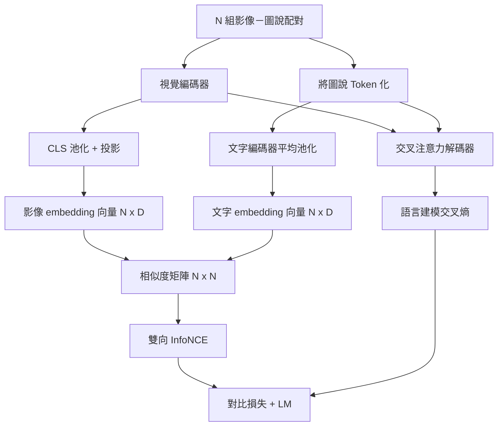

# 視覺語言多任務預訓練（Vision-Language Pretraining）

> 編碼器、投影層與解碼器已經全部組裝就緒。現在，我們將它們深度串聯並開展聯合預訓練。兩大核心目標驅動著神經網路的共同進化：**對比式圖文對齊損失（InfoNCE）**負責在 joint embedding space 中拉近匹配的圖文配對；**自回歸語言模型損失（LM Loss）**則讓解碼器為每張影像撰寫圖說。結合後，模型既能為圖說找到正確影像，也能為影像撰寫圖說。

**Type:** Build
**Languages:** Python
**Prerequisites:** Phase 19 lessons 30-37 (Track B foundations)
**Time:** ~90 minutes

## Learning Objectives｜學習目標

- 在包含 N 組「影像-圖說」配對的 Batch 批次維度上，實作雙向 InfoNCE 對比損失函式。
- 將對比檢索損失與自回歸語言建模損失進行多任務聯合加權組合。
- 在零外部資料集下載依賴的前提下，以純合成資料建置包含 200 組圖文對的自包含模擬語料庫。
- 運作 50 步微型端到端預訓練迴圈，觀察兩路損失函數是否下降。

## The Problem｜問題

視覺語言模型需要兩種能力。第一是排序：給定一段圖說，從多張影像中找出正確的影像。第二是生成：給定一張影像，撰寫圖說。只針對其中一種能力進行預訓練，得到的系統就只具備其中一部分能力。CLIP 擅長排序，但不能生成圖說；GPT-4V 能生成圖說，但使用獨立的檢索頭進行排序。多目標預訓練可在一次訓練中同時學習兩種能力。

InfoNCE 對比損失專門攻克檢索排序：在包含 N 個圖文對的批次中，模型將 N 個完全配對的樣本視為正例，將其餘 `N^2 - N` 個錯配樣本視為負例，並在最終產出的 `(N, N)` 相似度矩陣上計算雙向交叉熵。而語言模型損失則負責攻克生成：在以影像特徵為條件的前提下，執行標準的 next-token prediction。這兩種損失皆可微分，且可共用編碼器、投影層與解碼器權重。

## The Concept｜核心概念



### 一段話透視 InfoNCE 核心數學

將批次中的 N 個 image embedding 向量堆疊為矩陣行，將 N 個 text embedding 向量堆疊為矩陣行。對兩者分別實施 L2 範數歸一化。計算 `N x N` 相似度矩陣 `S = I T^T / tau`（其中 `tau` 為可學習的溫度係數）。主對角線上的條目代表真正匹配的圖文正例；對角線以外的所有非對角條目皆為負例。沿著行方向套用交叉熵損失，以 `argmax` 為目標，要求第 `i` 行的最大值必須精確出現在第 `i` 列；隨後對稱地沿著列方向再套用一次交叉熵。兩者的算術平均數即為最終的雙向 InfoNCE 損失。這就是名震天下的 CLIP 損失函數，在程式碼中僅需 8 行即可優雅表達。

### 溫度係數生死攸關

溫度係數 `tau` 嚴格掌控著 Softmax 機率分佈的尖銳程度。若設定得過小（例如 `tau = 0.01`），Softmax 分佈將極度尖銳，反向傳播梯度幾乎完全被最難的那一個單一負樣本所霸佔，使訓練過程受到雜訊影響；若設定得過大，Softmax 分佈將被徹底撫平，梯度衰減消失。CLIP 將 `tau` 作為可學習參數進行端到端最佳化；本課的演示程式同樣完全比照該做法。

### 自回歸語言模型損失

解碼器透過交叉注意力持續汲取影像特徵記憶，並在文字序列的每一個位置自回歸預測下一個 Token。損失計算採用標準的交叉熵，標籤為向左錯位平移一位的文字 Token。對應 Padding 填充的所有位置皆不納入損失計算。

### 損失的多任務動態加權

全局總損失定義為：`total = contrastive + lm_weight * lm`，其中 `lm_weight` 為平衡標量（通常設定為 1.0）。兩路損失在反向傳播時共同將梯度注入視覺編碼器與跨模態投影層；而文字解碼器則專門接收來自 LM 損失的專屬梯度。這是 CoCa、BLIP 與 SigLIP 等模型採用的多任務配方。

| 核心損失元件 | 作用的損失空間表面 | 實質影響的子網路模組 |
|---|---|---|
| InfoNCE 對比損失 | 聯合語義空間中的圖文對排序 | 視覺編碼器 + 投影層 + 文字編碼頭 |
| LM 語言模型損失 | 以影像為條件的 next-token prediction | 視覺編碼器 + 投影層 + 文字解碼器 |
| **Combined 聯合損失** | **多任務端到端協同** | **整套多模態神經網路堆疊** |

### 為何 50 步已足夠演示

本課提供的模擬語料是由隨機影像與隨機圖說 ID 組成的 200 對合成資料。在批次大小為 16 的配置下，執行 50 步 SGD 更新後，即使絕對值仍高於真實資料模型可達到的水準，兩路損失仍會明顯下降。演示的目的在於確認梯度路徑能端到端順暢運作，且加入 LM loss 不會使對比目標不穩定。

```figure
ch-infonce-diagonal
```

## Build It｜動手實作

`code/main.py` 實作了以下核心模組：

- `MultimodalModel`：完整整合微型 ViT 編碼器、MLP 投影層、文字編碼頭（對 embedding ID 實施平均池化），以及第六十一課打造的交叉注意力文字解碼器。
- `info_nce_loss(image_emb, text_emb, temperature)`：雙向對稱的 CLIP 風格 InfoNCE 核心對比損失。
- `lm_loss(logits, target_ids, padding_id)`：帶有 Padding 遮罩的 next-token cross-entropy 損失。
- `make_mock_corpus(seed, n_pairs)`：確定性合成 200 組包含（影像, 圖說 ID）的自包含測試語料。
- 核心訓練迴圈：配置批次大小為 16，使用 Adam 最佳化器與可學習的 Log-temperature 參數，連續執行 50 步預訓練，每隔 5 步即時印出兩路損失走勢。

執行測試：

```bash
python3 code/main.py
```

輸出結果：對比損失從約 `ln(16) = 2.77` 降至 2.4 附近；LM 語言模型損失從隨機均勻分佈的 `ln(512) ≈ 6.24` 降至約 4.7。兩路損失皆下降，顯示梯度連線正確。真實模型訓練數百萬步；其動態與此相同。

## Use It｜實際應用

完全相同的多任務損失配方廣泛統治著以下經典工業級模型：

- **CLIP（2021）**：純粹的圖文對比學習，另搭配一個使用凍結編碼器的圖說生成探針。
- **CoCa（2022）**：在一套統一模型中同時塞入圖文對比與影像描述 LM 損失。這正是本課建構的相同損失模式。
- **BLIP 與 BLIP-2**：對比損失 + LM 損失 + 圖文匹配（ITM）二分類頭，三重損失聯合驅動。
- **SigLIP（2023）**：將 InfoNCE 換成逐對計算的 Sigmoid 損失；扮演相同的對比角色，但函數形式不同。
- **LLaVA 家族**：兩階段訓練——第一階段對齊（在凍結的 LM 上訓練投影層，對應第六十課）；第二階段解凍 LM 並全面開啟多模態 LM 損失（對應本課）。

## 單元測試

`code/test_main.py` 覆蓋了以下核心測試項：

- InfoNCE 對比損失在影像維度與文字維度之間具備嚴格的雙向對稱性。
- 當相似度矩陣是對角線元素為很大正數的完美對角矩陣時，InfoNCE 損失會回傳 0。
- LM 損失能夠精準識別並排除 Padding 填充位置。
- 全模型前向傳播能夠穩定並行輸出兩路損失，無任何張量形狀異常。
- 5 步的微型訓練迴圈能夠實質性降低總合損失值。

執行單元測試：

```bash
python3 -m unittest code/test_main.py
```

## Exercises｜練習

1. 將 InfoNCE 損失替換為 SigLIP 風格的 Sigmoid 成對損失，在完全相同的模擬語料庫上對比兩者的收斂動態。
2. 引入難負樣本挖掘（Hard-Negative Mining）機制：每隔一個批次，挑選上一批次中預測最為混淆的非對角線負樣本強行追加進當前批次中。觀察對比損失的下降速率是否顯著加快。
3. 在 joint embedding space 頂部追加一個圖文匹配（ITM）二分類預測頭（判定輸入圖文是否為真實配對），引入第三種損失，重現 BLIP 的三頭結構。
4. 將純隨機合成的圖說 ID 替換為馬可夫鏈（Markov Chain）生成的結構化文字（其轉移機率矩陣與影像的雜湊值相關聯）。觀察 LM 損失是否能進一步暴跌，因為資料中含有可學習的影像條件訊號。
5. 分別在 `lm_weight = 0` 與 `lm_weight = 1` 兩種模式下訓練模型。對比兩者的對比損失收斂情況，觀察 LM 損失是否使排序目標退化。

## Key Terms｜關鍵術語

| 術語 | 核心定義 |
|---|---|
| InfoNCE | 雜訊對比估計損失：在圖文相似度矩陣上實施的雙向交叉熵損失 |
| Temperature（溫度係數） | 控制對比 Softmax 機率分佈平緩與尖銳程度的關鍵標量超參數 |
| Hard negative（難負樣本） | 模型極易發生混淆、在特徵空間中與錨點極為接近的錯誤負例配對 |
| LM loss（語言模型損失） | 在影像特徵條件約束下，文字解碼器端進行的 next-token prediction 標準交叉熵損失 |
| Joint embedding space | image embedding 與 text embedding 投影後共同所在、可直接比較餘弦相似度的高維幾何空間 |

## Further Reading｜延伸閱讀

- CLIP 原始學術論文：深入學習純對比式圖文表徵學習的奠基範式。
- CoCa 學術論文：深入學習在一套模型中融合對比與圖說生成的全能多模態架構。
- SigLIP 學術論文：說明基於 Sigmoid 的成對損失變體為何更具擴展性。
