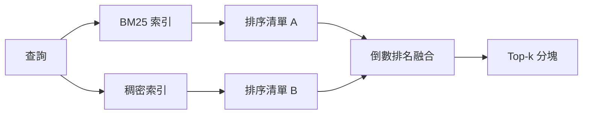

# 融合 BM25 與稠密 embedding 的混合檢索（Hybrid Retrieval with BM25 and Dense Embeddings）

> 詞彙匹配檢索與語義向量檢索在各自的盲區分佈上恰好形成互補。採用倒數排名融合（RRF）的混合檢索並非簡單的數值線性插值，它本質上是一場民主投票——且這場投票在所有查詢類型上皆能穩定勝出。

**Type:** Build
**Languages:** Python
**Prerequisites:** Phase 11 lessons 04 (embeddings), 06 (RAG); Phase 19 Track B foundations (lessons 20-29); Phase 19 lesson 64 (chunking strategies)
**Time:** ~90 minutes

## Learning Objectives｜學習目標
- 基於 Robertson 與 Sparck Jones 的經典理論，從零手寫實作 BM25 檢索演算法，包含欄位加權（Field Weighting）、文件長度歸一化以及可調參數 k1 與 b。
- 建構基於確定性模擬 embedding 的稠密檢索器，確保全套控制迴圈在離線環境下可自包含運作。
- 嚴格依照 Cormack、Clarke 與 Buettcher 於 2009 年發布的原創論文，實作倒數排名融合（Reciprocal Rank Fusion，RRF），並深入解釋為何它在數學與實踐上全面超越基於分數加權的線性插值。
- 調整 RRF 的常數 k 與跨模態加權權重，在小型測試夾具語料庫上深入洞察各項工程權衡。

## The Problem｜問題

當查詢提問中包含在語料庫中完全原樣出現的專有名詞標識符（Identifier）時，關鍵字檢索能夠以壓倒性優勢碾壓一切。提問 `AbortMultipartOnFail`，BM25 可以在數微秒內精準定位出對應的 Go 語言原始碼函式。若將完全相同的提問轉換為 embedding 向量，該向量會尷尬地懸浮在三個語義分群的交界邊緣，稠密檢索器往往會錯誤地把風馬牛不相及的文件排在第一名。

當查詢以不同措辭表達，與語料庫中的字面詞彙不一致時，稠密檢索在這種情況下較有效。當使用者提問「我們該如何處理取消的上傳？」時，提問中從未出現過 abort 或 multipart 等字眼。BM25 只能尷尬地召回關於「上傳大檔案」的泛化文件（僅僅因為那頁文件中出現了 upload 字眼）；而稠密語義檢索則能敏銳洞察語義關聯，精準抓出在摘要中提及「取消」的底層 abort 函式。

在真實世界中，這兩類提問模式是並存且不可預測的。查詢的分佈本身就是一個動態變數。一個生產級 RAG 系統必須透過同一個 API 端點同時從容服務這兩類完全不同的提問，這意味著檢索層必須在同一個時間點將兩者融為一體。這就是混合檢索（Hybrid Retrieval）。而整個架構中最關鍵的成敗死穴，就在於**結果合併（Merge）演算法的嚴密性**。

## The Concept｜核心概念



### 一段話透視 BM25

BM25 透過對查詢語句中的所有詞項進行遍歷求和來為「查詢－文件」配對打分：每個詞項的得分等於其逆文件頻率（IDF）權重，乘以一個帶有文件長度歸一化校正、呈飽和趨勢的詞頻因子。包含兩個核心調節旋鈕：`k1` 控制詞頻飽和速度（預設值 1.5 是論文發表的推薦值，未經對比實驗前不宜更動）；`b` 控制文件長度的懲罰力度（預設值 0.75 表示對超長文件施加適度的非線性長度懲罰）。

IDF 公式採用平滑後的 Robertson 與 Sparck Jones 定義：`log((N - df + 0.5) / (df + 0.5) + 1)`。在對數內部加上數值 1，能保證即便某個常見詞出現在超過半數的文件中時，其 IDF 依然能嚴格保持正值。這在停用詞（Stopwords）相對罕見的小型專業語料庫中顯得尤為關鍵。

欄位加權（Field Weighting）允許你告訴 BM25：命中函式符號名稱的重要性，遠遠高於在函式內部註解中偶爾出現該詞。在具體實作中，我們在建立索引時直接在對應欄位的詞頻上乘以放大倍數，而非在打分時計算複雜的加權。這種做法在數學上完全等價，且省去了維護多個獨立打分器的繁瑣開銷。

### 一段話透視稠密檢索

使用 embedding 模型將每個文字切塊映射為固定維度的稠密向量。在查詢時，同樣將提問文字轉換為向量，依照餘弦相似度對語料庫中的所有切塊進行降序排序，並截取 Top-K 候選。embedding 模型本身的品質決定了檢索精度的上限；而檢索演算法本質上只有極簡的兩行：向量點積與排序。

本課採用基於字串雜湊的確定性 embedding 函式，讓你無需發起任何外部網路請求即可深度理解底層融合數學。雜湊函式會將依 token 索引的偏移量加總為 96 維向量，並進行 L2 歸一化。輸出的餘弦相似度在多次運作中具備 100% 的確定性，滿足單元測試的嚴密要求。

### 倒數排名融合（RRF）的權威原創公式

傳入兩份獨立的排序清單。針對出現在任意一份清單中的每個候選者，計算其在兩份清單中的倒數排名貢獻並求和。2009 年的原始論文採用的標準公式為：`1 / (k + rank)`，並以 k = 60 作為論文採用的預設值。依據全局累計得分降序排列，這就是整個演算法的全部全貌。

原創常數 k = 60 絕非憑空捏造。當 k = 60 時，排名第 1 名的得分貢獻為 1 / 61 ≈ 0.0164，而排名第 10 名的貢獻為 1 / 70 ≈ 0.0143。這種平緩的衰減曲線，確保了深層候選者依然具備足夠的投票權重；過小的 k 會讓頭部第一名呈現病態壟斷；過大的 k 則會過度撫平曲線導致區分度不足。

本實作引入了兩個可調旋鈕：常數 `k`，以及一對跨模態加權權重（使你能在已知語料特徵的前提下，主動放大 BM25 或稠密檢索的投票份額）。將排名倒數乘以模態權重是兼具理論嚴密性與工程實用性的做法：它在保持尺度不變的同時完整保留了倒數衰減曲線。

### 為何基於排名的融合全面擊敗分數加權插值

BM25 的得分是無界的，且數值跨度極度依賴於當前語料庫的具體規模；而餘弦相似度的數值則被嚴格限制在 -1 到 1 之間。若採用線性組合公式 `alpha * bm25 + (1 - alpha) * cosine`，你必須為每個獨立的語料庫進行漫長痛苦的 alpha 參數調整，且每當重新建立索引或追加新文件時，原有權重便會當場徹底失效！而基於排名的融合（RRF）則完全免疫該缺陷：不同模態的排名可以互相比較。自 2010 年以來，RRF 在所有公開的 TREC 國際檢索評測軌道上，全面碾壓了基於原始分數的線性插值對照基準。

這與 Vespa 和 Weaviate 文件中的論點相同：除非你擁有壓倒性的實證資料支持，否則**永遠優先堅持基於排名的 RRF 融合**。

```figure
rrf-fusion
```

## Build It｜動手實作

`code/main.py` 實作了以下核心模組：

- `tokenize(text)`：基於正規表示式的快速 tokenizer。
- `BM25Index`：支援欄位加權、可調參數 k1 與 b 的 BM25 索引庫，暴露 `add` 與 `search` 方法。
- `mock_embed` 與 `DenseIndex`：與第六十四課完全對齊的確定性稠密向量索引庫。
- `rrf(rankings, k, weights)`：支援多模態加權的權威 RRF 融合演算法。
- `HybridRetriever`：將 BM25 與稠密向量深度縫合的統一混合檢索器。
- 演示程式 `main()`：載入小型測試夾具語料庫，發起三道分別考驗兩路檢索長短板的典型查詢，並列印出各路原始排名與最終的 RRF 融合清單。

執行測試：

```bash
python3 code/main.py
```

並列審讀終端機輸出的對照結果：面對精確符號標識符提問時，BM25 排在第 1 名、稠密排在第 4 名，RRF 融合精準定格在第 1 名；面對同義改寫提問時，BM25 掉落至第 6 名、稠密高居第 1 名，RRF 融合同樣精準鎖定在第 1 名；面對模棱兩可的邊界提問時，兩者皆排在第 3 名，而 RRF 融合則以兩票共識強勢將其推上第 1 名。這證明了：RRF 絕不僅僅是一次平局決裁，而是一套在所有查詢類型上皆能穩健勝出的強大架構。

## 參數調整指南

| 調節旋鈕 | 預設數值 | 何時應當調高此參數 | 何時應當調低此參數 |
|---|---|---|---|
| BM25 k1 | 1.5 | 關鍵字在文件中頻繁重複出現，且你希望高詞頻帶來更顯著的加分 | 文件篇幅極短，詞彙重複純屬無意義雜訊 |
| BM25 b | 0.75 | 長篇大論的文件確實存在嚴重的廢話稀釋現象 | 文件的長短與所探討主題的核心深度完全無關 |
| RRF k | 60 | 希望排名較靠後的候選者依然能保有充分的投票發言權 | 期望頭部第 1 名的優勢呈現絕對碾壓態勢 |
| BM25 權重 | 1.0 | 語料庫充滿嚴肅程式碼與 API 符號，且使用者習慣精準搜尋 | 使用者提問普遍為模糊口語化描述 |
| Dense 權重 | 1.0 | 使用者普遍進行同義意圖改寫與模糊提問 | 使用者普遍精準搜尋專有名詞 |

切記：參數調整必須依據第六十八課的評測套件在獨立測試集上以客觀指標為依歸，切勿憑拍腦袋的主觀直覺隨意更改。

## 實戰中必須警惕的三大暗坑

**未登錄詞（Out-of-vocabulary）陷阱**：BM25 的 IDF 完全依託於語料庫統計，對於語料中從未出現過的生僻詞，其貢獻精確為零；而稠密向量模型則會強行為該生僻詞幻覺出一個近似向量。在面對語料庫之外的虛擬標識符時，稠密檢索會召回看似合理但完全錯誤的鄰居。RRF 能吸收該錯誤（因為 BM25 回傳為空），但前提是你必須按文件進行嚴格去重，而非按分塊去重。

**停用詞狂暴霸榜**：若使用者拿純停用詞（如 "the"）向 BM25 發起查詢，系統將產出在全庫上高度均勻的廢棄排名。必須在索引端過濾停用詞，或者依託高 IDF 詞項在計算中天然佔據主導地位。

**雙模態內容完全同質化**：若語料庫規模極小，以至於 BM25 的第 1 名恰好與稠密檢索的第 1 名完全重合，RRF 會輸出完全相同的第 1 名。這在架構上是正確的，但會讓融合機制看起來形同虛設。在建立評測集時，必須特意注入對抗性查詢對，方能客觀檢驗融合模組的真實戰鬥力。

## Use It｜實際應用

工業級生產最佳實踐：

- BM25 索引強烈建議在本機行程內或記憶體中快速運作；其效能瓶頸在於詞頻倒排字典，而非高維矩陣運算。
- 稠密向量索引推薦託管在專門的向量儲存庫中（本課演示採用平坦清單；正式環境建議採用 HNSW 索引）。
- 並行發射兩路查詢；融合本質上是一次在聯集集合上的常數級別查表排序。
- 在每個召回條目上持久化記錄該結果是由哪一路模態命中的，供下游重排序器精準審計。

## Ship It｜交付成果

第六十六課將接管本課所產出的 RRF Top-K 融合清單，調用 Cross-Encoder 實施二次重排序。第六十八課將在精確率、召回率、MRR 與 nDCG 等維度對整條管線實施全量度量。本課的混合檢索器是第六十九課端到端系統的核心第一階段。

## Exercises｜練習

1. 將 `mock_embed` 替換為你所用提供者提供的真實 embedding 模型。重新運作演示程式，記錄純稠密檢索在面對同義改寫提問時發生的排名變化。
2. 引入第三路模態：將文件切塊摘要作為獨立索引入庫，在檢索時作為第三份排名清單參與 RRF 投票。客觀度量三路投票帶來的精度提升。
3. 在 10、30、60、100、200 的區間內全面掃描 RRF 的常數 k。調用第六十八課的評測套件繪製 Recall@K 曲線，找出在當前語料庫上能使曲線達到峰值的最優 k 值。
4. 完整實作嚴格的 BM25F 演算法（在每個欄位獨立實施長度歸一化，而非採用乘數放大技巧），並在專門考察符號名稱匹配的程式碼語料上驗證其效能增益。

## Key Terms｜關鍵術語

| 術語 | 常見說法 | 實際含義 |
|------|-----------------|------------------------|
| BM25 | 「詞彙檢索」 | 經典機率檢索模型：整合 IDF 權重、飽和詞頻 TF 以及文件長度歸一化補償 |
| RRF | 「排名融合」 | 將候選者在多份獨立清單中的排名倒數 1 / (k + rank) 進行累加求和的權威融合演算法；預設 k=60 |
| k1 | 「詞頻飽和」 | 詞頻飽和係數：控制當某個關鍵字在文件中頻繁重複時，其帶來的邊際加分衰減速度 |
| b | 「長度懲罰」 | 長度懲罰係數：0 代表完全忽略文件長度差異，1 代表實施嚴格線性的長度懲罰歸一化 |
| Field weighting | 「符號加權」 | 在索引時重複特定結構欄位（如標題、符號名稱）中的 token，以提高命中該欄位時的權重 |
| Rank-based vs score-based fusion | 「RRF 為何勝過線性融合」 | 位次在不同模態間天然具備可比性，而原始打分則無法跨分佈對齊 |

## Further Reading｜延伸閱讀

- Cormack, Clarke, Buettcher, 2009（《Reciprocal Rank Fusion outperforms Condorcet and individual rank learning methods》）：RRF 奠基性原創學術論文。
- Robertson et al.（《Okapi at TREC-3》）：BM25 原始發布論文。
- [Vespa：使用 BM25 與 embedding 的混合檢索](https://docs.vespa.ai/en/tutorials/hybrid-search.html)。
- [Weaviate：混合檢索（Hybrid Search）](https://weaviate.io/developers/weaviate/search/hybrid)。
- 第 11 階段第 06 課（RAG 基礎）。
- 第 19 階段第 64 課（文件切塊策略）。
- 第 19 階段第 66 課（Cross-Encoder 重排序器）。
