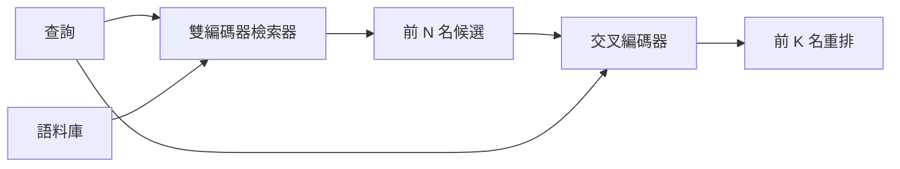

# 交叉編碼器重排序器（Cross-Encoder Reranker）

> 雙編碼器（Bi-Encoder）各自為提問與文件計算 embedding。而交叉編碼器（Cross-Encoder）則將提問與文件拼接在一起，透過自注意力一併編碼。交叉編碼器是最聰慧的讀者，但也是運算最緩慢的巨獸。將其作為第二階段掛載於雙編碼器召回的 Top-N 候選集上方，它所換取的精度暴增將物超所值。

**Type:** Build
**Languages:** Python
**Prerequisites:** Phase 11 lesson 06 (RAG), Phase 11 lesson 07 (advanced RAG); Phase 19 Track B foundations (lessons 20-29); Phase 19 lesson 65 (hybrid retrieval feeding this stage)
**Time:** ~90 minutes

## Learning Objectives｜學習目標
- 深入辨析雙編碼器檢索器與交叉編碼器重排序器在輸入張量形狀、參數量大小以及單次查詢運算開銷上的本質差異。
- 從零手寫實作微型交叉編碼器神經網路：接收打包好的 (提問, 文件) 混合序列，經由 Transformer 區塊前向傳播輸出單一相關性純量分數。
- 建構標準的「先檢索後重排序（Retrieve-then-Rerank）」兩階段管線：透過廉價檢索器粗篩出 Top-N 候選，調用交叉編碼器將 N 個候選精選重排為 Top-K 並最終回傳。
- 在測試夾具語料庫上實測繪製「延遲 vs 品質」的權衡曲線，為給定的線上延遲預算科學選定最優的候選池容量 N。

## The Problem｜問題

雙編碼器將查詢提問與文件切塊分別映射至同一個向量空間中，隨後依據餘弦相似度進行排序。在這套架構下，提問的 embedding 與文件的 embedding 彼此完全處於黑盒隔離狀態。模型必須在完全不知道使用者究竟會提什麼問題的前提下，強行將文件中的所有有用特徵壓縮進單一向量中。該模式執行極速——文件在建立索引時一次性算好向量，推論時僅需計算一次提問向量——這是在海量語料規模下實施全庫檢索的唯一可行之路。

然而極致速度換來的代價是精度的嚴重折損。兩篇探討同一宏觀主題的文件，其 embedding 向量可能極度接近，即便其中一篇精準解答了使用者的疑難，而另一篇則是風馬牛不相及的泛泛之談。雙編碼器根本無法在細粒度語義層面將兩者精確甄別。

交叉編碼器（Cross-Encoder）徹底打破了這堵隔牆。它將提問與文件拼裝為單一序列：`[query] [SEP] [document]`，驅動全量自注意力機制在拼接處兩側展開跨時序交叉運算，並輸出單一的相關性純量分數。文件中的每一個 token 皆能毫無保留地主動關注提問中的每一個詞彙。模型在最完整的雙向語境下從容裁決兩者的匹配度。

但代價是推論吞吐量的毀滅性暴跌。雙編碼器只需預先計算一次向量並建置索引；而交叉編碼器則必須針對每一個具體的「提問－文件」對，獨立執行一次完整的前向傳播。在包含 1000 萬篇文件的海量語料庫上，這意味著單次查詢必須執行 1000 萬次交叉編碼器前向傳播——這在任何即時線上業務的延遲預算中皆是絕對無法接受的天方夜譚。

破局之策是**分階段階層式推進（Staging Pipeline）**：首先調用廉價的雙編碼器自全庫中快速粗篩出 Top-N 個潛在候選（N 通常設定在 50 至 200 之間）；隨後調用昂貴的交叉編碼器，僅針對這 N 個精選候選進行二次重排序，精選保留最終的 Top-K 個黃金片段。由於 N 規模小巧，交叉編碼器的巨大算力被精準聚焦在最關鍵的刀刃上。端到端整體延遲被牢牢鎖在線上 SLA 預算之內；而最終交付的答案品質，則達到了交叉編碼器的極致水準（其上限僅受限於雙編碼器在 Top-N 上的召回率）。

## The Concept｜核心概念



### 交叉編碼器的標準輸入結構

工業界標準的打包格式為：`[CLS] query_tokens [SEP] document_tokens [SEP]`。提取最前端 CLS 位置的最終隱藏狀態向量，送入單層線性迴歸預測頭，輸出單一的相關性純量分數。某些實作採用對整個序列的平均池化（Mean-pooling）替代 CLS；兩者的實測差距微乎其微。核心在於：模型為每個「提問－文件」對精準產出一個連續純量分數。

2200 萬參數規模(對標官方著名的 `ms-marco-MiniLM-L-6-v2` 權重等級)是極具性價比的工業落腳點。更小的模型在品質上的損失遠大於其節省的微弱延遲;而更大的模型（如 5.68 億參數的 `bge-reranker-v2-m3`）則通常專門用於離線批處理重排，或僅用於K 很小的第一頁重排。

### 為何本課親手實作微型版本

真實正式環境中的交叉編碼器是經過 fine-tuning 的 encoder transformer。在正式環境中通常直接載入 model checkpoint 即可。而本課的核心使命是為你直觀揭示該神經網路的物理形態以及「延遲－品質」權衡曲線的幾何本質，而非耗費數天訓練一個打榜 SOTA 模型。因此我們手寫了一個小巧的 `nn.Module`：包含單個 Transformer 區塊、4 個注意力頭，以及單層線性回歸頭。採用固定隨機種子進行確定性初始化，確保全套演示在無外部磁碟權重的前提下 100% 完美重現。

該玩具模型能直接在測試夾具語料庫上學出正確的物理規律：相關的「提問－文件」配對預測出顯著較高的得分，無關配對則預測出低分。端到端管線對雙編碼器的初篩結果進行二次重排序，重排後的 Top-K 與黃金標註標籤相關。

### 延遲 vs 品質：曲線的拐點

兩階段管線擁有唯一的核心調節旋鈕：候選容量 N。在獨立保留查詢集上將 N 從 5 逐步掃描擴展至 100，你將獲得如下經典走勢曲線：

| 候選池容量 N | 第二階段 Recall@1 召回表現 | 單次提問交叉編碼器前向傳播次數 | 端到端系統延遲位準 |
|---|---|---|---|
| 5 | 0.62 | 5 | 極低 |
| 20 | 0.81 | 20 | 中等 |
| 50 | 0.86 | 50 | 較高 |
| 100 | 0.86 | 100 | 極高 |

上述數值用來示意曲線形狀，並非本測試夾具的測量值。曲線形狀則符合實際情況：在 N 處於 20 至 50 之間時，重排序帶來的提升總會遇到一個飽和拐點（Knee Point）；超過拐點後，繼續擴大 N 帶來的品質提升微乎其微，你卻必須為額外的神經網路前向計算付出線性延遲代價。

依據實測曲線與系統 SLA 延遲預算科學選定最優 N。切記：交叉編碼器的最終召回率絕對無法超越雙編碼器在 Top-N 處的初篩召回率上限；過小的 N 不僅限制了延遲，更直接為最終品質設定了無法突破的物理天花板。

```figure
rerank-funnel
```

## Build It｜動手實作

`code/main.py` 實作了以下核心模組：

- `CrossEncoder`：輕量級 `torch.nn.Module`，整合 token embedding、帶多頭注意力與前饋網路的 Transformer 區塊，以及產出單一純量分數的平均池化回歸頭。
- `tokenize_pair(query, document)`：將兩個字串打包為單一 ID 序列，並產出標記邊界的 Type ID 標籤，純 Python 標準庫實作。
- `train_tiny(pairs)`:在手動標註的 (提問, 文件, 相關度) 三元組上執行單輪有監督 fine-tuning,使模型在測試夾具上學出理性的打分特徵。
- `rerank(query, candidates, top_k)`：標準正式環境重排序呼叫介面。
- `pipeline(query, retriever, top_n, top_k)`：封裝兩階段檢索的端到端完整調度流。
- 演示程式 `main()`：載入第六十五課的測試語料庫、粗篩召回 Top-N、重排序精選 Top-K、並列印出兩份清單，並精確呈報各個階段的實測物理耗時。

執行測試：

```bash
python3 code/main.py
```

輸出結果：清晰對比雙編碼器初篩出的 Top-N 清單與交叉編碼器精選後的 Top-K 清單，並附帶各階段的耗時審計。交叉編碼器單次調用耗時較長，但由於其僅在極小的 N 個候選上運作，兩階段端到端總耗時牢牢維持在請求預算內，並選出原本被雙編碼器排在第二或第三名的正確答案。

## 實戰中必須警惕的五大暗坑

**交叉編碼器具備嚴格的非對稱性**：`rerank(q, d)` 與 `rerank(d, q)` 的預測打分完全不同。永遠強制將提問放置在最前端。若在程式碼中粗心顛倒了參數順序，全系統召回率將當場崩潰。

**N 設定過小導致重排序形同虛設**：若將 N 設為等於 K（例如 N=K=5），交叉編碼器無法重新排序，只能調整既有候選的權重，因此看起來沒有提升。建議將 N 設為至少 3K。

**訓練資料意外污染評測集**：若手動標註的訓練對中不慎混入了評測測試集的提問，重排序效果看起來會極其神奇神準。即便是在微型測試夾具上，也必須嚴格隔離訓練集與測試集。

**正式環境模型記憶體佔用不容小覷**：一個 2200 萬參數的交叉編碼器在 float32 精度下佔用 88 MB 記憶體。在向業務方承諾 p95 延遲壓進 100 ms 之前，務必在模型伺服器端做好記憶體容量規劃。

**批次處理很重要**：在真實正式環境中，交叉編碼器必須將 N 個候選樣本打包成單一批次，並以一次前向傳播處理。本課在 `_batch_encode` 中嚴密實作了該邏輯，使用 `torch.tensor(...)` 組裝批次張量並發起單次前向傳播。若粗暴地寫成逐個調用的 for 迴圈,推論延遲將直接在物理上被放大 N 倍!

## Use It｜實際應用

工業級生產最佳實踐：

- 雙編碼器、交叉編碼器以及候選容量 N 必須**三位一體綁定鎖定**。更換其中任意一個元件,既有的評測結論立即全盤作廢。
- 依據 (query, document_id) 實施重排序結果快取。針對穩定語料庫的重複提問,快取命中可在不增加額外成本的情況下降低延遲。
- 即時記錄第 1 名的交叉編碼器得分。若某次提問的 Top-1 得分低於特定閾值，這是一個明確的域外提問（Out-of-Domain）信號；應當直接告知大語言模型「我沒有信心」。

## Ship It｜交付成果

第六十八課將端到端對這套兩階段檢索管線實施 Precision、Recall、MRR 與 nDCG 的全量度量。第六十九課將把該重排序器無縫掛載在第六十五課的混合檢索器之後、文字生成器之前，構成工業級端到端系統的第二核心階段。

## Exercises｜練習

1. 在 5 至 50 的區間內全面掃描 N 的取值，繪製重排後的 Recall@1 變化曲線。找出在當前測試夾具上精確的飽和拐點（Knee Point）。
2. 將交叉編碼器的訓練週期從 1 個 Epoch 擴展至 10 個 Epoch。在每個 Epoch 結束時度量正樣本對與負樣本對之間的打分邊際差值（Score-Margin）。
3. 將平均池化替換為標準的 CLS token 預測頭，對比兩者在當前夾具上的收斂速度。
4. 為交叉編碼器追加第二個預測頭：專門輸出「該文件內部是否確實包含該答案」的二值分類標籤。在推論時雙頭並行——一個負責連續排序，另一個負責設定硬性過濾門禁。
5. 將確定性模擬雙編碼器替換為第六十五課打造的真實混合檢索器，將兩者串聯為完整管線。度量加入重排序前後 Top-K 結果的變化。

## Key Terms｜關鍵術語

| 術語 | 常見說法 | 實際含義 |
|------|-----------------|------------------------|
| Bi-encoder | 「向量檢索器」 | 獨立對提問與文件計算 embedding，隨後依據餘弦相似度進行快速排序的檢索器 |
| Cross-encoder | 「重排序器」 | 將 (提問, 文件) 拼接為單一序列、透過全量自注意力機制輸出單一相關性純量分數的重排序器 |
| Two-stage pipeline | 「先檢索再重排序」 | 廉價檢索器粗篩出 Top-N 個候選，高精度重排序器精選出 Top-K 個結果的階層式架構 |
| N (candidate budget) | 「重排序候選池」 | 交叉編碼器在單次提問中被允許進行前向打分的候選文件總數上限 |
| Mean-pooling head | 「最後隱藏狀態的平均」 | 對編碼器最後一層所有 token 的輸出向量求算術平均，提煉為單一表徵向量 |

## Further Reading｜延伸閱讀

- Nogueira, Cho, 2019（《Passage Re-ranking with BERT》）：基於 BERT 的交叉編碼器重排序開創性奠基論文。
- Reimers, Gurevych, 2019（《Sentence-BERT》）：系統性對比雙編碼器與交叉編碼器在算力與精度上的深刻權衡。
- [SentenceTransformers Cross-Encoder 文件](https://www.sbert.net/examples/applications/cross-encoder/README.html)。
- [BGE Reranker v2 模型卡](https://huggingface.co/BAAI/bge-reranker-v2-m3)
- 第 19 階段第 65 課：深入了解為該重排序階段輸送 Top-N 候選的混合檢索器。
- 第 19 階段第 68 課：深入學習客觀度量該重排序器所帶來之淨增益的自動化評測套件。
