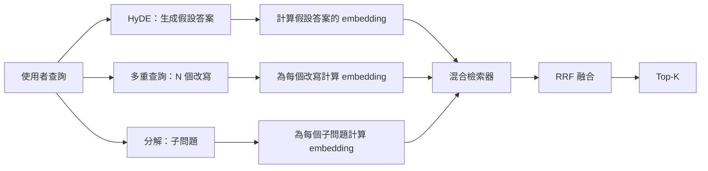

# 查詢重寫技術：HyDE、多重查詢與問題分解（Query Rewriting: HyDE, Multi-Query, and Decomposition）

> 使用者隨手鍵入的原始提問，往往根本不是你的檢索器真正渴望接收的輸入形態。查詢重寫在檢索觸發之前架起了一座關鍵橋樑，使索引庫看到的文字在分佈上更加接近真實答案的樣貌。

**Type:** Build
**Languages:** Python
**Prerequisites:** Phase 11 lessons 04 (embeddings), 06 (RAG); Phase 19 Track B foundations (lessons 20-29); Phase 19 lessons 64 and 65
**Time:** ~90 minutes

## Learning Objectives｜學習目標
- 實作假設文件 embedding（Hypothetical Document Embeddings，HyDE）：驅動大模型生成虛擬答案、對其計算 embedding，並使用該向量替代原始提問向量發起檢索。
- 實作多重查詢擴展（Multi-Query Expansion）：將單一提問動態重寫為 N 個同義改寫句，分別並行檢索，並透過倒數排名融合（RRF）合併聯集。
- 實作複雜查詢分解（Query Decomposition）：將多面向複雜問題精準拆解為多個獨立子問題，逐子問題發起檢索後合併。
- 在測試夾具上橫向對比三大重寫策略，深刻剖析各策略各自勝出的具體業務情境。
- 封裝確定性的本地 Mock 大模型，使全套重寫控制迴圈在離線環境下可自包含運作。

## The Problem｜問題

使用者在搜尋框鍵入了一句話：「當上傳失敗且預算耗盡時，我們團隊到底該怎麼處理？」。語料庫內有一份文件：「AbortMultipartOnFail 在上傳失敗時，負責中止在途的 S3 分段上傳，並扣減每個儲存桶專屬的重試預算」。此時，使用者的提問與文件之間幾乎沒有共享任何相同的名詞短語。BM25 關鍵字檢索漏掉了這份文件。雙編碼器在向量空間中往往會把該文件排在第三或第四名，因為提問向量落入的幾何區域偏向於「已取消的任務」，而非「被中止的上傳」。第六十六課的兩階段重排序固然能挽回處於 Top-N 內部的候選，但如果該關鍵文件連 Top-N 門檻都無法跨入，重排序器根本無緣與之相見。

做法是在提問進入檢索器之前先進行**查詢重寫（Query Rewriting）**。2023 年 Gao 等人發布的開創性論文《Precise Zero-Shot Dense Retrieval without Relevance Labels》提出了 HyDE：命令大語言模型「假設性地起草一份能夠回答該問題的文件」，對該虛構文件計算 embedding，並將該向量直接作為檢索錨點。這份虛構文件會落在 embedding 空間中正確的區域，因為它是以語料庫中的文件口吻寫成的。

另外兩種可與 HyDE 搭配的相關技術：**多重查詢擴展（Multi-Query Expansion）**（微軟 GraphRAG 所採用的術語），生成提問的 N 個同義改寫句並並行檢索後融合；**子問題分解（Decomposition）**（在 2024 年的史丹佛 DSPy 工作中被發揚光大），將「當上傳失敗且預算耗盡時我們該做什麼」精確拆分為兩個原子問題：「上傳失敗時會發生什麼？」與「重試預算耗盡時會發生什麼？」。兩次檢索、一次結果合併，讓答案的兩個部分都有機會被檢索到。

本課將親手實作這三大核心重寫策略，並在完全相同的測試夾具語料庫上進行橫向評估。

## The Concept｜核心概念



### 深入剖析 HyDE 核心機制

HyDE 將使用者的簡短提問向量，徹底替換為大模型虛構的假設文件向量。prompt 模板極其精煉：

```
You are a domain expert. Write a one-paragraph passage that answers the question
below. Use the same vocabulary and phrasing the documentation in this domain would
use. Do not refuse. Do not say you do not know.

Question: {user_query}

Passage:
```

大模型生成的假設回答在事實層面是錯的（因為大模型不了解你的語料庫）。但這在工程上完全無關緊要！檢索器根本不關心事實真偽，它只關心高維空間中的 token 分佈。這段虛構文件中會包含 abort、multipart、bucket、budget 等詞，因為討論這個主題的文件會使用這些詞。對該虛構段落計算 embedding，其向量會落在真實段落附近。

在正式環境中，必須將虛構文件嚴格限制在 2 至 3 句話以內。過長的虛構文件會累積過多幻想雜訊；過短則無法提供足夠的詞彙訊號。

### 深入剖析多重查詢擴展

為使用者的提問生成 N 個保留原意的改寫句。核心 Prompt 結構如下：

```
Rewrite the following question in {N} different ways. Each rewrite must preserve
the original intent. Number them 1 to {N}. Do not add explanations.
```

針對每個改寫句獨立檢索 Top-K 候選。將 N 份排名清單使用第六十五課的 RRF 演算法進行融合。廉價、完全並行、具備嚴密確定性。

多重查詢在「使用者的用詞只是多種合理問法之一、且某種改寫能讓問題表達得更好」的場景下較有優勢；但在「所有改寫皆表現拙劣（因為原始問法本身也有相同問題）」時則效果平平。

### 深入剖析複雜查詢分解

單次檢索根本無法滿足包含多個面向的複雜問題。子問題分解會將複合問題拆解為多個可獨立回答的子問題：

```
The following question may require information from multiple distinct topics.
Decompose it into a list of sub-questions. Each sub-question must be answerable
independently. If the question is already atomic, return it unchanged.

Question: {user_query}
```

逐子問題發起獨立檢索，隨後將各路召回結果實施聯集融合。該策略是攻克包含連詞、多條件對比或兩個不相關主題提問的終極重器。而在面對原子型單一問題時，分解器的唯一職責就是原封不動回傳，絕不能強行捏造虛假子問題。

### 為何三大策略必須並存

三者高度正交互補：HyDE 負責弭平提問口語與專業文件之間的 token 詞彙鴻溝；多重查詢負責涵蓋不同改寫方式；子問題分解負責處理多主題的提問。一個成熟的正式環境系統會同時整合這三種能力，並根據提問特徵動態路由（第六十九課端到端系統將展示專屬挑選器）。

## 確定性模擬大模型

本課在離線環境下自包含運作。內建的 Mock LLM 是一張以使用者提問為索引鍵的確定性查表字典，外加對未知提問的動態兜底函式：

- 針對夾具中的已知提問：精確提供預設的虛構假設段落、三個同義改寫句以及標準子問題拆解。
- 針對未知提問：實施確定性轉換——提取提問中的實詞，透過內建同義詞表進行擴展後回傳。

模擬樁的價值在於將資料契約徹底固定。在正式環境中，只需將該樁替換為真實的大模型 API 呼叫；檢索器本身則不需更動。

```figure
cd-hyde-vector
```

## Build It｜動手實作

`code/main.py` 實作了以下核心模組：

- `MockLLM`：確定性模擬大模型樁。
- `HyDERewriter`：調用大模型撰寫虛擬文件，回傳封裝有虛構文字與檢索目標的 `RewriteResult`。
- `MultiQueryRewriter`：調用大模型產出 N 個同義改寫句，回傳提問清單。
- `DecomposeRewriter`：調用大模型拆分子問題，回傳子提問清單。
- `retrieve_with_rewriter`：接收重寫器與檢索器，執行重寫與檢索，並以 RRF 融合結果。
- 演示程式：在測試夾具上並行驅動三大重寫器，印出究竟是哪一種策略最先精準召回黃金答案文件。

檢索器複用了第六十五課打造的「BM25 + 稠密向量」混合檢索器，融合機制沿用標準 RRF。唯一全新的架構形態是極度輕巧的重寫器介面。

執行測試：

```bash
python3 code/main.py
```

輸出結果：呈現各策略在不同提問下的詳細排名與最終匯總。在術語嚴重錯位的提問上，HyDE 斬獲第 1 名；在表達口吻多變的提問上，多重查詢高居榜首；在複合多維提問上，子問題分解強勢勝出。而不使用重寫器的基準，至少有一個題目的表現不如重寫策略。

## 實戰中必須警惕的四大暗坑

**HyDE 幻覺捏造了錯誤的專有標識符**：大模型憑空臆造了一個看似專業但實際上根本不存在的函式名稱。這導致虛構文件在正確目標文件上的 BM25 關鍵字得分徹底崩潰，因為這個捏造名稱成了權重很高、但索引中未收錄的 token。防範之策：嚴格限制虛構文件長度，並在 RRF 融合中適度調低 BM25 的權重。

**多重查詢改寫陷入同質化塌縮**：弱小的大模型往往只會吐出三個語義幾乎完全一模一樣、只作細微改動的改寫句。N 次檢索回傳的 Top-K 候選高度重合，RRF 融合相較於單次檢索毫無增益。防範之策：在 Prompt 中顯式追加多樣性發散約束，並使用 Jaccard 相似度即時剔除重複改寫。

**子問題過度切分碎裂**：分解器盲目將一個原本高度緊湊的原子問題強行劈成多個細碎碎片。各路檢索回傳的皆是完全同一篇文件但位次被稀釋，融合效果反而不如原始提問。防範之策：在扇出檢索前追加一道「子問題是否彼此足夠不同」的校驗閘門。

**推論延遲線性倍增**：HyDE 額外增加一次大模型生成呼叫；多重查詢增加一次生成加 N 次並行檢索；子問題分解增加一次生成加 M 次檢索。雖然檢索可並行，但大模型首次生成的時間是無法逾越的物理延遲底線。

## Use It｜實際應用

正式環境中的做法：

- **基於提問特徵動態路由重寫策略**：短小精煉的原子提問走多重查詢擴展；包含多個從句或邏輯連詞的複合提問走子問題分解；術語密集、與官方文件術語脫節的提問走 HyDE。
- **依據提問雜湊值建立重寫結果快取**：大量高頻查詢在線上反覆出現，快取重寫結果可避免重複執行改寫。
- **三路並行發射並全量 RRF 融合**：對於追求極致召回率的超高價值場景，同時並行觸發三大重寫並將所有結果進行大融合。代價是三次大模型 API 調用；增益是覆蓋了所有重寫策略的召回聯集。

## Ship It｜交付成果

第六十九課將把該查詢重寫模組無縫掛載在第六十五課的混合檢索器與第六十六課的重排序器最前端。第六十八課的評測套件將客觀度量重寫層為整個 RAG 系統帶來的召回率淨增益。

## Exercises｜練習

1. 實作 RAG-Fusion（多重查詢的 2024 年進階變體）：重寫器刻意產出語義跨度極大的發散改寫，隨後在檢索後交由第六十六課的 Cross-Encoder 進行終端裁決。
2. 引入第四種策略：**後退一步提示（Step-Back Prompting）**（命令大模型先提出一個更高階、更泛化的宏觀問題發起粗檢索，隨後逐步聚焦收斂）。在當前夾具上對比其表現。
3. 為分解器加入原子問題判別頭，辨識哪些提問是原子問題。對比引入該判別前後的「過度切分率」。
4. 將 Mock LLM 替換為真實模型呼叫，測量你的技術堆疊上各重寫策略的延遲。
5. 為每次改寫加入信心分數，主動過濾掉低於安全閾值的劣質改寫，量化該過濾對最終召回率的影響。

## Key Terms｜關鍵術語

| 術語 | 常見說法 | 實際含義 |
|------|-----------------|------------------------|
| HyDE | 「假設文件檢索」 | 假設文件 embedding：由大模型預先起草虛擬答案，計算該答案的 embedding 並替代原始提問發起檢索 |
| Multi-query | 「改寫擴展」 | 同義改寫擴展：將單一提問動態改寫為 N 個保留原意的句子，發起 N 次檢索並透過 RRF 融合 |
| Decomposition | 「子查詢拆解」 | 複合問題拆解：將涉及多個獨立面向的長提問拆分為多個可獨立回答的子問題，分別檢索 |
| Atomic query | 「單一主題」 | 語義單一自洽、若強行拆分只會引發資訊失真的不可分割提問 |
| Step-back | 「抽象化查詢」 | 先向大模型索取更抽象、更宏觀的高階問題發起大範圍背景檢索的引導技術 |

## Further Reading｜延伸閱讀

- Gao, Ma, Lin, Callan, 2023（《Precise Zero-Shot Dense Retrieval without Relevance Labels》）：HyDE 原創奠基論文。
- 微軟研究院《Multi-Query Expansion for Retrieval》。
- 史丹佛 DSPy 框架之《Subquery Decomposition for Multi-Hop QA》技術報告。
- [LlamaIndex：Query Transformations 查詢重寫專題](https://docs.llamaindex.ai/en/stable/optimizing/advanced_retrieval/query_transformations/)
- 第 11 階段第 07 課（進階 RAG 模式）。
- 第 19 階段第 65 課（混合檢索）。
- 第 19 階段第 68 課（RAG 評測套件）。
