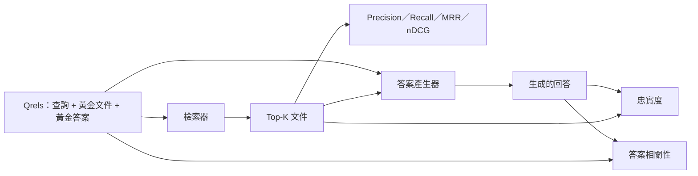

# RAG 全方位評估：精確率、召回率、MRR、nDCG、忠實度與答案相關性（RAG Evaluation: Precision, Recall, MRR, nDCG, Faithfulness, Answer Relevance）

> 若你無法同時為檢索階段與生成回答出具客觀評分，你就絕不能輕易將該系統交付上線。這兩者在度量維度上截然不同，且完全相同的 Prompt 往往會在不同的座標軸上遭遇潰敗。

**Type:** Build
**Languages:** Python
**Prerequisites:** Phase 11 lessons 06 (RAG), 10 (evaluation); Phase 19 Track B foundations (lessons 20-29); Phase 19 lessons 64, 65, 66, 67
**Time:** ~90 minutes

## Learning Objectives｜學習目標
- 基於黃金標註檔案（qrels），精準計算四大核心檢索指標：Precision@K、Recall@K、平均倒數排名（MRR）與歸一化折損累計增益（nDCG@K）。
- 計算兩大核心生成品質指標：忠實度（Faithfulness，評估每個論斷是否皆有檢索上下文支撐）與答案相關性（Answer Relevance，評估回答是否真正切題）。
- 建構標準的測試夾具 qrels 檔案（提問、黃金文件 ID、黃金答案文字），供評測套件端到端讀取。
- 透過對讀六大指標數值，精準定位整個管線究竟在何處發生斷裂：切塊器、檢索召回、二次重排、文字生成還是事實錨定。

## The Problem｜問題

一個現代 RAG 系統至少包含四個彼此咬合的活動齒輪：文件切塊器、檢索器、重排序器、答案產生器。其中任何一個零件發生故障，皆會直接導致最終輸出錯誤答案。若缺乏各階段的細分獨立指標，你在排查故障時無異於盲人摸象。

終端使用者回報系統答錯了。這究竟是因為切塊器粗暴切斷了答案片段？還是因為檢索器未能在 Top-K 候選中成功召回該切塊？還是因為重排序器把正確切塊踢出了第 1 名？抑或是產生器完全無視上下文、在後台自作主張胡說八道？單看最終的答案文字，你根本無從得知。你迫切需要一套立體評測體系：

- 檢索指標：專門為自檢索器吐出的候選池打分；
- 排序指標：專門為正確切塊在候選清單中的位次打分；
- 忠實度（Faithfulness）：專門審查產生器是否嚴格恪守在檢索上下文邊界之內；
- 答案相關性（Answer Relevance）：專門審查模型是否真正回答了使用者的原始提問。

本課將在內建的標準 qrels 檔案上，從零手寫實作這全部六大核心指標。全套評測完全離線且具備確定性；在正式環境中，只需將本機 Mock LLM 裁判無縫替換為真實大模型即可。

## The Concept｜核心概念



### Precision@K（精確率@K）

在檢索器回傳的 Top-K 個文件中，究竟有多大比例是真正命中黃金標註集合的？若黃金集合包含 3 份文件，而 Top-3 回傳了其中 2 份外加 1 份無關文件，則 Precision@3 精確等於 $2 / 3$。當無關雜訊切塊的代價極其高昂時（例如會嚴重浪費大模型的上下文 token 預算，或無關切塊會毒化答案時），精確率是核心監控維度。

### Recall@K（召回率@K）

在全庫所有真實相關的黃金文件中，究竟有多大比例成功闖入了 Top-K 候選清單？若黃金集合包含 3 份文件，而 Top-5 完整覆蓋了這 3 份，則 Recall@5 為滿分 1.0。當漏掉正確答案的代價極其致命時，召回率是最高優先級指標（你寧願多看一眼無關切塊，也絕對不能把包含答案的真理切塊漏掉）。

在正式環境 RAG 系統中，業界最常引用的頭條指標始終是 Recall@K。因為大模型產生器在後續有能力輕鬆忽略無關切塊；但面對一個從未被檢索召回的未知切塊，神仙也無從無中生有。

### 平均倒數排名（MRR，Mean Reciprocal Rank）

針對每道提問，在檢索排序清單中尋找**第一個相關文件出現的物理位次**。倒數排名即為 1 / position。在整個提問測試集上求平均。MRR 是一個高度概括檢索器是否具備「將最佳答案直接頂上榜首」能力的單純數值。

MRR 對第 1 名賦予了極高的獎勵權重：命中第 1 名貢獻滿分 1.0；第 2 名腰斬為 0.5；第 10 名僅貢獻 0.1。該指標由排序列表的頭部絕對統治。

### nDCG@K（歸一化折損累計增益）

Normalized Discounted Cumulative Gain。該公式為每個召回文件分配一個相關性增益分（例如相關記 1，無關記 0），隨後除以該位置的對數折損係數，求和後除以理想狀態下的最優 DCG（即完美排序時的理想值）。數值嚴格落在 0 到 1 之間。

nDCG 的最大優勢在於它天然相容**連續分級的相關性**：黃金標註中可以精細標註「文件 A 相關度為 3，文件 B 為 2，文件 C 為 1」。而 MRR 與 Recall@K 則只能粗暴地進行二值化判定。當你的語料庫中單一提問存在多個不同程度的局部相關文件時，這種情況適合使用 nDCG。

### 忠實度（Faithfulness）

針對模型回答中的每一個論斷語句，逐一檢驗其是否能從檢索召回的上下文中找到確鑿依據。標準實踐採用 LLM 裁判 Prompt：輸入 (論斷, 上下文)，判定為「是」或「否」。忠實度指標即為獲得支撐的論斷比例。

忠實度精準捕捉產生器最致命的「無中生有幻覺」缺陷。即便檢索器召回了完全正確的切塊，產生器一旦開始胡說八道，整套系統依然徹底宣告失敗。在學術界該指標亦被稱為事實錨定度（Groundedness）、論據支撐度（Support）或歸因度（Attribution）。

本課實作了一套基於 token 局部重疊閾值的確定性 Mock 裁判。在正式環境中可無縫替換為真實模型呼叫。指標合約完全同一。

### 答案相關性（Answer relevance）

模型的回答是否真正切中了使用者的提問意圖？忠實度衡量的是「回答是否錨定於上下文？」；而答案相關性衡量的是「回答是否錨定於使用者的問題？」。一個忠實但答非所問的回答，會呈現高忠實度、低相關性；而一個言簡意賅但完全拋開上下文盲猜的回答，會呈現高相關性、低忠實度。

標準實踐同樣依託 LLM 裁判：傳入 (提問, 回答)，判定回答是否直接切題。本課實作了結合 token 重疊評分與裁判的替代方案。

## 標準 qrels 測試夾具結構

```python
{
  "qid": "q1",
  "query": "what is the abort threshold for multipart uploads",
  "gold_doc_ids": ["d1", "d3"],
  "gold_answer_substring": "three failed parts",
  "graded_relevance": {"d1": 3, "d3": 2},
}
```

每道測試提問皆嚴密封裝：
- 提問字串（query）；
- 黃金文件 ID 集合（用於計算 Precision / Recall / MRR）；
- 分級相關度字典（用於計算 nDCG）；
- 黃金標準答案子字串（作為參考中繼資料保留；本課中的忠實度計算嚴格依據從回答擷取的論斷是否能被檢索上下文所支撐，而非簡單比對該字串）。

在正式環境中，需要為這些資料加上標籤。本課自包含交付了手動精心打造的測試夾具，確保全套評測可直接開箱即用。

```figure
ci-rag-metric-ladder
```

## Build It｜動手實作

`code/main.py` 實作了以下核心模組：

- `precision_at_k(retrieved, gold, k)`：標準精確率算子。
- `recall_at_k(retrieved, gold, k)`：標準召回率算子。
- `mean_reciprocal_rank(retrieved_list_of_lists, gold_list)`：跨提問求平均的 MRR 算子。
- `ndcg_at_k(retrieved, graded_relevance, k)`：支援二元或分級增益的 nDCG 算子。
- `extract_claims(answer)`：將長篇回答精確切分為單句級別的待審核論斷清單。
- `faithfulness(claims, context_texts, judge)`：度量論斷受上下文支撐比例的忠實度算子。
- `answer_relevance(question, answer, judge)`：審查回答是否切題的相關性算子。
- `MockJudge`：基於 token 重疊的確定性離線裁判。
- `evaluate_pipeline(pipeline_fn, qrels, ks)`：全自動調度全套指標的核心評測編排器。
- 底部演示程式：在完全相同的 qrels 上，平行運作三大管線變體（純切塊對照基準、混合檢索、混合檢索 + 重排序），並輸出完整的指標對比表。

執行測試：

```bash
python3 code/main.py
```

輸出結果：在單一終端機表格中呈現三種管線在 Precision@K、Recall@K、MRR、nDCG@K、忠實度與答案相關性上的全景對比。混合檢索在 Recall 召回率上勝過純切塊對照基準；而追加了重排序器的管線則在 MRR 上勝過混合檢索。

## 指標讀取與故障排查矩陣

| 監控異常特徵 | 最可能的底層病因 | 具體修復方案 |
|---|---|---|
| 低 Recall@K，低 Precision@K | 切塊器切斷了答案片段，或檢索器根本找不到對應文件 | 調整文件切塊邊界（第六十四課），或切換檢索模態（第六十五課） |
| 良好 Recall@K，但低 MRR | 正確切塊已進入前 Top-K，但遺憾未能排在第 1 名 | 引入 Cross-Encoder 二次重排序器（第六十六課） |
| 高 MRR，但低忠實度（Faithfulness） | 上下文完全正確，但產生器無視上下文開始胡亂幻覺 | 最佳化生成 Prompt；強制模型必須嚴格附帶引用或在無把握時拒絕作答 |
| 高忠實度，但低答案相關性 | 回答有理有據，但徹底答非所問 | 引入前置查詢重寫器（第六十七課），或重新修正生成 Prompt 意圖對齊 |
| 四項（檢索／排序）指標皆高，但用戶依然投訴 | 評測測試集缺乏代表性，脫離了真實業務場景 | 擴充 qrels，加入真實使用者查詢 |

## 實戰中必須警惕的四大暗坑

**大模型裁判的自戀偏見（LLM-as-judge bias）**：大語言模型在審查由自身家族生成的回答時，往往會給予顯著高於客觀水準的虛假高分。在正式環境中，永遠堅持選用與產生器不同家族的大模型充當裁判（例如 Claude 產生答案、GPT-4o 擔任裁判），或定期由人工專家對抽樣樣本進行盲審對齊。

**qrels 標註資料的過期腐化（Qrels rot）**：隨著企業知識庫的頻繁更新，半年前標註為正確的文件在今天很可能早已過時。若團隊重命名了底層函式，原本的黃金標註將變成引導模型走向錯誤答案的毒藥。必須建立季度級別的 qrels 定期複審制度。

**微觀單句通過，宏觀邏輯誤導**：逐句忠實度檢查可能通過，但答案整體結構仍可能造成誤導。必須在自動化指標上方追加全局層面的定性抽樣審計。

**平均召回率掩蓋結構性死穴**：高達 90% 的全局平均 Recall@K，往往會悄悄掩蓋某一個特定業務品類的提問其實在線上 100% 徹底漏報。必須依照查詢類別（專有詞、同義改寫、複合多跳）對 qrels 進行切片，並按切片呈報細分得分。

## Use It｜實際應用

工業級生產最佳實踐：

- 每次更動檢索器或生成器時都執行評測。將 recall@k 退步視為測試失敗。
- 將每一次提問的評測鏈路進行長效持久化。當線上用戶投訴時，立即查詢匹配的 qrels 條目，核實該事故在歷史評測中是否早已露出端倪。
- 建立三級梯隊 qrels 評測矩陣：20 道提問的冒煙測試集（於 CI 中執行）；200 道提問的回歸測試集（每晚定時跑通）；2000 道提問的深層全量測試集（每週末自動執行）。

## Ship It｜交付成果

第六十九課會將切塊器、檢索器、重排序器與產生器組裝為端到端系統，並執行本課的評測。

## Exercises｜練習

1. 為檢索模組引入第五大度量指標：**命中率（Hit-Rate@K）**。對比其與 Recall@K 的數值差異，並詳細闡述在何種業務場景下兩者會出現顯著分歧。
2. 實作分級忠實度打分（Graded Faithfulness）：0（完全無出處）、1（有部分佐證）、2（獲得充分確鑿支撐），並據此調整最終平均分計算邏輯。
3. 將本機 Mock 裁判替換為真實模型呼叫。量測 Mock 裁判與真實裁判在當前夾具上的分歧率。
4. 為 qrels 引入查詢類別標籤（"literal" 精準匹配、"paraphrased" 同義改寫、"multi-topic" 複合多跳），輸出按類別細分的二維評測矩陣。
5. 追加「回答長度」統計維度，並分析其與忠實度之間的相關性係數，繪製分佈散點圖。

## Key Terms｜關鍵術語

| 術語 | 常見說法 | 實際含義 |
|------|-----------------|------------------------|
| Precision@k | 「檢索結果命中率」 | 檢索精確率：被檢索出的 Top-K 個切塊中，真正命中黃金標註文件的比例 |
| Recall@k | 「黃金文件命中率」 | 檢索召回率：在全庫所有真實黃金文件中，成功被召回進入 Top-K 的比例 |
| MRR | 「首次命中位置」 | 平均倒數排名：跨所有查詢求平均的「第一個正確答案所在名次的倒數」 |
| nDCG@k | 「分級排序品質」 | 歸一化折損累計增益：考量候選文件連續相關度等級與所在位次對數衰減的加權排名指標 |
| Faithfulness | 「有據可循」 | 事實錨定度：模型回答中所陳述的每一個事實論斷，能從檢索上下文中找到依據的比例 |
| Answer relevance | 「是否回答到問題？」 | 切題度：模型的回答是否真正切中了使用者的原始提問意圖 |
| Qrels | 「黃金標籤」 | 黃金標註真相庫：包含查詢、黃金文件 ID 與標準答案文字的權威測試基準檔案 |

## Further Reading｜延伸閱讀

- Buckley, Voorhees, 2000（《Evaluating Evaluation Measure Stability》）：資訊檢索排名評估指標穩定性的奠基性經典文獻。
- Järvelin, Kekäläinen（《Cumulated Gain-based Evaluation of IR Techniques》）：nDCG 原始原創學術論文。
- [Ragas：RAG 管線自動化評估](https://docs.ragas.io)：RAG 管線的自動化評估工具。
- [Anthropic：Introducing Contextual Retrieval](https://www.anthropic.com/engineering/contextual-retrieval)：採用 $1 - \text{Recall@20}$ 評分檢索。
- 第 11 階段第 10 課（評估框架基礎）。
- 第 19 階段第 64 至 67 課：全面回顧被本評測套件打分驗收的切塊、混合檢索、重排序與查詢重寫元件。
- 第 19 階段第 69 課：端到端 RAG 系統。
