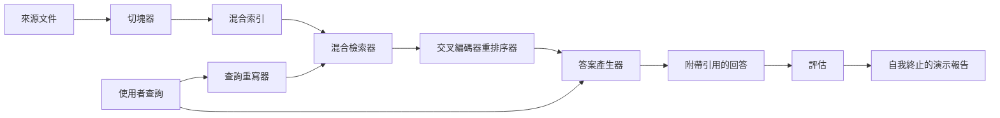

# 端到端 RAG 系統（End-to-End RAG System）

> 六堂課的元件。一條管線。一個評測迴圈。一個自我終止的演示。這就是要交付的系統。

**Type:** Build
**Languages:** Python
**Prerequisites:** Phase 11 lessons 06 (RAG), 10 (evaluation); Phase 19 Track B foundations (lessons 20-29); Phase 19 lessons 64, 65, 66, 67, 68
**Time:** ~90 minutes

## Learning Objectives｜學習目標
- 將文件切塊器、混合檢索器、查詢重寫器、Cross-Encoder 重排序器以及答案產生器無縫組裝為單一的端到端 RAG 管線。
- 實作支援依據分塊錨點（Chunk Anchor）標註引用的答案產生器，並內建「低信心拒絕作答（Refuse-on-low-confidence）」安全防禦機制。
- 在完整組裝的系統上運作第六十八課的評測套件，客觀證明階層式管線在所有指標上皆全面超越各個孤立元件的單打獨鬥。
- 打造一個具備自我終止能力的 CLI 演示程式：攝取測試夾具語料庫、執行固定提問集，並在所有指標達標時以結束碼 0 安全退出並輸出總結報告。

## The Problem｜問題

六個元件各自獨立測試，無法證明它們能整合成系統。切塊器可能在語料庫層面斬獲了極高的 Recall@5，但整套系統端到端的 Recall@5 卻可能一塌糊塗，僅僅因為檢索器根本無法對切塊器產出的碎片進行正確排序；重排序器可能在合成候選池上大幅拉高了 MRR，但在面對雙編碼器初篩出的真實候選時卻全面失靈，因為雙編碼器在重排預算內的召回率過於低下；查詢重寫器可能在某一條特定提問上巧妙將黃金文件頂上榜首，卻在下一道提問中因為大模型輸出了一段劣質的虛構段落而導致檢索全盤崩潰。

真正的系統級整合測試，必須以單一 orchestrator file 串接整條管線，並在完全相同的 qrels 黃金測試集上使用相同的度量標準執行端到端測試。這正是本課所建構的核心。如果組裝後的整合管線指標在整體上全面擊敗了各階段單獨運作時的演示表現，你才算真正證明了這套系統的工程價值。

## The Concept｜核心概念



### 管線拓撲與介面合約

整條管線是一個精巧的有向無環圖。每一個階段皆為一個具備清晰輸入輸出簽名的標準函式：

| 管線階段 | 輸入資料形態 | 輸出資料形態 |
|---|---|---|
| 切塊器（Chunker） | 原始文件文字（str） | Chunk 分塊物件清單 |
| 檢索器（Retriever） | 查詢提問字串（str） | Top-N 候選 Chunk 清單 |
| 重寫器（Rewriter，可選） | 查詢提問字串（str） | 改寫句清單 + 虛構文件 |
| 重排序器（Reranker） | 提問字串, Top-N 候選 | 附帶交叉打分的 Top-K Chunk 清單 |
| 產生器（Generator） | 提問字串, Top-K 候選 | 附帶精確引用的答案文字字串 |

只要每個階段的函式簽名維持穩定，整套系統的組裝便水到渠成。本課定義的 `Pipeline` 類別持有這五個階段，並暴露一個標準的 `query` 方法依序驅動執行。每個模組皆完全支援插拔替換：傳入不同的切塊器、檢索器、重寫器、重排序器或產生器，管線皆能毫無摩擦地流暢運作。

### 支援精確引用的答案產生器

產生器是整條鏈條的終點站，也是最容易出錯的環節。本課內建了一個確定性的模擬產生器：

1. 接收重排序器精選出的 Top-K 個切塊。
2. 篩選出最多兩篇與提問內容詞彙重疊度最高的關鍵切塊。
3. 輸出一段由各被選切塊的關鍵句拼接而成的回答，且在每句話末尾強制追加 `[doc_id:chunk_index]` 溯源錨點。
4. 若所有切塊的詞彙重疊度皆低於安全信心閾值，產生器果斷回答「我不知道」，且絕不附帶任何虛假引用。

在真實正式環境中，只需將該模擬器替換為呼叫真實大模型的標準 Prompt 模板：

```
You are answering a question using only the snippets below.
Cite every claim with the anchor in parentheses.
If the snippets do not answer the question, say "I do not know".

Question: {query}

Snippets:
{enumerated chunks with anchors}

Answer:
```

低信心拒絕作答（Refuse-on-low-confidence）正是第六十六課我們強制記錄交叉編碼器 Top-1 分數的根本原因。若第一名的得分低於語料庫安全底線，產生器立即主動拒絕回答。這是防止大模型在無把握時胡亂幻覺的最強安全閥。

### 自我終止的驗收演示程式

演示程式端到端運作全套流程：印出單道提問在各階段的詳細執行追蹤、在四道 qrels 測試集上全量運作第六十八課的評測套件、輸出完整的指標對照表格，並在**所有指標皆達到設定閾值時以結束碼 0 退出**。若任意一項指標未達標，演示程式以非零狀態碼退出並明確指名未達標的具體指標。

這正是 CI/CD 冒煙測試的標準形態。管線離線、極速、具備 100% 確定性。測試夾具上的閾值卡得極為嚴苛，任何前續六節課中遺留的退化缺陷皆會直接導致本演示報警失敗。

```figure
rag-pipeline-flow
```

## Build It｜動手實作

`code/main.py` 實作了以下核心模組：

- `Chunk`：貫穿全鏈路的標準資料記錄（擴展第六十四課的結構，追加 chunk_index 與來源 doc_id）。
- `Chunker`：調度第六十四課的切塊策略（預設採用泛化最強的遞迴階層切塊）。
- `HybridIndex`：封裝第六十五課的「BM25 + 稠密向量 + RRF 融合」混合索引。
- `Rewriter`（可選）：依據提問長度與連詞特徵，自動在第六十七課的 HyDE、多重查詢與子問題分解中動態選型。
- `Reranker`：封裝第六十六課訓練好的 Cross-Encoder，內建微型訓練集確保在數秒內收斂。
- `Generator`：具備引用錨點與低信心拒絕保護的確定性模擬產生器。
- `Pipeline`：統一編排五大階段，暴露 `query(question)` 方法，回傳包含 `Result(answer, top_k, latency_ms_per_stage)` 的結果物件。
- `run_demo()`：端到端攝取語料庫、運作三道測試查詢、觸發全量評測、印出結果表格，並依據指標門禁設定退出碼。

執行測試：

```bash
python3 code/main.py
```

輸出結果：展示單次提問的逐階段詳細 Trace、全量評估指標矩陣，以及最終的系統通過驗收狀態。在內建夾具上以結束碼 0 安全退出。

## 實戰中必須警惕的五大暗坑

**切塊邊界發生漂移**：若在標註 qrels 黃金測試集與實際運作演示之間切換了切塊策略，黃金文件 ID 將會發生錯位。必須在 qrels 檔案中強制鎖定切塊策略名稱。本示範的標頭會標明所用的切塊器。

**重排序器訓練集意外洩漏至評測集**：第六十六課中的 14 組訓練三元組若不慎混入了評測提問，重排序效果看起來會極其虛假神準。在正式環境中必須嚴格實施二者隔離。本演示的評測題目與重排訓練集保持絕對正交。

**模擬產生器掩蓋了真實幻覺風險**：模擬產生器天生免疫幻覺，因為它只會從檢索出的切塊中抽取句子。本課會指出這項限制，並說明如何在正式環境中改用真實模型。

**當前管線未實作串流輸出**：當前管線在每個階段結束後一次性回傳完整答案。真實正式環境通常會對產生器的輸出實施 token 級串流推播（Streaming）。串流輸出不在本課範圍內；無論是否串流，答案評級指標都可在最終字串上運作。

**離線延遲與真實網路延遲的落差**：模擬大模型調用是即時的常數時間；而真實大模型的 API 網路調用會主導端到端耗時。必須在請求範疇內做好整體延遲預算規劃。本課各階段的計時只量測 CPU 工作。

## Use It｜實際應用

工業級生產最佳實踐：

- 將整條管線程式碼收斂在單一編排器檔案身後，明確宣告各階段的輸入輸出介面。避免將組裝邏輯散落在儲存庫各處。
- 在每一次 Git PR 合併前強制執行該端到端評測。若全域評估指標出現下滑，堅決阻斷 PR 合併。
- 在 CI 運作中長效持久化每次評測的詳細 Trace 記錄，使任何局部的指標退化皆能精確定位至具體的某次元件替換。
- 建立分層測試集：20 道題目的冒煙測試集（在 CI 中 30 秒內跑完）；200 道題目的完整回歸測試集（每晚定時跑通）。

## Ship It｜交付成果

本課所交付的管線架構，是第 19 階段 Track F 後續所有進階課程所預設依託的核心骨架。後續課程可在此基礎上加入資料匯入自動化、增量重新索引、遙測與服務層。至此，檢索、重排、重寫與客觀評測四大核心拼圖已在本課中完美合體。

## Exercises｜練習

1. 在重寫器內部實作按提問特徵動態選型的啟發式策略：依據第六十七課的規則（提問長度、連詞數量、術語比例），自動在 HyDE、多重查詢與子問題分解之間進行動態分發。
2. 透過環境變數開關，將模擬產生器替換為真實的大模型呼叫。客觀度量接入真實大模型後端到端延遲的變化 Delta。
3. 為演示程式追加 `--corpus path` 參數，支援自外部指定路徑載入真實語料庫，並重新執行全套評測與門禁檢查。
4. 為切塊器追加 `--strategy` 參數，分別切換不同切塊策略，精確度量切塊策略對最終端到端召回率的實質貢獻。
5. 為產生器實作非同步串流（Streaming）介面並將其接入評估套件，確認忠實度指標是在整個字串接收完畢後才觸發計算，而非作用於不完整的前綴碎片上。

## Key Terms｜關鍵術語

| 術語 | 常見說法 | 實際含義 |
|------|-----------------|------------------------|
| Pipeline | 「RAG 管線」 | 將文件匯入、切塊、檢索、重排序直至產出附帶引用答案的端到端組合流程 |
| Citation anchor | 「來源連結」 | 緊隨在每個事實論斷後方的 [doc_id:chunk_index] 結構化溯源定位標籤 |
| Refuse-on-low-confidence | 「我不知道」 | 低信心拒絕：當重排序器 Top-1 得分低於安全底線時，產生器主動宣告「我不知道」的安全防禦機制 |
| Smoke set | 「CI 評測集」 | 包含少量核心提問、能在每次 PR 建置中數十秒內極速跑完的最小評測子集 |
| Stage interface | 「函式簽名」 | 整條管線中每個獨立運作節點所嚴格遵循的穩定輸入與輸出函式簽名 |

## Further Reading｜延伸閱讀

- [Anthropic：Building search and retrieval](https://www.anthropic.com/news/contextual-retrieval)
- [Pinterest：MCP internal search](https://medium.com/pinterest-engineering)：商業級大規模內部 RAG 系統參考架構。
- [Ragas：RAG 管線自動化評估](https://docs.ragas.io)：全面掌握 RAG 自動化評估指標在正式環境中的工程落地。
- 第 11 階段第 06 課（RAG 基礎）。
- 第 19 階段第 64 至 68 課：本端到端系統所集成的全部底層核心元件。
