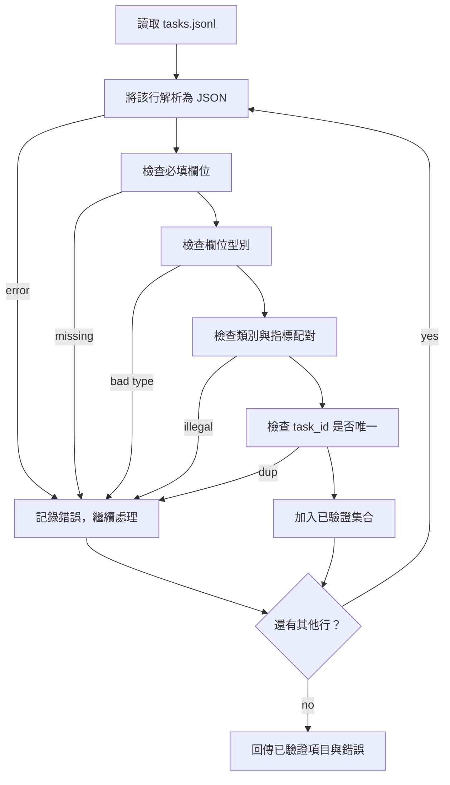

# 評測任務規格規範（Task Spec Format）

> 一套評測工具的品質上限，完全取決於其各項任務所恪守的契約。在撰寫任何評分函式之前，先凍結 JSONL 結構與指標詞彙。

**Type:** Build
**Languages:** Python
**Prerequisites:** Phase 19 Track B foundations
**Time:** ~90 min

## Learning objectives｜學習目標

- 定義單一統一形態的 JSONL 任務記錄結構描述，涵蓋基礎算術、選擇題、程式碼執行、文字分類與自由文字摘要。
- 將指標名稱限定為封閉詞彙，讓後續課程（第七十一至七十三課）能依據單一欄位進行分發。
- 將少樣本範例（Few-shot Examples）與後處理規則（Post-processing Rules）作為任務本身的靜態規格聲明，而非耦合在執行器內部，確保同一 Prompt 在不同模型間產出完全同一的目標。
- 實作嚴格的校驗器（Validator），在畸形錯誤記錄流入後續執行器前予以堅決攔截。
- 交付一套包含 10 個標準任務的測試夾具集，窮盡覆蓋規範的每一種邏輯路徑，為校驗器提供真實的實戰檢驗靶場。

```figure
ci-task-spec-gate
```

## 為何需要固化規範

在科研探索的程式碼庫中，評測腳本滋生繁殖的速度往往遠遠超過單元測試的編寫速度。半年過去後，每個 Jupyter Notebook 皆自創了一套私有的 JSON 結構，每種度量指標皆被重複粗糙實作了兩次，不同實驗運作之間完全無法進行客觀橫向對比。解法枯燥而有效：選定結構描述、撰寫校驗器、堅決拒絕一切不合規輸入。這正是本課的核心使命。

該結構借鏡了 BIG-bench、HELM 與 lm-evaluation-harness 等評測工具的設計概念，但欄位名稱由本課自訂。每個欄位都有明確的負責方：執行器讀取任務；指標讀取目標；後處理步驟將生成結果正規化。管線中途不得變更任何欄位。

## 單條任務記錄的標準形態

一個任務對應單行 JSON 物件。評測工具逐行讀取 `tasks.jsonl`，並分別驗證每一行。損壞的單行只會導致該筆記錄被拒絕，不會拖垮整場評測。

```json
{
  "task_id": "arith_001",
  "category": "arithmetic",
  "prompt": "Compute the result. Question: 17 + 24\nAnswer:",
  "targets": ["41"],
  "metric_name": "exact_match",
  "few_shot_examples": [
    {"prompt": "Question: 2 + 2\nAnswer:", "completion": "4"}
  ],
  "post_process": "strip_whitespace",
  "metadata": {"difficulty": "easy"}
}
```

強制必填欄位為：`task_id`、`category`、`prompt`、`targets`、`metric_name`、`post_process`。可選欄位為 `few_shot_examples` 與 `metadata`。任何未知的頂層非法欄位皆會直接導致校驗失敗。

## 欄位剛性約束規則

`task_id` 是一個不包含任何空白字元的唯一字串。校驗器在全檔案維度強制實施唯一性查重。

`category` 嚴格限制在 `arithmetic`（算術）、`mcq`（選擇題）、`code_exec`（程式碼執行）、`classification`（分類）、`summary`（摘要）五大枚舉值中。該類別嚴密約束了後續合法的指標與後處理配對：例如 `code_exec` 任務強制綁定 `metric_name = code_exec`；而 `mcq` 任務強制綁定 `metric_name = exact_match` 且目標為單一選項字母。

`prompt` 是一個非空字串。校驗器嚴厲禁止尾端殘留多餘空白，並拒絕任何在 Prompt 主體中私自拼接少樣本範例的違規記錄。少樣本文本的渲染組裝是執行器的專屬職責，絕不允許題目編寫者手動拼裝。

`targets` 是一個非空的字串清單。對於 `exact_match`，命中清單中的任意一項即可算作正確；對於 `f1` 與 `rouge_l`，以得分最高的那一項作為最終基準；對於 `mcq`，清單強制且僅能包含一個選項字母。

`metric_name` 嚴格限制在封閉詞彙表中：`exact_match`、`f1`、`bleu_4`、`rouge_l`、`accuracy`、`code_exec`。這是一份閉合詞彙表。引入新指標必須編寫專屬課程並在此處擴充註冊。

`few_shot_examples` 是由 `{prompt, completion}` 組成的字典清單。校驗器將清單長度嚴格卡死在最多 8 條，防止 Prompt 長度無節制膨脹。

`post_process` 嚴格限制為以下枚舉值之一：`none`、`strip_whitespace`、`lower`、`extract_letter`、`extract_code_block`、`extract_first_line`。每條規則具備單一且確定性的處理邏輯，校驗器嚴厲禁止多條規則的隨意複合疊加。

## 校驗器的行為決策流



校驗器回傳兩份清單：通過校驗的合法記錄清單，以及包含出錯行號、違反規則與具體欄位的錯誤記錄清單。除非顯式傳入 `--allow-bad-tasks` 容錯旗標，否則一旦錯誤清單非空，執行器堅決拒絕啟動。

## 少樣本範例的標準渲染

執行器在 Prompt 前端統一拼接少樣本範例，並以空行進行隔離。該程式碼路徑對所有模型一視同仁，確保整個評測中唯一的變異數來源是模型本身。作者只需編寫一次範例，無需為每個不同廠商 API 分別適配。

```python
def render(task):
    parts = []
    for ex in task.get("few_shot_examples", []):
        parts.append(ex["prompt"] + " " + ex["completion"])
    parts.append(task["prompt"])
    return "\n\n".join(parts)
```

## 後處理規則語義

後處理在模型生成完畢後、送入指標計算前觸發。它是無狀態的純函式：

- `none`：原樣回傳原始字串。
- `strip_whitespace`：去除首尾的所有空白字元。
- `lower`：全量轉為小寫字元。
- `extract_letter`：提取命中的第一個 `[A-E]` 選項字元，專用於選擇題。
- `extract_code_block`：提取第一個三重反引號（```）程式碼區塊內部的程式碼主體，專用於程式碼執行。
- `extract_first_line`：提取第一個非空文字行，專用於摘要分類。

任何需要新增清單外規則的任務，都應另開新課處理。

## 本課邊界

本課不負責計算指標得分。不負責發起大模型呼叫。不執行程式碼。這些功能將在第七十一課、第七十二課與第七十五課中逐一建置。本課會凍結所有模組都必須遵守的契約。

內建的 10 道任務測試夾具全面覆蓋：2 道算術、2 道選擇題、2 道程式碼執行、2 道分類與 2 道摘要。校驗器在全量 10 道題目上 100% 綠燈通過。同時配備了專屬的異常測試夾具（`tasks_bad.jsonl`），會觸發每一條違規規則，且校驗器回傳的錯誤數量恰好與違規規則相同。

## 程式碼導讀

`main.py` 定義了 `TaskSpec`、`validate_task`、`validate_file` 以及標準 CLI 命令列入口。測試夾具載入器為 `load_fixtures`。渲染與後處理輔助方法與校驗邏輯並列存放，使第七十五課的執行器只需引入該單一模組即可。

自頂向下通讀 `main.py`，隨後研讀 `code/tests/test_spec.py`。單元測試鎖定了每一條校驗規則與後處理邊界。`main.py` 檔案底部的演示程式自動校驗內建夾具並印出摘要。

## 工程深化

在真實評測工程中，新增任務分類往往就像資料庫結構描述擴充欄位一樣不可避免。成熟的工程紀律是：**堅決拒絕在缺乏對應指標、後處理規則與測試夾具的前提下盲目新增分類**。請將評測規格視同資料庫遷移腳本（Migration）：每一次調整皆經過嚴格評審、具備版本號控制，並附帶完備的單元測試。本課的校驗器就是守護該紀律的第一道剛性門禁。
