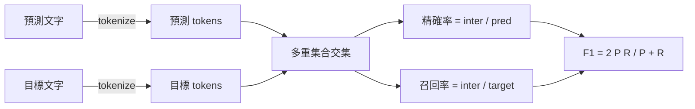
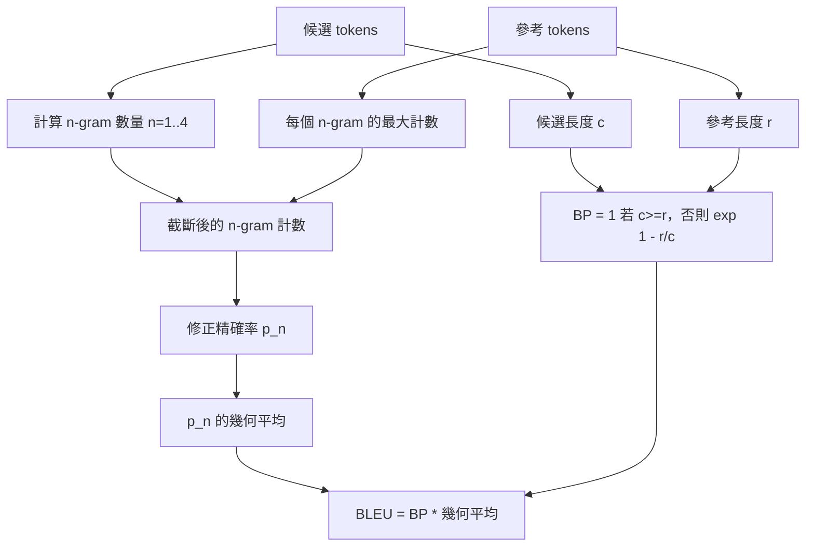

# 經典評測度量指標（Classical Metrics）

> BLEU、ROUGE-L、F1、Exact-Match、準確率（accuracy）。這五大經典指標至今仍占已發表 LLM 評測數字的大多數。從第一性原理出發親手實作每一個指標，你才能真正洞悉這些數字背後的實質意義。

**Type:** Build
**Languages:** Python
**Prerequisites:** Phase 19 Track B foundations, lesson 70
**Time:** ~90 min

## Learning objectives｜學習目標

- 實作 token 級別的 Exact-Match、F1 與準確率指標，並嚴格綁定明確的 tokenization 規則。
- 從零手寫完整實作 BLEU-4：修正 n-gram 精確率、1 到 4-gram 幾何平均數計算，以及字串過短懲罰（Brevity Penalty）。
- 基於動態規劃的最長公共子序列（LCS）演算法實作 ROUGE-L，並融合計算對稱的 F-beta 數值。
- 依據第七十課定義的 metric_name 欄位進行統一動態分發，確保執行器主迴圈對具體指標完全保持無感解耦。
- 使用推導精確的黃金參考向量鎖定指標行為，絕不依賴任何第三方黑盒軟體庫。

```figure
cd-bleu-overlap
```

## 為何親手重寫

你經常會在論文 A 中看見報告 BLEU 28.3，而在論文 B 中看到報告 BLEU 0.283。你還會發現，同一個評測集在兩個不同開源庫中跑出的 ROUGE-L 得分竟然能相差整整 10 個點，僅僅因為其中一個庫在底層自動執行了小寫轉換而另一個沒有！徹底消除這些混亂與爭拗的最快方式，就是親自手寫這些指標程式碼——親自指明在哪一行決定了 tokenizer、在哪一行注入了平滑因子。在此之後，橫向比對各篇論文的評測結果，將回歸為嚴肅審視其具體指標設定，而不再淪為對第三方庫黑盒差異的無效爭論。

Python 標準庫搭配 numpy 綽綽有餘。BLEU 本質上是計數與截斷；ROUGE-L 本質上是動態規劃；F1 本質上是 token 多重集合的交集運算。整套實作中最關鍵的決策，是選定一套明確的 tokenizer 並堅決恪守它。

## Tokenization 合約

本課的 tokenizer 統一定義為：`re.findall(r"\w+", text.lower())`。強制轉小寫、提取連續字母數字詞彙、徹底剝離標點符號。本課中的所有指標，無一例外皆強制使用這套完全同一的 tokenizer。執行器絕對無權在此處隨意切換。一旦你擅自替換了 tokenizer，你實質上是在運作一個完全不同的全新評測基準！

```python
TOKEN_RE = re.compile(r"\w+", re.UNICODE)
def tokenize(text):
    return TOKEN_RE.findall(text.lower())
```

這是一項深思熟慮的簡化。在正式環境中你可能需要進一步考量 CJK 中日韓字元切分、英語縮寫以及程式碼變數標識符。本課的核心在於傳授一個剛性觀念：**tokenizer 是一份神聖的契約，絕不是一個可以隨意撥動的超參數旋鈕**。

## 精確匹配率

```python
def exact_match(pred, targets):
    return float(any(pred.strip() == t.strip() for t in targets))
```

在單個任務樣本上回傳 1.0 或 0.0。在整個資料集上計算算術平均。它是基礎算術、選擇題（MCQ）以及短文本分類任務的絕對主力基石。

## token 級別 F1 分數

為預測文字與標準答案分別建立 token 多重集合（Multiset）。精確率定義為交集元素數量除以預測文字的 token 總數；召回率定義為完全相同的交集元素數量除以標準答案的 token 總數；F1 分數則是兩者的調和平均數。實作中嚴密處理了預測文字為空或標準答案為空的邊界異常。



針對具備多個標準答案的任務，系統自動取所有目標中的最大 F1 分數作為最終得分。這與學術界廣泛報告的 SQuAD 標準評測行為完全對齊。

## 全功能 BLEU-4 實作

BLEU 是機器翻譯領域的指標，至今也仍用於文字摘要研究。本課實作的是語料庫層級的標準 BLEU-4，內建字串過短懲罰（Brevity Penalty），並在修正後的 n-gram 計數上引入加一平滑（Additive-One Smoothing），防止因單個 4-gram 缺失而導致整個得分直接歸零。

針對每對「候選-參考」文本，分別統計 n=1, 2, 3, 4 的修正 n-gram 精確率。修正精確率將候選文本中的 n-gram 出現次數，截斷限制在該 n-gram 在任一參考答案中的最大出現次數以內，防止模型透過無腦重複同一個短語來刷分。隨後對四個階數的精確率求幾何平均數，並乘以字串過短懲罰因子。



平滑規則採用 Lin 與 Och 提出的「Method 1」：在計算對數之前，為每個 n-gram 精確率的分子與分母同時加 1。這徹底避免了當參考文本中沒有任何 4-gram 匹配時引發的 `log 0` 數學崩潰，且在長候選文本上仍接近未平滑值。

## 基於最長公共子序列的 ROUGE-L

ROUGE-L 深度比對候選序列與參考序列之間的**最長公共子序列（Longest Common Subsequence，LCS）**。LCS 能在完全不強求單詞物理連續的前提下精準捕獲詞序結構，這正是它長盛不衰成為常用摘要指標的根本原因。我們使用經典的動態規劃二維表格計算 LCS 長度，隨後將召回率定義為 `lcs / reference length`、精確率定義為 `lcs / candidate length`，並在 beta 等於 1 時計算對稱的 F1 形式。

```python
def lcs_length(a, b):
    n, m = len(a), len(b)
    dp = numpy.zeros((n + 1, m + 1), dtype=int)
    for i in range(n):
        for j in range(m):
            if a[i] == b[j]:
                dp[i+1, j+1] = dp[i, j] + 1
            else:
                dp[i+1, j+1] = max(dp[i+1, j], dp[i, j+1])
    return int(dp[n, m])
```

使用 numpy 表格使實作更易讀；純 Python 串列也可行。ROUGE-L 的單樣本計算複雜度為 O(n × m)。在常規摘要篇幅下，單次計算耗時嚴格低於 1 毫秒。

## 分類準確率

對多目標分類任務，準確率可簡化為與單一正規化目標的 Exact-Match 比對。我們將其暴露為獨立的具名函式，使分發器能依據 `metric_name` 完成路由，而無需在執行器內部編寫散亂的條件判斷。

## 統一分發合約

全套指標的單一對外公開入口為 `score(metric_name, prediction, targets)`。它回傳一個落在 `[0, 1]` 區間內的浮點數。執行器在運作時完全不需要針對指標名稱寫死特判：只需將輸入透傳給該分發函式並記錄回傳數值即可。這正是第七十五課將指標與第七十課的任務規格進行終極縫合的標準介面。

```python
def score(metric_name, pred, targets):
    if metric_name == "exact_match":
        return exact_match(pred, targets)
    if metric_name == "f1":
        return max(f1_score(pred, t) for t in targets)
    if metric_name == "bleu_4":
        return max(bleu4(pred, t) for t in targets)
    if metric_name == "rouge_l":
        return max(rouge_l(pred, t) for t in targets)
    if metric_name == "accuracy":
        return accuracy(pred, targets)
    raise ValueError(f"unknown metric_name: {metric_name}")
```

（`code_exec` 程式碼執行指標將在第七十二課中深入建置並補齊至該分發器中）。

## 本課邊界

本課不負責呼叫模型。不對模型生成文字進行超出第七十課後處理規則之外的任何額外正規化。不計算複雜的統計信賴區間。不涉及 BLEURT 或 BERTScore（這些指標需要模型，並在另一課介紹）。本課的全部焦點在於打牢底層地基：**五大經典指標、單一剛性 tokenizer、單一統一分發路由表**。

## 程式碼導讀

`main.py` 將每個指標實作為乾淨的純函式，並暴露核心分發器。在檔案底部的 `_reference_examples` 區塊中定義了一組黃金參考向量。演示程式呼叫分發器，在 8 個經典範例上執行評分並印出結果。`code/tests/test_metrics.py` 單元測試嚴密鎖定了這些參考向量，並極限測試了所有邊界場景（空預測、空參考、無交集 token、完全匹配、高頻詞重複截斷等）。

自頂向下閱讀 `main.py`。函式依照複雜度循序漸進排列：Exact-Match 與 Accuracy 各佔一行；F1 佔六行；BLEU 與 ROUGE-L 包含詳細的註解，深入闡述平滑因子與 LCS 動態規劃狀態轉移方程式。

## 工程深化

經典度量指標是必不可少的基礎設施，但它們並非萬能靈丹。它們本質上獎勵的是表面的字詞重疊，而容易忽略深層的語義邏輯。在未來的成熟工程中，你應當在堅固的經典指標地基之上，進一步追加基於大模型的進階語義指標（如 BLEURT、BERTScore、G-Eval）。但當務之急是：親手把這五大經典指標徹底跑通、用單元測試將其行為死死釘住，你便擁有了一套高度透明、運算極速、完全可審計且可重現的度量基石。
