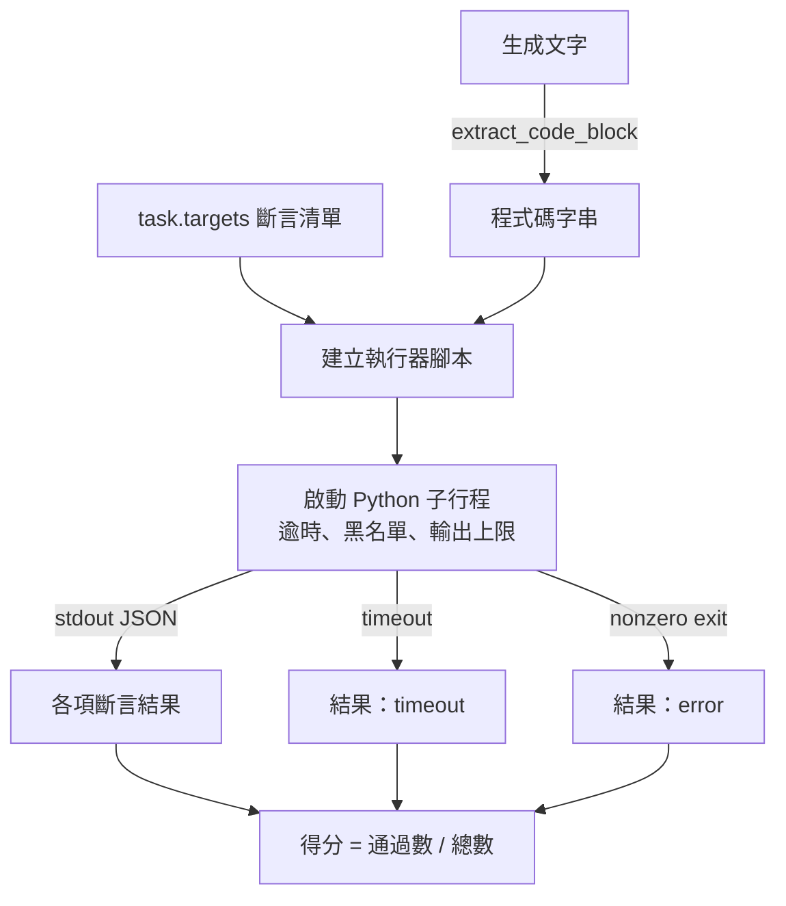
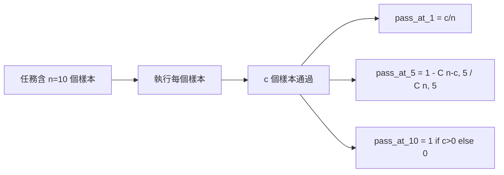

# 程式碼執行度量指標（Code Exec Metric）

> 生成的程式碼通過測試才算正確。評測工具必須擷取程式碼、執行時不讓主機當機，並誠實統計通過率。本課將打造這個功能。

**Type:** Build
**Languages:** Python
**Prerequisites:** Phase 19 Track B foundations, lessons 70 and 71
**Time:** ~90 min

## Learning objectives｜學習目標

- 從自由文字輸出中精準提取程式碼區塊，行為嚴格對齊第七十課宣告的後處理規則。
- 在隔離子行程中執行候選程式碼，並設定實際經過時間逾時、輸出上限與危險模組匯入黑名單。
- 將任務得分度量為：候選程式碼在給定的一組斷言（Assertions）字串中的測試通過比例。
- 實作無偏估計的 Pass@K 數學公式，支援對單一模型抽樣多次生成的評測情境。
- 將沙盒崩潰、語法錯誤（SyntaxError）與逾時中斷視為一等公民的異常狀態，並賦予標準退出碼供執行器記錄。

```figure
sandbox-runner
```

## 為何必須在獨立子行程中執行

直接在主行程內呼叫 `exec` 會造成安全與穩定性問題。一段大模型生成的無效死循環 `while True: pass` 會讓整個評測主迴圈永久凍結掛死；一段惡意的 `import shutil; shutil.rmtree('/')` 更是名副其實的伺服器滅頂之災。解法是：為每一個候選程式碼派生一個全新的 Python 直譯器子行程，透過標準輸入（stdin）注入待測程式碼，透過標準輸出（stdout）接收斷言測試結果，並在執行超時時由父行程強制殺死子行程。評測主行程始終安然無恙。

像 HumanEval、MBPP、BigCodeBench 和 LiveCodeBench 這類實際評測都使用子行程沙盒。有些還會在此基礎上加入 Docker。我們基於特定理由止於子行程：它具可攜性、使用標準函式庫，並能捕捉對教學評測重要的失效模式。正式環境部署會再加入 seccomp、網路隔離和唯讀檔案系統。下一課將介紹本課程範圍之外的強化方式。

## 程式碼執行任務的標準形態

一個 `code_exec` 任務在其 `targets` 列表中攜帶一組斷言測試語句。執行器自模型生成文字中提取程式碼區塊中的程式碼，圍繞其自動搭建測試執行器腳本，隨後呼叫子行程執行：



最終得分是一個落在 `[0, 1]` 區間內的浮點數。例如一個包含 3 條斷言的任務，若有 2 條通過，則得分為 0.667。無論底層發生何種異常，執行器回傳的資料結構永遠維持穩定：子行程崩潰會對應到正規化的錯誤碼，不會以 Python Traceback 冒泡至評測工具。

## 危險模組導入黑名單

黑名單在模組導入層面實施防禦。在正式執行候選程式碼之前，測試腳本會動態重寫危險模組的導入邏輯，將其替換為直接拋出 `ImportError("denied")` 的樁模組。黑名單刻意採取保守設計：`os.system`、`subprocess`、`socket`、`requests`、`urllib`、`urllib.request`、`urllib.error`、`urllib.parse`、`ctypes`、`shutil`、`http.client`、`asyncio.subprocess`。

我們絕不天真地宣稱這套機制固若金湯。有心的攻擊者所撰寫的惡意程式碼，可能逃出任何 Python 行程內的沙盒。黑名單只是一道基礎防禦底線；**實際經過時間逾時與輸出大小上限才是關鍵控制措施**。

```python
DENIED = {
    "os.system": True,
    "subprocess": True,
    "socket": True,
    "shutil": True,
    "requests": True,
    "urllib": True,
    "ctypes": True,
}
```

我們在候選程式碼前端注入 `import sys` 以及將 `os.system` 猴子補丁（Monkey-patch）為強制報錯的防禦程式碼。完整模板定義於 `main.py` 中。

## 實際經過時間逾時

每個子行程預設有 3 秒的實際經過時間預算。執行器使用 `subprocess.run(..., timeout=t)`。一旦觸發逾時，執行器捕獲 `TimeoutExpired` 異常，強制殺死子行程，並為該任務記錄 `timeout` 終止原因。該任務的得分直接記為 0 分。執行器隨後順暢接續下一道題目。

逾時時長可依任務透過 `task.metadata.timeout_s` 設定。針對耗時較長的複雜單元測試可適度放寬；但第七十課的校驗器將其上限死死卡在最多 30 秒，防止整個評測集耗時無休止失控。

## 標準輸出體積封頂

惡意或有缺陷的子行程可能會向 stdout 瘋狂傾倒海量文字，直接撐爆主機記憶體。執行器以串流方式將 stdout 讀入緩衝區，一旦累積輸出大小超過 256 KB，立即強制殺死子行程！執行結果被記錄為 `exit_code = error`，並在詳情中標註 `"output overflow"`。在實際評測中，當大模型生成的程式碼意外寫出了一個死循環 print 時，該防禦將大顯身手。

## Pass@K 無偏估計數學公式

Pass@K 是 HumanEval 等使用的無偏估計量。給定單道題目獨立採樣生成的 `n` 個候選答案，其中有 `c` 個成功通過了全量測試，則從 `n` 個候選答案中隨機抽取容量為 `k` 的子集且該子集中至少包含一個正確解答的機率為：

```
pass_at_k(n, c, k) = 1 - C(n - c, k) / C(n, k)
```

當 `n - c < k` 時，分子組合數無定義，此時該公式直接計算為 `1`。實作中嚴密覆蓋了所有邊界條件。我們將 `pass_at_k(n, c, k)` 封裝為標準函式，供第七十四課的排行榜層直接呼叫。



## 五大標準退出狀態碼

執行器針對每個任務精確回傳五種標準結果之一：

- `pass`：所有斷言測試 100% 全量通過。
- `assertion_fail`：程式碼成功執行，但至少有一項斷言失敗。
- `syntax_error`：程式碼未能匯入或發生 SyntaxError。
- `timeout`：超過實際經過時間限制。
- `error`：其餘所有異常崩潰，包含命中黑名單攔截或終端輸出體積溢出（溢出時附帶 `"output overflow"` 詳情）。

得分仍以比例表示；退出碼則是中繼資料。下游模組可依據業務偏好自主裁決：究竟是將逾時視為 0 分，還是將其作為缺失值單獨呈報。

## 本課邊界

本課不提供真正的沙盒。它不適合在完全無防護的情況下直接執行來自公開網路的不可信程式碼。它不負責處理有狀態任務，例如檔案 I/O 或網路呼叫。這些高階需求需要虛擬化容器或 MicroVM。本課的核心使命是確立合約：**隔離子行程、黑名單、逾時限制、輸出上限、標準退出碼詞彙表，以及 Pass@K 計算**。

## 程式碼導讀

`main.py` 定義了 `extract_code`、`run_candidate`、`score_code_exec` 以及 `pass_at_k`。子行程執行腳本在記憶體中動態組裝為 Python 腳本字串，並透過 `-c` 參數傳遞給全新的 Python 直譯器。`code/tests/test_exec.py` 使用 HumanEval 風格的範例測試四種退出狀態，並驗證 Pass@K 的數學計算。

自頂向下閱讀 `main.py`。執行器腳本模板是整個模組的核心承重牆。仔細審讀斷言迴圈的每一步，直到你能夠閉著眼睛推導出它回傳給父行程的標準 JSON 資料結構。

## 工程深化

在子行程機制跑通之後，下一步的工程重心是跨平台可移植性。不同 Python 版本在處理 SIGKILL 訊號時存在細微差異（尤其是在 Windows 環境下）。最乾淨徹底的工業級方案是將執行器直接封裝進 Docker 映像檔中。在此之後，將簡單的斷言字串升級為真實的單元測試檔案，使評測完全對齊正式環境 CI/CD。到了那個階段，你便可以自信地告別玩具式的字串測試，全面擁抱工業級的真實程式碼檢驗。
