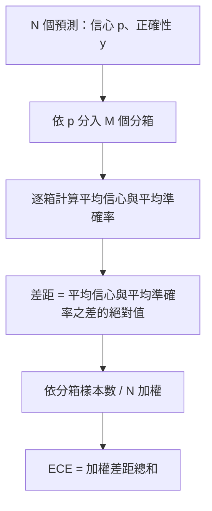
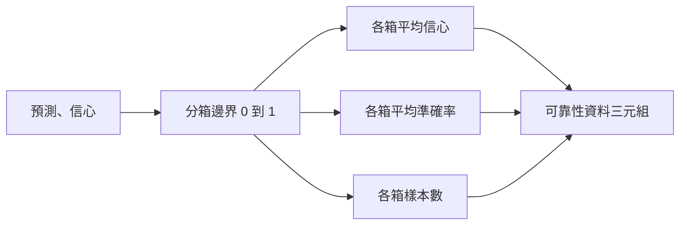

# 困惑度與機率校準（Perplexity and Calibration）

> 若你的模型在一千個回答上宣稱自己有 90% 信心，最後卻只答對六百個，那麼它的機率校準就不理想。校準度（Calibration）是支撐大模型可信評測的半壁江山；而另一半江山則是困惑度（Perplexity），它客觀揭示了模型究竟是否認為獨立保留的文字語料具備基本合理性。

**Type:** Build
**Languages:** Python
**Prerequisites:** Phase 19 Track B foundations, lessons 70 and 71
**Time:** ~90 min

## Learning objectives｜學習目標

- 直接依據模型適配器回傳的單 token 負對數機率（NLL），在獨立保留語料庫上精確計算 token 級別的困惑度。
- 透過對預測信心機率進行分箱統計，精確計算分類任務或多選題評測中的期望校準誤差（ECE，Expected Calibration Error）。
- 計算布里爾分數（Brier Score，預測機率與真實結果指示變數之間的均方誤差），並深刻解釋它在何種維度上補充了 ECE 的盲區。
- 產出繪製「信心與準確率」可靠性圖表（Reliability Diagram）所需的底層結構化資料。
- 將上述三項關鍵能力接入評測工具，使執行器能在模型評測報告中並列呈報 `perplexity`、`ece` 與 `brier` 數值。

```figure
cd-reliability-diagram
```

## 困惑度的實質內涵

困惑度的數學本質是：**每個 token 平均負對數概似（NLL）的指數化數值**。數值越低代表模型越強。困惑度等於 1 意味著模型為每一個真實出現的 token 皆賦予了 100% 的絕對確定性機率；困惑度等於詞表容量大小意味著模型輸出的機率完全呈現均勻分佈，等同於大腦一片空白什麼都沒學會。真實數值介於兩者之間：一個強大的 2026 年基礎模型在 WikiText-103 基準上的困惑度通常落在 8 到 12 之間；而一個拙劣的劣質模型在完全相同的文字上困惑度會高達 50 以上。

評測工具本身不負責直接計算對數機率。那些對數機率來自模型適配器。評測工具負責整體聚合：接收單 token 負對數機率清單與每個序列的 token 計數清單，最終輸出語料庫級別的困惑度。

```python
def perplexity(neg_log_probs, token_counts):
    total_nll = sum(neg_log_probs)
    total_tokens = sum(token_counts)
    return math.exp(total_nll / total_tokens)
```

實作嚴密處理了 0 個 token 的極端邊界，並斷言所有傳入的負對數機率必須嚴格為非負數。初學者常犯的經典錯誤是忘記取負號：適配器若錯誤回傳了 `log p` 而非 `-log p`，會算出一張小於 1 的荒謬困惑度數值。該函式能將此類合約違規在第一時間拋出攔截。

## 期望校準誤差（ECE）衡量了什麼

期望校準誤差（Expected Calibration Error）首先依據模型預測的信心，將所有預測樣本劃分為固定數量的機率區間桶（Bins），隨後在各個分箱內部計算「平均信心」與「實際經驗準確率」之間的絕對偏差，最後以各分箱的樣本佔比作為權重進行加權求和。



業界標準規範是在 `[0, 1]` 區間內劃分 10 個等寬分箱。本課實作支援任意正整數分箱數量。我們暴露了 `bins` 參數，使執行器能夠在學術論文發表慣例（10 個桶）與更精細的橫向比對慣例（15 個桶）之間自由切換。

必須留意，ECE 會受到分箱數與樣本數造成的偏差影響。若在僅有 100 個預測樣本上強行劃分 10 個桶，0.02 的 ECE 數值與隨機雜訊在統計上將毫無區分度。本課實作在回傳 ECE 的同時，同步返回包含有效樣本的實體分箱個數（populated bins），允許執行器在樣本量嚴重不足時主動拒絕呈報單一數值。

## 布里爾分數（Brier Score）的獨特威力

ECE 僅關心各分箱內部的平均差距。一個在一半分箱中信心過高、而在另一半分箱中信心不足的模型，ECE 數值可能看似很低，但在局部校準仍不佳。布里爾分數（Brier Score）則直接度量每筆預測機率與真實二值結果之間的**均方誤差（MSE）**，因此會直接懲罰個別預測值的落差。

針對二元結果，布里爾分數定義為：`mean((p_i - y_i)^2)`。在統計學上，它能精準分解為可靠性（Reliability）、分辨率（Resolution）與不確定性（Uncertainty）三大核心分量。執行器對外呈報標量分數，並在內部為監控看板完整記錄這三大分解分量。

```python
def brier(p, y):
    return float(np.mean((p - y) ** 2))
```

## 可靠性圖表結構化資料

可靠性圖表（Reliability Diagram）在二維座標系中繪製各分箱內的預測信心與實際經驗準確率。完美對角線代表理想的校準狀態。本函式回傳三個對齊的陣列：各分箱平均信心、各分箱平均準確率、各分箱樣本計數。繪圖程式碼收斂於下游模組；本課精準交付該結構化資料形態。



回傳的三元組正是呼叫端繪製圖表或計算自適應 ECE（Adaptive ECE）、sweep ECE 等變體所需的資料。我們直接回傳 numpy 陣列，下游呼叫方無需進行資料型別轉換。

## 信心的資料來源

評測工具不假設信心必定來自 Softmax。它允許接收單樣本落在 `[0, 1]` 區間內的任意合法數值。對於多選題，最自然的信心值是各選項的 `softmax over option log-likelihoods` 正規化後的機率；對於自由文字生成，最自然的信心值是模型自報的機率或平均對數概似的指數化數值。評測工具只負責使用該數值。數值自何處萃取，是模型適配器的職責。

## 極限邊界防禦

- 所有預測全部答錯：ECE 數值退化為平均信心，布里爾分數顯著飆升，困惑度客觀反映模型對文字的真實評價。
- 所有預測全部答對且信心極高：ECE 趨近於 0，布里爾分數趨近於 0。
- 完全迷茫的預測器（固定輸出 p=0.5）：ECE 等於 $0.5 - \text{準確率}$，布里爾分數等於 0.25 減去修正項。
- 空輸入資料流：ECE、Brier 與可靠性資料優雅回傳 `0.0`（或全 0 陣列）；困惑度在 0 個 token 時安全回傳 `NaN`。這些極限路徑絕不向終端機噴出混亂的 Warning；執行器能優雅讀取並自主決定是略過還是呈報。

這些邊界都納入單元測試。真實模型在常規基準上極少觸發它們，但有錯誤的適配器或極小樣本可能觸發，評測工具不應因此崩潰。

## 統一分發與呼叫介面

機率校準絕非類似 F1 那種作用於單一任務的微觀指標。它是一個**模型級別（Per-Model）的整體報告**。執行器在整場評測中累計收集 `(confidence, correct)` 配對，並在最後一次性計算出 ECE、Brier 與可靠性資料。困惑度則在獨立保留的文字語料上計算，與逐題打分流程完全正交解耦。

標準呼叫介面：

```python
report = CalibrationReport.from_predictions(confidences, correct)
report.ece          # float
report.brier        # float
report.reliability  # tuple of three numpy arrays
report.populated_bins  # int
```

而 `PerplexityResult.from_token_nll(neg_log_probs, token_counts)` 則精確呈報語料困惑度與單 token 平均負對數概似。

## 本課邊界

本課不負責發起模型網路呼叫。不實作 Softmax 算子。不直接從輸出 token 中萃取信心（那是適配器的責任）。不實作溫度縮放（Temperature Scaling）或 Platt 縮放校準——這些屬於模型事後校準調整的獨立主題。本課的核心在於確保這三大指標（困惑度、ECE、布里爾分數）的計算具備可信度與可重現性。

## 程式碼導讀

`main.py` 定義了 `perplexity`、`expected_calibration_error`、`brier_score`、`reliability_diagram`，以及 `CalibrationReport` 與 `PerplexityResult` 資料類別。底部的演示程式在已知 Ground Truth 的合成預測上運作：一個校準良好的模型、一個過度自信的模型，以及一個信心偏低的模型。`code/tests/test_calibration.py` 單元測試鎖定了所有極限邊界，以及合成預測器的參考值。

自頂向下通讀 `main.py`。程式碼編排由純量運算過渡至向量運算、最後收斂至綜合報告。每個函式皆包含嚴密的數學註解與合約規範。

## 工程深化

機率校準是目前公開大模型評測論文中最常被忽略的面向。大多數排行榜只回報單一的 Accuracy 準確率數值，便認為評估已完成。一個準確率較高但 Brier 分數較差的模型，在正式環境中的表現可能比準確率低幾個百分點、但能可靠回報自身不確定性的模型更差。當你將本課的校驗管線完整就緒後，在保留驗證集上實施溫度縮放（Temperature Scaling），重新計算 ECE，觀察差距縮小——那是通往高階工程殿堂的必經之路。
