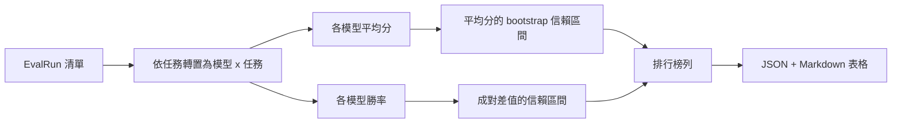
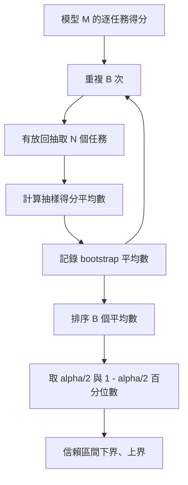

# 排行榜資料聚合（Leaderboard Aggregation）

> 計算單一任務的得分是輕而易舉的；而在多個異質任務上對多個模型進行整體排名則要複雜得多。在一份包含千次預測的排行榜上計算統計顯著性，是大家常忽略的一環。本課會納入這項檢查。

**Type:** Build
**Languages:** Python
**Prerequisites:** Phase 19 Track B foundations, lessons 70, 71, 73
**Time:** ~90 min

## Learning objectives｜學習目標

- 將跨多個模型與多個異質任務的每項任務得分，整潔聚合為模型維度的標準行記錄。
- 對異質評測指標實施嚴密正規化，防止通過率或 BLEU 數值因量綱差異而過度影響整體平均數。
- 同時依託平均分（Mean）與勝率（Win-Rate）對模型進行綜合排名，並深刻理解兩者各自適用的業務決策情境。
- 基於 Bootstrap 自助重抽樣演算法，精確計算模型平均分以及成對模型差值的 95% 信賴區間（CI）。
- 輸出標準 JSON 格式報告與 Markdown 表格，供第七十五課的執行器直接貼入 CI 評論。

```figure
ci-leaderboard-ci
```

## 輸入資料的標準形狀

聚合器消費由 `EvalRun` 記錄組成的標準清單：

```python
@dataclass
class EvalRun:
    model_id: str
    task_id: str
    metric_name: str
    score: float          # in [0, 1]
    category: str
```

第七十五課的執行器針對每一個 `(model, task)` 配對產出單條記錄。聚合器完全不關心該分數究竟是由何種具體指標算出的；它強制要求所有傳入的分數必須已經完成正規化，嚴格落在 `[0, 1]` 區間內。

## 輸出資料流

聚合器加工產出三張核心表格：



排行榜的標準行記錄包含：`model_id`、`mean_score`、`mean_ci_lo`、`mean_ci_hi`、`win_rate`、`tasks_completed`，以及一個可選的 `categories` 字典（呈報按分類細分的平均分）。

## 嚴苛的正規化合約

若任務 A 的得分落在 `[0, 1]` 區間，而任務 B 的得分落在 `[0, 100]` 區間，後者會在平均數中占過大比重。聚合器會驗證每個輸入分數是否位於 `[0, 1]` 之內；一旦越界便拒絕執行。該修復職責屬於上游：所有指標算子本身就應當輸出標準比例。第七十一課至第七十三課嚴密落實了這項合約。

## 平均分與勝率的雙重視角

兩種排名體系服務於截然不同的決策維度：

**平均分（Mean Score）** 是單個模型在所有任務上的得分算術平均數，也是排行榜常呈現的重點數字。它容易受到離群值與任務不平衡影響。

**勝率（Win-Rate）** 統計的是一個模型在同一個任務上擊敗所有其餘競爭對手的頻率。針對每項任務，得分最高者記為獲勝（平局則平分勝率）。勝率等於總勝場數除以該模型有得分的任務數。它較不受離群值與尺度差異影響，但會遺失分數差距的資訊。

```python
def win_rate(model_id, runs_by_task, all_models):
    wins, total = 0, 0
    for task_id, runs in runs_by_task.items():
        scores = {r.model_id: r.score for r in runs if r.model_id in all_models}
        if model_id not in scores:
            continue
        total += 1
        best = max(scores.values())
        if scores[model_id] >= best:
            wins += 1
    return wins / total if total else 0.0
```

評測工具將兩者並列呈報。第七十五課的執行器預設依照平均分排序；但勝率欄位清晰並列在旁，供決策者隨時對照參考。

## 自助重抽樣信賴區間的數學本質

我們透過在任務維度進行 Bootstrap 自助重抽樣，為每個模型的平均分估計信賴區間。在任務集合中有放回地重複抽樣 N 次，計算重抽樣樣本的均值，重複該過程 `B` 次，隨後在經驗分佈上截取特定顯著性水準 `alpha` 的分位數區間。



針對成對模型比較，我們在每項任務上計算得分差值 `score_A - score_B`，對該差值數組實施 Bootstrap 重抽樣，並呈報其信賴區間。使用者只需查看該區間是否排除 0。若排除，表示兩者在 alpha 顯著水準下有統計顯著差異；若未排除，排行榜會將兩者視為平手。

底層輔助函式（`bootstrap_mean_ci`、`bootstrap_pairwise_diff`）預設設定抽樣次數為 `B=1000`；公開的聚合器（`aggregate`、`pairwise_diffs`）預設採用 `b=500` 以確保演示與單元測試極速執行。預設顯著性水準 alpha = 0.05（即 95% 信賴水準）。整套演算法完全基於純 numpy 實作，零依賴 scipy。

## 按任務類別細分呈報

若 `EvalRun.category` 欄位被填寫，聚合器將同步輸出按分類細分的平均分。這就是排行榜中標註 `math`（數學）、`reasoning`（推理）、`code`（程式碼）、`safety`（安全）的欄位。它能讓執行器看出某個模型整體表現良好、但程式碼能力較弱的情況；這是總覽平均數所隱藏的資訊。

## Markdown 表格渲染

排行榜自動排版為標準的 Markdown 表格：

```text
| Rank | Model | Mean | 95% CI | Win rate | Tasks |
|------|-------|------|--------|----------|-------|
| 1    | gpt   | 0.78 | 0.74-0.82 | 0.62 | 50 |
| 2    | claude| 0.75 | 0.71-0.79 | 0.34 | 50 |
| 3    | random| 0.10 | 0.07-0.13 | 0.04 | 50 |
```

表格嚴格依照平均分降序排列。信賴區間保留兩位小數。超長模型 ID 自動截斷至 20 個字元以保證排版整潔。

## 本課邊界

本課不負責發起模型前向運算。不直接呼叫度量指標層。不實作自適應 ECE 等機率校準變體（那些屬於第七十三課）。不實作任務加權——此處所有任務權重相同。正式環境排行榜通常會為不同任務設定自訂權重；我們在資料類別中預留了 `weight` 擴充欄位，但目前的聚合器不會使用。如有需要，可在後續課程加入任務加權。

## 程式碼導讀

`main.py` 定義了 `EvalRun`、`LeaderboardRow`、`aggregate`、`bootstrap_mean_ci`、`bootstrap_pairwise_diff` 以及 `render_markdown`。底部的演示程式在記憶體中建立包含 3 個模型與 12 個任務的合成評測資料，執行全套聚合，並在終端機印出排行榜表格與成對差值表。`code/tests/test_leaderboard.py` 完整覆蓋了 Bootstrap 計算精度、Markdown 渲染格式、勝率的各種邊界案例以及空輸入防禦。

自頂向下閱讀 `main.py`。資料結構定義先行，聚合邏輯次之，Bootstrap 重抽樣居中，Markdown 渲染收尾。每個函式皆具備精準聚焦的契約職責。

## 工程深化

自然的下一步是採用成對任務顯著性檢定（Paired-Task Significance），取代未配對 Bootstrap。若模型 A 與模型 B 都在相同的 100 個任務上接受評測，適當的檢定是對逐任務差值進行成對 Bootstrap（本課已實作）。此外，可採用**階層式 Bootstrap（Hierarchical Bootstrap）**，保留任務族群的結構（數學題彼此並非統計獨立；同一種算術錯誤模式會影響其中十題）。這屬於後續工作。本課的目標是打好基礎，讓評測報告提供可辯護的數字。
