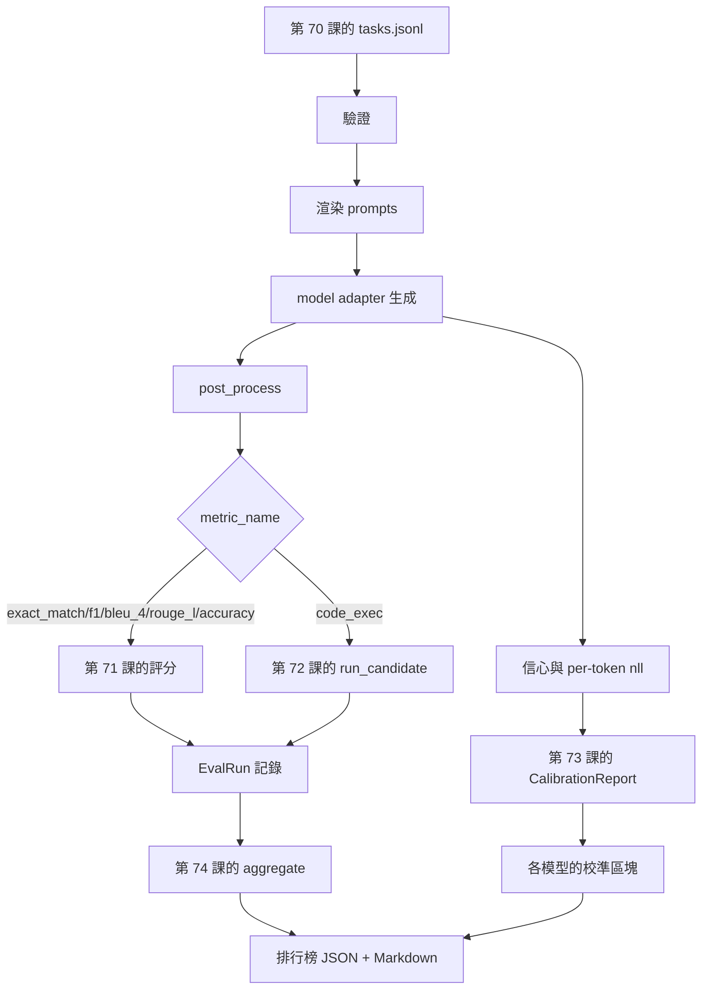

# 端到端評測執行器（End-to-End Eval Runner）

> 前五課打下基礎，本課負責把它們串接起來。執行器讀取第七十課的任務規格，透過適配器呼叫模型，使用第七十一與七十二課評分、附上第七十三課的校準報告，並輸出第七十四課的排行榜。Demo 會自行終止。

**Type:** Build
**Languages:** Python
**Prerequisites:** Phase 19 Track B foundations, lessons 70 through 74
**Time:** ~90 min

## Learning objectives｜學習目標

- 定義極簡的 `ModelAdapter` 抽象介面，使任何模型（Mock、本機模型或 API 模型）皆能以極小的函式介面符合此介面。
- 透過執行緒池在固定任務的 JSONL 檔案上並行執行評測任務。
- 在單次遍歷傳遞中，將經典度量指標（Exact-Match、F1、BLEU-4、ROUGE-L、程式碼執行）與機率校準評估深度融合。
- 產出模型維度的標準 `EvalRun` 記錄，並將其直接餵入排行榜聚合器中。
- 同步輸出結構化 JSON 評測報告與 Markdown 排版表格；在乾淨跑通時以結束碼 0 安全退出，在遭遇校驗或執行時期異常時以非零狀態碼報警。

```figure
eval-grid
```

## 全鏈路處理架構



執行器負責整合各模組。第七十至七十四課各自負責一個模組，由執行器組合使用。執行器不重複實作這些模組的邏輯，而是直接匯入它們。

## 模型適配器介面

適配器負責連接執行器與任何模型，介面刻意保持簡潔：

```python
class ModelAdapter:
    model_id: str

    def generate(self, prompt: str, task: TaskSpec) -> Generation: ...
```

`Generation` 是一個結構化的資料類別：

- `text`：模型生成的原始自由文本文字；
- `confidence`：落在 `[0, 1]` 區間內的浮點數，代表模型對該回答自我報告的信心機率；
- `token_nll`：可選欄位，生成 Token 序列上的負對數概似（NLL）總和；
- `token_count`：可選欄位，生成的有效 Token 總數。

執行器內建了三種不同風味的 Mock 適配器：`RuleBasedAdapter`（確定性規則驅動，近乎滿分）、`NoisyAdapter`（過度自信但頻繁犯錯），以及 `BiasedAdapter`（在某個特定類別上表現優異、但在其餘類別上一塌糊塗）。演示程式將驅動這三款模型在第七十課的測試夾具上展開同台競技。

## 高併發並行調度

執行器使用 `concurrent.futures.ThreadPoolExecutor` 針對單個模型並行分發多個任務。Worker 執行緒數量預設設定為 8 與任務總數中的較小者。使用多執行緒已足夠，因為真實模型呼叫的瓶頸在於網路 I/O。程式碼執行路徑會在自身內部派生獨立的作業系統子行程，執行器只負責排程等待。

為了讓測試能固定執行順序，執行器額外提供 `run_eval(adapters, tasks, parallel=False)` 序列化模式。

## 單次遍歷打分控制迴圈

針對每一個具體任務，執行器依序執行：

1. 渲染 Prompt（拼接少樣本範例與問題主體）。
2. 呼叫適配器並為這次呼叫計時。
3. 依照任務宣告的後處理規則處理生成文字。
4. 動態路由分發至對應的指標模組完成打分。
5. 建立包含得分與指標中繼資料的 `EvalRun` 標準記錄。
6. 將 `(confidence, correct)` 二元組追加至機率校準緩衝區。

判定 `correct` 布林值的準則為：對於 Exact-Match 風格的硬指標（`exact_match`、`accuracy`、`code_exec`），要求 `score >= 1.0`；對於連續型分級指標，要求 `score >= 0.5`。該判定閾值由內部函式 `_correct_from_score` 控制；執行器不提供公開的覆寫介面。

## 整體報告彙總

在所有任務運作完畢後，執行器呼叫第七十四課的 `aggregate` 與 `pairwise_diffs`，以及第七十三課的 `CalibrationReport.from_predictions`。所有評測資產被打包進統一的 JSON 信封中：

```json
{
  "leaderboard": [...],
  "pairwise": [...],
  "calibration": {
    "model_id_a": {"ece": 0.04, "brier": 0.10, "populated_bins": 8, ...},
    ...
  },
  "summary": {
    "tasks": 10,
    "models": 3,
    "wall_seconds": 1.2
  }
}
```

執行器同步在終端機標準輸出上印出排版精美的 Markdown 表格，供工程師直接拷貝張貼至 GitHub PR 審查評論區中。

## 自我終止演示

演示程式驅動三款模擬適配器，在第七十課內建的 10 道標準測試夾具上展開全量評測。端到端耗時應低於 10 秒。在完全健康運作的情境下，以結束碼 0 安全退出。

健康退出的四項硬性判定標準：

- 所有任務 100% 通過第七十課的結構描述校驗。
- 每項任務均由第七十一與七十二課完成計分。
- 第七十三課的機率校準報告被完整聚合且無任何異常。
- 排行榜最終排名嚴格判定基於規則的適配器領先於純隨機適配器。

若上述任意一項條件遭破壞，執行器以非零退出碼報警，並在 JSON 結構中回傳具體的錯誤資訊。

## 本課邊界

本課不呼叫真實模型。不實作 API key 流程或速率限制處理，也不實作重試。不實作串流或部分生成；適配器每次呼叫只回傳一個生成結果。不實作推論快取。這些關注點應封裝在適配器內；執行器不依賴特定模型供應商或指標細節。

## 程式碼導讀

`main.py` 是整個模組的整合樞紐。它透過一個輕巧的 `_load_sibling` 輔助函式，自同級目錄中動態載入其餘五節課的核心產物。`Generation`、`EvalReport` 以及 `ModelAdapter` 資料結構定義於此檔案中。各類模擬適配器收斂在檔案末尾。

自頂向下通讀 `main.py`：先看資料結構定義，接著研讀核心執行器 `run_eval`，隨後審視單題打分 `_score_one`，最後閱讀底部的適配器實作。檔案末尾的演示程式是整個系統的最佳切入點。

`code/tests/test_runner.py` 完整覆蓋了適配器介面規範、單次遍歷迴圈、並行與序列執行的數學等價性、校準緩衝區累積，以及輸出 JSON 信封的結構驗收。

## 工程深化

本執行器是評測系統的起點。正式環境的評測系統可在此基礎上加入：以 `(task_id, model_id, model_version)` 為 Key 的評測結果持久化快取、追蹤每次執行的美元成本與 token 消耗的成本帳本、遇到速率限制時採用退避策略的重試層、針對 Pass@K 任務的動態取樣排程策略，以及為長時間執行的評測套件提供串流輸出格式。這些功能各自處理一項獨立關注點，可包在執行器外部而不必更動底層指標或排行榜聚合邏輯。

在跑通所有模擬適配器後，為你最熟悉的真實大模型編寫一個專屬適配器：挑選一個有免費方案的供應商，撰寫 30 行膠水程式碼，親眼看著你的自建排行榜被真實數值點亮！隨後再加入第二個服務供應商，讓評測工具處理其餘工作。
