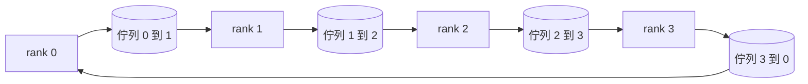

# 從零實作分散式集合通訊原語（Collective Ops From Scratch）

> 支撐分散式訓練的四種集合通訊原語是 allreduce、broadcast、allgather 和 reduce_scatter。訓練框架提供的其他原語都是這四者的包裝。只要在 `multiprocessing.Queue` 網格上實作並以參考實作驗證這些原語，這個軌道其餘的內容就成了把它們整合起來的工程工作。

**Type:** Build
**Languages:** Python
**Prerequisites:** Phase 19 Track C lessons 42-49
**Time:** ~90 min

## Learning Objectives｜學習目標

- 分兩階段（Reduce-Scatter 隨後 AllGather）實作經典的環狀 AllReduce（Ring AllReduce），並從數學上證明每個 rank 的通訊量恆等於 2(N-1)/N 位元組／元素。
- 在基於 `multiprocessing.Queue` 的點對點佇列網格之上，從零實作 broadcast、allgather 與 reduce_scatter。
- 針對完全相同的輸入張量與節點規模，使用 `torch.distributed` 的 gloo 後端嚴密校驗每一個自定義原語的數值精確度。
- 深入辯論：依據叢集拓撲形狀、網路延遲底線與頻寬物理上限，科學選定環狀（Ring）還是樹狀（Tree）通訊架構。

## The Problem｜問題

若以樸素的方式在 N 個 rank 上執行 AllReduce，就會將張量複製 N 次傳給 root，再由 root 廣播 N 次給所有 rank。每個 rank 的頻寬消耗會隨 N 呈 O(N) 成長，root 會成為瓶頸，而耗時下限是最慢鏈路耗時的 N 倍。環狀 AllReduce（Ring AllReduce）將通訊量分成 2(N-1) 個大小為 T/N 的分塊，使每個 rank 的傳輸位元組量降至 2T(N-1)/N，**與叢集規模無關**。當 rank 數較少或鏈路延遲較高時，樹狀 AllReduce（Tree AllReduce）勝出，因為其深度是 log_2(N) 跳，而非 2(N-1)。若為叢集選錯通訊拓撲，最慢的 GPU 會決定訓練步驟時間。

你在本專案軌道中會接觸到的每個分散式訓練框架，底層都依賴這四大原語：PyTorch DDP 透過分桶 AllReduce 同步參數梯度；ZeRO 透過 reduce_scatter 分片儲存最佳化器狀態，並在反向傳播後透過 allgather 重構更新後的權重；FSDP 將完整的前向傳播轉為 allgather 加 reduce_scatter；管線並行（Pipeline Parallel）則透過 broadcast 跨階段傳遞活化值。若無法親手實作這四大集合原語，就無法理解訓練為何會停滯、為何 rank 3 會出現梯度不匹配，或者為何切換網路拓撲後管線氣泡（Bubble）會翻倍。

## The Concept｜核心概念



### 兩階段環狀 AllReduce 原理

將長度為 T 的張量等分為 N 個分塊，索引為 0..N-1。每個 rank 初始持有索引等於自身 rank 的分塊。第一階段為 **Reduce-Scatter（規約散射）**，共執行 N-1 步：在第 s 步，rank r 將分塊 (r - s) mod N 發送給相鄰的 (r + 1) mod N，並同時接收來自 (r - 1) mod N 的分塊 (r - s - 1) mod N，將接收到的資料累加至本地副本。經過 N-1 步後，rank r 持有分塊 r 在所有 rank 上的總和。第二階段為 **AllGather（全域收集）**，同樣執行 N-1 步：各 rank 沿環狀拓撲依序傳遞已完成的分塊，直到每個 rank 都持有所有分塊的全域總和。

| 集合通訊原語 | 每個 rank 的傳輸位元組量 | 步數深度 | 最優適用場景 |
|---|---|---|---|
| 環狀 AllReduce（Ring） | 2T(N-1)/N | 2(N-1) | 張量 T 極大、高頻寬同構叢集 |
| 樹狀 AllReduce（Tree） | T log2(N) | 2 log2(N) | 張量 T 較小，或網路存在顯著高延遲的環境 |
| 廣播（Broadcast） | T | log2(N) 樹狀 | 參數初始化、純量設定發布 |
| 全域收集（AllGather） | T(N-1)/N | N-1 | 分片前向傳播、ZeRO 參數動態重構解分片 |
| 規約散射（Reduce-Scatter） | T(N-1)/N | N-1 | ZeRO 梯度分片聚合 |

### 行程佇列網格作為 NCCL 的簡化替身

NVIDIA NCCL 依託 PCIe 與 NVLink 匯流排，在 GPU 硬體層面實作硬體卸載歸約。而在普通 CPU 上我們缺乏該專屬硬體。在環狀拓撲的每條邊上建立一個 `multiprocessing.Queue`，即可為單生產者-單消費者提供保證順序的點對點通道。歸約計算在使用者空間進行，因此會付出 Python 額外開銷，但其在網路線路上的通訊模式與真實 NCCL Ring AllReduce 完全相同。在佇列網格上驗證演算法正確性，叢集行為也會隨之成立。

### 對照 gloo 進行驗證

本課實作的每一個原語，皆配備了專屬的單元測試：在完全相同的張量輸入與相同的 World Size 下，將自研原語的輸出與基於 gloo 後端的 `torch.distributed` 輸出進行嚴密比對。若兩者的浮點數偏差大於 float32 的機器精度 epsilon，測試當場宣告失敗。以參考實作驗證不可或缺；若沒有這項驗證，原語看似正確，直到真實訓練跑到第 10000 步才顯現問題。

```figure
ci-ring-allreduce
```

## Build It｜動手實作

`code/main.py` 實作了以下核心模組：

- `Mesh` 類別：將 N 個 `multiprocessing.Queue` 實例編織成環狀網格，為每個 Rank 暴露 `send(dst, tensor)` 與 `recv(src)` 介面。
- `ring_allreduce(mesh, rank, world_size, tensor)`：驅動上述兩階段環狀演算法。
- `broadcast(mesh, rank, world_size, tensor, src)`：基於對數樹狀拓撲的極速廣播。
- `allgather(mesh, rank, world_size, tensor)`：透過 N-1 次環狀旋轉完成全域收集。
- `reduce_scatter(mesh, rank, world_size, tensor)`：作為 AllReduce 的前置獨立半程演算法。
- `_gloo_reference(op, world_size, tensor)`：呼叫 PyTorch `torch.distributed`（gloo 後端）產出二進位黃金對照值。

執行測試：

```bash
python3 code/main.py
```

輸出結果：展示各原語在自研佇列網格與 gloo 之間的輸出比較表，並附帶每個 rank 的傳輸位元組計數器，呈現其通訊量符合 2T(N-1)/N 的縮放關係。

## 正式環境中的常見模式

三大實戰工程技巧，能將教科書上的理論原語加固為可交付線上的生產級元件：

**在 AllReduce 之前強制對梯度進行分桶（Bucket gradients）**：一個 10 億參數的大模型擁有數萬個細碎的梯度張量。為每個張量發起一次獨立的 AllReduce，意味著在網路上支付數萬次網路往返延遲底線。PyTorch DDP 將微小梯度打包為約 25 MB 的大型緩衝區塊（Bucket），並針對整個桶發起單次 AllReduce；小張量搭乘大張量的順風車一次性傳輸完畢。缺乏分桶機制，延遲開銷會主導整個訓練步驟。

**計算與通訊的極限重疊管線化（Overlap communication with computation）**：反向傳播是沿著神經網路層逆向逐層推導梯度的。在最後一層梯度計算完畢的瞬間，立即向網路發射該層的 AllReduce 通訊，而計算核心同時在背景接續計算倒數第二層的梯度！PyTorch DDP 透過 Bucket-Ready 回呼鉤子實作該重疊機制。當網路頻寬充足時，計算與通訊的管線重疊能直接將體感通訊耗時砍掉一半。

**依據訊息大小選擇 Ring 或 Tree**：NCCL 會依據訊息大小偵測拓撲；訊息大於約 1 MB 時選擇環狀拓撲，小於 1 MB 時選擇樹狀拓撲。這取決於頻寬與延遲的權衡：訊息大於 1 MB 時，頻寬項 2T(N-1)/N 較重要，Ring 較適合；小於 1 MB 時，log2(N) 的跳數較少，Tree 較適合。

## Use It｜實際應用

工業級生產框架在底層全體呼叫完全相同的原語：

- **PyTorch DDP**：在反向傳播後，在分桶梯度上直接呼叫 `dist.all_reduce`。分桶大小可動態調整，在 100Gbit 乙太網中，25 MB 作為預設分桶大小是合理的。
- **DeepSpeed ZeRO**：呼叫 reduce_scatter 將梯度分片分散到各 rank，並在下一次前向傳播前呼叫 allgather 重構全量參數。本課所手寫的原語，正是 ZeRO 在底層所發起的實際呼叫。
- **FSDP**：前向傳播開始時呼叫 allgather 解分片，計算完畢後立即呼叫 reduce_scatter 歸約並銷毀全量張量。相同的四大原語，不同的調度節奏。

## Ship It｜交付成果

本課打造的佇列網格原語將直接貫穿並支撐第七十七至八十一課：第七十七課將 AllReduce 接入 DDP；第七十八課將 Reduce_Scatter 接入 ZeRO；第七十九課將 Broadcast 接入管線活化值傳遞；第八十一課將這四大原語全量匯聚於端到端分散式訓練大演示中。

## Exercises｜練習

1. 實作樹狀 AllReduce（Tree AllReduce）變體，並在程式碼中依據訊息大小自動在 Ring 與 Tree 之間切換。實測兩者的效能交叉點。
2. 為佇列通訊加入 `recv_timeout_ms` 逾時控制：當某個 rank 發生死鎖或離線時，主動回報明確的逾時錯誤，而不讓行程無休止地掛住。
3. 將底層的 `multiprocessing.Queue` 替換為 TCP sockets。在完全相同的測試集上驗證通訊語意。
4. 為原語封裝頻寬監控鉤子，將每個 rank 的即時通訊位元組數以標準結構化格式寫入 JSONL 檔案中。
5. 在 4 個 Rank 的叢集上，分別針對 1KB、1MB、16MB 三種尺寸的張量對比 Ring 與 Tree 的實際經過時間，以實證資料捍衛拓撲切換的決策閾值。

## Key Terms｜關鍵術語

| 術語 | 常見說法 | 實際含義 |
|---|---|---|
| Allreduce（全域歸約） | 「跨 Rank 求和」 | 呼叫結束後，每個 Rank 都持有相同的歸約後張量 |
| Ring topology（環狀拓撲） | 「快速拓撲」 | 將 N-1 個大小為 T/N 的分塊在閉合環路中連續旋轉傳遞兩輪 |
| Tree topology（樹狀拓撲） | 「對數拓撲」 | 沿著二元樹結構層層歸約並向下分發的拓撲結構；其深度嚴格為 log2(N) 跳 |
| Allgather（全域收集） | 「串接分片」 | 每個 rank 貢獻一個局部分片，呼叫結束後所有 rank 皆持有拼接後的完整全量張量 |
| Reduce_scatter（規約散射） | 「切分總和」 | 跨 rank 對張量求和，但呼叫結束後每個 rank 僅各自保留其中單一分塊的全域總和 |
| Bucket（分桶融合） | 「融合小張量」 | 將數萬個細碎的小張量在記憶體中拼接為約 25 MB 的大區塊，合併發起單次集合通訊以消解網路延遲開銷 |

## Further Reading｜延伸閱讀

- [PyTorch 官方技術文件《NCCL Collectives 集合通訊函式詳解》](https://pytorch.org/docs/stable/distributed.html#collective-functions)
- [《Horovod：TensorFlow 中快速且簡便的分散式深度學習》](https://arxiv.org/abs/1802.05799)：環狀 AllReduce 普及的奠基性論文。
- [NVIDIA NCCL 官方指南《拓撲檢測與演算法自適應選擇》](https://docs.nvidia.com/deeplearning/nccl/user-guide/docs/index.html)
- [Patarasuk 與 Yuan，〈工作站叢集的頻寬最佳化 AllReduce 演算法〉](https://www.cs.fsu.edu/~xyuan/paper/09jpdc.pdf)：頻寬最佳化 AllReduce 的數學證明。
- 第 10 階段第 05 課（分散式訓練全景概覽）。
- 第 19 階段第 77 課（直接依託本課原語建構的 DDP 系統）。
