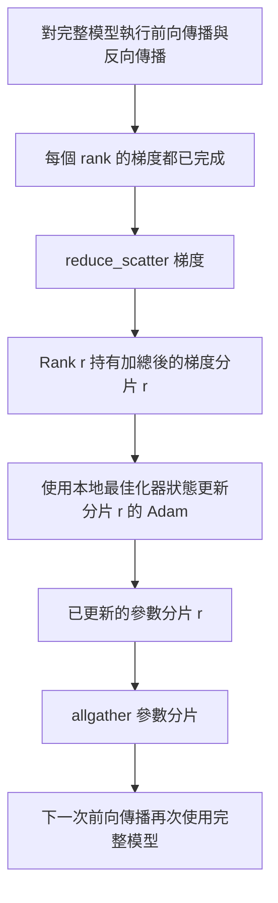

# ZeRO 最佳化器狀態分片（ZeRO Optimizer State Sharding）

> Adam 最佳化器為每個參數儲存一階與二階動量估計，兩者皆以 float32 儲存。一個 70 億參數（7B）的大模型，單是最佳化器狀態就占用 56 GB 記憶體！ZeRO Stage 1 將該狀態分片到 N 個 rank 上，每個 rank 僅承擔 1/N 的最佳化器記憶體開銷。在本地完成步進更新後，更新後的參數分片會透過網路傳回，讓每個 rank 重建完整模型，接著開始下一個訓練步驟。這讓訓練技術堆疊中最大的單項記憶體用量按線性比例下降。

**Type:** Build
**Languages:** Python
**Prerequisites:** Phase 19 Track C lessons 42-49
**Time:** ~90 min

## Learning Objectives｜學習目標

- 將最佳化器狀態（一階動量、二階動量、FP32 高精度主權重複本）均勻分片至 N 個 rank，使每個 rank 僅持有 1/N 的記憶體開銷。
- 使用 reduce_scatter 集合通訊僅將屬於該 rank 分片的梯度總和傳給對應 rank，隨後呼叫 allgather 將更新後的參數分片組回完整模型，供所有 rank 使用。
- 精確計算原生 DDP 與 Stage 1、Stage 2、Stage 3 的記憶體節省對照矩陣。
- 依據模型參數量規模與叢集網路頻寬預算，科學捍衛 Stage 1 vs Stage 2 vs Stage 3 的架構選型決策。

## The Problem｜問題

原生 DDP 採取粗暴的「全量複製」策略：模型參數、梯度以及最佳化器狀態在每個 rank 上皆完整持有。對於一個採用 FP16 訓練的 7B 模型，這意味著每個 rank 必須承受：14 GB 的參數、14 GB 的梯度，以及高達 28 GB 的最佳化器狀態！最佳化器狀態是記憶體佔用中最大的一項，也最容易分片，因為它只在最佳化器更新（optimizer.step）時使用，不會在前向或反向傳播期間使用。

ZeRO Stage 1 將最佳化器狀態分片：每個 Rank 僅持有 1/N 的 Adam 動量。反向傳播結束後，ZeRO 不對完整梯度執行全域 AllReduce，而是呼叫 reduce_scatter，只將各 Rank 分片的梯度總和交給對應 Rank。接著，該 Rank 使用本地高精度主權重分片執行 Adam 更新。最後，所有 rank 並行呼叫 allgather，傳送更新後的參數分片，讓每個 rank 在下一次前向傳播前取得完整模型。最佳化器記憶體開銷除以 N；網路傳輸量則與 DDP 相同，因為一次 reduce_scatter 加一次 allgather 在頻寬上等同一次 allreduce。

## The Concept｜核心概念



### ZeRO 的三大階段演進

| ZeRO 階段 | 實施分片切分的物件 | 每個 rank 常駐記憶體開銷 | 單步網路通訊量 |
|---|---|---|---|
| 原生 DDP | 完全無分片 | 參數 + 梯度 + 最佳化器 | 1 次 AllReduce |
| **ZeRO-1** | **僅分片最佳化器狀態** | 參數 + 梯度 + **最佳化器 / N** | 1 次 Reduce-Scatter + 1 次 AllGather |
| ZeRO-2 | 分片最佳化器與梯度 | 參數 + **梯度 / N** + **最佳化器 / N** | 1 次 Reduce-Scatter + 1 次 AllGather |
| ZeRO-3（FSDP） | 參數、梯度、最佳化器全分片 | **參數 / N** + **梯度 / N** + **最佳化器 / N** | 逐層 1 次 AllGather + 逐層 1 次 Reduce-Scatter |

Stage 1 是性價比最高的黃金勝利，因為最佳化器狀態本就佔據了絕大多數的記憶體預算。Stage 2 額外追加了梯度分片累積邏輯，但在網路頻寬上完全持平。Stage 3（即 FSDP 範式）雖然進一步將參數分片，但在前向傳播與反向傳播中必須承擔逐層動態通訊的巨大開銷。本課完整手寫實作 Stage 1 的全套架構。

### 記憶體節省的硬核數學

針對一個參數總量為 P、在混合精度下使用 Adam 最佳化器訓練的大模型：

| 記憶體組成項 | 原生 DDP 開銷 | ZeRO-1 分片後開銷 | 物理存在原因 |
|---|---|---|---|
| FP16 參數權重 | 2P 位元組 | 2P 位元組 | 前向傳播運算所必需 |
| FP16 參數梯度 | 2P 位元組 | 2P 位元組 | 反向傳播鏈式求導所必需 |
| FP32 高精度主權重複本 | 4P 位元組 | 4P / N 位元組 | 僅供最佳化器高精度更新使用 |
| FP32 一階動量 | 4P 位元組 | 4P / N 位元組 | 僅供最佳化器維護動量使用 |
| FP32 二階矩 | 4P 位元組 | 4P / N 位元組 | 僅供最佳化器維護二階矩使用 |
| **總記憶體開銷** | **16P 位元組** | **4P + 12P / N 位元組** | |

當 rank 數 N=8 時：原生 DDP 為 16P，ZeRO-1 降至 5.5P，**記憶體減少 65%**！當 rank 數 N=64 時：原生 DDP 依舊為 16P，ZeRO-1 降至 4.19P，**記憶體減少 74%**！

### 為何 Reduce-Scatter 全面擊敗「AllReduce 後再本地切片」？

AllReduce 會將完整的加總梯度傳送給每個 rank。若目前的 rank 只需要分片 r，其餘 (N-1)/N 的梯度歸約結果對該 rank 都沒有用。reduce_scatter 只會將各 rank 所屬分片的梯度總和傳送給對應 rank；每個 rank 的傳輸量與 AllReduce 相同。之後，參數分片的 allgather 會取代原本 AllReduce 的第二部分。總傳輸量與 DDP 相同，記憶體用量下降，吞吐量則維持不變。

```figure
cd-zero-shard
```

## Build It｜動手實作

`code/main.py` 實作了以下核心模組：

- `flatten_params(module)` 與 `unflatten_into(module, flat)`：將神經網路的所有零散參數打包拼接為單一連續張量，並支援逆向解包還原。扁平化記憶體排布是讓參數能夠按 rank 實施乾淨切片的核心基石。
- `ZeroOptimizer(model, world_size, rank, lr)`：接管並專門持有當前 Rank 自身管轄的那一份高精度主權重複本與 Adam 動量分片。
- `step()`：在扁平梯度上執行 reduce_scatter、呼叫 Adam 更新本地分片，最後透過 allgather 將更新後的參數分片還原至完整模型。
- 底部演示程式：驅動一個 3 層 MLP 訓練 20 步，在終端機逐步印出記憶體預算數值，並與原生 DDP 基準線展開並列比對。

執行測試：

```bash
python3 code/main.py
```

輸出結果：呈現逐步損失函數曲線與記憶體預算對照表，確認 ZeRO-1 在每個 rank 上僅持有 1/N 的最佳化器狀態。

## 正式環境中的實務模式

三大實戰工程防線，能確保你的 ZeRO 架構足以安全投入線上生產：

**分片 model checkpointing 至關重要**：在 ZeRO-1 中，最佳化器狀態分散在各個 rank 上；model checkpoint 必須記錄哪個 rank 持有哪一部分分片。第八十課將親手打造標準的分片 model checkpoint 清單（Manifest），確保 ZeRO 任務能夠在完全相同的 World Size 下完美中斷續訓。缺乏該機制，存檔的檔案在重啟時將徹底無法還原。

**混合精度是整套體系的靈魂所在**：ZeRO 本質上是一套專門針對混合精度訓練的記憶體最佳化架構；被分片拆解的核心大頭正是高達 12P 的 FP32 主權重與動量。若在純 fp32 精度下運作 ZeRO，你既要承受 fp32 master copy 的記憶體負擔，卻沒有相應的 fp16 前向效益。正式環境必須將 ZeRO 與 autocast 或 BF16 權重緊密結合。

**Stage 1 是一項近乎免費的勝利**：其網路頻寬開銷與原生 DDP 相同；記憶體節省量隨 N 線性增加；唯一的代價是維護最佳化器分片的記帳邏輯。在正式環境中，預設使用 Stage 1；如果參數分片所需的記憶體也成為問題，則可考慮使用 Stage 2 或 Stage 3，以增加通訊量換取記憶體。

## Use It｜實際應用

工業級生產框架在底層全體遵循完全相同的架構：

- **DeepSpeed ZeRO**：參考實作。透過 `deepspeed_config.json` 靈活切換 Stage 1/2/3 與分區大小。
- **PyTorch FSDP**：PyTorch 官方原生內建的同構框架。其 `ShardingStrategy.SHARD_GRAD_OP` 精確對標 ZeRO-2；而 `FULL_SHARD` 則對標 ZeRO-3。
- **Hugging Face Accelerate**：在統一設定方式下無縫包裹並抹平了 DeepSpeed 與 FSDP 的呼叫細節。

## Ship It｜交付成果

第七十九課（管線並行 Pipeline Parallel）將解鎖另一個正交維度的分片思路：不同於在同一模型上分片最佳化器狀態，管線並行是將神經網路的層（Layers）分配到不同 rank。第八十一課則將 DDP + ZeRO 深度融合，呈現在端到端分散式大演示中。

## Exercises｜練習

1. 將本實作升級至 ZeRO-2：對梯度實施分片儲存，在反向傳播後將非本地分片部分歸零。
2. 編寫記憶體 Profiler 分析器：即時印出 Rank 0 上真實消耗的 FP32 位元組數量，並與本課理論數學公式的預測值進行精確比對。
3. 比較原生 DDP 與 ZeRO-1 的單步實際經過時間，並將總耗時分解為前向傳播、反向傳播與通訊三個部分。
4. 實作 ZeRO-1 模式下的梯度裁剪（Gradient Clipping）：由於梯度已分片，全域 L2 範數必須透過對各分片的局部範數平方和執行一次 AllReduce 才能精確得出。
5. 實作一個「樸素版 ZeRO」（採用 AllReduce 替代 Reduce-Scatter），實測兩者在實體網路線路耗時上的具體差異，用硬核數字捍衛 Reduce-Scatter 的不可替代性。

## Key Terms｜關鍵術語

| 術語 | 常見說法 | 實際含義 |
|---|---|---|
| ZeRO-1 | 「分片最佳化器」 | 最佳化器狀態分片：每個 rank 僅持有 1/N 的 FP32 高精度主權重與 Adam 一階、二階動量 |
| ZeRO-2 | 「梯度也分片」 | 梯度與最佳化器雙重分片：在 Reduce-Scatter 之後，各 rank 立即釋放其餘非管轄分片的梯度記憶體 |
| ZeRO-3（FSDP） | 「分片參數」 | 全參數分片：每個 rank 僅持有 1/N 的模型參數，在前向與反向傳播中按需動態 AllGather 重構 |
| Master copy（主權重複本） | 「fp32 權重」 | 最佳化器更新參數時使用的高精度參數複本 |
| Reduce_scatter（規約散射） | 「切分總和」 | 將全域梯度求和，但僅將各 Rank 對應的分片總和傳送給該 Rank 的集合通訊原語 |

## Further Reading｜延伸閱讀

- [Rajbhandari et al., 2019，〈ZeRO: Memory Optimizations Toward Training Trillion Parameter Models〉](https://arxiv.org/abs/1910.02054)：DeepSpeed ZeRO 震撼業界的開創性奠基論文。
- [DeepSpeed ZeRO 官方技術指南與架構教學](https://www.deepspeed.ai/tutorials/zero/)
- [PyTorch FSDP（Fully Sharded Data Parallel）官方技術規格手冊](https://pytorch.org/docs/stable/fsdp.html)
- 第 19 階段第 76 課：深入掌握支撐 ZeRO 運作的 Reduce-Scatter 與 AllGather 底層集合通訊原語。
- 第 19 階段第 80 課：學習 ZeRO 分散式狀態在持久化存檔時所必須依託的分片 model checkpoint 架構。
