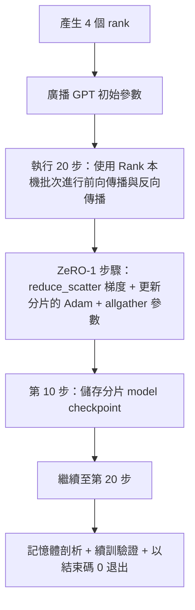

# 端到端分散式訓練實戰大演示（End-to-End Distributed Training）

> 第七十六課至第八十課分別打造了一塊核心拼圖。本課將它們組合起來：在 4 個模擬 rank 上訓練微型 GPT——透過 DDP 跨 rank 同步梯度、使用 ZeRO-1 分片最佳化器狀態，並在訓練半程的第 10 步寫入分片 model checkpoint。演示程式執行 20 步後自行終止，印出損失曲線與記憶體剖析，並產出可供續訓的 model checkpoint。

**Type:** Build
**Languages:** Python
**Prerequisites:** Phase 19 Track C lessons 42-49
**Time:** ~90 min

## Learning Objectives｜學習目標

- 將 DDP（第七十七課）、ZeRO-1（第七十八課）與分片 model checkpoint（第八十課）深度縫合進單一統一大模型訓練控制迴圈中。
- 在跨 4 個模擬 Rank 的環境中，使用小型合成語料庫訓練一個 2 層 Transformer 語言模型 20 步。
- 印出逐步損失表、各 Rank 的記憶體剖析，以及 model checkpoint 清單（Manifest）；並確認在相同 World Size 下可還原位元組相同的狀態。
- 說明模組解耦組合的方式：每個元件皆可在前序章節中獨立測試，而本課則證明它們可以組合運作。

## The Problem｜問題

專案實作課程要驗證的是各個部分能否組合運作。第七十六課實作了集合通訊底層原語；第七十七課將其封裝為 DDP；第七十八課透過 reduce_scatter 將最佳化器狀態分片；第七十九課分析管線並行；第八十課實作原子性分片 model checkpoint。前面每一課都有自己的單元測試。然而，真實訓練流程會一併使用所有原語；如果組合方式有誤，損失函數可能發散、model checkpoint 可能無法續訓，或者每個 rank 的記憶體用量在原本應當縮減時反而增加。

本課執行端到端演示，並驗證四項不變性：(a) 在 20 步內，損失函數在浮點數雜訊範圍內單調下降；(b) 每一步更新後，所有 rank 持有相同的模型參數範數；(c) 每個 rank 的最佳化器記憶體用量符合 ZeRO-1 理論公式 $12P/N$ 位元組；(d) 第 10 步存檔的分片 model checkpoint 在系統重新啟動後可逐位元組一致地載入。演示程式會自行終止：以單一指令啟動、執行 20 步，並以結束碼 0 退出。

## The Concept｜核心概念



### 微型 GPT 幾何規格

本課的模型規格刻意維持微縮：2 個 Transformer 區塊、embedding 維度 32、4 個注意力頭、詞表容量 64、上下文長度 16、批次大小 4。模型參數量僅有數千個。該規模足以完整考驗所有分散式連線決策（多頭注意力運作標準因果遮罩路徑；LayerNorm 包含待同步的縮放權重；LM Head 是一個獨立將特徵投影回詞表的線性層），同時足夠輕巧，確保在 4 個 CPU 行程上跑完 20 步僅需短短數秒。

### 模組組合與權責劃分

| 模組元件 | 專屬職責範圍 | 留給外層主迴圈的呼叫接縫 |
|---|---|---|
| DDP 廣播 | 初始模型參數跨 rank 同步 | 建構實例化時觸發單次呼叫 |
| ZeRO-1 步進 | 梯度歸約、主權重分片更新、參數廣播還原 | 每一步呼叫一次，直接替代傳統的 optimizer.step() |
| 分片 model checkpoint | 儲存各 rank 的局部狀態、生成帶 SHA256 的清單 | 透過 AllGather 收集狀態並在 rank 0 上單次呼叫 |
| 訓練主迴圈 | 前向傳播、反向傳播、損失紀錄 | 依序呼叫上述三大模組 |

主迴圈不需要知道 reduce_scatter 或 rendezvous 檔案。ZeRO 與 model checkpoint 模組暴露了極致收斂的乾淨介面，主迴圈僅負責流程編排。

### 為何選擇微型 GPT，而非單純的 MLP？

第七十七課的多層感知器（MLP）已完全足以驗證梯度同步邏輯。而組裝一個微型 GPT 則額外帶來了三項至關重要的實戰挑戰：第一，包含獨立的詞表 LM 預測頭（本課中為求清晰暫未開啟權重綁定；完整 GPT 通常綁定 token embedding）；第二，損失函數採用「Softmax + 交叉熵」（相較於均方誤差 MSE，它具備更豐富的數值邊界特徵）；第三，前向傳播呈現非對稱性（embedding 層 -> 自注意力 -> MLP）。在集大成演示中堅持使用 GPT，能確鑿檢驗整套分散式技術堆疊在面對 LayerNorm 或 embedding 層複雜梯度形狀時的真實相容性。

### 自我終止意味著安全以 0 碼退出

迴圈執行固定 20 步後自動退出。沒有 `while True` 無窮迴圈、無需人工介入，也不會從外部狀態續訓。一個能讓你安心掛在背景運作、且在結束時留下一份完整紀錄的專案演示，才是真正證明系統連線完全正確的鐵證。若任何一個模組發生死鎖，演示程式將永遠無法回傳，測試架構會在第一時間將其捕獲。

```figure
ci-distributed-assembly
```

## Build It｜動手實作

`code/main.py` 實作了以下核心模組：

- `MiniGPT`：包含因果遮罩自注意力與獨立 LM 預測頭的 2 層 Transformer 模型。
- `make_corpus(seed, total_tokens)`：確定性生成next-token prediction 資料。
- `_train_worker`：在每個 Rank 上獨立派生的工作行程；廣播初始權重、推進訓練迴圈、呼叫 ZeRO 更新，並在第 10 步精確觸發分片 model checkpoint 存檔。
- `verify_resume`：在主流程結束後，在行程內重新載入第 10 步存檔的分片 model checkpoint，逐位元組嚴格斷言磁碟分片與記憶體快照完全一致。
- `main`：全域編排演示程式、印出逐步損失表、輸出記憶體剖析分佈，並出具校驗結論。

執行測試：

```bash
python3 code/main.py
```

輸出結果：展示包含 20 行的損失函數衰減表格、4 個 Rank 的記憶體剖析分佈、model checkpoint Manifest 清單，並在驗收通過時印出 "RESUME VERIFIED" 字樣。

## 正式環境中的實務模式

三大實戰工程防線，能讓這套分散式組合拳從容駕馭真實的超大規模預訓練任務：

**依照時間間隔存檔，而非單純依據步數**：在超大模型中，單步耗時會隨序列長度與微批次規模而變化。設定「每隔 10 分鐘自動存檔一次」，按實際經過時間排程，無論模型大小與步長如何波動，皆能將意外崩潰時的算力損失嚴格鎖定在固定時間窗口內。

**建立早期發散即時阻斷防線**：正式環境訓練會在反向傳播後掛載 NaN 數值守護器與損失突變偵測器；一旦偵測到單步 Loss 暴漲超過 2 倍，系統立即自動拒絕更新並回滾至上一個健康 model checkpoint，堅決杜絕最佳化器跌入病態區域。本課示範的損失曲線平滑，因此未使用此守護機制，但保留了這個掛接點。

**跨 rank 彙整記憶體用量**：在多 rank 的執行環境中，不同 rank 的記憶體用量會有差異（例如持有較大管線階段的 rank 會持有較多活化值）。正式環境監控看板應彙整各 rank 記憶體用量的最大值（Max）與平均值（Mean）；本課演示程式會逐 rank 印出記憶體用量，供讀者與理論公式比較。

## Use It｜實際應用

工業級生產框架在底層全體遵循完全相同的架構：

- **DeepSpeed**：在統一設定下將 DDP + ZeRO + 管線並行 + 活化值檢查點融為一體。本課的端到端組裝，本質上就是微縮版的 DeepSpeed 核心架構。
- **PyTorch FSDP**：官方原生同構框架。`FullyShardedDataParallel` 搭配 `ShardingStrategy.SHARD_GRAD_OP` 即為標準的 ZeRO-2。
- **NeMo 與 Megatron-LM**：針對規模最大的模型進一步疊加張量並行（TP）；其餘分散式組合骨架完全同一。

## Ship It｜交付成果

至此，Track C 分散式訓練軌道告一段落。這 6 節課程共同建置了一個真實團隊在採用 DeepSpeed 前會打造的分散式訓練子系統；全套抽象在 gloo 後端上通過校驗，各種失效模式也都經過演練。第 17 階段（基礎設施與生產部署）可將這套組合帶到真實叢集。

## Exercises｜練習

1. 為注意力頭部引入張量並行（Tensor Parallel）切分，驗證其損失函數曲線與單卡基準線完全一致。在 2 個 rank 上實作：每個 rank 僅持有半數注意力頭，在注意力輸出端發起 AllReduce。
2. 引入跨 4 個微批次的梯度累加，驗證累積後的梯度等於單次全批次前向傳播產生的梯度。
3. 實作「自第 10 步 model checkpoint 真正接續訓練至第 20 步」的完整斷點續訓路徑，驗證其最終產出的模型損失值與從未中斷過的原始訓練完全一致。
4. 將訓練指標（Loss、梯度範數、單步耗時）導出為標準 JSONL 檔案，方便在事後繪製全景視覺化監控看板。
5. 實作 NaN 數值熔斷與自動回滾：故意在某一步手動使用單步學習率倍率誘發 spike，驗證系統能否敏銳捕捉異常並自動回退至上一個健康 model checkpoint。

## Key Terms｜關鍵術語

| 術語 | 常見說法 | 實際含義 |
|---|---|---|
| End-to-end（端到端） | 「把所有元件接起來」 | 單次運作整合所有底層元件，而非各自獨立進行單元測試的系統級工程大驗收 |
| Memory profile（記憶體剖析） | 「每個 rank 的 GB 數」 | 精確統計每個 rank 上模型參數、梯度與最佳化器狀態分別占用的位元組數 |
| Resume contract（續訓合約） | 「儲存與載入」 | model checkpoint 經過儲存與重新載入後，各 rank 的狀態保持逐位元組一致的保證 |
| Self-terminating（自我終止） | 「有限次執行」 | 運作固定步數、結束時以 0 碼安全退出、全流程完全無人值守的自動化工程特徵 |

## Further Reading｜延伸閱讀

- [DeepSpeed 官方端到端預訓練實踐教學](https://www.deepspeed.ai/getting-started/)
- [PyTorch FSDP 進階實戰指南](https://pytorch.org/tutorials/intermediate/FSDP_advanced_tutorial.html)
- [NVIDIA Megatron-LM 官方預訓練腳本參考架構](https://github.com/NVIDIA/Megatron-LM)
- 第 19 階段第 76 至 80 課：本課所整合的全部底層核心元件。
- 第 17 階段（基礎設施與生產部署）：將本課組裝出的技術堆疊正式遷移至真實 GPU 雲端叢集。
