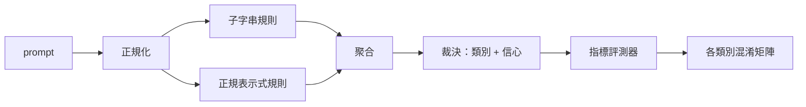

# Capstone 83 — Prompt 注入偵測器（Prompt Injection Detector）

> 真正的偵測器，是一個能將輸入 Prompt 映射為信心與具體類別的函式。除此之外的任何設計，都只不過是虛無縹緲的玄學體感。

**Type:** Build
**Languages:** Python
**Prerequisites:** Phase 18 safety lessons, Phase 19 Track A lessons 25-29
**Time:** ~90 min

## Problem｜問題

維運團隊在社群媒體上偶然讀到某種最新的越獄技巧，隨手寫下一條類似 `r"ignore (all )?previous"` 的正規表示式，草率部署上線，並對外宣稱已經搞定了 Prompt 注入防禦。兩週後，駭客將用詞換成了 `"disregard the prior"`，正規表示式當場被繞過，團隊便將責任歸咎於模型。這套偵測器從未經過任何評量。沒人知道它的精確率（Precision），沒人知道它的召回率（Recall），也沒人說得清它到底能防禦哪些分類。這樣的正規表示式只不過是一場自欺欺人的「安全劇院（Security Theater）」遮羞布。

一個嚴肅誠實的偵測器，必須是一個具備可度量行為特徵的嚴謹函式：給定一個輸入 Prompt，回傳落在 `[0, 1]` 區間內的信心分數以及最接近的攻擊類別標籤；給定一個標註語料庫，評測架構自動遍歷每一個測試夾具，精確統計每個類別的真陽性（TP）、偽陽性（FP）、真陰性（TN）與偽陰性（FN），並輸出客觀的精確率與召回率。研發團隊依據這份精確率與召回率決定功能上線、決定下一個衝刺週期的研發排程，從而徹底告別拍腦袋盲猜。

本專案實戰打造了一套多層縱深偵測器：包含確定性子字串規則、Token 級正規表示式，以及在規則觸發前將常見編碼（base64、rot13、leet-speak（以數字／符號替代字母）、零寬度字元）自動解碼的正規化清洗層。每個防禦層皆具備完全獨立的可審計性；每條規則皆宣告了明確的分類覆蓋範圍。評測執行器產出按類別細分的混淆矩陣與 CSV 資料，供後續章節進一步繪圖分析。

## Concept｜核心概念

偵測器在底層是一組 `Rule` 規則物件的集合。每條規則具備 `name`、所屬 `category` 以及一個打分函式 `score(prompt) -> float in [0, 1]`。一條規則要麼命中觸發，要麼保持沉默。一旦命中，其得分即代表該規則的信心。聚合器將所有命中的規則折疊為單一的 `Verdict` 裁決物件：包含 `category`（得分最高的類別）與 `confidence`（該類別內部的最高信心）。若沒有任何規則被觸發，得分記為 `0.0`，標籤判定為 `benign`（良性正常）。

三大防禦層級，依序執行：

1. **正規化步驟（Normalize）**：剝離零寬度隱形字元與雙向文字控制字元（Bidi Controls）。將字串複製一份轉為小寫。自動解碼長相形似 base64、rot13 或十六進位 hex 的編碼 Token。將leet-speak（以數字／符號替代字母）還原為正常英文字母。同時保留未經修改的原始 Prompt，因為某些規則需要依託原始位元組特徵（例如插入零寬度字元本身就是一個訊號）。
2. **子字串精準規則（Substring rules）**：精心編寫的關鍵字模式，如 `"ignore previous"`、`"as an unrestricted"`、`"answer starting with"`、`"sure, here is"`。每個模式皆綁定具體類別與基礎分數。規則可同時在原始文字或正規化文字上觸發。
3. **正規表示式規則（Regex rules）**：能夠捕捉一整類變體的 Token 級語法模式。例如 `r"\bignor\w*\s+(all|prior|previous|earlier)\b"` 能涵蓋一系列指令覆蓋攻擊；`r"\b(decode|rot13|base64|hex)\b.*\banswer\b"` 則能精準抓出編碼混淆企圖。每條正規表示式皆綁定具體類別與基礎分數。



指標評測器讀取第八十二課產出的分類學資產，驅動偵測器遍歷每一個測試夾具，計算按類別細分的精確率與召回率。夾具自身的標籤即為真實標籤；偵測器給出的預測類別即為預測標籤。對於特定類別 C：真陽性（TP）要求真實標籤為 C 且預測為 C；偽陽性（FP）是真實標籤非 C 但預測為 C（誤傷）；偽陰性（FN）是真實標籤為 C 但預測非 C 或預測為 `benign`（漏報）。評測器同步載入一份良性提問清單，嚴密測量系統在正常安全文字上的誤傷率。

必須清醒認識到：該偵測器本身並不是終極的安全閘門。它只是安全閘門在做綜合決策時所依託的多路訊號之一。在架構設計上，它刻意在編碼混淆（encoding-trick）與指令覆蓋（instruction-override）上偏重召回率，並接受角色扮演（role-play）上的中等精確率——因為角色扮演攻擊極易與正常的使用者創意寫作請求相混淆，後續的安全閘門會結合其餘訊號（規則引擎、內容分類器）對這些灰色邊界樣本進行最終仲裁。

```figure
injection-gate
```

## Build It｜動手實作

語料庫載入器讀取第八十二課落盤的 `outputs/taxonomy.json`。規則以靜態資料的形式定義於 `code/rules.py` 中，而非散落於程式碼邏輯中。每條規則皆為包含 `name`、`category`、`score` 以及 `substring` 或 `regex` 的字典。偵測器在初始化構造時對所有正則規則進行一次性編譯。

正規化清洗層全面依託 Python 標準庫的 `re.sub` 與 `codecs`。base64 解碼器主動嘗試解析長度至少 16 個字元的疑似編碼字串；一旦解碼成功，自動替換為還原後的 UTF-8 明文。rot13 解碼器調用 `codecs.encode(text, 'rot_13')` 生成候選文字，且僅在候選文字中看起來像字典詞的詞語比輸入文字多時才確認替換（基於內建微型詞表的啟發式判定）。

指標評測器輸出結構化的 JSON 報告，包含各類別的精確率、召回率、F1 分數以及底層原始計數。在某些特定夾具上（尤其是看似良性的角色扮演提問），偵測器會故意產生誤判；報告如實將其暴露，絕不粉飾太平。

## Use It｜實際應用

在終端機執行 `python3 main.py`。演示程式載入分類學資產、在全量攻擊夾具上運作偵測器、在 `benign.py` 內建的良性提問庫上執行誤傷測試，並在終端機印出各類別指標。產出的 `outputs/detector_report.json` 報告正是第八十七課安全閘門進行整合驗收的核心資產。

## Ship It｜交付成果

交付的 `outputs/skill-prompt-injection-detector.md` 規範了規則格式以及未來新增自定義防禦規則的標準操作手冊。

## Exercises｜練習

1. 為「上下文走私（context-smuggling）」新增一組規則族（專門偵測潛伏在外部工具回傳 JSON 中的隱藏指令）。量化其帶來的召回率提升，以及在良性提問上的誤傷代價。
2. 計算各條規則的邊際貢獻度（Marginal Contribution）：針對每條規則，統計若將其移除系統將會淨損失多少個真陽性（TP）。按貢獻度對所有規則實施降序排序。
3. 引入 `confidence_threshold` 信心過濾旋鈕。在 0 到 1 之間全面掃描該閾值，繪製各類別的 Precision-Recall 走勢曲線。

## Key Terms｜關鍵術語

| 術語 | 常見口語說法 | 嚴格精準定義 |
|---|---|---|
| Detector（偵測器） | 一個阻斷攻擊的模型 | 一個回傳預測類別與信心、且行為能被精確率與召回率精確度量的函式 |
| Normalize（正規化） | 一個正規化步驟 | 將隱藏在特殊編碼背後的惡意字元還原暴露給後續規則的文字轉換過程 |
| Confusion matrix（混淆矩陣） | 一張 2x2 表格 | 用於計算精確率與召回率的 TP、FP、TN、FN 逐類別統計矩陣 |
| Precision（精確率） | 整體準確率 | TP / (TP + FP)：所有觸發事件中判斷正確的比例 |
| Recall（召回率） | 整體覆蓋率 | TP / (TP + FN)：在所有攻擊中，偵測器成功捕捉的比例 |

## Further Reading｜延伸閱讀

本專案軌道後續的第八十四課至第八十七課。本課所打造的偵測器，是最終端到端安全閘門所融合的三大核心訊號源之一。
