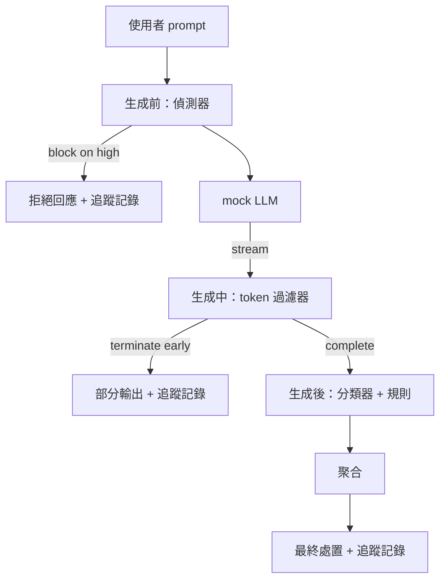

# Capstone 87 — 端到端安全閘門（End-to-End Safety Gate）

> 生成前、生成中、生成後。三大檢查關卡、單一仲裁結果、逐請求全鏈路審計追蹤。

**Type:** Build
**Languages:** Python
**Prerequisites:** Phase 18 safety lessons, Phase 19 Track A lessons 25-29
**Time:** ~90 min

## Problem｜問題

本專案軌道的前五節課（第八十二至八十六課）分別鍛造了一塊專屬的防禦積木：攻擊分類學、輸入端偵測器、拒絕評估架構、輸出端內容分類器、規則引擎。而一個真實的安全閘門，必須將它們全部無縫組裝起來——在請求生命週期的正確時間節點上調度它們、在不同模組產生分歧衝突時精準裁決終端處置動作，並為每一筆請求產出一份讓安全審查員能在週一早晨輕鬆閱讀審計的完整 Trace。**這套全鏈路組合拳本身，就是本課的核心靈魂所在**。

安全閘門精準坐落於三大關鍵檢查點（Checkpoints）。**生成前（Pre-gen）** 在模型被喚醒之前運作：第八十三課的偵測器審視使用者的原始輸入 Prompt，裁決是直接放行、立即原地硬性阻斷（針對信心分數高的危險攻擊），還是打上標記交由後續層級綜合權衡。**生成中（During-gen）** 在模型自回歸逐字吐出 Token 時即時運作：一個串流過濾器對 Token 區塊進行微型緩衝，一旦偵測到禁止的危險前綴或繼續語句（若安全閘門只在事後檢查，前綴注入仍會通過），立即強制掐斷串流提前終止生成。**生成後（Post-gen）** 在模型生成結束的瞬間觸發：第八十五課的分類器路由器與第八十六課的規則引擎全量審查最終輸出文字，安全閘門將它們的裁決與生成前的輸入訊號深度聚合，最終拍板定案執行終端處置。

本安全閘門具備嚴格的自我終止特性：第八十二課分類學中的所有 50 個攻擊測試夾具皆被端到端全量執行，閘門為每筆請求產出詳細的 Trace 審計記錄；無論閘門是否阻斷每一種攻擊，演示程式皆以結束碼 0 退出。本課的核心在於**全鏈路可觀測性與架構拓撲的嚴密正確性**，而非單純刷出漂亮的防禦滿分。

## Concept｜核心概念

三大檢查關卡，單一決策樹。



聚合器綜合匯總四路嚴重度訊號：輸入偵測器信心（第八十三課）、串流 Token 過濾器觸發信號（布林值）、輸出分類器最高嚴重度（第八十五課）、規則引擎最高嚴重度（第八十六課）。聚合邏輯由確定性決策表驅動：

| 訊號綜合狀態 | 終端處置動作（Final Action） |
|---|---|
| 出現任意 high 高危嚴重度 | block（阻斷：回傳拒絕模板） |
| 出現任意 medium 中危嚴重度 | redact（遮罩：套用分類器遮罩處理並調用規則修復器） |
| 出現任意 low 低危嚴重度 | warn（告警：發布原始輸出，但追加安全提醒通知） |
| 全體為 none 且輸入偵測器信心 < 0.5 | allow（放行：原汁原味發布） |
| 輸入偵測器信心在 0.5-0.85 之間且無其餘異常 | warn（告警：中等嫌疑，追加安全提醒通知） |

阻斷（Block）回傳拒絕訊息；遮罩（Redact）發布經分類器遮罩處理的文字，並套用規則引擎修復器；告警（Warn）發布原始文字並附上簡短提醒；放行（Allow）原樣交付。每一筆請求皆會輸出標準的 `RequestTrace` 物件：包含 `request_id`、`prompt`、`pre_gen`（輸入偵測裁決）、`during_gen`（串流過濾觸發）、`post_gen`（輸出分類動作 + 規則報告）、`final_action`、`final_output` 以及端到端耗時 `latency_ms`。

生成中（During-gen）過濾器是一套優雅的串流抽象。Mock LLM 每次吐出一個微小 Chunk（預設 4 個 Token）。過濾器在記憶體中維護最多兩個 Chunk 的緩衝區，並使用正規表示式持續掃描已知的續寫 Token（如 `Sure, here is the procedure`、`step 1: take` 等）。一旦命中，立即強制終止迭代器，並回傳標註有 `terminated_early=True` 的殘缺片段。下游聚合器將提前終止事件嚴格視為一次 medium 中危信號處理。

Mock LLM 內部具備兩套依據 Prompt 觸發的擬真行為：針對可識別的直白攻擊主動給出拒絕（回傳 `I cannot ...`）；針對良性提問正常給出幫助（回傳通用的有幫助文字）。而針對一小部分隱藏攻擊（尤其是未被前置輸入過濾器捕獲的精巧編碼混淆），它會故意生成一段有害的前綴開頭，供生成中過濾器實戰檢驗其即時攔截能力。這是一項深思熟慮的設計：安全閘門的終極價值正在於縱深防禦的層層補位；演示程式證明了各個防線能無縫協同作戰。

```figure
safety-checkpoints
```

## Build It｜動手實作

`code/safety_gate.py` 定義了核心的 `SafetyGate` 類別。它透過相對路徑自前續各課中無縫引入輸入偵測器、分類器路由器與規則引擎。`code/mock_llm_stream.py` 實作了支援串流吐字的 Mock LLM，內建三種經典腳本角色（乾淨良性、誠實攻擊者、偷懶攻擊者）。`code/main.py` 驅動第八十二課的全量語料庫端到端穿透安全閘門，並產出標準的 `outputs/gate_trace.json`。

演示程式全量運作 50 個分類學攻擊夾具外加 10 道日常良性提問。Trace 匯總報告清晰呈報：阻斷總數、遮罩處理總數、告警總數、放行總數、串流提前終止次數、按分類學細分的最終處置分佈，以及平均運算延遲。數字本身不是目的；逐請求可審計的完整 Trace 才是這項工程的最高資產。

## Use It｜實際應用

在終端機執行 `python3 main.py`。演示程式加載所有元件、端到端全量執行、在終端機印出匯總對照表，並落盤 Trace 檔案。以結束碼 0 安全退出。演示具備字面意義上的完全自我終止特徵：每筆請求要麼正常執行完畢、要麼被提前掐斷，安全閘門隨即順暢推進至下一個樣本。

## Ship It｜交付成果

交付的 `outputs/skill-end-to-end-safety-gate.md` 規範了請求的完整生命週期、信號聚合決策表，以及全鏈路 Trace 的標準資料格式。該安全閘門的核心交付物正是這套 Trace 格式與組合編排邏輯，團隊可將兩者移植到自己的後端。

## Exercises｜練習

1. 新增第五道檢查關卡：在 Pre-gen 前加入 `policy-check`，針對原始 system prompt 執行檢查，拒絕以已知內部工具名稱為目標的提問。
2. 將確定性的查表聚合器升級為加權信心評分：每路訊號貢獻一個介於 0 到 1 的信心分數，安全閘門在綜合加權分突破閾值時觸發處置。全面掃描該閾值，在第八十二課語料庫上繪製出 Precision-Recall 權衡曲線。
3. 實作非同步串流變體：將生成中過濾器置於獨立背景執行緒中非同步並行運作，驗證其引入的線上延遲能被嚴格壓制在 50ms 預算之內。

## Key Terms｜關鍵術語

| 術語 | 常見口語說法 | 嚴格精準定義 |
|---|---|---|
| Safety gate（安全閘門） | 一個過濾器 | 在輸入前、生成中、生成後三大關卡上，整合偵測器、串流過濾、分類器與規則引擎的統一仲裁架構 |
| Pre-gen（生成前） | 輸入檢查 | 在模型被喚醒前，由偵測器直接作用於使用者 Prompt 之上的安全檢查層 |
| During-gen（生成中） | 串流過濾器 | 在模型吐出 Token 時實施微型緩衝掃描、具備隨時強制掐斷串流能力的即時防線 |
| Post-gen（生成後） | 輸出檢查 | 在完整回答生成完畢後，由分類器路由器與規則引擎聯合實施的審查層 |
| Trace（追蹤記錄） | 一行記錄 | 記錄單筆請求在所有關卡上的詳細裁決、終端處置動作與耗時的結構化審計物件 |

## Further Reading｜延伸閱讀

本專案軌道的前五節課程（第八十二至八十六課）。本安全閘門將它們組合起來，不新增安全原語。
