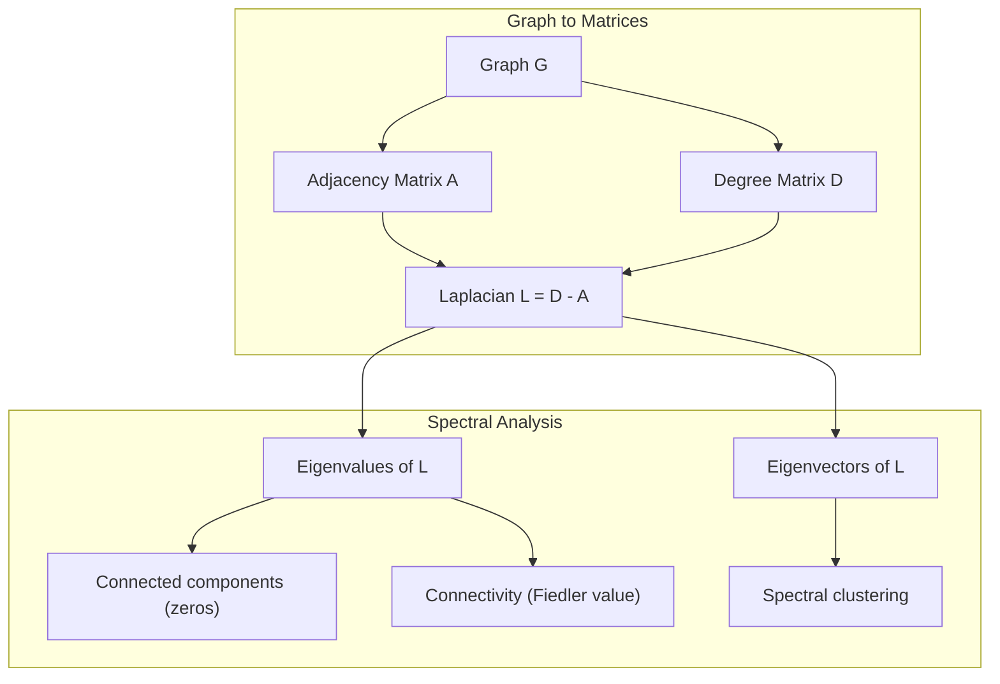
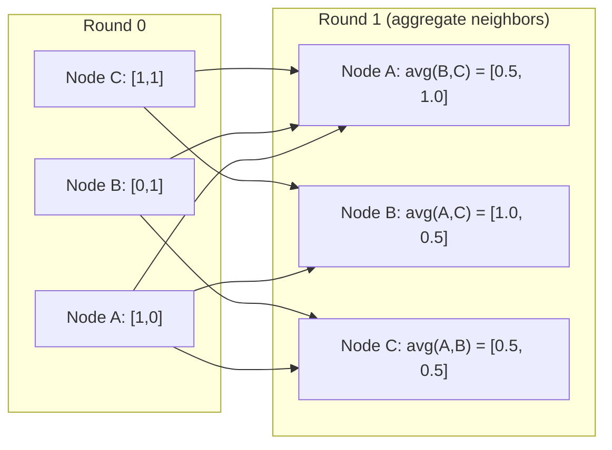

# 机器学习的图形理论

> 如果你的数据有联系,你需要图形理论.

**Type:** Build
**Languages:** Python, TypeScript
**Prerequisites:** Phase 1, Lessons 01-03 (linear algebra, matrices)
**Time:** ~90 minutes

## 学习目标

- 建立一个附属矩阵/列表表示的图形类,并实现BFS和DFS穿越
- 计算拉普拉斯图,并使用其本值检测连接的组件和集群节点
- 实现一个轮 GNN 式消息通过正常化的邻接矩阵乘法
- 应用光谱集群来使用Fiedler向量分区图

## 问题

社交网络,分子,知识库,引用网络,路线图,都是图表.传统的ML将数据视为平面表.每个行都是独立的.每个特征都是列.

想想预测用户会购买什么产品.他们的购买历史是重要的. 但他们的朋友的购买历史更重要. 连接传递信号.

原子是重要的,但真正重要的是原子是如何相互结合的.结构是数据.

图神经网络 (GNN) 是深度学习领域增长最快的领域.它们支持药物发现,社会推,欺诈检测和知识图论.每个GNN都建立在同一基础上:基本图理论.

你需要四件事:
1. 作为矩阵表示图表的方式 (这样你可以乘以它们)
2. 跨度算法探索图形结构
3. 拉普拉西亚 - - 在光谱图理论中最重要的单一矩阵
4. 传递消息 - - 使 GNN 运行的操作

## 概念

### 图:节点和边缘

图表$G = (V, E)$由顶点 (节点) 组成$V$子和边缘$E$每个边缘连接两个节点.

**Directed vs undirected.**在一个未指向的图表中,边缘$(u, v)$平均$u$连接到$v$,,$v$连接到$u$在指向图中,边缘$(u, v)$平均$u$指出$v$虽然这并不一定是相反的.

**Weighted vs unweighted.**在一个不加权图中,边缘要么存在,要么没有.在一个加权图中,每个边缘都有数值的重量 - - 距离,成本,强度.

| Graph type | Example |
|-----------|---------|
| Undirected, unweighted | Facebook friendship network |
| Directed, unweighted | Twitter follow network |
| Undirected, weighted | Road map (distances) |
| Directed, weighted | Web page links (PageRank scores) |

### 接近矩阵

邻近矩阵$A$对于一个图表的$n$节点:

```math
A[i][j] = \begin{cases} 1 & \text{if there is an edge from node } i \text{ to node } j \\ 0 & \text{otherwise} \end{cases}
```

对于未定向图表,$A$是对称的: $A[i][j] = A[j][i]$对于权重图表,$A[i][j]$=边缘重量$(i, j)$现在,我们要去.

**Example -- a triangle:**

```
Nodes: 0, 1, 2
Edges: (0,1), (1,2), (0,2)

A = [[0, 1, 1],
     [1, 0, 1],
     [1, 1, 0]]
```

接壤矩阵是每个 GNN 的输入.$A$根据图表的操作.

### 学位

节点的度是与节点连接的边缘数量.对于指向图表,你有进度 (进度边缘) 和出度 (出边缘).

度矩阵$D$是斜角:

```math
\begin{aligned}
D[i][i] &= \text{degree of node } i \\
D[i][j] &= 0 \quad \text{for } i \ne j
\end{aligned}
```

对于三角形的例子:$D = \mathop{\mathrm{diag}}(2, 2, 2)$因为每个节点连接到另外两个节点.

度告诉你关于节点的重要性.高度 = 枢纽节点.网络的度分布揭示了其结构.社交网络遵循电力规律 (少数枢纽,许多叶子节点).随机图表具有波森分布式的度数.

### 和

需要两个基本的图形穿越算法.

**Breadth-First Search (BFS):**首先探索所有邻居,然后使用邻居的邻居.

```
BFS from node 0:
  Visit 0
  Queue: [1, 2]        (neighbors of 0)
  Visit 1
  Queue: [2, 3]        (add neighbors of 1)
  Visit 2
  Queue: [3]           (neighbors of 2 already visited)
  Visit 3
  Queue: []            (done)
```

基于BFS的数据,BFS在未加权图中找到最短的路径.从开始到任何节点的距离等于该节点首次发现的BFS水平.

**Depth-First Search (DFS):**在回溯之前尽可能深入. 使用子 (LIFO) 或复发.

```
DFS from node 0:
  Visit 0
  Stack: [1, 2]        (neighbors of 0)
  Visit 2               (pop from stack)
  Stack: [1, 3]         (add neighbors of 2)
  Visit 3               (pop from stack)
  Stack: [1]
  Visit 1               (pop from stack)
  Stack: []             (done)
```

对于:
- 找到连接组件 (从未访问的节点运行DFS)
- 循环检测 (DFS树的后边)
- 拓分类 (反向DFS完成顺序)

| Algorithm | Data structure | Finds | Use case |
|-----------|---------------|-------|----------|
| BFS | Queue | Shortest paths | Social network distance, knowledge graph traversal |
| DFS | Stack | Components, cycles | Connectivity, topological sort |

### 拉普拉西亚图

$L = D - A$频谱图理论中最重要的矩阵.

对于三角形:

```math
D = \begin{bmatrix} 2 & 0 & 0 \\ 0 & 2 & 0 \\ 0 & 0 & 2 \end{bmatrix} \qquad A = \begin{bmatrix} 0 & 1 & 1 \\ 1 & 0 & 1 \\ 1 & 1 & 0 \end{bmatrix} \qquad L = \begin{bmatrix} 2 & -1 & -1 \\ -1 & 2 & -1 \\ -1 & -1 & 2 \end{bmatrix}
```

拉普拉西亚人具有着显著的特征:

1. **$L$ is positive semi-definite.**所有的本值都是$\ge 0$现在,我们要去.

2. **The number of zero eigenvalues equals the number of connected components.**连接的图表具有一个零的本值.一个连接不连接的3个组件的图表具有三个零的本值.

3. **The smallest non-zero eigenvalue (Fiedler value) measures connectivity.**较大的Fiedler值意味着图表是有联系的.较小的Fiedler值意味着图表有一个弱点 - - 瓶.

4. **The eigenvector of the Fiedler value (Fiedler vector) reveals the best split.**带有正值的节点进入一个组,带有负值的节点进入另一个组.



### 频谱特性

邻近矩阵和拉普拉西亚的本值显示了没有任何穿越的结构性质.

**Spectral clustering**运行方式是这样的:
1. 计算拉普拉西亚人$L$
2. 找一个$k$最小的自向量$L$(跳过第一个,这是连接图的全部)
3. 使用这些自向量作为每个节点的新坐标
4. 跑步$k$- 在这些坐标上,

它们是对象的.$L$它们可以编码图表上的"最光滑"函数. 结合良好的节点得到类似的自向量值. 结合瓶分离的节点得到不同的值. 自向量自然分离集群.

**Random walk connection.**正常化拉普拉西亚语与图上的随机行走有关.随机行走的静止分布与节点程度相比例.混合时间 (行走的接近速度) 取决于光谱差距.

### 传递信息

每个节点都收集了邻居的信息,汇集它们,并更新了自己的状态.

```math
h_v^{(k+1)} = \text{UPDATE}\left(h_v^{(k)}, \text{AGGREGATE}\left(\{h_u^{(k)} : u \in \text{neighbors}(v)\}\right)\right)
```

在最简单的形式中,AGGREGATE =平均值,UPDATE =线性转换 +激活:

```math
h_v^{(k+1)} = \sigma\left(W \cdot \text{mean}\left(\{h_u^{(k)} : u \in \text{neighbors}(v)\}\right)\right)
```

这就是形矩阵乘法.$H$是所有节点特征的矩阵,$A$是邻近矩阵:

```math
H^{(k+1)} = \sigma\left(A_{\text{norm}} H^{(k)} W\right)
```

在哪里$A_{\text{norm}}$是正常化的邻近矩阵 (每个行总数为 1).

通过一个轮传递信息,每个节点可以"看到"其近邻.$K$轮子给每个节点提供其信息$K$- 哈尔街.



### 概念和 ML 应用

| Concept | ML Application |
|---------|---------------|
| Adjacency matrix | GNN input representation |
| Graph Laplacian | Spectral clustering, community detection |
| BFS/DFS | Knowledge graph traversal, path finding |
| Degree distribution | Node importance, feature engineering |
| Message passing | GNN layers (GCN, GAT, GraphSAGE) |
| Eigenvalues of L | Community detection, graph partitioning |
| Spectral clustering | Unsupervised node grouping |
| PageRank | Node importance, web search |

```figure
graph-degree-distribution
```

## 建立它

### 步骤1:从零开始的图形课程

```python
class Graph:
    def __init__(self, n_nodes, directed=False):
        self.n = n_nodes
        self.directed = directed
        self.adj = {i: {} for i in range(n_nodes)}

    def add_edge(self, u, v, weight=1.0):
        self.adj[u][v] = weight
        if not self.directed:
            self.adj[v][u] = weight

    def neighbors(self, node):
        return list(self.adj[node].keys())

    def degree(self, node):
        return len(self.adj[node])

    def weighted_degree(self, node):
        return sum(self.adj[node].values())

    def adjacency_matrix(self):
        import numpy as np
        A = np.zeros((self.n, self.n))
        for u in range(self.n):
            for v, w in self.adj[u].items():
                A[u][v] = w
        return A

    def degree_matrix(self):
        import numpy as np
        D = np.zeros((self.n, self.n))
        for i in range(self.n):
            D[i][i] = self.weighted_degree(i)
        return D

    def laplacian(self):
        return self.degree_matrix() - self.adjacency_matrix()
```

邻近的列表 (`self.adj`邻近矩阵转换使用numpy,因为所有光谱操作都需要它.

### 步骤2:BFS和DFS

```python
from collections import deque

def bfs(graph, start):
    visited = set()
    order = []
    distances = {}
    queue = deque([(start, 0)])
    visited.add(start)
    while queue:
        node, dist = queue.popleft()
        order.append(node)
        distances[node] = dist
        for neighbor in graph.neighbors(node):
            if neighbor not in visited:
                visited.add(neighbor)
                queue.append((neighbor, dist + 1))
    return order, distances


def dfs(graph, start):
    visited = set()
    order = []
    stack = [start]
    while stack:
        node = stack.pop()
        if node in visited:
            continue
        visited.add(node)
        order.append(node)
        for neighbor in reversed(graph.neighbors(node)):
            if neighbor not in visited:
                stack.append(neighbor)
    return order
```

 BFS使用一个双边排队$O(1)$现在,我们可以看到一个单词,一个单词,一个单词,一个单词,一个单词,一个单词,一个单词,一个单词,一个单词,一个单词,一个单词,一个单词,一个单词,一个单词,一个单词,一个单词,一个单词,一个单词,一个单词,一个单词,一个单词,一个单词,一个单词,一个单词,一个单词,一个单词,一个单词,一个单词,一个单词,一个单词,一个单词,一个单词,一个单词,一个单词,一个单词,一个单词,一个单词,一个单词,一个单词,一个单词,一个单词,一个单词,一个单词,一个单词,一个单词,一个单词,一个单词,一个单词,一个单词,一个单词,一个单词,一个单词,一个单词,一个单词,一个单词,一个单词,一个单词,一个单词,一个单词,一个单词,一个单词,一个单词,一个单词,一个单词,一个单词,一个单词,一个单词,一个,一个单词,一个,一个,一个,一个,一个,一个,一个,一个,一个,一个,一个,一个,一个,一个,一个,一个,一个,一个,一个,一个,一个,一个,一个,一个,一个,一个,一个,一个,一个,一个,一个,一个,一个,一个,一个,一个,一个,一个,一个,一个,一个,一个,一个,一个,一个,一个,一个,一个,一个,一个,一个,一个,一个,一个,一个,一个,一个,一个,一个,一个,一个,一个,一个,一个,一个,一个,一个,一个,一个,一个,一个,一个,一个,一个,一个,$O(V + E)$时间.

### 关联组件和拉普拉斯人本值

```python
def connected_components(graph):
    visited = set()
    components = []
    for node in range(graph.n):
        if node not in visited:
            order, _ = bfs(graph, node)
            visited.update(order)
            components.append(order)
    return components


def laplacian_eigenvalues(graph):
    import numpy as np
    L = graph.laplacian()
    eigenvalues = np.linalg.eigvalsh(L)
    return eigenvalues
```

`eigvalsh`拉普拉西亚语对不定向图表来说总是对称.它以上升顺序返回自值.

### 步骤4:光谱集群

```python
def spectral_clustering(graph, k=2):
    import numpy as np
    L = graph.laplacian()
    eigenvalues, eigenvectors = np.linalg.eigh(L)
    features = eigenvectors[:, 1:k+1]

    labels = np.zeros(graph.n, dtype=int)
    for i in range(graph.n):
        if features[i, 0] >= 0:
            labels[i] = 0
        else:
            labels[i] = 1
    return labels
```

为了$k=2$图表分为两个集群.$k>2$你会跑去$k$- 首先是指$k$实体向量 (不包括微小的全一实体实体向量).

### 步骤5:传递信息

```python
def message_passing(graph, features, weight_matrix):
    import numpy as np
    A = graph.adjacency_matrix()
    row_sums = A.sum(axis=1, keepdims=True)
    row_sums[row_sums == 0] = 1
    A_norm = A / row_sums
    aggregated = A_norm @ features
    output = aggregated @ weight_matrix
    return output
```

这是一个 GNN 消息传递的一轮.每个节点的新特性是其邻居的特征的权重平均值,由重量矩阵转化.堆叠多轮来进一步传播信息.

## 用它

网络x和numpy,相同的操作是单行:

```python
import networkx as nx
import numpy as np

G = nx.karate_club_graph()

A = nx.adjacency_matrix(G).toarray()
L = nx.laplacian_matrix(G).toarray()

eigenvalues = np.linalg.eigvalsh(L.astype(float))
print(f"Smallest eigenvalues: {eigenvalues[:5]}")
print(f"Connected components: {nx.number_connected_components(G)}")

communities = nx.community.greedy_modularity_communities(G)
print(f"Communities found: {len(communities)}")

pr = nx.pagerank(G)
top_nodes = sorted(pr.items(), key=lambda x: x[1], reverse=True)[:5]
print(f"Top 5 PageRank nodes: {top_nodes}")
```

网络x处理任何尺寸的图表,使用优化的C后端. 在生产中使用它. 使用从零开始的实现来了解它做什么.

### 光谱分析

```python
import numpy as np

A = np.array([
    [0, 1, 1, 0, 0],
    [1, 0, 1, 0, 0],
    [1, 1, 0, 1, 0],
    [0, 0, 1, 0, 1],
    [0, 0, 0, 1, 0]
])

D = np.diag(A.sum(axis=1))
L = D - A

eigenvalues, eigenvectors = np.linalg.eigh(L)
print(f"Eigenvalues: {np.round(eigenvalues, 4)}")
print(f"Fiedler value: {eigenvalues[1]:.4f}")
print(f"Fiedler vector: {np.round(eigenvectors[:, 1], 4)}")

fiedler = eigenvectors[:, 1]
group_a = np.where(fiedler >= 0)[0]
group_b = np.where(fiedler < 0)[0]
print(f"Cluster A: {group_a}")
print(f"Cluster B: {group_b}")
```

德勒向量做了重点.一个集群中正值输入,另一个集群中负值输入.不需要再进化优化,只需要一个自定义组合.

## 运送它

这一课产生了:
- `outputs/skill-graph-analysis.md`-- 分析图形结构数据的技能参考

## 联系

| Concept | Where it shows up |
|---------|------------------|
| Adjacency matrix | GCN, GAT, GraphSAGE input |
| Laplacian | Spectral clustering, ChebNet filters |
| BFS | Knowledge graph traversal, shortest path queries |
| Message passing | Every GNN layer, neural message passing |
| Spectral gap | Graph connectivity, mixing time of random walks |
| Degree distribution | Power-law networks, node feature engineering |
| Connected components | Preprocessing, handling disconnected graphs |
| PageRank | Node importance ranking, attention initialization |

基因图的卷积操作 (Kipf & Welling, 2017) 使用附加自环的邻接矩阵,$\hat{A} = A + I$其他:

```math
H^{(l+1)} = \sigma\left(\hat{D}^{-1/2} \hat{A} \hat{D}^{-1/2} H^{(l)} W^{(l)}\right)
```

在哪里$\hat{A} = A + I$子,子,子,子,子,子,子,子,子,子,子,子,子,子,子,子,子,子,子,子,子,子,子,子,子,子,子,子,子,子,子,子,子,子,子,子,子,子,子,子,子,子,子,子,子,子,子,子,子,子,子,子,子,子,子,子,子,子,子,子,子,子,子,子,子,子,子,子,子,子,子,子,子,子,子,子,子,子,子,子,子,子,子,子,子,子,子,子,子,子,子,子,子,子,子,子,子,子,子,子$\hat{D}$是 的度矩阵$\hat{A}$单个环节确保每个节点在聚合过程中包含自己的特性. 这正是对称正常化传递信息.$\hat{D}^{-1/2} \hat{A} \hat{D}^{-1/2}$拉普拉西亚出现,因为这种正常化与$L_{\text{sym}} = I - D^{-1/2} A D^{-1/2}$了解拉普拉西亚语意味着理解GCN为什么工作.

## 运动

1. **Implement PageRank from scratch.**开始以均的分数. 在每一步:分数(v) = (1-d) /n + d * sum(score(u) /out_degree(u)) 对于所有指向v的 u. 使用d=0.85. 运行到融合 (变化 < 1e-6). 在一个小的网页图上测试.

2. **Find communities using spectral clustering.**创建一个图表,有两个明显分离的集群 (例如,两个单边连接的点).运行光谱集群并验证它找到正确的分区.当你添加更多的跨集群边缘时会发生什么?

3. **Implement Dijkstra's algorithm**对于重量图中最短的路径. 进行相同的图表中与BFS的结果进行比较.

4. **Build a 2-layer message passing network.**运行两个重量矩阵的消息,显示在2轮之后,每个节点都从其2跳邻里得到信息.

5. **Analyze a real-world graph.**使用卡拉特俱乐部图 (34节点,78边缘).计算程度分布,拉普拉斯人自值和光谱集群.将光谱集群结果与已知地面真理分区进行比较.

### 暗示

**Exercise 1.**使用从练习中所述公式.一个没有出口边缘的节点必须与所有节点平等地分享其分数,或者总数降低到1.检查每个步骤后的分数总计到1 ,并将结果与`pagerank(graph)`现在,我们要去.

**Exercise 2.**建立两个小伙子`add_edge`连接它们一个边缘,然后打电话`spectral_clustering(graph, k=2)`检查每个点击得到一个标签. 当你添加横边,打印第二最小的自值`laplacian()`随着两组的结合而增长.

**Exercise 3.**保持优先排列`heapq`按每一个重量为1,检查每个Djkstra距离是否等于该节点的BFS层`bfs(graph, start)`现在,我们要去.

**Exercise 4.**使用身份矩阵为`features`按此,每个列标记一个节点,并应用`message_passing`然后在节点的行中输入的非零$v$显示哪些节点达到$v$首先比较距离宽度2的节点.

**Exercise 5.** `networkx.karate_club_graph()`给了结点属性中的边缘列表和底部真相`club`复制边缘成一个`Graph`检查它是否有34个节点和78个边缘.`spectral_clustering`随着`club`它们的值,并允许交换两个标签名称.

## 关键词

| Term | What people say | What it actually means |
|------|----------------|----------------------|
| Graph | "Nodes and edges" | A mathematical structure $G=(V,E)$ encoding pairwise relationships |
| Adjacency matrix | "The connection table" | An $n \times n$ matrix where $A[i][j] = 1$ if nodes $i$ and $j$ are connected |
| Degree | "How connected a node is" | The number of edges touching a node |
| Laplacian | "D minus A" | $L = D - A$, the matrix whose eigenvalues reveal graph structure |
| Fiedler value | "The algebraic connectivity" | The smallest non-zero eigenvalue of $L$, measuring how well-connected the graph is |
| BFS | "Level-by-level search" | Traversal that visits all neighbors before going deeper, finds shortest paths |
| DFS | "Go deep first" | Traversal that follows one path to its end before backtracking |
| Message passing | "Nodes talk to neighbors" | Each node aggregates information from its neighbors, the core of GNNs |
| Spectral clustering | "Cluster by eigenvectors" | Partition a graph using eigenvectors of its Laplacian |
| Connected component | "A separate piece" | A maximal subgraph where every node can reach every other node |

## 进一步阅读

- **Kipf & Welling (2017)**报告中发现,光谱图的转变使信息传递变得简单.
- **Spielman (2012)**关于"光谱图理论"的讲座说明. 关于拉普拉西亚人的最终介绍,
- **Hamilton (2020)**关于GNN从基础到应用的书.
- **Bronstein et al. (2021)**基何学深度学习:网格,组,图形,地质学和测量器.
- **Veličković et al. (2018)**通过注意力机制传递信息.
