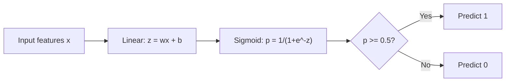
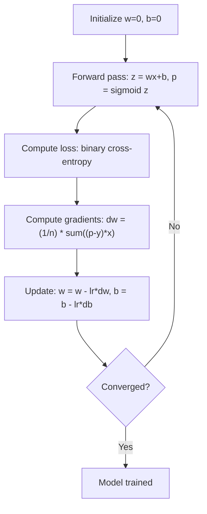

# 后勤回归

> 逻辑回归将直线曲线成S曲线,以回答与概率的"是"或"没有"问题.

**Type:** Build
**Languages:** Python, Julia, Rust
**Prerequisites:** Phase 2 Lesson 1-2 (What Is ML, Linear Regression)
**Time:** ~90 minutes

## 学习目标

- 通过使用sigmoid函数和二进制交叉缩损失从零开始实现物流回归
- 计算和解释精度,回忆,F1分数和二进制分类的混矩阵
- 解释为什么MSE未能进行分类,以及为什么二进制交叉能产生曲的成本表面
- 建立多类分类的软max回归模型,并评估值调整权衡

## 问题

根据其大小,你想预测瘤是否恶性或良性.你试图线性回归.它输出0.3或1.7或0.5等数字.这些数字意味着什么?1.7是"非常恶性"吗?0.5是"非常良性"吗?线性回归输出无限数量.分类需要0到1之间的有限概率,并明确决定:是否.

逻辑回归解决了这个问题.$wx + b$输出是一个概率.你设定一个门 (通常是0.5) 并做出决定.

尽管其名称,物流回归是一种分类算法,而不是回归算法.这个名称来自它使用的物流 (sigmoid) 函数.

## 概念

### 为什么线性回归不能分类

设想根据学习时间预测通过/失败 (1/0) 线性回归通过数据符合一个线:

```
hours:  1   2   3   4   5   6   7   8   9   10
actual: 0   0   0   0   1   1   1   1   1   1
```

线性合适可能会产生 -0.2在1小时和1.3在10小时等预测.这些值不是概率.它们低于0和以上 1.更糟糕的是,一个单个异常值 (有人研究了50小时) 将拖着整个线,改变预测对每个人都有.

类别需要一个函数:
- 输出值在0到1之间 (概率)
- 创造一个急剧的转型 (决定的边界)
- 没有被远离边界的异常值扭曲

### 赛格莫ид功能

状函数的作用是这样的:

```math
\sigma(z) = \frac{1}{1 + e^{-z}}
```

性能:
- 什么时候$z$具有大规模和积极性的$\sigma(z)$方法 1
- 什么时候$z$率是大,负,$\sigma(z)$接近0
- 什么时候$z = 0$现在$\sigma(z) = 0.5$
- 输出总是0到1之间
- 功能在任何地方都很平滑,可区分

衍生品具有方便的形式:$\sigma'(z) = \sigma(z) (1 - \sigma(z))$这使得梯度计算效率高.

### 后勤回归 =线性模型 + 形

模型计算$z = wx + b$后面是指:



输出$p$解释为$P(y=1 \mid x)$输入属于1类的概率.$wx + b = 0$它们的输出量为0.5.

### 双边交叉缩损失

对于物流回归,不能使用MSE.使用sigmoid的MSE创建了一个不曲的成本表面,具有许多本地最小值.

```math
\text{Loss} = -\frac{1}{n} \sum \left( y \log(p) + (1-y) \log(1-p) \right)
```

为什么这能有效:
- 什么时候$y=1$其他$p$接近1$\log(1) = 0$由于此类情况,
- 什么时候$y=1$其他$p$接近0: $\log(0)$接近负无限,所以损失是巨大的 (错误,高成本)
- 什么时候$y=0$其他$p$接近0: $\log(1) = 0$由于此类情况,
- 什么时候$y=0$其他$p$接近1$\log(0)$接近负无限,所以损失是巨大的 (错误,高成本)

由于这种损失函数是逻辑回归的曲,因此每个地方最小是全球最小值,梯度下降不能被困在一个坏的数据上.在完全可分离的数据上,随着重量增长,损失不断下降,因此没有有限的最小值;L2规律化修复了这一点,使得最小值独特.

### 后勤回归的逐渐下降

双向交叉透的梯度与sigmoid具有清洁的形式:

```math
\begin{aligned}
\frac{\partial L}{\partial w} &= \frac{1}{n} \sum (p - y) \, x \\
\frac{\partial L}{\partial b} &= \frac{1}{n} \sum (p - y)
\end{aligned}
```

它们看起来与线性回归梯度相同.$p = \sigma(wx + b)$没有$p = wx + b$形引入非线性,但梯度更新规则保持不变.



### 决策的界限

对于2D输入 (两个特征),决策边界是:

```math
w_1 x_1 + w_2 x_2 + b = 0
```

一边的点被分为1,另一边的点被分为0.物流回归总是产生线性决策边界.如果你需要一个曲线边界,你要么添加多项式特性,要么使用非线性模型.

### 多类分类与Softmax

由于二进制物流回归处理两个类.$k$类,使用软max函数:

```math
\text{softmax}(z_i) = \frac{e^{z_i}}{\sum_j e^{z_j}}
```

每个类都有自己的权重向量.模型计算一个分数.$z_i$对于每个类,软max将分数转换为概率,总数为1.预测的类是具有最高概率的类.

损失函数变成了类型的交叉:

```math
\text{Loss} = -\frac{1}{n} \sum \sum_k y_k \log(p_k)
```

在哪里$y_k$为真类1和所有其他类型 (单热编码) 的0

### 评估指标

对于一个数据集的95%负和5%正,一个总是预测负的模型得到了95%的准确性,但是无用的.

**Confusion Matrix**其他:

| | Predicted Positive | Predicted Negative |
|---|---|---|
| Actually Positive | True Positive (TP) | False Negative (FN) |
| Actually Negative | False Positive (FP) | True Negative (TN) |

**Precision**预测的积极因素中,实际上有多少是积极的?
```math
\text{Precision} = \frac{TP}{TP + FP}
```

**Recall**(敏感性):从所有实际的积极因素中,我们抓到了多少?
```math
\text{Recall} = \frac{TP}{TP + FN}
```

**F1 Score**调整两个指标.
```math
F_1 = 2 \cdot \frac{\text{Precision} \cdot \text{Recall}}{\text{Precision} + \text{Recall}}
```

什么时候优先考虑:
- **Precision**:假阳性数据成本高昂 (垃圾邮件过器,你不想阻止合法电子邮件)
- **Recall**:假消极结果成本高昂 (癌症查,你不想错过瘤)
- **F1**:当你需要一个平衡的指标

```figure
logistic-sigmoid
```

## 建立它

### 步骤1:Sigmoid函数和数据生成

```python
import random
import math

def sigmoid(z):
    z = max(-500, min(500, z))
    return 1.0 / (1.0 + math.exp(-z))


random.seed(42)
N = 200
X = []
y = []

for _ in range(N // 2):
    X.append([random.gauss(2, 1), random.gauss(2, 1)])
    y.append(0)

for _ in range(N // 2):
    X.append([random.gauss(5, 1), random.gauss(5, 1)])
    y.append(1)

combined = list(zip(X, y))
random.shuffle(combined)
X, y = zip(*combined)
X = list(X)
y = list(y)

print(f"Generated {N} samples (2 classes, 2 features)")
print(f"Class 0 center: (2, 2), Class 1 center: (5, 5)")
print(f"First 5 samples:")
for i in range(5):
    print(f"  Features: [{X[i][0]:.2f}, {X[i][1]:.2f}], Label: {y[i]}")
```

### 步骤2:从零开始的物流回归

```python
class LogisticRegression:
    def __init__(self, n_features, learning_rate=0.01):
        self.weights = [0.0] * n_features
        self.bias = 0.0
        self.lr = learning_rate
        self.loss_history = []

    def predict_proba(self, x):
        z = sum(w * xi for w, xi in zip(self.weights, x)) + self.bias
        return sigmoid(z)

    def predict(self, x, threshold=0.5):
        return 1 if self.predict_proba(x) >= threshold else 0

    def compute_loss(self, X, y):
        n = len(y)
        total = 0.0
        for i in range(n):
            p = self.predict_proba(X[i])
            p = max(1e-15, min(1 - 1e-15, p))
            total += y[i] * math.log(p) + (1 - y[i]) * math.log(1 - p)
        return -total / n

    def fit(self, X, y, epochs=1000, print_every=200):
        n = len(y)
        n_features = len(X[0])
        for epoch in range(epochs):
            dw = [0.0] * n_features
            db = 0.0
            for i in range(n):
                p = self.predict_proba(X[i])
                error = p - y[i]
                for j in range(n_features):
                    dw[j] += error * X[i][j]
                db += error
            for j in range(n_features):
                self.weights[j] -= self.lr * (dw[j] / n)
            self.bias -= self.lr * (db / n)
            loss = self.compute_loss(X, y)
            self.loss_history.append(loss)
            if epoch % print_every == 0:
                print(f"  Epoch {epoch:4d} | Loss: {loss:.4f} | w: [{self.weights[0]:.3f}, {self.weights[1]:.3f}] | b: {self.bias:.3f}")
        return self

    def accuracy(self, X, y):
        correct = sum(1 for i in range(len(y)) if self.predict(X[i]) == y[i])
        return correct / len(y)


split = int(0.8 * N)
X_train, X_test = X[:split], X[split:]
y_train, y_test = y[:split], y[split:]

print("\n=== Training Logistic Regression ===")
model = LogisticRegression(n_features=2, learning_rate=0.1)
model.fit(X_train, y_train, epochs=1000, print_every=200)

print(f"\nTrain accuracy: {model.accuracy(X_train, y_train):.4f}")
print(f"Test accuracy:  {model.accuracy(X_test, y_test):.4f}")
print(f"Weights: [{model.weights[0]:.4f}, {model.weights[1]:.4f}]")
print(f"Bias: {model.bias:.4f}")
```

### 步骤3:从零开始的混矩阵和指标

```python
class ClassificationMetrics:
    def __init__(self, y_true, y_pred):
        self.tp = sum(1 for t, p in zip(y_true, y_pred) if t == 1 and p == 1)
        self.tn = sum(1 for t, p in zip(y_true, y_pred) if t == 0 and p == 0)
        self.fp = sum(1 for t, p in zip(y_true, y_pred) if t == 0 and p == 1)
        self.fn = sum(1 for t, p in zip(y_true, y_pred) if t == 1 and p == 0)

    def accuracy(self):
        total = self.tp + self.tn + self.fp + self.fn
        return (self.tp + self.tn) / total if total > 0 else 0

    def precision(self):
        denom = self.tp + self.fp
        return self.tp / denom if denom > 0 else 0

    def recall(self):
        denom = self.tp + self.fn
        return self.tp / denom if denom > 0 else 0

    def f1(self):
        p = self.precision()
        r = self.recall()
        return 2 * p * r / (p + r) if (p + r) > 0 else 0

    def print_confusion_matrix(self):
        print(f"\n  Confusion Matrix:")
        print(f"                  Predicted")
        print(f"                  Pos   Neg")
        print(f"  Actual Pos     {self.tp:4d}  {self.fn:4d}")
        print(f"  Actual Neg     {self.fp:4d}  {self.tn:4d}")

    def print_report(self):
        self.print_confusion_matrix()
        print(f"\n  Accuracy:  {self.accuracy():.4f}")
        print(f"  Precision: {self.precision():.4f}")
        print(f"  Recall:    {self.recall():.4f}")
        print(f"  F1 Score:  {self.f1():.4f}")


y_pred_test = [model.predict(x) for x in X_test]
print("\n=== Classification Report (Test Set) ===")
metrics = ClassificationMetrics(y_test, y_pred_test)
metrics.print_report()
```

### 步骤4:决策边界分析

```python
print("\n=== Decision Boundary ===")
w1, w2 = model.weights
b = model.bias
print(f"Decision boundary: {w1:.4f}*x1 + {w2:.4f}*x2 + {b:.4f} = 0")
if abs(w2) > 1e-10:
    print(f"Solved for x2:     x2 = {-w1/w2:.4f}*x1 + {-b/w2:.4f}")

print("\nSample predictions near the boundary:")
test_points = [
    [3.0, 3.0],
    [3.5, 3.5],
    [4.0, 4.0],
    [2.5, 2.5],
    [5.0, 5.0],
]
for point in test_points:
    prob = model.predict_proba(point)
    pred = model.predict(point)
    print(f"  [{point[0]}, {point[1]}] -> prob={prob:.4f}, class={pred}")
```

### 步骤5:多级软max

```python
class SoftmaxRegression:
    def __init__(self, n_features, n_classes, learning_rate=0.01):
        self.n_features = n_features
        self.n_classes = n_classes
        self.lr = learning_rate
        self.weights = [[0.0] * n_features for _ in range(n_classes)]
        self.biases = [0.0] * n_classes

    def softmax(self, scores):
        max_score = max(scores)
        exp_scores = [math.exp(s - max_score) for s in scores]
        total = sum(exp_scores)
        return [e / total for e in exp_scores]

    def predict_proba(self, x):
        scores = [
            sum(self.weights[k][j] * x[j] for j in range(self.n_features)) + self.biases[k]
            for k in range(self.n_classes)
        ]
        return self.softmax(scores)

    def predict(self, x):
        probs = self.predict_proba(x)
        return probs.index(max(probs))

    def fit(self, X, y, epochs=1000, print_every=200):
        n = len(y)
        for epoch in range(epochs):
            grad_w = [[0.0] * self.n_features for _ in range(self.n_classes)]
            grad_b = [0.0] * self.n_classes
            total_loss = 0.0
            for i in range(n):
                probs = self.predict_proba(X[i])
                for k in range(self.n_classes):
                    target = 1.0 if y[i] == k else 0.0
                    error = probs[k] - target
                    for j in range(self.n_features):
                        grad_w[k][j] += error * X[i][j]
                    grad_b[k] += error
                true_prob = max(probs[y[i]], 1e-15)
                total_loss -= math.log(true_prob)
            for k in range(self.n_classes):
                for j in range(self.n_features):
                    self.weights[k][j] -= self.lr * (grad_w[k][j] / n)
                self.biases[k] -= self.lr * (grad_b[k] / n)
            if epoch % print_every == 0:
                print(f"  Epoch {epoch:4d} | Loss: {total_loss / n:.4f}")
        return self

    def accuracy(self, X, y):
        correct = sum(1 for i in range(len(y)) if self.predict(X[i]) == y[i])
        return correct / len(y)


random.seed(42)
X_3class = []
y_3class = []

centers = [(1, 1), (5, 1), (3, 5)]
for label, (cx, cy) in enumerate(centers):
    for _ in range(50):
        X_3class.append([random.gauss(cx, 0.8), random.gauss(cy, 0.8)])
        y_3class.append(label)

combined = list(zip(X_3class, y_3class))
random.shuffle(combined)
X_3class, y_3class = zip(*combined)
X_3class = list(X_3class)
y_3class = list(y_3class)

split_3 = int(0.8 * len(X_3class))
X_train_3 = X_3class[:split_3]
y_train_3 = y_3class[:split_3]
X_test_3 = X_3class[split_3:]
y_test_3 = y_3class[split_3:]

print("\n=== Multi-class Softmax Regression (3 classes) ===")
softmax_model = SoftmaxRegression(n_features=2, n_classes=3, learning_rate=0.1)
softmax_model.fit(X_train_3, y_train_3, epochs=1000, print_every=200)
print(f"\nTrain accuracy: {softmax_model.accuracy(X_train_3, y_train_3):.4f}")
print(f"Test accuracy:  {softmax_model.accuracy(X_test_3, y_test_3):.4f}")

print("\nSample predictions:")
for i in range(5):
    probs = softmax_model.predict_proba(X_test_3[i])
    pred = softmax_model.predict(X_test_3[i])
    print(f"  True: {y_test_3[i]}, Predicted: {pred}, Probs: [{', '.join(f'{p:.3f}' for p in probs)}]")
```

### 步骤 6: 调整门

```python
print("\n=== Threshold Tuning ===")
print("Default threshold: 0.5. Adjusting the threshold trades precision for recall.\n")

thresholds = [0.3, 0.4, 0.5, 0.6, 0.7]
print(f"{'Threshold':>10} {'Accuracy':>10} {'Precision':>10} {'Recall':>10} {'F1':>10}")
print("-" * 52)

for t in thresholds:
    y_pred_t = [1 if model.predict_proba(x) >= t else 0 for x in X_test]
    m = ClassificationMetrics(y_test, y_pred_t)
    print(f"{t:>10.1f} {m.accuracy():>10.4f} {m.precision():>10.4f} {m.recall():>10.4f} {m.f1():>10.4f}")
```

## 用它

现在,与子学习同样.

```python
from sklearn.linear_model import LogisticRegression as SklearnLR
from sklearn.metrics import accuracy_score, precision_score, recall_score, f1_score
from sklearn.metrics import confusion_matrix, classification_report
from sklearn.model_selection import train_test_split
from sklearn.preprocessing import StandardScaler
import numpy as np

np.random.seed(42)
X_0 = np.random.randn(100, 2) + [2, 2]
X_1 = np.random.randn(100, 2) + [5, 5]
X_sk = np.vstack([X_0, X_1])
y_sk = np.array([0] * 100 + [1] * 100)

X_tr, X_te, y_tr, y_te = train_test_split(X_sk, y_sk, test_size=0.2, random_state=42)

scaler = StandardScaler()
X_tr_sc = scaler.fit_transform(X_tr)
X_te_sc = scaler.transform(X_te)

lr = SklearnLR()
lr.fit(X_tr_sc, y_tr)
y_pred = lr.predict(X_te_sc)

print("=== Scikit-learn Logistic Regression ===")
print(f"Accuracy:  {accuracy_score(y_te, y_pred):.4f}")
print(f"Precision: {precision_score(y_te, y_pred):.4f}")
print(f"Recall:    {recall_score(y_te, y_pred):.4f}")
print(f"F1:        {f1_score(y_te, y_pred):.4f}")
print(f"\nConfusion Matrix:\n{confusion_matrix(y_te, y_pred)}")
print(f"\nClassification Report:\n{classification_report(y_te, y_pred)}")
```

您从零开始实现的决策界限和指标相同. Scikit-learn 添加解决方案 (liblinear, lbfgs, saga),自动规范化,多类策略 (one vs rest, multomial),以及数值稳定优化.

## 运送它

这一课产生了:
- `code/logistic_regression.py`- 从零开始的物流回归,使用指标
- `code/main.rs`- 只有Rust,只有Sdlib.`rustc --edition 2021 code/main.rs && ./main`现在,我们要去.

## 运动

1. 生成一个不线性可分离的数据集 (例如,两个集中圆). 训练物流回归并观察其故障. 然后添加多项函数 ($x_1^2, x_2^2, x_1 x_2$显示精度提高.
2. 实现3级软max模型的多类混矩阵.计算每个类的精度和回忆.哪个类是最难分类的?
3. 建立一个ROC曲线从零开始.为100个从0到1的门值计算真正率和虚假正率.使用拖式规则计算AUC (曲线下面的区域).

## 关键词

| Term | What people say | What it actually means |
|------|----------------|----------------------|
| Logistic regression | "Regression for classification" | A linear model followed by a sigmoid function that outputs class probabilities |
| Sigmoid function | "The S-curve" | The function $1/(1+e^{-z})$ that maps any real number to the range (0, 1) |
| Binary cross-entropy | "Log loss" | The loss function $-[y \log(p) + (1-y) \log(1-p)]$ that penalizes confident wrong predictions severely |
| Decision boundary | "The dividing line" | The surface where the model's output probability equals 0.5, separating predicted classes |
| Softmax | "Multi-class sigmoid" | A function that converts a vector of scores into probabilities that sum to 1 |
| Precision | "How many selected are relevant" | $TP / (TP + FP)$, the fraction of positive predictions that are actually positive |
| Recall | "How many relevant are selected" | $TP / (TP + FN)$, the fraction of actual positives that the model correctly identifies |
| F1 score | "Balanced accuracy" | The harmonic mean of precision and recall: $2PR / (P+R)$ |
| Confusion matrix | "The error breakdown" | A table showing TP, TN, FP, FN counts for each class pair |
| Threshold | "The cutoff" | The probability value above which the model predicts class 1 (default 0.5, tunable) |
| One-hot encoding | "Binary columns for categories" | Representing class $k$ as a vector of zeros with a 1 at position $k$ |
| Categorical cross-entropy | "Multi-class log loss" | The extension of binary cross-entropy to $k$ classes using one-hot encoded labels |
