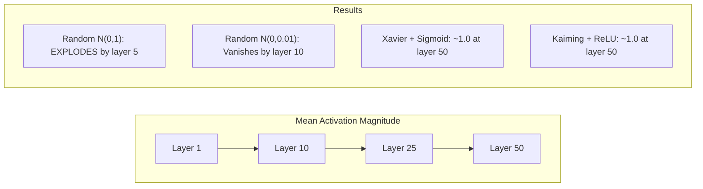
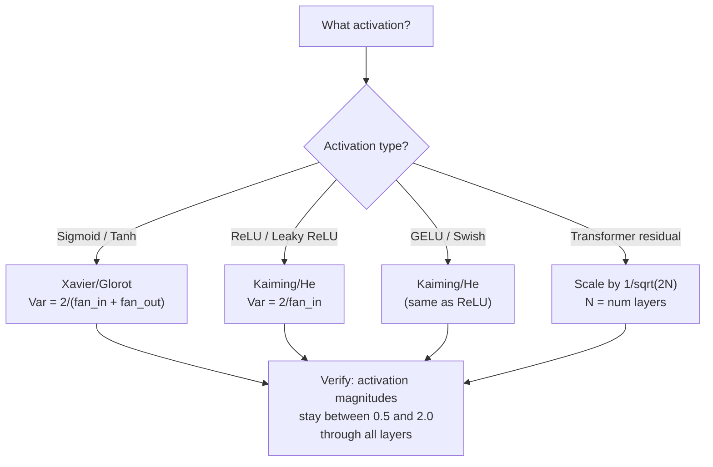

# 体重初始化和训练稳定性

> 开始错误,训练永远不会开始.开始正确,50层训练就像3层一样顺利.

**Type:** Build
**Languages:** Python, TypeScript
**Prerequisites:** Lesson 03.04 (Activation Functions), Lesson 03.07 (Regularization)
**Time:** ~90 minutes

## 学习目标

- 实现零,随机,Xavier/Glorot和Kaiming/He初始化策略,并通过50层来测量其对激活大小的影响
- 导出为什么Xavier init使用Var(w) = 2/(fan_in + fan_out) 和Kaiming使用Var(w) = 2/fan_in
- 证明零初始化对称性问题,并解释为什么随机尺度本身是不够的
- 匹配正确的初始化策略与激活函数:Xavier为sigmoid/tanh,Kaiming为ReLU/GELU

## 问题

开始所有重量到零.什么都不会学习.每个神经元都计算出相同的函数,得到相同的梯度,并更新相同. 在1万个时代之后,你的512神经元隐藏层仍然是512副本的同一个神经元.你支付了512个参数,得到了1.

激活器在网络中爆炸.在10层时,值达到1e15.在20层时,它们溢出到无限. 梯度以逆行走相同的轨迹.

根据随机尺寸的小小或大小,信号的速度会变得无限. "工作"和"破裂"之间的界限是薄薄.

开始重量是深度学习中最低估的决定. 建筑得到论文. 优化者得到博客帖子. 开始得到脚注.

## 概念

### 象征问题

一层中的每个神经元都有相同的结构:乘以重量输入,添加偏差,应用激活.如果所有重量从相同的值开始 (零是极端情况),每个神经元计算出相同的输出.在后扩散过程中,每个神经元都会获得相同的梯度.在更新阶段,每个神经元都会变化相同的数量.

你被困了.网络有数百个参数,但它们都在锁步上移动.这称为对称性,随机初始化是破解它的方法.每个神经元在重量空间的不同点开始,所以每个学习不同的特征.

随机性是网络运行的决定.

### 通过层的变异传播

考虑一个单层的风扇_in输入:

```math
z = w_1 x_1 + w_2 x_2 + \cdots + w_n x_n
```

如果每一个重量$w_i$根据分数的差异,$\mathrm{Var}(w)$并且每一个输入$x_i$具有差异性$\mathrm{Var}(x)$,输出差异为:

```math
\mathrm{Var}(z) = \text{fan}_{\text{in}} \cdot \mathrm{Var}(w) \cdot \mathrm{Var}(x)
```

如果$\mathrm{Var}(w) = 1$其他$\text{fan}_{\text{in}} = 512$输出差距为输入差距的512倍.$512^{10} = 1.2 \times 10^{27}$你的信号已经爆炸了.

如果$\mathrm{Var}(w) = 0.001$输出差距减少了$0.001 \cdot 512 = 0.512$经过10层:$0.512^{10} = 0.00013$你的信号已经消失了.

目标:选择$\mathrm{Var}(w)$所以,$\mathrm{Var}(z) = \mathrm{Var}(x)$信号大小在各层保持一致.

### 哈维尔/格洛罗初始化

为了保持前进和后退的变异常态:

```math
\mathrm{Var}(w) = \frac{2}{\text{fan}_{\text{in}} + \text{fan}_{\text{out}}}
```

实际上,重量来自:

```math
w \sim \text{Uniform}(-\text{limit}, \text{limit}) \quad \text{where } \text{limit} = \sqrt{\frac{6}{\text{fan}_{\text{in}} + \text{fan}_{\text{out}}}}
```

或:

```math
w \sim \text{Normal}\left(0, \sqrt{\frac{2}{\text{fan}_{\text{in}} + \text{fan}_{\text{out}}}}\right)
```

这种方法是因为sigmoid和tanh大致是近零的线性,正确启动的激活活活在其中.

### 卡明/他初始化

实际上,它是因为平均的输入中有一半是零的. 克萨维尔 init 没有考虑到这一点 - 它低估了所需的差异.

他等人 (2015) 调整了公式:

```math
\mathrm{Var}(w) = \frac{2}{\text{fan}_{\text{in}}}
```

权重是从:

```math
w \sim \text{Normal}\left(0, \sqrt{\frac{2}{\text{fan}_{\text{in}}}}\right)
```

由于在线电信号的速度在线电信号的速度下降,所以在线电信号的速度下降了0.5倍.$0.5^{50} = 8.8 \times 10^{-16}$宁发动会阻止这一点.

### 变压器启动

其他类型的电源是GPT-2的.

```math
x = x + \text{sublayer}(x)
```

每次加起来,增加了差异.$N$其他部分的度相对$N$. GPT-2 量化剩余层的重量为 $1/\sqrt{2N}$在哪里$N$这使得积累的信号大小保持稳定.

没有这种扩展,剩余流将在126层注意力和输送前进块中无限增长.

```mermaid
flowchart TD
    subgraph "Zero Init"
        Z1["Layer 1<br/>All weights = 0"] --> Z2["Layer 2<br/>All neurons identical"]
        Z2 --> Z3["Layer 3<br/>Still identical"]
        Z3 --> ZR["Result: 1 effective neuron<br/>regardless of width"]
    end

    subgraph "Xavier Init"
        X1["Layer 1<br/>Var = 2/(fan_in+fan_out)"] --> X2["Layer 2<br/>Signal stable"]
        X2 --> X3["Layer 50<br/>Signal stable"]
        X3 --> XR["Result: Trains with<br/>sigmoid/tanh"]
    end

    subgraph "Kaiming Init"
        K1["Layer 1<br/>Var = 2/fan_in"] --> K2["Layer 2<br/>Signal stable"]
        K2 --> K3["Layer 50<br/>Signal stable"]
        K3 --> KR["Result: Trains with<br/>ReLU/GELU"]
    end
```



### 通过50层的激活大小



### 选择正确的心灵



```figure
weight-init-variance
```

## 建立它

### 步骤1:启动策略

重量矩阵初始化四种方法.每个方法都返回了列表 (2D矩阵) 的列表,其中包含粉丝_在列和粉丝_出列.

```python
import math
import random


def zero_init(fan_in, fan_out):
    return [[0.0 for _ in range(fan_in)] for _ in range(fan_out)]


def random_init(fan_in, fan_out, scale=1.0):
    return [[random.gauss(0, scale) for _ in range(fan_in)] for _ in range(fan_out)]


def xavier_init(fan_in, fan_out):
    std = math.sqrt(2.0 / (fan_in + fan_out))
    return [[random.gauss(0, std) for _ in range(fan_in)] for _ in range(fan_out)]


def kaiming_init(fan_in, fan_out):
    std = math.sqrt(2.0 / fan_in)
    return [[random.gauss(0, std) for _ in range(fan_in)] for _ in range(fan_out)]
```

### 行动功能

我们需要sigmoid,tanh,和ReLU,以测试每一个 init战略,

```python
def sigmoid(x):
    x = max(-500, min(500, x))
    return 1.0 / (1.0 + math.exp(-x))


def tanh_act(x):
    return math.tanh(x)


def relu(x):
    return max(0.0, x)
```

### 步骤3: 往前穿过50层

通过深度网络传递随机数据,

```python
def forward_deep(init_fn, activation_fn, n_layers=50, width=64, n_samples=100):
    random.seed(42)
    layer_magnitudes = []

    inputs = [[random.gauss(0, 1) for _ in range(width)] for _ in range(n_samples)]

    for layer_idx in range(n_layers):
        weights = init_fn(width, width)
        biases = [0.0] * width

        new_inputs = []
        for sample in inputs:
            output = []
            for neuron_idx in range(width):
                z = sum(weights[neuron_idx][j] * sample[j] for j in range(width)) + biases[neuron_idx]
                output.append(activation_fn(z))
            new_inputs.append(output)
        inputs = new_inputs

        magnitudes = []
        for sample in inputs:
            magnitudes.append(sum(abs(v) for v in sample) / width)
        mean_mag = sum(magnitudes) / len(magnitudes)
        layer_magnitudes.append(mean_mag)

    return layer_magnitudes
```

### 第四步:实验

运行所有组合:零 init,随机 N(0,1),随机 N(0,0.01),Xavier与 sigmoid,Xavier与 tanh,Kaiming与 ReLU.

```python
def run_experiment():
    configs = [
        ("Zero init + Sigmoid", lambda fi, fo: zero_init(fi, fo), sigmoid),
        ("Random N(0,1) + ReLU", lambda fi, fo: random_init(fi, fo, 1.0), relu),
        ("Random N(0,0.01) + ReLU", lambda fi, fo: random_init(fi, fo, 0.01), relu),
        ("Xavier + Sigmoid", xavier_init, sigmoid),
        ("Xavier + Tanh", xavier_init, tanh_act),
        ("Kaiming + ReLU", kaiming_init, relu),
    ]

    print(f"{'Strategy':<30} {'L1':>10} {'L5':>10} {'L10':>10} {'L25':>10} {'L50':>10}")
    print("-" * 80)

    for name, init_fn, act_fn in configs:
        mags = forward_deep(init_fn, act_fn)
        row = f"{name:<30}"
        for idx in [0, 4, 9, 24, 49]:
            val = mags[idx]
            if val > 1e6:
                row += f" {'EXPLODED':>10}"
            elif val < 1e-6:
                row += f" {'VANISHED':>10}"
            else:
                row += f" {val:>10.4f}"
        print(row)
```

### 步骤5:对称性示范

证明零 init产生相同的神经元.

```python
def symmetry_demo():
    random.seed(42)
    weights = zero_init(2, 4)
    biases = [0.0] * 4

    inputs = [0.5, -0.3]
    outputs = []
    for neuron_idx in range(4):
        z = sum(weights[neuron_idx][j] * inputs[j] for j in range(2)) + biases[neuron_idx]
        outputs.append(sigmoid(z))

    print("\nSymmetry Demo (4 neurons, zero init):")
    for i, out in enumerate(outputs):
        print(f"  Neuron {i}: output = {out:.6f}")
    all_same = all(abs(outputs[i] - outputs[0]) < 1e-10 for i in range(len(outputs)))
    print(f"  All identical: {all_same}")
    print(f"  Effective parameters: 1 (not {len(weights) * len(weights[0])})")
```

### 步骤 6: 层次大小报告

通过50层打印激活大小的视觉条图.

```python
def magnitude_report(name, magnitudes):
    print(f"\n{name}:")
    for i, mag in enumerate(magnitudes):
        if i % 5 == 0 or i == len(magnitudes) - 1:
            if mag > 1e6:
                bar = "X" * 50 + " EXPLODED"
            elif mag < 1e-6:
                bar = "." + " VANISHED"
            else:
                bar_len = min(50, max(1, int(mag * 10)))
                bar = "#" * bar_len
            print(f"  Layer {i+1:3d}: {bar} ({mag:.6f})")
```

## 用它

PyTorch 提供了以下功能:

```python
import torch
import torch.nn as nn

layer = nn.Linear(512, 256)

nn.init.xavier_uniform_(layer.weight)
nn.init.xavier_normal_(layer.weight)

nn.init.kaiming_uniform_(layer.weight, nonlinearity='relu')
nn.init.kaiming_normal_(layer.weight, nonlinearity='relu')

nn.init.zeros_(layer.bias)
```

当你打电话时`nn.Linear(512, 256)`由于PyTorch 已经做出了正确的选择,但是当你构建定制架构或更深入于20层时,你需要了解发生了什么,并可能取消默认的情况.

对于变压器,HuggingFace模型通常处理其初始化.`_init_weights`实现GPT-2的规模预测残余预测$1/\sqrt{N}$如果你要从零开始建造变压器,你必须自己添加这个.

## 运送它

这一课产生了:
- `outputs/prompt-init-strategy.md`-- 提示诊断体重初始化问题,并建议正确的策略

## 运动

1. 添加LeCun初始化 ($\mathrm{Var} = 1/\text{fan}_{\text{in}}$运行50层实验,使用LeCun init + tanh,并将其与Xavier + tanh进行比较.

2. 实施GPT-2残余规模化:乘以每层输出量$1/\sqrt{2N}$运行50层,无论是没有扩展,测量剩余大小的速度.

3. 创建一个"init健康检查"函数,它取网络层尺寸和激活类型,然后建议正确的初始化,并警告如果当前的 init会导致问题.

4. 运行实验$\text{fan} _{\text{in}} = 16$其他$\text{fan} _{\text{in}} = 1024$让我们知道"工作"和"休息"之间的差距如何随着更大的层次扩大.

5. 实现直角初始化 (生成一个随机矩阵,计算其SVD,使用直角矩阵U).比较ReLU网络的Kaiming50层.

## 关键词

| Term | What people say | What it actually means |
|------|----------------|----------------------|
| Weight initialization | "Set starting weights randomly" | The strategy for choosing initial weight values that determines whether a network can train at all |
| Symmetry breaking | "Make neurons different" | Using random initialization to ensure neurons learn distinct features instead of computing identical functions |
| Fan-in | "Number of inputs to a neuron" | The number of incoming connections, which determines how input variance accumulates in the weighted sum |
| Fan-out | "Number of outputs from a neuron" | The number of outgoing connections, relevant for maintaining gradient variance during backpropagation |
| Xavier/Glorot init | "The sigmoid initialization" | $\mathrm{Var}(w) = 2/(\text{fan} _{\text{in}} + \text{fan} _{\text{out}})$, designed to preserve variance through sigmoid and tanh activations |
| Kaiming/He init | "The ReLU initialization" | $\mathrm{Var}(w) = 2/\text{fan}_{\text{in}}$, accounts for ReLU zeroing half the activations |
| Variance propagation | "How signals grow or shrink through layers" | The mathematical analysis of how activation variance changes layer by layer based on weight scale |
| Residual scaling | "GPT-2's init trick" | Scaling residual connection weights by $1/\sqrt{2N}$ to prevent variance growth through $N$ transformer layers |
| Dead network | "Nothing trains" | A network where poor initialization causes all gradients to be zero or all activations to saturate |
| Exploding activations | "Values go to infinity" | When weight variance is too high, causing activation magnitudes to grow exponentially through layers |

## 进一步阅读

- 格洛罗特和Bengio, "理解训练深度传输神经网络的难度" (2010) -- 哈维埃初始化论文与变异分析
- 他等, "深入调整器" (2015) -- 引入了ReLU网络的凯明初始化
- 拉德福德等人",语言模型是无监督多任务学习者" (2019) -- GPT-2 论文,其余规模化初始化
- 密希金和马塔斯,"你需要的只是一个好的初步" (2016) - - 层次单元变异初始化,对分析公式的实验性替代
