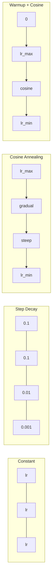
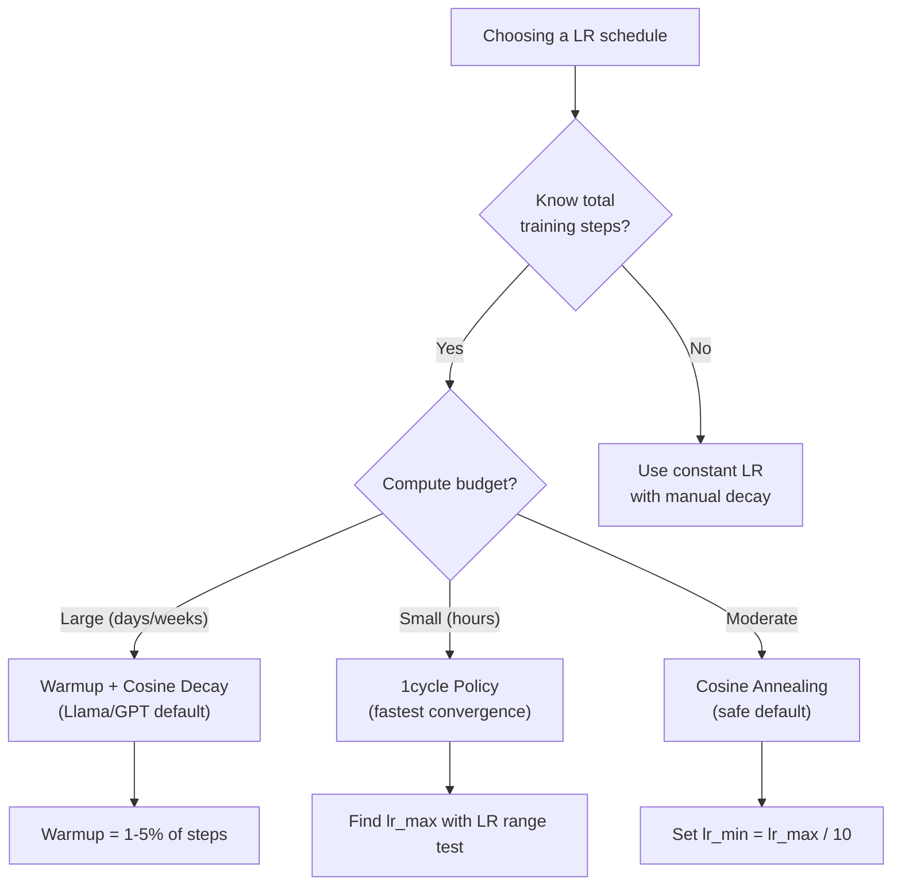
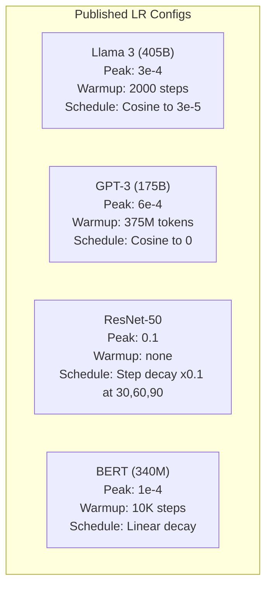

# 学习时间表和热身

> 学习速度是最重要的超参数. 不是架构,数据集的尺寸,不是激活函数,学习速度.如果你没有调整其他东西,

**Type:** Build
**Languages:** Python, TypeScript
**Prerequisites:** Lesson 03.06 (Optimizers), Lesson 03.08 (Weight Initialization)
**Time:** ~90 minutes

## 学习目标

- 从零开始实施常态,步骤衰退,化,加热+化和1周期学习率计划
- 展示学习率选择的三个失败模式:分离 (过高),停滞 (过低) 和振荡 (没有衰退)
- 解释为什么亚当基础上优化者需要加热,以及如何稳定早期训练
- 进行相同任务的五个时间表中的融合速度进行比较,并选择适合特定培训预算的时间表

## 问题

设置学习率为0.1.训练分离 - - 损失在3步中跳到无限.设置为0.0001.训练爬行 - - 100个时代后,模型几乎没有从随机移动.设置为0.01.训练工作50个时代,然后损失在最低水平上摇摆,它永远无法达到,因为步骤太大.

训练中最好的学习速度不是恒定的.训练期间它会发生变化.早期,你需要快速地步覆盖大层面.训练中晚些时候,你需要小小的步骤达到极度.90%准确的模型和95%准确的模型之间的区别通常只是时间表.

过去三年中出版的每一个主要模型都使用学习率时间表.Llama 3使用了最大的 lr=3e-4,2000个加热步骤和可西因衰变到3e-5.GPT-3使用 lr=6e-4加热超过375万个代币.这些不是任意的选择.它们是大量的超参数扫描结果,成本数百万美元.

你需要了解时间表,因为默认的规则不会解决你的问题.当你调整预训练模型时,正确的时间表与从头开始的训练不同.当你增加批量时,需要改变升温时间.当训练休息到10000步时,你需要知道这是一个时间表问题还是其他东西.

## 概念

### 持续学习率

最简单的方法是选择一个数字,用它来执行每一步.

```math
\text{lr}(t) = \text{lr}_0
```

很少是最佳的.它要么太高于训练结束时 (动在最低点左右) 还要太低于开始 (浪费了微小步骤的计算).对于小型号和调试工作很好.对于训练超过一个小时的任何东西来说,这是一个可怕的选择.

### 步骤衰退

通过 ResNet时代的旧式方法,在固定时代,减少学习率一倍 (通常是10倍).

```math
\text{lr}(t) = \text{lr}_0 \cdot \gamma^{\lfloor \text{epoch} / \text{step\_size} \rfloor}
```

在哪里?$\gamma = 0.1$现在,我们可以看到一个数字,然后我们可以看到一个数字,然后我们可以看到一个数字.

问题是:最佳的衰退点取决于数据集和架构. 转向另一个问题,你需要重新调整下降时间. 转变是突然的 - - 损失可能会升,当速度突然改变.

### 酸

随着可西因曲线的顺序下降,从最大学习速度到最低水平:

```math
\text{lr}(t) = \text{lr}_{\min} + 0.5 \cdot (\text{lr}_{\max} - \text{lr}_{\min}) \cdot \left(1 + \cos\left(\frac{\pi t}{T}\right)\right)
```

在哪里?$t$是目前的步骤$T$是步骤的总数.

在$t=0$, 代数是1,所以$\text{lr} = \text{lr} _{\max}$在$t=T$, 代数是 -1,所以$\text{lr} = \text{lr} _{\min}$衰变最初是温和的,在中间加速,然后在结束时再次变得温和.

现在,我们需要一个新的训练,$\text{lr} _{\max}$其他$\text{lr} _{\min}$随数形状与经验观察相符,大多数学习都在训练中发生,你需要在关键时期进行合理的步骤尺寸.

### 热情:为什么你开始小

亚当和其他适应优化器保持了梯度平均和变异的运行估计.在0步,这些估计初始化为零.第一些梯度更新基于垃圾统计.如果您在此期间的学习速度很大,模型会采取巨大的,不适合方向的步骤.

首先要从一个小的学习速度开始 (通常是lr_max/warmup_steps甚至是零)$\text{lr}_{\max}$在第一场$N$到了你达到学习的全部速度,亚当的统计已经稳定了.

```math
\text{lr}(t) = \text{lr}_{\max} \cdot \frac{t}{\text{warmup\_steps}} \quad \text{for } t < \text{warmup\_steps}
```

典型的加热:总训练步骤的1-5%.Llama 3训练了约1.8万亿代币,加热了2000个步骤.GPT-3加热了超过3.75亿代币.

### 线性变暖 + 化衰变

现在的默认方式是:

```
if t < warmup_steps:
    lr(t) = lr_max * (t / warmup_steps)
else:
    progress = (t - warmup_steps) / (total_steps - warmup_steps)
    lr(t) = lr_min + 0.5 * (lr_max - lr_min) * (1 + cos(pi * progress))
```

光电器的热量可以减少光电的光电. 光电器的热量可以减少光电的光电.

### 周期政策

莱斯利·史密斯的发现 (2018):在训练的第一半年,学习率从低值升至高值,然后在下半年再降.

理论:高学习率通过增加噪音来调整优化轨迹.模型在升级阶段探索更多的损失景观,找到更好的盆地.升级阶段然后在发现的最佳盆地内精炼.

```
Phase 1 (0 to T/2):    lr ramps from lr_max/25 to lr_max
Phase 2 (T/2 to T):    lr ramps from lr_max to lr_max/10000
```

对于固定计算预算,一轮车往往比轮车速.

### 时间表的形状



### 决策流程图



### 已出版的模型中的真实数字



```figure
lr-schedule
```

## 建立它

### 步骤1:安排工作

每个函数都按照当前步骤进行学习,并返回当前步骤的学习速度.

```python
import math


def constant_schedule(step, lr=0.01, **kwargs):
    return lr


def step_decay_schedule(step, lr=0.1, step_size=100, gamma=0.1, **kwargs):
    return lr * (gamma ** (step // step_size))


def cosine_schedule(step, lr=0.01, total_steps=1000, lr_min=1e-5, **kwargs):
    if step >= total_steps:
        return lr_min
    return lr_min + 0.5 * (lr - lr_min) * (1 + math.cos(math.pi * step / total_steps))


def warmup_cosine_schedule(step, lr=0.01, total_steps=1000, warmup_steps=100, lr_min=1e-5, **kwargs):
    if total_steps <= warmup_steps:
        return lr * (step / max(warmup_steps, 1))
    if step < warmup_steps:
        return lr * step / warmup_steps
    progress = (step - warmup_steps) / (total_steps - warmup_steps)
    return lr_min + 0.5 * (lr - lr_min) * (1 + math.cos(math.pi * progress))


def one_cycle_schedule(step, lr=0.01, total_steps=1000, **kwargs):
    mid = max(total_steps // 2, 1)
    if step < mid:
        return (lr / 25) + (lr - lr / 25) * step / mid
    else:
        progress = (step - mid) / max(total_steps - mid, 1)
        return lr * (1 - progress) + (lr / 10000) * progress
```

### 第二步: 设想所有时间表

打印一个基于文字的图表,显示每个课程在训练过程中如何发展.

```python
def visualize_schedule(name, schedule_fn, total_steps=500, **kwargs):
    steps = list(range(0, total_steps, total_steps // 20))
    if total_steps - 1 not in steps:
        steps.append(total_steps - 1)

    lrs = [schedule_fn(s, total_steps=total_steps, **kwargs) for s in steps]
    max_lr = max(lrs) if max(lrs) > 0 else 1.0

    print(f"\n{name}:")
    for s, lr_val in zip(steps, lrs):
        bar_len = int(lr_val / max_lr * 40)
        bar = "#" * bar_len
        print(f"  Step {s:4d}: lr={lr_val:.6f} {bar}")
```

### 第三步:培训网络

简单的两个层网络,像以前的课程一样,但现在我们改变时间表.

```python
import random


def sigmoid(x):
    x = max(-500, min(500, x))
    return 1.0 / (1.0 + math.exp(-x))


def relu(x):
    return max(0.0, x)


def relu_deriv(x):
    return 1.0 if x > 0 else 0.0


def make_circle_data(n=200, seed=42):
    random.seed(seed)
    data = []
    for _ in range(n):
        x = random.uniform(-2, 2)
        y = random.uniform(-2, 2)
        label = 1.0 if x * x + y * y < 1.5 else 0.0
        data.append(([x, y], label))
    return data


def train_with_schedule(schedule_fn, schedule_name, data, epochs=300, base_lr=0.05, **kwargs):
    random.seed(0)
    hidden_size = 8
    total_steps = epochs * len(data)

    std = math.sqrt(2.0 / 2)
    w1 = [[random.gauss(0, std) for _ in range(2)] for _ in range(hidden_size)]
    b1 = [0.0] * hidden_size
    w2 = [random.gauss(0, std) for _ in range(hidden_size)]
    b2 = 0.0

    step = 0
    epoch_losses = []

    for epoch in range(epochs):
        total_loss = 0
        correct = 0

        for x, target in data:
            lr = schedule_fn(step, lr=base_lr, total_steps=total_steps, **kwargs)

            z1 = []
            h = []
            for i in range(hidden_size):
                z = w1[i][0] * x[0] + w1[i][1] * x[1] + b1[i]
                z1.append(z)
                h.append(relu(z))

            z2 = sum(w2[i] * h[i] for i in range(hidden_size)) + b2
            out = sigmoid(z2)

            error = out - target
            d_out = error * out * (1 - out)

            for i in range(hidden_size):
                d_h = d_out * w2[i] * relu_deriv(z1[i])
                w2[i] -= lr * d_out * h[i]
                for j in range(2):
                    w1[i][j] -= lr * d_h * x[j]
                b1[i] -= lr * d_h
            b2 -= lr * d_out

            total_loss += (out - target) ** 2
            if (out >= 0.5) == (target >= 0.5):
                correct += 1
            step += 1

        avg_loss = total_loss / len(data)
        accuracy = correct / len(data) * 100
        epoch_losses.append(avg_loss)

    return epoch_losses
```

### 步骤4: 进行所有时间表的比较

训练同一个网络,并比较最终损失和合行为.

```python
def compare_schedules(data):
    configs = [
        ("Constant", constant_schedule, {}),
        ("Step Decay", step_decay_schedule, {"step_size": 15000, "gamma": 0.1}),
        ("Cosine", cosine_schedule, {"lr_min": 1e-5}),
        ("Warmup+Cosine", warmup_cosine_schedule, {"warmup_steps": 3000, "lr_min": 1e-5}),
        ("1cycle", one_cycle_schedule, {}),
    ]

    print(f"\n{'Schedule':<20} {'Start Loss':>12} {'Mid Loss':>12} {'End Loss':>12} {'Best Loss':>12}")
    print("-" * 70)

    for name, schedule_fn, extra_kwargs in configs:
        losses = train_with_schedule(schedule_fn, name, data, epochs=300, base_lr=0.05, **extra_kwargs)
        mid_idx = len(losses) // 2
        best = min(losses)
        print(f"{name:<20} {losses[0]:>12.6f} {losses[mid_idx]:>12.6f} {losses[-1]:>12.6f} {best:>12.6f}")
```

### 步骤5: LR过高对低

展示三个失败模式:过高 (分离),过低 (爬行),正确.

```python
def lr_sensitivity(data):
    learning_rates = [1.0, 0.1, 0.01, 0.001, 0.0001]

    print("\nLR Sensitivity (constant schedule, 100 epochs):")
    print(f"  {'LR':>10} {'Start Loss':>12} {'End Loss':>12} {'Status':>15}")
    print("  " + "-" * 52)

    for lr in learning_rates:
        losses = train_with_schedule(constant_schedule, f"lr={lr}", data, epochs=100, base_lr=lr)
        start = losses[0]
        end = losses[-1]

        if end > start or math.isnan(end) or end > 1.0:
            status = "DIVERGED"
        elif end > start * 0.9:
            status = "BARELY MOVED"
        elif end < 0.15:
            status = "CONVERGED"
        else:
            status = "LEARNING"

        end_str = f"{end:.6f}" if not math.isnan(end) else "NaN"
        print(f"  {lr:>10.4f} {start:>12.6f} {end_str:>12} {status:>15}")
```

## 用它

皮托尔奇提供时间表`torch.optim.lr_scheduler`其他:

```python
import torch
import torch.optim as optim
from torch.optim.lr_scheduler import CosineAnnealingLR, OneCycleLR, StepLR

model = nn.Sequential(nn.Linear(10, 64), nn.ReLU(), nn.Linear(64, 1))
optimizer = optim.Adam(model.parameters(), lr=3e-4)

scheduler = CosineAnnealingLR(optimizer, T_max=1000, eta_min=1e-5)

for step in range(1000):
    loss = train_step(model, optimizer)
    scheduler.step()
```

对于加热+可西斯,使用一个Lambda调度器或`get_cosine_schedule_with_warmup`收起脸:

```python
from transformers import get_cosine_schedule_with_warmup

scheduler = get_cosine_schedule_with_warmup(
    optimizer,
    num_warmup_steps=2000,
    num_training_steps=100000,
)
```

拥抱面部功能是大多数Llama和GPT细调脚本所使用的.在怀疑时,使用加热+加热的可西因 = 总步骤的 3-5%.它几乎适用于所有事情.

## 运送它

这一课产生了:
- `outputs/prompt-lr-schedule-advisor.md`-- 提示建议您的训练设置的适当学习速度时间表和超参数

## 运动

1. 实现指数式衰退:$\text{lr}(t) = \text{lr}_0 \cdot \gamma^t$在哪里$\gamma = 0.999$比较圆数据集中的可西因缩.

2. 执行学习率范围测试 (Leslie Smith):训练几百步,同时从1e-7升至1. 插图损失与 LR. 最佳最大LR是损失开始增加之前.

3. 训练用加热+,但变化加热时间:0%,1%,5%,10%,20%的总步骤.找到训练最稳定的甜点.

4. 实现热启动 (SGDR) 的可西因缩:重置学习速度为 $\text{lr}_{\max}$每一个$T$较长的训练中,与标准的体相比.

5. 建立一个"日程外科医生",监测训练损失,自动从加热转向位,

## 关键词

| Term | What people say | What it actually means |
|------|----------------|----------------------|
| Learning rate | "How fast the model learns" | The scalar that multiplies the gradient to determine the parameter update size |
| Schedule | "Change the LR over time" | A function that maps training step to learning rate, designed to optimize convergence |
| Warmup | "Start with a small LR" | Linearly ramping the LR from near-zero to the target value over the first $N$ steps to stabilize optimizer statistics |
| Cosine annealing | "Smooth LR decay" | Decreasing the LR following a cosine curve from $\text{lr} _{\max}$ to $\text{lr} _{\min}$ over training |
| Step decay | "Drop LR at milestones" | Multiplying the LR by a factor (usually 0.1) at fixed epoch intervals |
| 1cycle policy | "Up then down" | Leslie Smith's method of ramping LR up then down in a single cycle for faster convergence |
| LR range test | "Find the best learning rate" | Training briefly while increasing LR to find the value where loss starts diverging |
| Cosine with warm restarts | "Reset and repeat" | Periodically resetting the LR to $\text{lr} _{\max}$ and decaying again (SGDR) |
| Eta min | "The floor for the LR" | The minimum learning rate that the schedule decays to |
| Peak learning rate | "The maximum LR" | The highest LR reached during training, typically after warmup |

## 进一步阅读

- 洛希洛夫和哈特, "SGDR:随着温暖的恢复而降低的斯托哈斯斯基梯度" (2017) -- 引入了缩和温暖的重新启动
- 史密斯, "超级融合:使用较高学习率的神经网络非常快速培训" (2018) -- 1周期政策论文
- 图弗龙等人",Llama 2:开放基础和精细调节的聊天模式" (2023) --记录了在规模上使用的加热+可西因时间表
- 戈伊尔等人",精确,大型小型批次SGD:训练1小时中的图像网" (2017) --线性扩展规则和大型批次训练的加热
