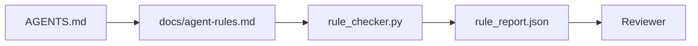

# 代理指令作为可执行的限制

> 作为散文写的指示是愿望.作为限制写的指示是测试.工作台将每一个规则变成一个代理在运行时间检查的东西,一个审查员可以验证事实之后.

**Type:** Build
**Languages:** Python (stdlib), TypeScript
**Prerequisites:** Phase 14 · 32 (Minimal Workbench)
**Time:** ~50 minutes

## 学习目标

- 单独从操作规则中分开路由散文.
- 声明启动规则,禁止行动,完成的定义,不确定性处理和批准界限作为可机器检查的限制.
- 执行一个规则检查器,以对规则设置进行运行.
- 让规则设置变异友好,以便审查可以看到发生了什么变化.

## 问题

典型的`AGENTS.md`经理说:"要小心",要彻底测试",要问"如果不确定".三天后,经理发送了没有测试的变更,写到一个被禁止的目录,

工作指令是有效的,而有抱负的时代是弱的. 解决方案是写出工作桌可以解释的规则,评审员可以得分.

## 概念

规则属于`docs/agent-rules.md`每个规则都有一个名字,一个类别,一个检查.



### 五类涵盖大多数规则

| Category | Question the rule answers | Example |
|----------|---------------------------|---------|
| Startup | What must be true before work begins? | "state file exists and is fresh" |
| Forbidden | What must never happen? | "do not edit `scripts/release.sh`" |
| Definition of done | What proves the task is complete? | "pytest exits 0 and acceptance line passes" |
| Uncertainty | What does the agent do when unsure? | "open a question note instead of guessing" |
| Approval | What requires human approval? | "any new dependency, any prod write" |

没有一个规则,通常需要两个规则.

### 规则是机器可读的

每个规则都有一个字符,一个类别,一个单行描述,`check`域中一个函数的名称`rule_checker.py`增加规则意味着增加支票; 随着工作桌的增长,支票也会增长.

### 规则是不同的

规则在一个标记文件中每个标题都有一个. 名称在不同中可见. 新规则位于其类别的顶部. 旧规则被删除,而不是发表评论,因为工作台是真相的来源,而不是团队上季度感觉的聊天日志.

### 规则与框架护

框架护 (OpenAI Agents SDK护,LangGraph中断) 执行运行时间水平的规则.本课中设定的规则是这些护实施的可读,可审查的合同.你需要两者:运行时间在转换过程中捕获违规行为,规则设定证明运行时间正在做正确的事情.

### 渐进的披露:地图,而不是百科全书

原因`AGENTS.md`每次事件都增加了一个规则,没有事件删除了一个.一年后,文件是2000行,代理阅读了第一张屏幕,没有注意力预算,并以所被告知的部分行动.一个巨大的指令文件由于40页的登录文件失败的原因而失败:读者一次扫描它,从来没有回到重要部分.

解决方案不是一个更短的文件.它是一个层次的文件.根路由器保持足够小,可以阅读每次会议,只能包含指针. 文件的深度只在任务触及时才会被代理加载.给代理一个地图,而不是整个百科全书,让它走到它需要的页面.

```
AGENTS.md                  # router, < 50 lines: what this repo is, where to look, the 5 hard rules
docs/
  agent-rules.md           # the full rule set (this lesson)
  architecture.md          # loaded when the task touches module boundaries
  testing.md               # loaded when the task writes or runs tests
  deploy.md                # loaded only for release work, gated behind an approval rule
feature_list.json          # the backlog (Phase 14 · 36)
```

| Tier | Lives in | Read when | Size budget |
|------|----------|-----------|-------------|
| Router | `AGENTS.md` | Every session, always | Under ~50 lines |
| Rules | `docs/agent-rules.md` | Every session, on startup | One screen per category |
| Topic docs | `docs/<topic>.md` | Only when the task touches that topic | As deep as needed |

两次测试让层次保持诚实. 可达性测试:代理应在路由器最多两次跳到任何规则,因此路由器必须按路径链接每个主题文档,而不是用散文描述它. 调节器的短短足以让评论员在每一个公关上重新阅读它, 这就是唯一阻止它默默地重新成长到它所取代的百科全书. 没有解决的指针比缺失的规则更糟糕, 所以路由器中断的链接本身就是启动检查违规.

```figure
wb-rule-checkoff
```

## 建立它

`code/main.py`船舶:

- `agent-rules.md`解析器将规则加载到数据类中.
- `rule_checker.py`风格检查器功能,每一个`check`参考
- 经过两项规则的演示代理,并通过一个检查证来抓住他们.

运行它:

```
python3 code/main.py
npx tsx code/main.ts
```

输出:解析规则集,运行跟踪,通过/失败每规则,`rule_report.json`保存在脚本旁边.

## 野生生产模式

只有三种模式, 隔离一个持续四分之一的规则,

**Severity tagging at write time.**每一个规则都包含`severity`其他`block`现在`warn`其他`info`检查器报告了所有三个; 运行时间只拒绝了`block`许多团队在预期期期内过度估值严重性,然后在最后期限压力下轻松削弱它;在写作时标签,将校准带来前进.`block`统治成一个`overrides.jsonl`审计记录.

**Rule expiry as a forcing function.**每一个规则都有一个规则.`expires_at`检查器在未到期的规则已连续60天没有违反过的时发出警告;下一个季度审查要么证明保留它是合理的,要么削弱它.`info`云飞云的生产AI代码审查数据 (2026年4月,131,246次审查在30天内进行了5,169个备忘录) 显示,明确过期的规则集保持在每个备忘录的30个规则下;没有的组长到80多个,大多数从来没有开放.

**Markdown-as-source, JSON-as-cache.** `agent-rules.md`是作者文件;`agent-rules.lock.json`检查器在热路中读取的缓存.锁由预订重建. 标记差异可检查; 标记解析不会在每一个转折中进行,因为检查器只加载了小的预建JSON. 与`package.json`现在,`package-lock.json`其他`Cargo.toml`现在,`Cargo.lock`现在,我们要去.

## 用它

在生产中:

- 考试员在拒绝行动时引用规则, 检查员在CI中重新运行它们,
- 开放AI代理SDK护卫器记录与输入和输出护卫器相同的检查. 标记是文件表面;SDK是运行时间表面.
- 长度图器在飞行中违反规则时打断火. 打断处理器读取规则,询问人类,并恢复.

规则集是可移植的,因为它只是一个标记加上函数名称.

## 运送它

`outputs/skill-rule-set-builder.md`采访项目主人,将现有的散文说明分为五类,并发出一个版本的`agent-rules.md`另外还有一张检查片.

## 运动

1. 如果您的产品真的需要它,请添加第六类别,并解释为什么产品不会被分为五类.
2. 扩展检查器,使规则具有严重性 (`block`现在`warn`现在`info`) 报告相应的总结.
3. 通过电线将检查器输入CI:如果在最新的代理运行中失败了区块严格规则,则无法构建.
4. 通过"过期"的字段,每条规则都会被修改.
5. 找一个真正的`AGENTS.md`它们中的几条是运行的?

## 关键词

| Term | What people say | What it actually means |
|------|----------------|------------------------|
| Operational rule | "A real instruction" | A rule the workbench can check at runtime |
| Aspirational rule | "Be careful" | A rule with no check; either delete or upgrade |
| Definition of done | "Acceptance" | An objective, file-backed proof the task is complete |
| Block severity | "Hard rule" | Violation halts the run; cannot be silenced without an operator |
| Rule expiry | "Stale rule sweep" | A rule with no fails in N days is up for retirement |

## 进一步阅读

- [OpenAI Agents SDK guardrails](https://openai.github.io/openai-agents-python/guardrails/)
- [LangGraph interrupts](https://langchain-ai.github.io/langgraph/how-tos/human_in_the_loop/breakpoints/)
- [Anthropic, Building Effective Agents](https://www.anthropic.com/research/building-effective-agents)
- [Rick Hightower, Agent RuleZ: A Deterministic Policy Engine](https://medium.com/@richardhightower/agent-rulez-a-deterministic-policy-engine-for-ai-coding-agents-9489e0561edf)  产量中阻塞/警告/信息严重性
- [Cloudflare, Orchestrating AI Code Review at Scale](https://blog.cloudflare.com/ai-code-review/)131万次复习,规则编制课程
- [microservices.io, GenAI development platform — part 1: guardrails](https://microservices.io/post/architecture/2026/03/09/genai-development-platform-part-1-development-guardrails.html)规则与CI之间的深度防御
- [Type-Checked Compliance: Deterministic Guardrails (arXiv 2604.01483)](https://arxiv.org/pdf/2604.01483)                                                                                                                                                                                                                                                              
- [logi-cmd/agent-guardrails](https://github.com/logi-cmd/agent-guardrails)融合门的实施:范围,突变测试,违规预算
- 阶段 14 · 32  工作台最小这个规则设置下降到
- 阶段14 · 38  消耗规则报告的验证门
- 阶段14 · 39 评审员评分规则遵守
