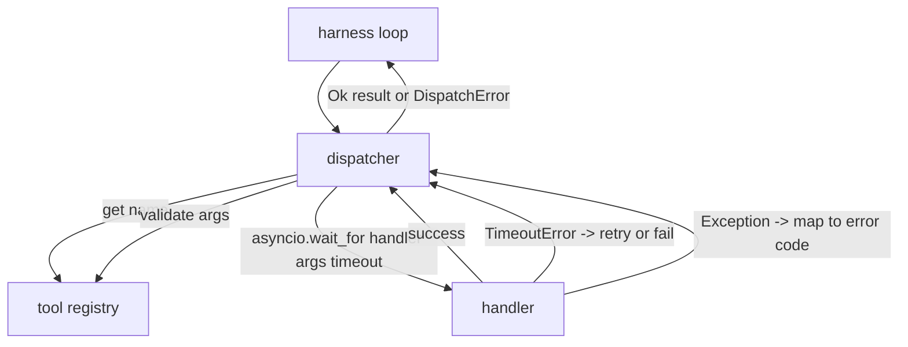
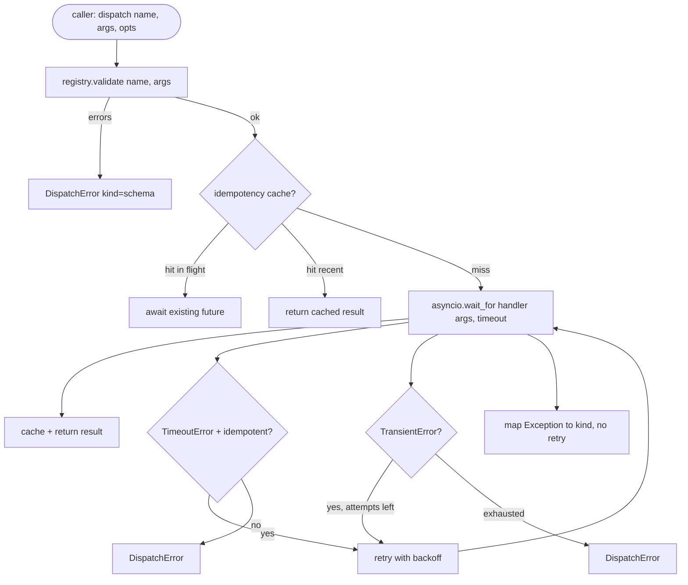

# 函数调用调用器

> 发射器是指,带支付了每一个计划所做的承诺,时间,重试,减值,错误映射.

**Type:** Build
**Languages:** Python, TypeScript
**Prerequisites:** Phase 13 lessons 01-07, Phase 14 lesson 01
**Time:** ~90 minutes

## 学习目标
- 打回一个输入错误的通话时间,而不是挂的工具处理器.
- 应用动和最大尝试数.
- 通过无能率键进行复制,使得慢的原始比赛的复制尝试不会两次运行.
- 运输错误的错误,已经理解了该链路的错误包.
- 交叉发送与同步限制,所以四十个工具调用的风扇不耗尽事件循环.

```figure
cf-dispatch-retry
```

## 发送机坐的地方

运输 (课二十二) 给循环提供了食物.循环向发送器传递工具调用.发送器调用了注册表,运行了处理器,并返回了结果或一个JSON-RPC形状的错误包.



发送器是唯一知道时间表,反试和无能率的层.循环没有.登记器没有.处理器没有.隔离是重点.

## 时间限制

每个工具都有默认的时间限制.`timeout_ms`发送器在传输链时将其转移到通话时.`asyncio.wait_for`在时间休止时,处理任务被取消,`DispatchError(kind="timeout")`现在,我们要去.

时间过关不是非自主工具的默认可重复错误.`db.write`发送者尊重发送者, 发送者, 发送者, 发送者, 发送者, 发送者, 发送者, 发送者, 发送者, 发送者, 发送者, 发送者, 发送者, 发送者, 发送者, 发送者, 发送者, 发送者, 发送者, 发送者, 发送者, 发送者, 发送者, 发送者, 发送者, 发送者, 发送者, 发送者, 发送者, 发送者, 发送者, 发送者, 发送者, 发送者, 发送者, 发送者, 发送者, 发送者, 发送者, 发送者, 发送者, 发送者, 发送者, 发送者, 发送者, 发送者, 发送者, 发送者, 发送者, 发送者, 发送者, 发送者, 发送者, 发送者, 发送者, 发送者, 发送者, 发送者, 发送者, 发送者, 发送者, 发送者, 发送者, 发送者, 发送者, 发送者, 发送者, 发送者, 发送者, 发送者, 发送者, 发送者, 发送者, 发送者, 发送者, 发送者, 发送者, 发送者, 发送者, 发送者, 发送者`idempotent`无权的工具再试,无权的工具没有.

## 复试,以指数式后退

复试政策是三次最大,反击率是指数值的,

```text
attempt 1  -> delay 0
attempt 2  -> delay 0.1s * (1 + random[0..0.5])
attempt 3  -> delay 0.4s * (1 + random[0..0.5])
```

只有`timeout`其他`transient`错误再试.`schema`错误`not_found`其他`internal`错误不会再尝试. 方案错误是决定性的. 再尝试不会改变结果,并且会损失预算.

如果调用者的预算剩余的工具调用是零,发送器在第一次尝试中很快失败,然后返回.`kind="budget_exceeded"`现在,我们要去.

## 无能关键扣除

试机在原始机器仍在飞行中再次发射,这是一个真正的生产错误.第一次电话挂在4点9秒 (就在时间限下).重试5秒发射.现在两个请求与相同的后端竞赛.如果工具是`payments.charge`你已经收费了两次.

发送器接受了可选的`idempotency_key`如果同一键在通话到达时在飞行中,发射器会等待飞行中的未来,然后返回结果.

关键是电话给人负责.`f"{step_id}:{tool_name}:{hash(args)}"`发送器不会发明钥匙,因为仅仅从参数中得出一个钥匙,

## 错误封面

失败的发射返回一个形状.

```text
DispatchError
  kind        : "timeout" | "transient" | "schema" | "not_found" | "internal" | "budget_exceeded"
  message     : str
  attempts    : int
  jsonrpc_code: int   (one of -32601, -32602, -32603)
```

连接环路图`kind`让我们去下一个州.`schema`其他`not_found`走去`on_error`引发一个重机.`timeout`其他`transient`走去`on_error`根据尝试,可能会重新计划或不重新计划. `budget_exceeded`触发器`on_budget_exceeded`现在,我们要去.

## 风扇外出的货币限制

`gather(*calls)`通过40个工具调用,即40个开源或40个子处理管.大多数后台不喜欢一个客户端的40个并行连接.

发送器包装`gather`在一个通讯器中.默认的同步限为八.每次通话都在发送之前收购通讯器,并在完成时释放.通话者看到`gather`实际的时间表是有限的.

## 流动一次通话



## 如何读取代码

`code/main.py`定义`Dispatcher`现在`DispatchError`其他`TransientError`发送机记录了建筑物.`dispatch(name, args, ...)`只有一个进入点. 每次试验的时间限制在内线.`_run_with_retries`使用`asyncio.wait_for`现在,我们要去.`gather_bounded(calls)`运行许多随机发送的发送量.

`code/tests/test_dispatcher.py`覆盖时间限开,暂时重试,方案错误无重试,无效率减免 (两个同时调用相同键的崩到一个处理器调用),并行限制 (在操作中的半径).

测试使用`asyncio.sleep(0)`确定性`Counter`它们可以在毫秒内完成,而不会依赖于墙钟的时间.

## 走得更远

首先,在每个过渡时进行结构化记录 (循环的事件流已经给你提供了,但发射器也应该发射`dispatch.attempt`其他`dispatch.retry`系统中出现的电路断裂事件.`kind="circuit_open"`两者都在这个发射器上,没有改变合同.

课24将发射器粘贴到一个计划执行的代理,
